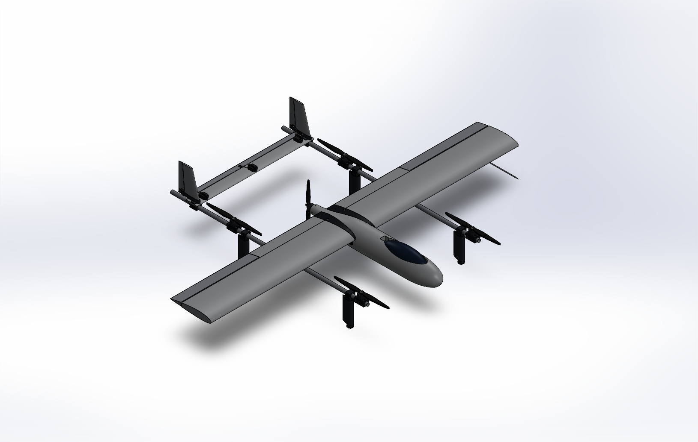

# DBF-Combined: Lift + Cruise VTOL "C0" (UC Berkeley capstone)

> **New: the K09-L redesign.** See everything in one place: **[redesign/SHOWCASE.md](redesign/SHOWCASE.md)**: CAD renders, rotatable 3-D models, the morphological chart, the engineering team, simulations and status.


A hybrid VTOL with four vertical lift rotors for takeoff and landing, and a pusher prop and fixed wing for cruise. The
lift rotors stop in cruise. A four-person UC Berkeley capstone team builds and flight-tests it on a **fixed $2,000
budget** (hardware, spares, test gear, tax and shipping) by **2027-04-30**.

This is the team's single repository. It combines DBF-VTOL, DillonVTOL, TiltWing and OpenCAEModel as of 2026-11-08;
[PROVENANCE.md](PROVENANCE.md) lists the source repository and commit for every area, and what was left out.



## Start here

| If you want to… | Open |
|---|---|
| Read the design | [`VTOL-Review.html`](VTOL-Review.html) (download and double-click; see [Viewing the pages](#viewing-the-pages)) |
| Know what is still undecided | [`DECISIONS.md`](DECISIONS.md): every open design-parameter conflict, with values and file paths |
| Find the canonical design numbers | [`analysis/results.json`](analysis/results.json) (sizing, BOM totals), [`docs/DESIGN-BASIS.md`](docs/DESIGN-BASIS.md) (requirements R1–R21), [`cad/params.txt`](cad/params.txt) (geometry the CAD is built from), [`docs/purchasing/C0_BOM.csv`](docs/purchasing/C0_BOM.csv) (what to buy), [`firmware/vtol_c0.param`](firmware/vtol_c0.param) (flight parameters) |
| Check a claim | [`docs/validation/VALIDATION-MATRIX.md`](docs/validation/VALIDATION-MATRIX.md) and [`docs/validation/proofs/`](docs/validation/proofs/README.md) (one proof per claim); `py tools/vtol.py` or double-click `VTOL.bat` for a menu |
| Know where a file came from | [`PROVENANCE.md`](PROVENANCE.md) |
| Work here as an AI agent | [`CLAUDE.md`](CLAUDE.md) (rules), [`docs/validation/AGENT-INTERFACE.md`](docs/validation/AGENT-INTERFACE.md) (machine-readable entry points), then this README |

## Status (2026-11-08)

- **Design phase. Nothing has been built or flown**, so there is no measured thrust, temperature or flight data. Each
  chapter of the review lists what the team still has to measure.
- **The root design package is v0.4.0, resized 2026-11-02, CAD and drawings rev G** (from DillonVTOL). The table below
  is that state.
- **Not everything is on that baseline.** The inventory, Fusion model, alternative designs A1–A3 and four research
  notes are still on v0.3.1 (6.18 kg, 20 m/s); the concept-models page shows rev D. The team has not yet decided
  between them on cruise speed, mass, ballast rule, battery plug (a **safety** item), ESC/airspeed/GPS vendors, spare
  motor, budget and thermal ambient. **See [DECISIONS.md](DECISIONS.md) before using any number from `inventory/`,
  `fusion/` or `concepts/`.**
- Validation: 79 claims, 40 Verified, 38 Partially Verified, 1 Unverified, 0 Failed
  (`analysis/validation/validation_matrix.json` `counts`). SITL scenarios A–G passed on the earlier sizing; the re-run on
  the current sizing is pending.

## Current design (v0.4.0, resized 2026-11-02)

From `analysis/results.json` (sizing) and `analysis/aero/aero_results.json` (aerodynamics) unless noted.

| | |
|---|---|
| Layout | C0: 4-lift twin-boom quadplane, H-tail with twin rudders on the booms, pusher on the pod; best of 29 configurations that keep the lift rotors stopped in cruise (`analysis/tradestudy.json`) |
| Span / wing | 2.4 m, 0.774 m² (chord 322.3 mm, AR 7.45; C0 `sized.S`, `sized.chord`, `sized.AR`), NACA 2415, XPS foam core with packing-tape skin |
| MTOW | 7.438 kg (C0 `sized.m`); bottom-up 7.416 kg (`analysis/mass/mass_budget.json`); hard cap 25 kg; below the 8–15 kg working target (R2, sign-off pending) |
| Lift / pusher | 5 × SunnySky X4110S 400KV; 17 × 5.5 in lift props; APC 14×8.5EP pusher |
| Hover / cruise | 1132 W hover (51.0 A at 22.2 V); 296 W at 18 m/s cruise by the sizing, 258 W by the aero build-up; hover T/W 1.68 on maker data (`sized.P_hover`, `I_hover`, `P_cruise`, `TW`; `aero_results.json` `drag.cruise.P_elec_W`) |
| Energy | 1 × Ovonic 6S 6500 mAh LiPo flown, 144.3 Wh; 12.0 min cruise available at 18 m/s after 2 min hover + 40 s transition, with a 20 % reserve (`sized.t_cruise_avail_min`, `params.EBattFixed`) |
| Aerodynamics | CD0 0.0425, L/D 8.71 at 18 m/s; stall 11.75 m/s at CL_max 1.115 (R11 ≤ 12 m/s); neutral point 38.4 % MAC with the pod (AVL), static margin 10.4 % at the 28 % CG (`aero_results.json` `neutral_point`; DESIGN-BASIS quotes the sizing value 10.2 %, see DECISIONS) |
| CFD | Full-aircraft SU2 (inviscid) on four meshes up to 23.3 M cells: CL 0.523 at 4°, grid uncertainty ±6.8 % (GCI); neutral point 39.7 % MAC (`analysis/cfd3d/out/cfd3d_results.json`) |
| Structure | 6061-T6 booms, spar sockets and a 0.76 m slip-fit joiner; joiner reserve factor 1.41 on yield at 4.5 g, Schrenk root moment 91.0 N·m (C0 `struct.MS_J`, `struct.Mroot`) |
| CAD | SOLIDWORKS, drawing set DBF-DRW-001 rev G: 397 components (75 unique part files) including every screw, nut, washer and insert; 0 unexplained interferences (`cad/verification.txt`, `cad/drawings/layout-check.txt`) |
| Avionics | CoreWing F405 Wing V2 + ArduPlane 4.7.2 QuadPlane; `firmware/vtol_c0.param` checked |
| Budget | **$1,854.55 committed** (goods $1,598.69 + tax $163.87 + shipping $91.99); **$145.45 reserve** (C0 `bom`, `docs/purchasing/C0_BOM.csv`) |

## Directory map

| Path | What it is | Baseline |
|---|---|---|
| `VTOL-Review.html`, `build-manual.html`, `test-plan.html`, `flight-software.html`, `templates.html` | Generated design review DBF-RPT-001 (issue 6) and companion pages; built by `node review/build.mjs` | 11-02 |
| `index.html`, `.nojekyll` | GitHub Pages entry point (forwards to `VTOL-Review.html`) | — |
| `Inventory-Overview.html` | Generated inventory and electrical overview DBF-INV-001; built by `node inventory/build_overview.mjs` | v0.3.1 |
| `Concept-Models.html` | Generated literature concept models; built by `node concepts/build.mjs` | rev D |
| `analysis/` | Sizing model and scripts, aero (XFOIL/AVL/SU2), 3-D CFD, thermal, mass budget, structures, validation matrix, trade study, independent checks ([README](analysis/README.md)) | 11-02 |
| `cad/` | SOLIDWORKS model generator (C# API tools), parameters, part files, meshes, drawings, FEA/thermal results ([README](cad/README.md)) | 11-02, rev G |
| `docs/` | Design basis, research notes, build manual, test plan, purchasing BOM, validation proofs, figures, review style | 11-02 (four research notes v0.3.1, see below) |
| `firmware/` | ArduPlane parameter files, setup guide, checklists, parameter checker, SITL scripts and results ([README](firmware/README.md)) | 11-02 |
| `review/` | Sources and build script for the review and companion pages | 11-02 |
| `inventory/` | Inventory master list, Google Sheet seed and workbook, electrical design data, hardware schedule, Fusion exports, overview page sources, frozen `v031/` inputs | v0.3.1 |
| `fusion/` | Autodesk Fusion build, joint, kinematics and motion-clearance scripts; variant Fusion builds in `fusion/variants/` | v0.3.1 |
| `concepts/` | Eleven literature concepts (`concepts.json`, `models.js`, `build.mjs`) and alternative designs A1–A3 (`variants/`) | v0.3.1 |
| `sim/` | Browser flight game (notional 8-lift eVTOL, 2,200 kg); demonstration only, not engineering ([README](sim/README.md)) | n/a |
| `explorations/tiltwing/` | **Archived** tilt-wing design study (model, dashboard, CAD); not the baseline ([README](explorations/tiltwing/README.md)) | n/a |
| `tools/` | `tools/vtol.py` (one-command runner for checks, CFD, claims; `VTOL.bat` opens its menu) and `tools/opencae-studio/` (OpenCAE Studio desktop CAE app, GPL-3.0, own Python environment, [README](tools/opencae-studio/README.md)) | — |
| `.github/workflows/` | CI: regenerates the sizing, BOM, VLM, trade study and review pages and fails if a committed output is stale | — |
| `CLAUDE.md`, `PRODUCT.md`, `DESIGN.md`, `.impeccable/` | Agent working rules and team list; who the review is for; the review's visual design system | — |
| `DECISIONS.md`, `PROVENANCE.md` | Open design conflicts; where every area came from | — |

The four DBF-VTOL research notes still on v0.3.1: `docs/research/electrical-architecture.md`, `hardware-schedule.md`,
`tolerance-analysis.md`, `nautical-wings-props.md`.

## Viewing the pages

The pages are single self-contained HTML files. GitHub's file view cannot render them (the review is 29 MB), so either:

- **Download and double-click** `VTOL-Review.html` (or any root page). Web fonts load from the internet;
  `Concept-Models.html` also loads three.js from a CDN.
- **GitHub Pages:** DillonVTOL publishes the same review at
  [davinciucberkeley-collab.github.io/DillonVTOL](https://davinciucberkeley-collab.github.io/DillonVTOL/). This repo has the
  same `index.html` + `.nojekyll`; once Pages is enabled for it (Settings → Pages → branch `main`, folder `/`) the review
  would be at `https://davinciucberkeley-collab.github.io/DBF-Combined/`. Which URL is canonical is open (DECISIONS D15).

| Document | File | Source |
|---|---|---|
| Design review DBF-RPT-001, issue 6 | [`VTOL-Review.html`](VTOL-Review.html) | `review/src/`, `analysis/`, `cad/` |
| Build manual DBF-MAN-001 (14 work packages) | [`build-manual.html`](build-manual.html) | [`docs/build/BUILD-MANUAL.md`](docs/build/BUILD-MANUAL.md) |
| Test and evaluation plan DBF-TP-001 | [`test-plan.html`](test-plan.html) | [`docs/test/TEST-PLAN.md`](docs/test/TEST-PLAN.md) |
| Flight software setup DBF-SW-001 | [`flight-software.html`](flight-software.html) | [`firmware/README.md`](firmware/README.md) |
| Hot-wire templates (1:1) | [`templates.html`](templates.html) | `docs/build/templates/` |
| Drawing set DBF-DRW-001 rev G (9 sheets) | [`cad/drawings/DBF-DRW-001.PDF`](cad/drawings/DBF-DRW-001.PDF) (GitHub shows it directly) | `cad/Drawings.cs` |
| Inventory & electrical overview DBF-INV-001 (v0.3.1) | [`Inventory-Overview.html`](Inventory-Overview.html) | `inventory/` |
| Concept models (rev D C0 envelope) | [`Concept-Models.html`](Concept-Models.html) | `concepts/` |
| Browser flight game | [`sim/`](sim/README.md) (needs a local web server: `python -m http.server` in `sim/`) | `sim/src/` |
| Tilt-wing dashboard (archived) | [`explorations/tiltwing/dashboard.html`](explorations/tiltwing/dashboard.html) | `explorations/tiltwing/src/` |

`review/build.mjs` and `inventory/build_overview.mjs` also write fragment copies (`review/*.html`,
`inventory/inventory-overview.html`) for publishing as claude.ai artifacts. Those copies are git-ignored; the root files
are the committed versions.

### Inventory side (Tristan Hottier), on v0.3.1

- **Inventory overview** sections: overview and spend, 3D model coloured by inventory status plus the full-detail Fusion
  model, electrical trees and port map, wiring blueprint DBF-ELE-001, inventory, budget and orders, fabrication and kits,
  Nautical Wings props, receiving and storage, alternative designs A1–A3.
- **Live inventory:** the editable copy is the Google Sheet
  [DBF Inventory (DBF-INV-001)](https://docs.google.com/spreadsheets/d/1nKiNBmtv2FeFGMaZjcKlNWKAuCMhC6uzteGTA2Iy9WE/edit)
  (private; ask Tristan for access). It is seeded from the v0.3.1 BOM ($1,897.92 committed), not the current one.
- **Electrical design:** [`docs/research/electrical-architecture.md`](docs/research/electrical-architecture.md), with
  components, wires and connectors in `inventory/electrical/`. It specifies an XT90S battery plug; the current BOM uses
  an AS150U (DECISIONS D5).
- **Fusion model (full detail):** every screw, washer, nut, insert, servo, pushrod and hinge, built by the scripts in
  `fusion/`; STEP, `.f3d`, meshes, renders, kinematics and animations in `inventory/fusion/`; interference and motion
  clearance in `fusion/interference_report.json` and [`fusion/motion_clearance.md`](fusion/motion_clearance.md). Hardware
  schedule: [`docs/research/hardware-schedule.md`](docs/research/hardware-schedule.md); print fits and stack-ups:
  [`docs/research/tolerance-analysis.md`](docs/research/tolerance-analysis.md).
- **Nautical Wings carbon props:** a sponsorship offer reported by the team in October 2026, not yet confirmed in
  writing. Spec sheet and acceptance tests: [`docs/research/nautical-wings-props.md`](docs/research/nautical-wings-props.md)
  (its design point is v0.3.1; update before sending, DECISIONS D12). If the props are free, the reserve rises from
  $102.08 to $186.05 on the v0.3.1 BOM, or from $145.45 to about $229.43 on the current BOM (both EST).

### Published versions (claude.ai artifacts)

Pages published from the team account. "—" means access has not been checked. Access checked 2026-11-04.

| Page | In the repo | Link | Access |
|---|---|---|---|
| Lift + Cruise VTOL Review (published 2026-10-19, v0.3.1; the repo file is newer) | `VTOL-Review.html` | https://claude.ai/artifact/5VFFp3Xv1u88pdJkyqS6dd | Public |
| DBF Inventory Overview | `Inventory-Overview.html` | https://claude.ai/artifact/C6JEuXWN4B4Aoay5zHU3Pg | Public |
| Lift + Cruise VTOL Sim | `sim/` | https://claude.ai/artifact/221H8qjqH89NDempeZCqnT | Public |
| Concept Models | `Concept-Models.html` | https://claude.ai/artifact/RmtnqVwQwzGtr5uR8NeNmD | — |
| VTOL Concept Atlas | — | https://claude.ai/artifact/MUwcV6DA63V6CELbSu1nuU | — |
| Lift+Cruise VTOL Phase 0–1 Review (slides) | — | https://claude.ai/artifact/W3H44ZixNDq3kHi9U3G4xY | Private |
| Program Status Wall (team tracking) | — | https://claude.ai/artifact/YaMQS7AE6VnxFRDzhsQBUN | — |
| Prediction Wall (team tracking) | — | https://claude.ai/artifact/UotDJxRj63HPV1EKpi6q9H | — |
| Tilt-Wing VTOL Design Report (archived) | — | https://claude.ai/artifact/P1anPjH3fBxVVbGBEpLHUg | — |
| Tilt-Wing Designer (archived) | `explorations/tiltwing/dashboard.html` | https://claude.ai/artifact/PQmwyLZZRQxfzAyzwcWGxL | — |

## Getting the repository

CAD and media files (`*.step`, `*.f3d`, SOLIDWORKS files, `*.stl` outside `cad/mesh/`, `*.mp4`, `*.pdf`, `*.xlsx`) are
stored with **Git LFS** (see `.gitattributes`). Install Git LFS and run `git lfs install` once per machine **before**
cloning, or those files arrive as small text pointers and the Fusion, inventory and CFD-geometry scripts fail.
`cad/mesh/*.stl` and the drawing PDF are ordinary Git files so CI and GitHub Pages work without LFS.

## Regenerate

```bash
node analysis/sizing.mjs        # sizing + BOM  -> analysis/results.json
node analysis/vlm.mjs           # aero check    -> analysis/aero.json
node analysis/export_bom.mjs    # purchasing    -> docs/purchasing/C0_BOM.csv
py -3 analysis/verify.py        # independent checks (expects "FAILED CHECKS: none")
node analysis/tradestudy.mjs    # 29-variant trade study -> analysis/tradestudy.json
py -3 analysis/aero/run_all.py  # aerodynamics and 2-D CFD -> analysis/aero/aero_results.json (--skip-cfd for the fast tools)
py -3 firmware/tools/check_params.py firmware/vtol_c0.param
node review/build.mjs           # review and companion pages (root *.html)
py tools/vtol.py check          # re-run every validation check and claim
# inventory side (reads the frozen v0.3.1 inputs in inventory/v031/ until it is migrated)
node inventory/build_inventory.mjs   # -> inventory/inventory.csv, inventory.json
python3 inventory/build_sheet.py     # -> inventory/DBF-Inventory.xlsx, DBF-Inventory-sheet.csv
node inventory/build_overview.mjs    # -> Inventory-Overview.html
node concepts/build.mjs              # -> Concept-Models.html (reads the root cad/params.txt: a rebuild moves A0 to rev G)
```

The CAD and simulations need SOLIDWORKS 2025 with Simulation on Windows:

```bash
powershell -ExecutionPolicy Bypass -File cad/build.ps1   # params -> parts, assembly, STEP, drawings, meshes
cad/Sim.exe cad/params.txt cad/sim                      # FEA + modal + thermal -> cad/sim/results.txt
```

The CI workflow (`.github/workflows/regenerate-check.yml`) runs the first block up to the review build on every push.

## Working rules (from CLAUDE.md)

- Every number cites its source: a repo file, a formula shown in the review, or a URL with the date checked.
- Estimates are labelled `est`. Unknowns are shown as "—" and never invented.
- Reports follow `docs/reference/REVIEW-STYLE.md`. The flight game in `sim/` is out of scope for engineering numbers.
- **Never commit secrets.** The team will receive a Claude API key: keep it in an environment variable or a local `.env`
  file. `.env`, `*.env`, `.env.*` and `secrets.*` are git-ignored; commit only a `.env.example` with placeholder values.
  If a key is ever committed, revoke it at once (removing the commit is not enough).

## Open items for the team

1. **Settle [DECISIONS.md](DECISIONS.md)**, the battery plug (D5, safety) first, then the baseline (D1–D4) and the BOM vendor set (D6–D10).
2. **Approve and order.** Client approval and Order A (test motors, packs, charger); the dates in the source READMEs (2026-11-02) have passed.
3. **Flying site and legal path.** Ask UCPD/Risk Services whether the capstone qualifies, and request Richmond Field Station (target date in the source READMEs: 2026-11-06).
4. **Thrust stand first.** Qualify every motor and ESC before any flight; C0 has no hover motor-out tolerance.
5. **Battery access.** Cut the access well before skinning and settle the bay length (build manual §8.2 items 18–21; [`docs/research/team-crosscheck.md`](docs/research/team-crosscheck.md); [`fusion/motion_clearance.md`](fusion/motion_clearance.md)).
6. **Bench checks.** Servo rail with all five servos stalled against the BEC, per-motor current cap at 26 A, clamp re-torque after 24 h, compass interference test (firmware guide 6.3a).
7. **Measure before printing.** Tube diameters, the X4110S bolt pattern and thread depth, servo ear holes, hub bore and thread are unmeasured; the joiner fit fails as drawn in the v0.3.1 tolerance analysis ([`docs/research/tolerance-analysis.md`](docs/research/tolerance-analysis.md)).
8. **Landing gear.** Decide on the wheeled-gear proposal (inventory overview §7).
9. **Migrate the inventory side** (inventory, Google Sheet, Fusion model, A1–A3) to whichever baseline D1 picks.
10. **Re-run SITL** on the current sizing and parameter file.

## Known issues

- **Hard-coded user paths** (left as they are; none was a safe one-line config default to change):
  - `analysis/aero/common.py` line 22 (`C:\Users\dillo\tools`, override with env `AERO_TOOLS`),
    `analysis/cfd3d/run_cases.py` line 21 (env `SU2_CFD`), `analysis/cfd3d/scheme_check_2d.py` line 22 (env `XFOIL`).
    Docs naming the same folder: `docs/research/aerodynamics.md` line 51, `docs/validation/AGENT-INTERFACE.md` line 75.
  - `fusion/export_world.py`, `fusion/build_detail_fusion.py`, `fusion/build_joints_fusion.py`,
    `fusion/render_animations_fusion.py`, `fusion/pocket_g.py`, `fusion/report_run_g.py` and `fusion/variants/build_a{1,2,3}_fusion.py`
    write to or `exec` from `C:/Users/trist/Documents/DBF-Fusion-Export/` (Fusion 360 scripts; edit `BASE`/`EXPORT` before running).
  - `concepts/variants/a3/analysis/build_a3_json.py` line 3 (`ROOT='/home/claude/design-build-fly/'`).
  - `explorations/tiltwing/tools/polars.py` line 19 writes to `/home/claude/dbf-vtol/tiltwing/data/airfoils.json`.
  - `tools/opencae-studio/launch_opencae.bat` (example `C:\Users\User\miniforge3` in a comment; env `OPENCAE_CONDA_ROOT`)
    and `tools/opencae-studio/opencae/cfd/su2.py` lines 30 and 46 (searches `C:\SU2`).
  - Logs and records (`cad/build_2026-11-03.log`, `cad/drawings/layout-check.txt`, `firmware/sitl/results/console.log`)
    contain absolute paths from the machine that produced them; they are records, not configuration.
- **Two baselines in one tree.** See [DECISIONS.md](DECISIONS.md). Documents from DBF-VTOL cite root files
  (`analysis/results.json`, `docs/DESIGN-BASIS.md`) for v0.3.1 values that are now in `inventory/v031/`.
- **OpenCAE Studio** is a snapshot without its compiled PE test fixtures and example solver runs; its
  `opencae/tests/test_launcher.py` cannot run here (see its README banner).
- **Large files in plain Git:** `VTOL-Review.html` (27.7 MiB) and `analysis/cfd3d/out/viz/cfd3d_viz.json` (22.0 MiB)
  stay out of LFS because GitHub Pages and the review build need the real files.

## Team and sources

Dillon Alcouffe (design, CAD, analysis), Tristan Hottier (inventory, electrical, Fusion, alternative designs), James
Guymon (concept models), Vaibhav Bagrodia (tilt-wing study). Original repositories, kept on GitHub for their history:
[DBF-VTOL](https://github.com/davinciucberkeley-collab/DBF-VTOL), [DillonVTOL](https://github.com/davinciucberkeley-collab/DillonVTOL),
[TiltWing](https://github.com/davinciucberkeley-collab/TiltWing), [OpenCAEModel](https://github.com/davinciucberkeley-collab/OpenCAEModel).
Snapshot commits:

| Area | Source repo | Commit |
|---|---|---|
| C0 package at the root (`analysis/ cad/ docs/ firmware/ review/ tools/vtol.py`, root pages) | DillonVTOL | `cd21931` (2026-11-03) |
| `inventory/ fusion/ concepts/ sim/`, `Inventory-Overview.html`, `Concept-Models.html`, four `docs/research/` notes, `CLAUDE.md`, `PRODUCT.md` | DBF-VTOL | `9cc31fe` (2026-11-04) |
| `explorations/tiltwing/` | TiltWing (= DBF-VTOL `design2` `aef0007`) | `1488f8f` (2026-10-19) |
| `tools/opencae-studio/` | OpenCAEModel | `792f0ab` (2026-11-02) |

Full SHAs, what was left out and every edit made during the import: [PROVENANCE.md](PROVENANCE.md).
