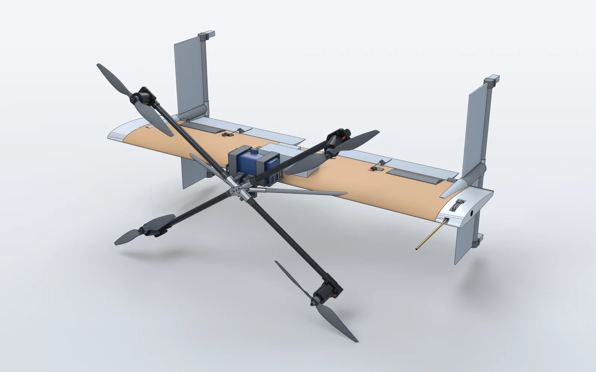
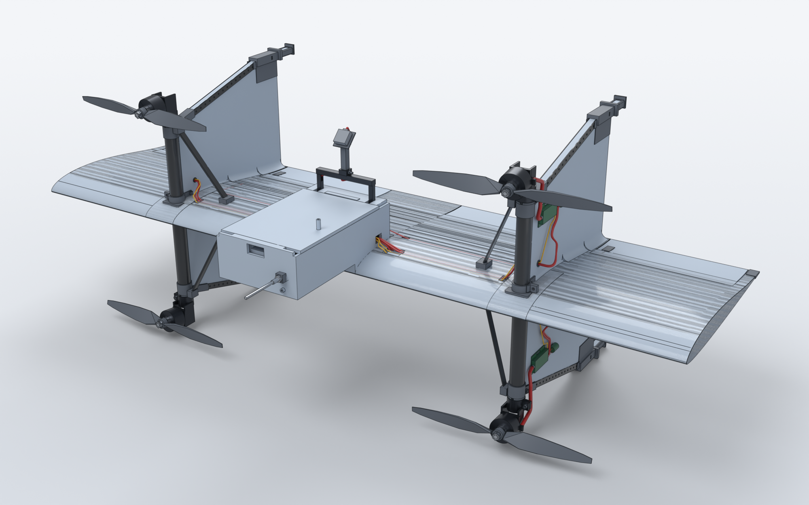

# DBF-Combined: quad-tailsitter VTOL, concept A (UC Berkeley MEng capstone)

<h2 align="center">
  <a href="https://davinciucberkeley-collab.github.io/DBF-Combined/redesign/site/">&#9654; Open the Concept A Explorer in your browser</a>
</h2>

  3-D aircraft, build guide and films, hub stress map, BOM and status. Nothing to download or install. 
  <a href="https://davinciucberkeley-collab.github.io/DBF-Combined/redesign/site/">davinciucberkeley-collab.github.io/DBF-Combined/redesign/site</a>
  &middot; <a href="https://davinciucberkeley-collab.github.io/DBF-Combined/redesign/site/#structures">Hub stress map (earlier printed hub, record)</a>
  &middot; <a href="https://davinciucberkeley-collab.github.io/DBF-Combined/redesign/site/#build">Build guide</a>

> **Current design (2026-11-23): concept A, a scaled quad tailsitter, re-sit as O4b (D-182, D-219, D-227, D-240).** K09-L, described
> below, could not be built new within $2,000 (cheapest workable build about $2,577) and is kept as the record. Concept A O4b:
> 0.90 m wing, 4 x SunnySky X2216 V3 880KV motors on 4 x APC 9x4.5MR props, 4S 2,800 mAh pack, Kakute H743-Wing flight controller
> 75 mm left of centre, glass wing skin; **1.881 kg predicted (`EST`, CAD basic 1,641.0 g)**, which misses the 1.47 kg weigh-in gate
> (-27.9 %), so the physics checks govern; **BOM $1,939.17 of $2,000** (spend $1,592.23 + crash reserve $346.94, margin $60.83;
> $2,029.68 if unverified prices run 30 % over, information only). Design, reports and status:
> [redesign/qp/README.md](redesign/qp/README.md). Decisions D-182 to D-247: [CHANGE-LOG.md](redesign/params/CHANGE-LOG.md).
> **Status:** designed and checked on paper, in SITL and in the 3-D gates; nothing bought, built or flown. The strict proof build
> (`python -I redesign/qp/A/proofs/run_all.py`, 2026-11-23) has 14 FAIL claims (mass gate and prediction, hover vibration in band,
> gain margin, FC vibration, elevon horn / rib / free play, elevon pitch use 0.69-0.79 against 0.60 of 15 deg, and 1.3 Vs 17.74 m/s at the
> predicted mass against 17 m/s cruise), to be decided by bench and tap tests. Order 1 ($887.25 EST) awaits approval 1-4 Dec; go/no-go 2027-01-29 (AM-037, D-248).
> The Explorer's renders, films and drawings show concept A (the K09-L ones are kept as the record).

**Hard constraints (team lead; full text in [CLAUDE.md](CLAUDE.md)):**
1. $2,000 total, all bought new (tax, shipping, packs, charger, radio, test gear, spares); the Jacobs Hall Makers Pass is outside it.
2. Built and flight-tested by 2027-04-30.
3. The packed aircraft fits one car trunk (two at most); a team of 4 moves it; under 25 kg.
4. Passes the 3-D gates: an interference check (static, at neutral and at the elevon stops) of every build step and the assembled aircraft, no part interpenetration, no open wire ends, no exemptions, plus a swept insertion check (straight-line build-step paths); flight cases in the 3-D sims pass. Gate tools for concept A: `redesign/qp/A/cad/collide_a.py` (CAD) and `redesign/qp/A/cad/collide_glb_a.py` (exported `concept-a.glb`), with the D-247 wire-entry rule (a lead end must seat in a pad or termination body: pad / termination proximity), which replaces the K09-L square-entry test of `collide.py --glb`; this is an engineering-team gate definition (CHANGE-LOG D-247) that the user may veto. These are interference checks, not physics simulations; mechanism physics is in docs/analysis-records.md (kinematics AR-001, rigid-body dynamics AR-002, swept interference AR-003).
5. **The CAD looks exactly like the physical aircraft** (2026-11-15): every part at its real shape and size from the vendor drawing or data sheet, real prop blades, no stand-in disks or boxes; unknown dimensions flagged, never invented.
6. **Limit exposed wiring** (2026-11-15): wires inside the arm tubes, wing-core channels, fairings or covers; any wire left outside the skin is listed with its length and reason, and kept to the minimum.

*Concept A in cruise attitude (current design), rendered in Blender from the CAD model in `redesign/qp/A/cad`
(real APC 9x4.5MR props, motors, cage, wing, fins, linkage). Films: [how it flies](redesign/showcase/concept-a/animation/a-how-it-flies.mp4),
[whole build](redesign/showcase/concept-a/animation/a-build.mp4) (45 steps in 10 stages with step cards, callouts and checkpoints, one clip each in the same folder; written guide: [redesign/qp/A/BUILD-GUIDE-A.md](redesign/qp/A/BUILD-GUIDE-A.md)).
More renders: [redesign/SHOWCASE.md](redesign/SHOWCASE.md). Status: design on paper, nothing bought, built or flown yet.*

**K09-L (previous design, kept as the record).** K09-L is the VTOL demonstrator a four-person UC Berkeley MEng capstone team will build and fly. It is a quad
tailsitter: a 1.15 m flat flying wing with two fins, each fin carrying two fixed motors (four in all, one above and
one below the wing on each side), and two elevons for roll and pitch in cruise. It stands on its four fin tips, takes
off as a quadcopter, pitches 90° to cruise on the wing at 16 m/s, and pitches back to land. Power is one 4S 6500 mAh
LiPo; the flight controller runs ArduPilot Plane in tailsitter mode. A configuration study of 43 concepts picked it
([CONFIGURATION.md](redesign/CONFIGURATION.md)). The constraints are hard: **$2,000 total budget**, student-built at
Jacobs Hall, transportable in one piece in a car, parts ordered mid-December 2026, build January to early
February 2027, everything done by **2027-04-30**. The CAD is scripted for Autodesk Fusion only.

*K09-L in cruise attitude, rendered in Blender from the same scripts that build the Fusion model. Status: design
complete on paper, nothing bought, built or flown yet.*

## Open it

- **In any browser, nothing to download:** the link at the top of this page (GitHub Pages, published from the
  `redesign/v1` branch; it updates a minute or two after each push).
- **Windows, with Python installed:** double-click `00 - OPEN THE K09-L EXPLORER (double-click me).bat` in the repo
  folder. It serves `redesign/site/` on `http://localhost:8765/` and opens the Explorer in your browser, now showing concept A: a
  rotatable 3-D model with a vendor link or build clip for every part, the configuration decision and morph chart, the
  concept A BOM and status, proof chains and every document and the Simulations view (SITL and landing reruns on the current design, T-097 / T-098). Close the console window to stop it.
- **On GitHub, no install:** read [redesign/SHOWCASE.md](redesign/SHOWCASE.md) for the renders, the flight animation,
  STL models that rotate in the browser, the morphological chart, the decision and the simulation figures.
- **Building it:** [redesign/BUILD-GUIDE.md](redesign/BUILD-GUIDE.md) is the short, ordered build guide, with an animated clip per
  stage (K09-L, previous design: [whole build](redesign/showcase/animation/build/k09l-build.mp4); concept A: [whole build](redesign/showcase/concept-a/animation/a-build.mp4), written guide [redesign/qp/A/BUILD-GUIDE-A.md](redesign/qp/A/BUILD-GUIDE-A.md)). Read
  [redesign/review/BUILDABILITY-REVIEW.md](redesign/review/BUILDABILITY-REVIEW.md) first: 6 blockers and 30 major
  build problems found by a buildability review, to fix before more CFD/FEA or any cutting.

## Key numbers (K09-L, previous design, record)

These rows are K09-L (frame revision A1-R5, 2026-11-10), not concept A; concept A numbers are in the current-design paragraph above and in [redesign/qp/A/proofs/out/CHAIN.md](redesign/qp/A/proofs/out/CHAIN.md).  "Modelled" means computed by analysis or simulation; no number is verified by test.

| Item | Value | State | Source |
|---|---|---|---|
| Span × chord | 1.15 × 0.32 m, one piece | proposed | [`redesign/params/params.json`](redesign/params/params.json) `wing` |
| Take-off mass, basic / predicted | 2,341 g / 2,457 g against a 2,600 g gate (margin 143 g; 103 g with a 590 g pack, gate 100 g); landing 59.1 g vs 60 g allocated; predicted CG 50.1 mm in the 46.6–51.4 mm range | modelled | [`redesign/MASS-CG.md`](redesign/MASS-CG.md) (D-75…D-78), `CL-A3-*` in the proof graph |
| Propulsion | 4 × SunnySky X3108S, APC 11×5.5MR props, 4 × 45 A ESCs, 4S 6500 mAh pack | proposed | [`redesign/README.md`](redesign/README.md) |
| Hover T/W, fresh pack / worst pack | 2.49 / 2.12 | unverified (thrust stand owed) | [`redesign/README.md`](redesign/README.md) key numbers |
| Cruise speed / power | 16 m/s / 240 W (E1 disputes: 246 W) | unverified | [`redesign/STATUS.md`](redesign/STATUS.md) issue 5 |
| Cruise after 2 min hover, base / pessimistic | 12.0 / 6.4 min | unverified | [`redesign/README.md`](redesign/README.md) key numbers |
| Stall at forward CG | 11.99 m/s against a 12.0 m/s limit | unverified | [`redesign/team/B2/SIMULATION-REPORT.md`](redesign/team/B2/SIMULATION-REPORT.md) |
| Budget | $2,000 hard | requirement | [`redesign/BRIEF.md`](redesign/BRIEF.md) |
| BOM spend / reserve, baseline | $1,588.38 / $411.62 | prices unverified | [`redesign/team/I1/bom_summary.json`](redesign/team/I1/bom_summary.json) |
| BOM spend / reserve, pessimistic | $1,673.59 / $326.41 (gate: reserve ≥ $309, one crash) | holds only with two Jacobs Hall tool loans | [`redesign/team/I1/ORDER-PLAN.md`](redesign/team/I1/ORDER-PLAN.md) |
| Orders | early order ~2026-11-20 ($1,064.39); main order 2026-12-15 ($430.83) | planned | [`redesign/team/I1/ORDER-PLAN.md`](redesign/team/I1/ORDER-PLAN.md) |
| Build and finish | build start 2027-01-19 (proposed), first hover by build week 4, complete by 2027-04-30 | planned | [`redesign/params/params.json`](redesign/params/params.json) `schedule` |
| Transport | one-piece box 1.25 × 0.55 × 0.54 m; field set-up about 5 min, one person | proposed | [`redesign/README.md`](redesign/README.md) |
| Requirements | 59 total: 0 verified, 1 checked, 1 proposed, 57 unverified; 11 show a fail (most are stale claims) | | [`redesign/STATUS.md`](redesign/STATUS.md) |
| Proof graph | 4,244 nodes, 13,815 links; clean build (0 drift, 0 errors); 87 claims fail on margin (2026-11-11) | | [`redesign/PROOFS.md`](redesign/PROOFS.md) |
| Collision (no parts phasing) | 1,007 bodies in 193 parts plus every routed wire, tape skin included: 0 penetrations > 0.05 mm, static and at both elevon limits; every wire end seated in a part; no wire crosses or folds through itself (D-86, D-87) | modelled | [`redesign/collision/README.md`](redesign/collision/README.md) |

## Where things are

| Path | What it is |
|---|---|
| [`redesign/`](redesign/README.md) | Everything for the redesign. Concept A (current) is in [`redesign/qp/`](redesign/qp/README.md); the K09-L record is described in the [README](redesign/README.md) |
| [`redesign/config-study/`](redesign/config-study/README.md) | How K09-L was chosen: requirements, morphological chart, 43 concepts, shortlist, judging, tie-break. Decision: [`CONFIGURATION.md`](redesign/CONFIGURATION.md) |
| [`redesign/team/<role>/`](redesign/TEAM.md) | One folder per engineering role (A systems, B aero, C structures, D CAD, E propulsion, F electrical, H test, I programme, J support), each with `SUMMARY.md`, scripts, `claims.json` and change requests |
| [`redesign/params/`](redesign/params/params.json) | `params.json` (every top-level number), [`CHANGE-LOG.md`](redesign/params/CHANGE-LOG.md) (decisions D-01 to D-200), `mass_budget.json` |
| [`redesign/subsystems/`](redesign/subsystems/wing/SPEC.md) | Per-subsystem spec, parts list, interfaces and Fusion module (wing, fins, pod, landing, propulsion, power, avionics, harness, mechanisms, transport, flight software, ground) |
| [`redesign/interfaces/`](redesign/interfaces/REPORT.md) | Interface graph (parts and joints) and its checker `merge_check.py` |
| [`redesign/fusion/`](redesign/fusion/DATUMS.md) | Fusion framework: `BuildAll` script, backends, `check.py`, skeleton, datums |
| [`redesign/proofs/`](redesign/PROOFS.md) | Proof chains from requirement to claim to calculation to source; `build_graph.py` rebuilds and flags drift |
| `redesign/site/` | The Explorer web app opened by the `.bat` file (concept A; the `.bat` keeps its old K09-L name) |
| [`redesign/showcase/`](redesign/SHOWCASE.md) | Renders, flight and build animations, STL models, page snapshots |
| [`redesign/design-system/`](redesign/design-system/README.md) | Visual standard for every output (tokens, components, Blender style) |
| BOM | Concept A: [`redesign/qp/A/BOM-A.csv`](redesign/qp/A/BOM-A.csv), totals [`bom_a.py`](redesign/qp/A/bom_a.py), [`ORDER-1.csv`](redesign/qp/A/ORDER-1.csv). K09-L record: [`redesign/team/I1/K09L-BOM.xlsx`](redesign/team/I1/K09L-BOM.xlsx) (Excel with live formulas), [`BOM.csv`](redesign/team/I1/BOM.csv), [`ORDER-PLAN.md`](redesign/team/I1/ORDER-PLAN.md) |
| Legacy (C0 era) | `analysis/`, `cad/` (SOLIDWORKS), `docs/`, `firmware/`, `review/`, the root `*.html` pages, `inventory/`, `fusion/` (C0 v0.3.1 scripts), `concepts/`, `sim/`, `explorations/tiltwing/`, `tools/`, [`DECISIONS.md`](DECISIONS.md). Imported on 2026-11-08 from DBF-VTOL, DillonVTOL, TiltWing and OpenCAEModel; superseded by K09-L. Source commits and what was left out: [`PROVENANCE.md`](PROVENANCE.md) |

## Status and next steps

As of 2026-11-23 (concept A, O4b; sources: `CLAUDE.md` status line, [`redesign/qp/A/bom_a.py`](redesign/qp/A/bom_a.py), `run_all.py`, [`docs/audits/2026-11-23-T099-final-design-audit.md`](docs/audits/2026-11-23-T099-final-design-audit.md)):

- **Design:** 1.881 kg EST (CAD 1,641.0 g), X2216 motors, 4S 2,800 mAh, CG 22.05 mm, static margin 7.61 %; BOM $1,939.17 of $2,000.
  Mass gate 1.47 kg missed; the physics checks govern (AM-011).
- **Checks:** run_all 14 STRICT FAIL claims (list in the current-design paragraph) plus the nominal elevon flutter claim UNVERIFIED;
  3-D gates on the CAD: collide_a 0 pairs above 0.05 mm, 0 open wire ends, a_assembly 66 steps with 129 of 129 parts placed (T-099 gates record).
  Everything is modelled; nothing is VERIFIED by hardware.
- **Open:** elevon pitch use (D-245 keeps the 15 deg basis; fix path is controls rung 1 then a SITL rerun); stall at the predicted mass (TP-11);
  landing stroke passes only inside the foam region Fp 37.5-39.0 N, zeta 0.02-0.05 (TP-3); the X2216 is on RMRC backorder (T-088);
  the exported-model gate for `concept-a.glb` passes: 0 part pairs above 0.05 mm, 0 unseated wire ends, 0 bad wire entries (`collide_glb_a.py`, D-247; the published GLB is the gated export).
- **Next:** Order 1 approval 1-4 Dec (T-093; order 1b with the config-independent lines and R15 by 11 Dec, D-248); no fabrication before Jacobs reopens (AM-037); bench stand, TP-1 / TP-2 19-28 Jan 2027, go/no-go Fri 29 Jan 2027 (F-6 answered by AM-037; schedule slack +2 d, SCHEDULE-A; Explorer Status), build January to February 2027,
  flight test, done by 2027-04-30. Human decisions and dates: Explorer Status tab.

The K09-L status of 2026-11-10 (`redesign/STATUS.md`, `redesign/HANDOFF.md`) is kept as the record.

### Resume the work

[`redesign/RESUME.md`](redesign/RESUME.md) explains how to restart the design programme (remaining phases: build and
programme planning, media, design review) and lists the checks to run before any meeting.

## Legacy: C0 lift + cruise

Before K09-L the team's baseline was C0, a 2.4 m twin-boom quadplane with four lift rotors and a pusher, designed in
SOLIDWORKS. The configuration study superseded it on 2026-11-09. Its files remain at the repo root for reference;
[`PROVENANCE.md`](PROVENANCE.md) records where each came from, and the design review is
[`VTOL-Review.html`](VTOL-Review.html) (download and open locally).

## CI

The GitHub Actions workflow `.github/workflows/regenerate-check.yml` (green) covers the K09-L / legacy generators only (`analysis/verify.py`,
`review/build.mjs`, `firmware/tools/check_params.py`); it runs none of the concept A generators and is not evidence that concept A is consistent.
Concept A's check is `python -I redesign/qp/A/proofs/run_all.py` plus `python -I tools/ledger_audit.py`.
