# K09-L build guide

A short, ordered guide to building the K09-L quad tailsitter at Jacobs Hall. Each stage points to the detailed
`subsystems/<x>/BUILD.md`, which holds the dimensions, cut tables and checks. This guide gives the order, the
time, the parts and the warnings from the [buildability review](review/BUILDABILITY-REVIEW.md).

Status: design `PROPOSED`, frame A1-R5. Nothing has been built yet. **Open Blockers are not solved.** Where a step
depends on one, it says "pending fix". Do not print or cut those parts until the fix lands in CAD.

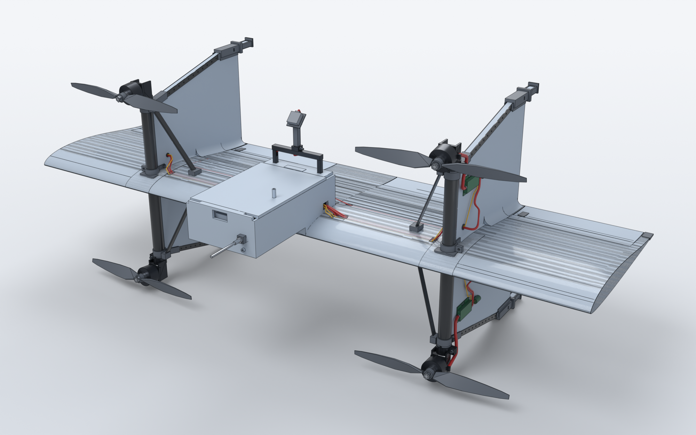

**Build animation:** [the whole build, stages 2–11](showcase/animation/build/k09l-build.mp4) (about 49 s). Each
stage below links its own clip and shows its end state. Parts fly in to where they seat, from the same CAD that
passes the collision check (`collision/`); rendered by `showcase/animation/render_build.py`.

Finding IDs (BR-xx) are in the [review master table](review/BUILDABILITY-REVIEW.md#master-table-blockers-and-majors-ranked).
BOM line IDs (B01, W04…) are in [`team/I1/BOM.csv`](team/I1/BOM.csv).

## Before you start

**Access.** Every builder needs a Jacobs Hall Maker Pass ($125 per student per semester; ⚠ not in the budget yet,
[BR-04](review/BUILDABILITY-REVIEW.md#fix-before-ordering-or-cutting)) and the laser, 3D-printer, woodshop,
drill-press and electronics trainings. Fall access ends **18 Dec**; spring trainings run only in the first half of
term, so take them all in November and December ([BR-31](review/MANUFACTURING.md#4-findings)).

**Tools Jacobs has:** Universal laser cutters (use the 48 × 25 in bed for 20 × 30 in board), Prusa printers
(PETG), band saw, drill presses, PCB shear and soldering stations in the Electronics Lab, spray booth (for the
3M 77 lamination).
**Tools Jacobs does not list:** a hot-wire foam cutter and an enclosed printer for ASA. Buy the hot-wire gear
(G11, H05) and find an enclosed printer early ([BR-29, BR-30](review/MANUFACTURING.md#4-findings)).
**Bring or buy:** 1 m steel rule, calipers, depth gauge, inclinometer, preset torque screwdriver (0.1–1 N·m),
0.1 g and 1 g scales, Z-bend pliers, pin vise, 2.5 / 3.4 / 8 mm drills, 3 mm and 22 mm ball bits, sharpened
8 mm brass tube, luggage scale, servo tester, prop balancer.

**Consumables** (⚠ mostly missing from the BOM, [BR-32](review/MANUFACTURING.md#4-findings)): laminating epoxy by
the quart, colloidal silica, glass and phenolic microballoons, mixing cups, gloves, IPA, 3M 77, 48 mm and 100 mm
clear tape, 12 mm filament tape, Blenderm or filament hinge tape, straws, heat-shrink, PETG in four colours, ASA,
TPU 95A.

**Safety.**
- **LiPo:** charge, store and re-terminate packs in a LiPo bag next to a sand bucket; never solder a pack above
  3.8 V per cell; one lead bare at a time. Props off for every powered bench test.
- **Hot wire:** XPS fumes; cut with extraction or outdoors, never leave the wire powered unattended, keep the
  supply current at the lowest setting that cuts cleanly.
- **Epoxy and CA:** nitrile gloves, ventilation; no CA or solvent glue on XPS (it melts the foam). Sanding cured
  epoxy and carbon makes fine dust: mask and vacuum.
- **Motors:** after any crash, approach from behind the pod and pull the plug before touching props or fins.

**Stop items before stage 1** (from the review):
- ✓ CG back in range in the design (BR-00): lighter feet, landing allocation 60 g, pack datum 4 mm forward
  (D-75…D-78; predicted CG 50.2 mm in 46.6–51.4). Still modelled only: weigh the first feet and pack.
- ✓ Fin tip and foot shoe on one datum (BR-01, D-75): no overlap in CAD.
- ✓ Motor-mount slit open (BR-02, D-80); clocking dog and notch added (MM-02, D-81). ⚠ The dog's shear strength
  is not sized yet (C6, before the 18 Dec freeze): print one mount and one collar as test articles first.
- ⚠ Through-core block strap eyes stop the block going into its pocket: pending fix
  [SW-01](review/STRUCTURE-WING.md#findings) (BR-17).
- ✓ Shop files exist (BR-03): `python -B redesign/manufacturing/make_shop_files.py` (STLs, DXFs, hot-wire
  templates, jigs). Re-run after any CAD change.
- ✓ No two parts overlap in CAD (`python -I redesign/collision/collide.py`, static and both elevon limits).
  Re-run before printing anything that changed.

---

## Stage 1. Buy, measure, print and cut parts

Time: November–18 Dec, plus the winter break for home printing and electrical pre-work.
Parts: B01, B02, A01, M01, P01, W03/W04, W05, W08, D01–D03, C03.
Detail: every `subsystems/*/BUILD.md` step 1.

1. Buy one motor, one ESC 4-pack, one CoreWing V2, three servos and both packs **now**. Weigh and caliper them.
   Write the numbers into the params files.
2. Measure the motor bolt pattern. It must fit y ≤ 17.5 mm. ⚠ Never drill through the motor; use a printed drill
   guide ([MM-04](review/MOTOR-MOUNTS.md#findings)).
3. Map the CoreWing boards (S1–S12, Vx, current sense, battery pads) before the pod deck is frozen
   ([WB-01](review/WIRING-BATTERY.md#findings)). Flash Plane 4.7 and Bluejay.
4. Laser-cut the S5010 templates, radius templates and ply jigs: block clocking jig, build stand, 45° and pin
   drill guides ([SW-06, MF-06](review/MANUFACTURING.md#4-findings)).
5. Print test-fit parts first, then the flight set. Make two of every crash part: 8 mounts, 8 collars, 3 blocks,
   spare horns, servo frames and pod handle.
6. Build one fin-station test article (300 mm wing stub, block, tube, one half-fin, one foot) and break it. It is
   also your rehearsal for stages 2–5.

☐ Inspect before moving on: every measured value logged; one mount, one collar and one frame test-fitted; design
freeze signed off on 18 Dec.

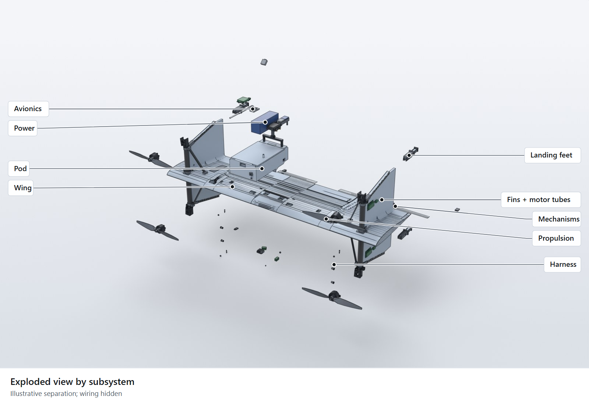

## Stage 2. Wing core and spar

[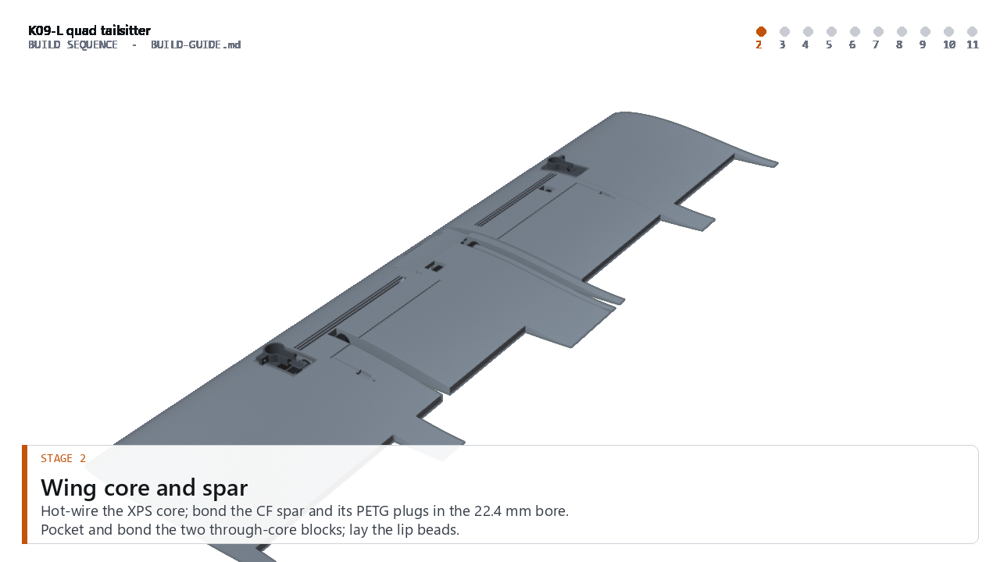](showcase/animation/build/stage-02.mp4)
[Play the stage 2 clip](showcase/animation/build/stage-02.mp4)

Time: about 2 days hands-on plus 2 × 24 h cures (practice cores extra).
Parts: W01 XPS, W03/W04 spar tube, PETG plugs (W05), C05 epoxy, blocks `FIN-004`.
Detail: [`subsystems/wing/BUILD.md`](subsystems/wing/BUILD.md) steps 1–8, [`subsystems/fins/BUILD.md`](subsystems/fins/BUILD.md) step 7.

1. Hot-wire **two** cores from the S5010 templates in one 1.15 m pass each; keep both foam beds. Sand the LE
   until no ridge can be felt. ⚠ Stall margin is +0.05 %; accept a core only by template gauge at three stations
   and log the real TE thickness ([MF-05, SW-16](review/MANUFACTURING.md#4-findings)).
2. With the core in its lower bed, cut the spar slot from below, the block and anchor pockets, the servo pockets,
   the pod recess, the grooves and the JR recess. Never lift a slotted core out of its bed
   ([SW-07](review/STRUCTURE-WING.md#findings)).
3. Push the PETG plugs into the spar to the dowel marks. Cure 24 h.
4. Bond both blocks to the spar in the clocking jig with silica-thickened epoxy, then cure
   ([SW-08](review/STRUCTURE-WING.md#findings)). ⚠ Strap eyes: pending fix SW-01.
5. Bond spar and blocks into the core with microballoon epoxy, fill the lip-bead chamfers, sleeve the pod ties.
   Weight it on the relieved bed, LE on a straight edge. Cure 24 h.

☐ Inspect before moving on: core straight within 1 mm, no twist; blocks at y ±320 ± 1 mm; tube bores parallel and
vertical within ±0.5° in the jig; beads continuous.

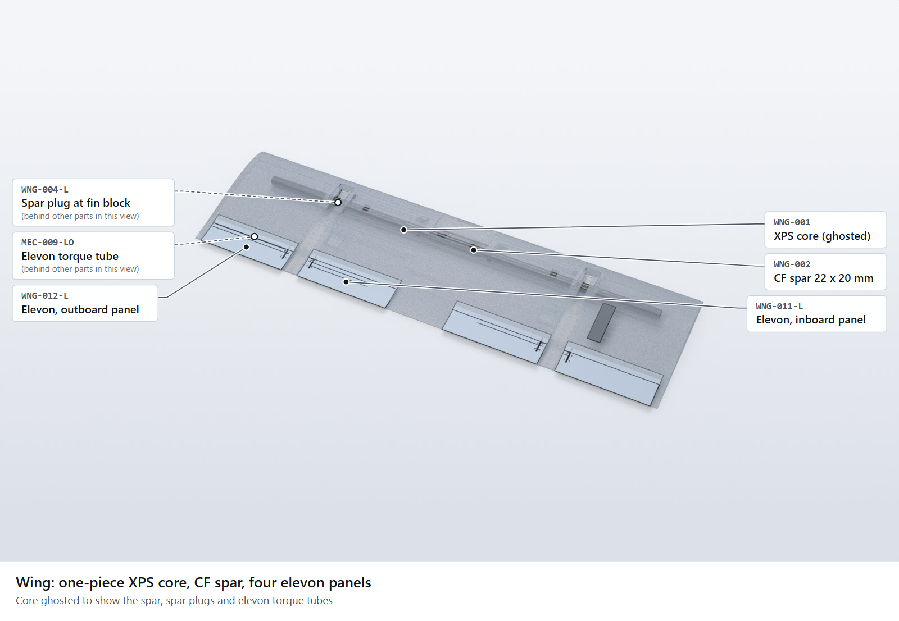

## Stage 3. Elevon panels

[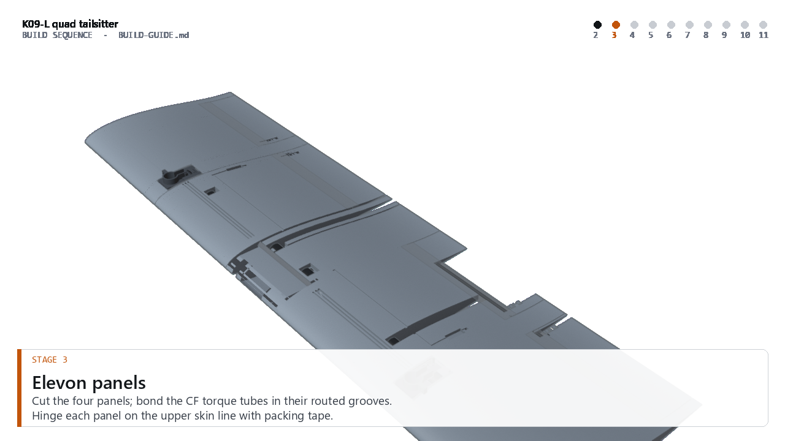](showcase/animation/build/stage-03.mp4)
[Play the stage 3 clip](showcase/animation/build/stage-03.mp4)

Time: 3–4 h plus a 24 h cure.
Parts: torque tubes `MEC-009` (H02), hinge tape.
Detail: [`subsystems/wing/BUILD.md`](subsystems/wing/BUILD.md) step 9, [`subsystems/mechanisms/BUILD.md`](subsystems/mechanisms/BUILD.md) steps 1–4.

1. Route the torque-tube grooves with a depth stop **while the core is still whole**, then cut the panels free
   ([SW-17](review/STRUCTURE-WING.md#findings)). Leave R 3 mm at the fin-tab corners.
2. Bevel the panel fronts 30° on the lower side; knife the horn-blade slots.
3. Bond the torque tubes flush with microballoon epoxy. Cure 24 h. Tape the bevel face.

☐ Inspect before moving on: panels 228 and 218 mm long, chord 70.4 mm; ≥ 1 mm foam over each tube; corner radii
by gauge.

## Stage 4. Fins on the motor tubes

[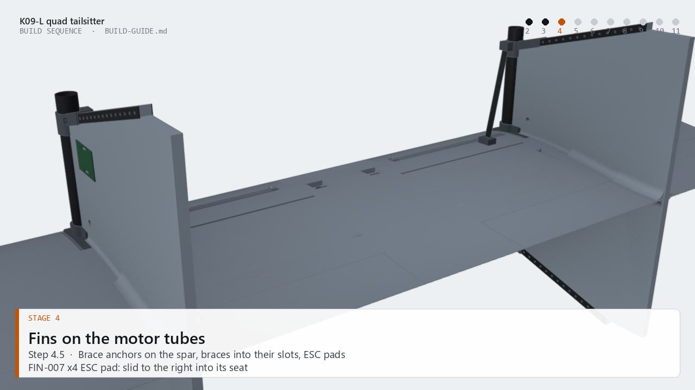](showcase/animation/build/stage-04.mp4)
[Play the stage 4 clip](showcase/animation/build/stage-04.mp4)

Time: about 2 days hands-on plus 4–5 × 24 h cures.
Parts: W02 foam board, W04 tubes, D03 plugs, D01 braces, D02 strips, C03 pins, collars `FIN-008`, anchors, ESC pads `FIN-007`.
Detail: [`subsystems/fins/BUILD.md`](subsystems/fins/BUILD.md) steps 1–17.

1. Laminate the board pairs (3M 77 in the spray booth), measure the laminate, then knife- or laser-cut the four
   half-fins. Tip outline per D-75 (one datum with the foot shoe).
2. Cut the two 344 mm motor tubes, fit the plugs, cure. Slide the tubes through the bosses and blocks, square them
   in the jig, epoxy. Cure 24 h.
3. Bond the half-fin roots and run the cove fillets. ⚠ Weigh a cup from every fillet batch; the CG has no aft
   margin left ([MF-14](review/MANUFACTURING.md#4-findings), BR-00). ⚠ The lower roots have the rod notch under a
   fillet that already fails: pending C4 check [SC-04](review/SERVOS-CONTROLS.md#findings).
4. Edge strips and pins. Fit strips and drill pins on the bench, flat, before the half-fin goes on, if the team
   adopts [SW-04](review/STRUCTURE-WING.md#findings). ⚠ Pin row depends on the tip decision.
5. Station collars, braces, ESC pads. ⚠ Collar height (13, 15 or 22 mm) is not frozen: pending H7 / BR-08. Clock
   the collar notch with an inclinometer if the keyed mount ([MM-02](review/MOTOR-MOUNTS.md#findings)) is adopted.
6. Post-cure the collars in a heat tent (box, lamp, thermocouple), keeping XPS and tape cool
   ([SW-14](review/STRUCTURE-WING.md#findings)).

☐ Inspect before moving on: tubes vertical and parallel; each half-fin weighed before and after (+6.3 g expected);
no filler in lead holes or elevon gaps.

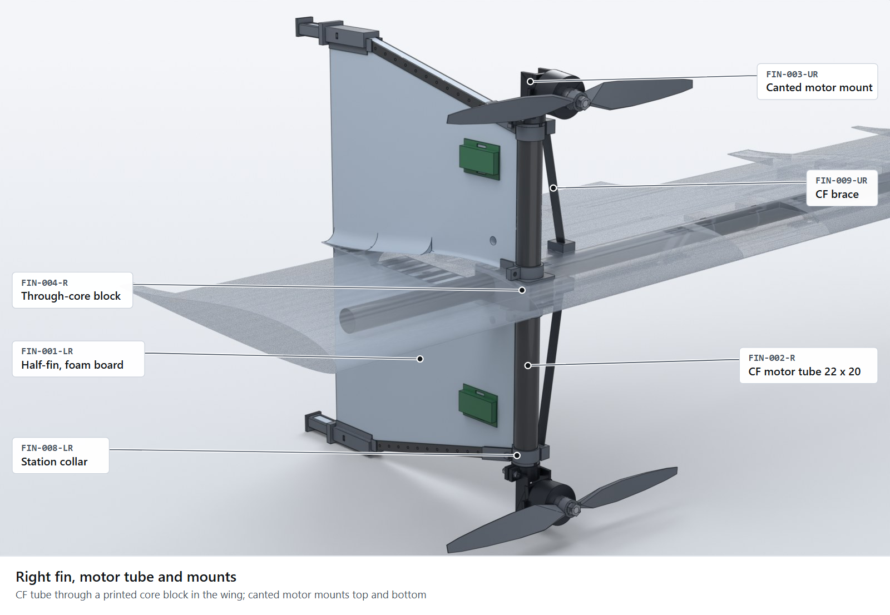

## Stage 5. Pod and power stack

[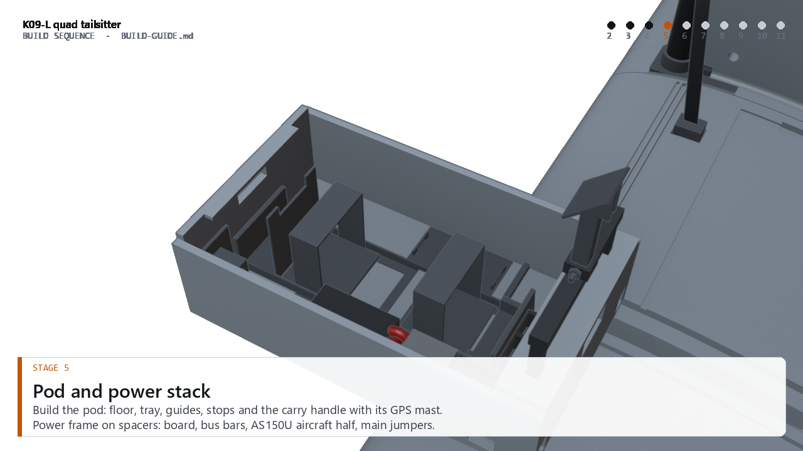](showcase/animation/build/stage-05.mp4)
[Play the stage 5 clip](showcase/animation/build/stage-05.mp4)

Time: about 8.5 h for the pod plus 3 × 24 h cures; 3 h for the power stack.
Parts: pod board and prints `POD-*` (W02, W05), F01 AS150U, F02–F04 wire, F05 UBEC, F06 fuse, F07 caps, F08 FR4, C02 inserts, C06 nylon screws, D06 straps.
Detail: [`subsystems/pod/BUILD.md`](subsystems/pod/BUILD.md), [`subsystems/power/BUILD.md`](subsystems/power/BUILD.md).

1. Build the pod box on the bench in parallel with stage 4: stop T, tray, walls, fillets.
2. Lay the recess-step fillet on the wing, cure, then bond the pod into the recess. ⚠ Pod BUILD step 11 bonds the
   handle bridge to a "slot fill" that does not exist on top of the wing ([SW-10](review/STRUCTURE-WING.md#findings));
   bond to the spar saddles only.
3. Build the power stack **on the bench**: bus board, power board with the supplied 470 µF 35 V input cap,
   AS150U. ⚠ The power and harness BUILD files disagree on when the ESC leads are soldered
   ([WB-02](review/WIRING-BATTERY.md#findings)); solder the bus board before the frame goes on, or use ESC-pair
   plugs at the pod exits if the team adopts [WB-03](review/WIRING-BATTERY.md#findings).
4. Put the AS150U on a short flying pigtail if [WB-04](review/WIRING-BATTERY.md#findings) is adopted, so the
   plug can be pulled fast after a crash.
5. Re-terminate both packs to AS150U in the LiPo area. Make one colour-matched spacer and crush-block kit per pack
   and tether it to that pack ([WB-06](review/WIRING-BATTERY.md#findings)). ⚠ The pack station may move forward up
   to 6 mm under the CG fix (BR-00).

☐ Inspect before moving on: polarity; > 1 MΩ between rails; loop resistance logged; stack weighed (88 g).

| | |
|---|---|
| 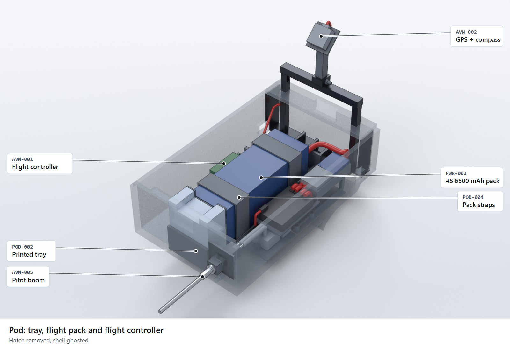 | 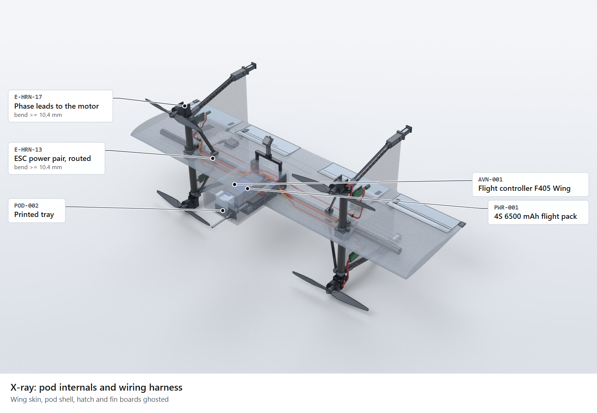 |

## Stage 6. Harness, then skin

[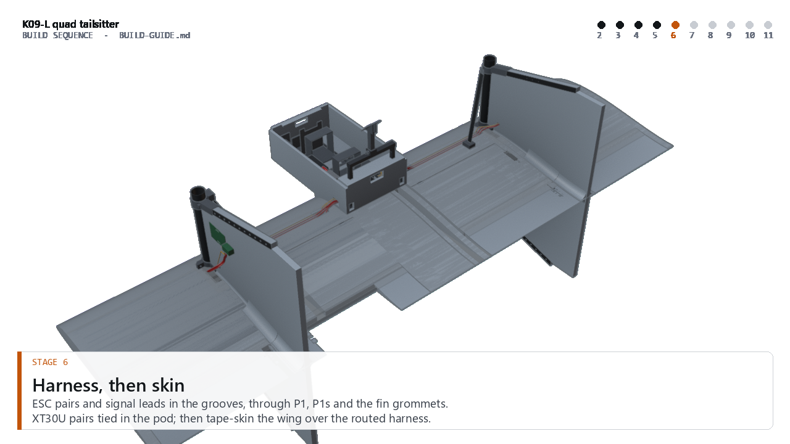](showcase/animation/build/stage-06.mp4)
[Play the stage 6 clip](showcase/animation/build/stage-06.mp4)

Time: 1–2 days plus skinning 3–4 h for two people.
Parts: F03 16 AWG, H01 harness parts, F09 heat-shrink, W06 tape, 100 mm tape.
Detail: [`subsystems/harness/BUILD.md`](subsystems/harness/BUILD.md), [`subsystems/wing/BUILD.md`](subsystems/wing/BUILD.md) step 11.

1. Weigh each reel, caliper its OD, cut and label every wire, twist the pairs.
2. Solder each ESC's 16 AWG pair, cap and DShot pair on the bench. Bed the cap can in silicone
   ([WB-07](review/WIRING-BATTERY.md#findings)). Pull-test.
   On the bus bars (D-86, D-87: bars 35 mm): each pair lands as two conductors, + on the + bar and − on the − bar,
   3.5 mm along the bar top, at four stations 8 mm apart from the aft end (LR aft-most, then UR, LL, UL). Each pair
   rises over the ones aft of it. Form the bends off the pad at 2 × OD on the bench. The 10 AWG main jumper's two
   conductors start on the board's output pads, drop through the deck window either side of the pairs and land
   across the bars' forward ends. The battery jumper's two conductors run side by side from the AS150U cups,
   through the 10.4 mm cup slot, onto the board's two input pads (D-89).
   At the ESC: the pair and the DShot lead come up the gap between the ESC's aft end and the cap and enter the ESC's
   aft end face square onto its power pads (D-87, D-88), the signal lead to the lowest pad. Slide a 1.5–3.5 mm length of
   adhesive-lined heat-shrink (HRN-107) over each lead before soldering and shrink it over the joint at the face.
3. Strap the ESCs on their pads; thread the leads through the fin grommet with a 20–30 mm service loop
   ([WB-08](review/WIRING-BATTERY.md#findings)); lay them in the grooves with tape tabs.
4. Servo leads to the JR recess before the skin. The mated JR pair lies flat on the floor of the 30.5 × 10.8 × 5 mm
   recess (D-86; the old 18 × 10 mm recess was narrower than the 10.3 mm shroud): female forward, lead dropping in
   from the groove, servo lead rising out of the aft end into the branch groove. In the pod, the six JR pairs stand
   on edge on the tie bar in FC-output order (output 1 inboard), two per tie.
   Lower-station ESC signal leads: out of the P1s lower mouth straight into the jog groove to the signal groove,
   under the tape (D-86).
5. Skin the wing: lower, upper, then the 100 mm LE strip. No seam within 32 mm of the LE. Run a finger along every
   groove: nothing proud. Where a lead leaves its groove (pod exits, groove ends by the fins), slit the tape round
   it with a fresh blade: nothing runs on top of the tape (D-86).
   At each fin root, trim the tape square along the edge of the cove fillet: no tape lies on the fillet (D-88).
6. `T-F2-CONT` with the pack out: every net < 0.1 Ω, > 1 MΩ between nets.

☐ Inspect before moving on: continuity and isolation logged; no tape wrinkles at the LE; LE-strip edges ≥ 32 mm.

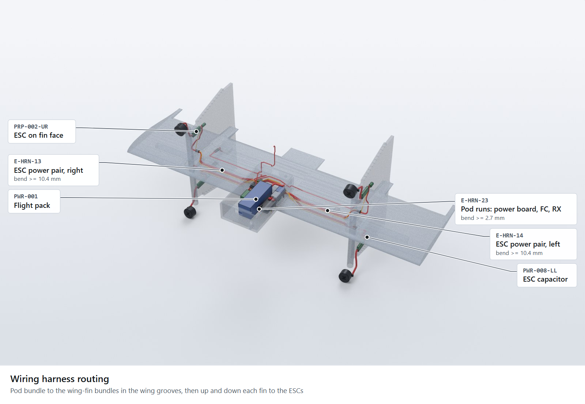

## Stage 7. Servos, linkage and hinges

[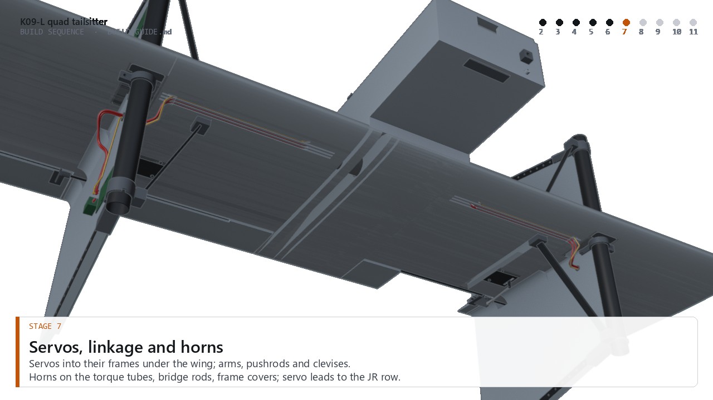](showcase/animation/build/stage-07.mp4)
[Play the stage 7 clip](showcase/animation/build/stage-07.mp4)

Time: per side about half a day plus 2 × 24 h cures.
Parts: M01 servos, H02 mechanisms hardware, horns and frames `MEC-004…008`.
Detail: [`subsystems/mechanisms/BUILD.md`](subsystems/mechanisms/BUILD.md) steps 5–12.

1. Hinge: use Blenderm or filament tape, top strip at neutral, lower strip with the panel full TE-up
   ([SC-02](review/SERVOS-CONTROLS.md#findings)). Both panels of a side in one setup.
2. Bond the inboard horn with the rod in place. ⚠ Slip-fit the outboard horn in a brass sleeve instead of bonding
   both ends ([SC-03](review/SERVOS-CONTROLS.md#findings)).
3. Bench-prep the servo at 1500 µs; drill the arm to 1.85 mm (not 1.6 mm) for the 2-56 Z-bend
   ([SC-07](review/SERVOS-CONTROLS.md#findings)). Crimp pins but leave the JR housing off, so the lead passes the
   straw ([SC-01](review/SERVOS-CONTROLS.md#findings)).
4. Bond the frame in the pocket, install the servo, fit the cover, paint-pen the screws.
5. Pushrod and clevis at neutral; sweep 900–2100 µs on the tester with no binding.

☐ Inspect before moving on: free play ≤ 1° at the TE; both panels of a side within 1° at 0 and ±25°; warm peel
test passed (3.5 N at the TE, 10 min).

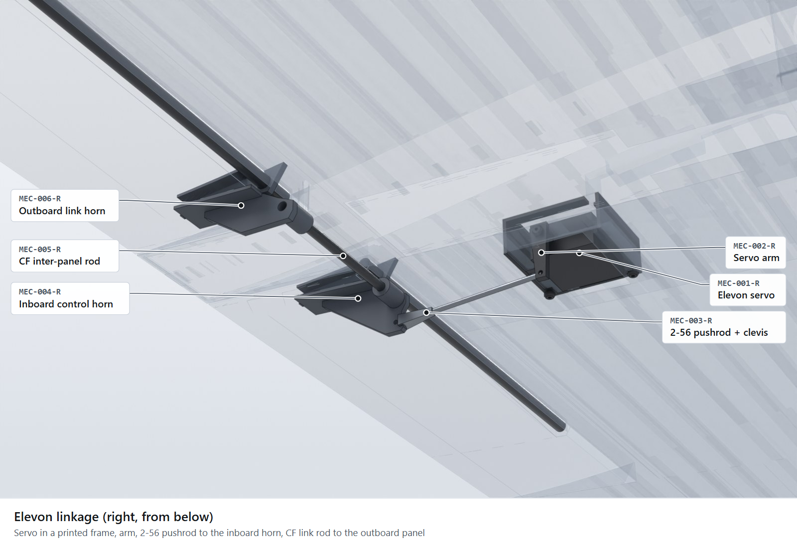

## Stage 8. Motor mounts, motors and props

[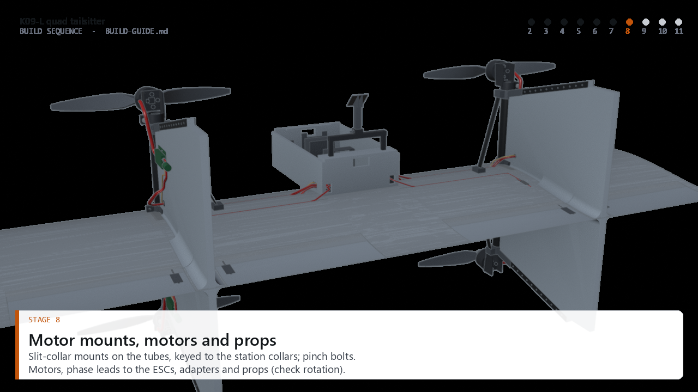](showcase/animation/build/stage-08.mp4)
[Play the stage 8 clip](showcase/animation/build/stage-08.mp4)

Time: about 1 h per station plus 4 × T-E1-STAND runs.
Parts: B01 motors, B03 props, B05 adapter rings, B07 screws, C01 pinch bolts and nylocs, C04 Loctite, mounts `FIN-003` (W08 ASA).
Detail: [`subsystems/propulsion/BUILD.md`](subsystems/propulsion/BUILD.md), [`subsystems/fins/BUILD.md`](subsystems/fins/BUILD.md) steps 18–19.

1. Print the D-80/D-81 mount (slit open, clocking dog) and check the 1.5 mm slit with a feeler. The dog drops
   into the notch at the front of the station collar; ⚠ its shear size is still C6's to set (D-81).
2. Incoming check on **every** motor: weight, pattern, all hole depths, E-clip seating, phase resistance.
3. Drill each plate from a printed guide with no motor on it. Fit a spreader plate under the screw heads if
   [MM-03](review/MOTOR-MOUNTS.md#findings) is adopted; screws with 243 on the tips; torque driver; witness marks.
4. Mount on the tube, set the slip (`T-D3-SLIP`), check 7 ± 1° cant with the inclinometer. ⚠ Slip number differs
   between documents (70–80, 74, 85–100 N); use the one D3 and C6 agree. Recheck the 25 mm blade-to-tube gauge
   ([MF-07](review/MANUFACTURING.md#4-findings)).
5. Phase splices with sleeves; tie the bundle to fixed structure with a service loop, clear of the pinch bolt
   ([MM-12](review/MOTOR-MOUNTS.md#findings)). Route (D-86): forward off the ESC along the board face, up outboard of
   the collar tail wall, tie at the collar's phase lug, tape up the outboard cheek face over the pinch nut, into the
   motor's lead exit. No span hangs free. Spin test for direction at 5 %, props off.
6. Balance every prop. Fit by hand (MRP on UR/LL, MR on UL/LR), washer, nyloc, 1.5 N·m. ⚠ Prop-nut thread
   engagement is 0.11 mm: pending adapter choice [MM-06](review/MOTOR-MOUNTS.md#findings).

☐ Inspect before moving on: each motor turns in its stated direction; witness marks on every screw and nut; slip
holds 60 N.

| | |
|---|---|
| 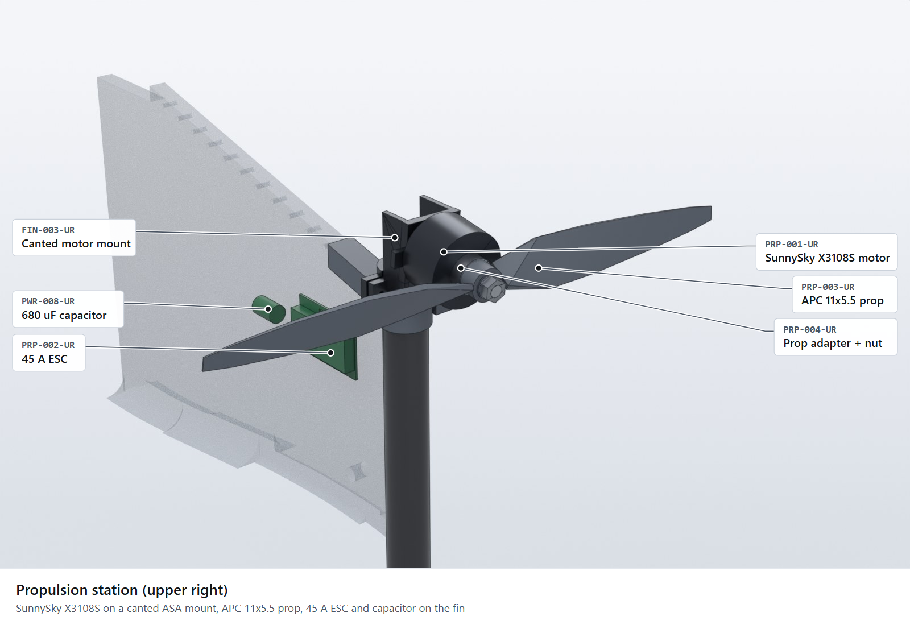 | 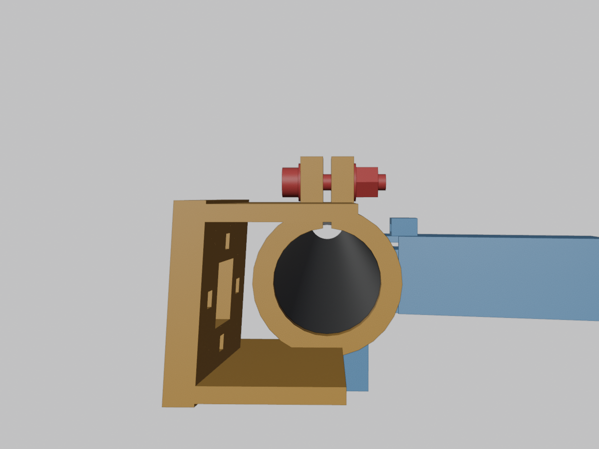   Before D-80: the cheek (left) bridged the slit (MM-01). Fixed in CAD. |

## Stage 9. Avionics

[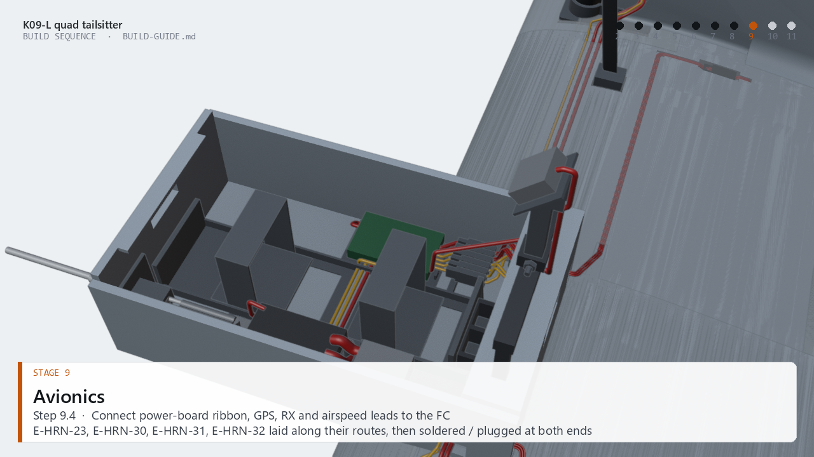](showcase/animation/build/stage-09.mp4)
[Play the stage 9 clip](showcase/animation/build/stage-09.mp4)

Time: about 1 day including calibration.
Parts: A01 FC, A02 GPS, A03 RX, A04 airspeed, A05 microSD, A06 antennas, A07 isolation set.
Detail: [`subsystems/avionics/BUILD.md`](subsystems/avionics/BUILD.md).

1. FC on four gel cubes with its strap; airspeed sensor between the tie posts; RX crosswise with antennas up the
   tubes.
2. GPS on the mast pad; check the compass chip ID at the I²C scan ([WB-12](review/WIRING-BATTERY.md#findings)).
3. Pitot lines on different coupler sizes or colours so T and S cannot swap ([WB-13](review/WIRING-BATTERY.md#findings)).
4. Connect, tie within 20 mm of each plug, twist the current-sense wire with its ground. Every lead ends on a
   real termination (D-89):
   - **Outputs 1–6:** solder each conductor into its own hole of the FC's S / Vx / G field (aft edge). Bend it
     up off the board on a 2 × OD lead-off; the forward holes run higher, over the risers aft of them. Then lead
     it into its contact of the JR pair on the tray.
   - **GPS (GH-6) and SERIAL6 to the RX (GH-4):** plug into the FC's aft-edge and fore-edge sockets. The RX lead
     runs down in front of the fore end stop and aft under the FC, inboard of the gel cubes.
   - **Airspeed I²C branch:** solder it to the GPS cable's four conductors about 15 mm from the FC plug. Shrink
     one adhesive sleeve over the splice and both cables. Its other end plugs into the sensor's GH-4 on the
     aft face.
   - **RX end:** strip the 4-core cable under a 2 mm breakout sleeve. Lay the four conductors flat onto the
     RP3's 5 V / GND / TX / RX pads and solder them. Check the pad order against the board first; the order
     in the CAD is an estimate.
   - **Power-board link ribbon:** plug into the PDB's top header and into the FC's underside header between
     the gel cubes. Fit the FC end before the FC goes onto its cubes.
5. Calibrate accelerometer (cruise attitude), compass, airspeed zero.

☐ Inspect before moving on: pre-arm checks pass; airspeed rises on a blow at the tip and drops on a suck.

## Stage 10. Feet and corner caps

[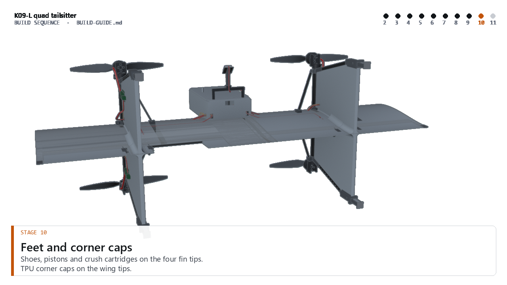](showcase/animation/build/stage-10.mp4)
[Play the stage 10 clip](showcase/animation/build/stage-10.mp4)

Time: 4 × 55 min shoe prints, 1 h bench, 24 h cure; cartridges most of a day.
Parts: shoes `GER-001`, pistons `GER-002`, cartridges (W01 offcuts), D05 neoprene, D07 brass cutter, TPU caps `GER-007`.
Detail: [`subsystems/landing/BUILD.md`](subsystems/landing/BUILD.md).

1. Print the D-76 foot (59.1 g `EST`, landing allocation 60 g, D-78) on the D-75 tip. Weigh the first shoe and
   report it to A3 before printing the other three.
2. Print pistons in orange (upper) and blue (lower); weigh each.
3. Cut and pre-crush the cartridge sticks with a fence and crush block.
4. Dry-fit, then bond the shoes; fit inserts by colour; push on the corner caps.

☐ Inspect before moving on: four feet and two caps weighed and reported to A3; pads level.

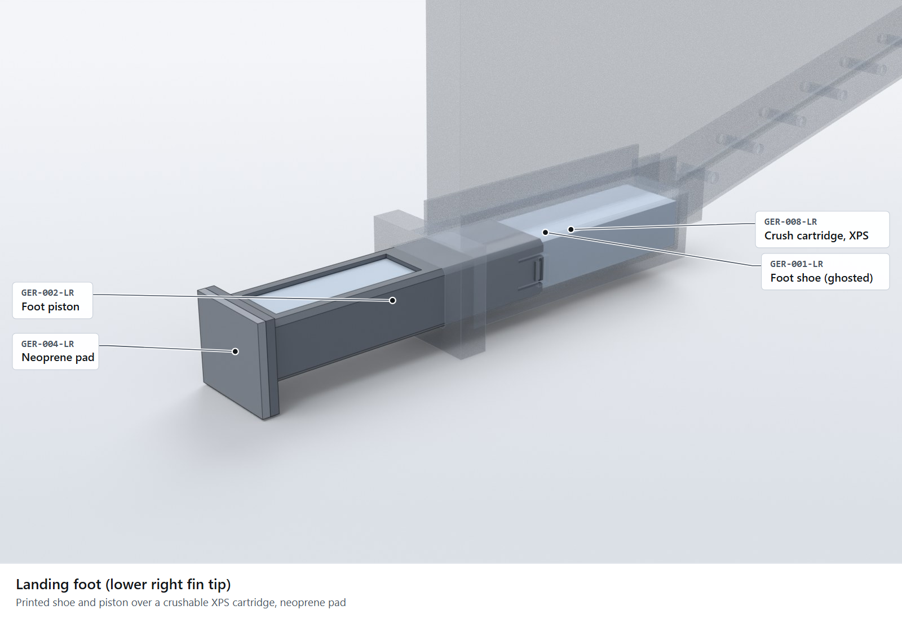

## Stage 11. Checks: weight, CG, controls, thrust stand

[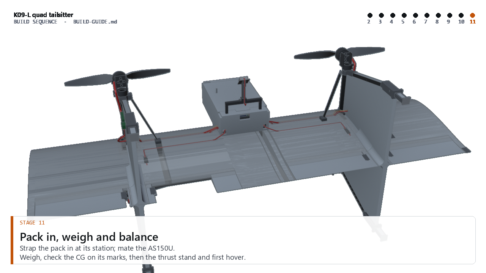](showcase/animation/build/stage-11.mp4)
[Play the stage 11 clip](showcase/animation/build/stage-11.mp4)

Time: about 2 days (GT-06, 07, 12, 13, 14, 18).
Parts: G04 watt meter, G06/G12 thrust stand, CG jig.
Detail: [`team/H1/GROUND-TEST-PLAN.md`](team/H1/GROUND-TEST-PLAN.md), [`subsystems/flight-software/K09L.param`](subsystems/flight-software/K09L.param).

1. Weigh the complete aircraft with each pack.
2. **CG on the jig with each pack and its own spacer kit** (`T-A3-CG-BALANCE`, marks at 46.6 and 51.4 mm).
   ⚠ **Mass and CG requirements currently FAIL** (BR-00): predicted CG 52.6 mm with a 550 g pack, 1.2 mm aft of
   the limit; worst pack range use 1.028; gate margin 107 g against the 100 g overrun. If the aircraft balances
   aft of 51.4 mm, **do not fly it**. Nose ballast costs about 13 g per mm of CG and only 7 g of mass margin
   remains, so use ballast only to trim. Report the measured CG to A3 and B3.
3. Control directions: with props off, check each elevon moves the right way for roll and pitch in FBWA, and what
   the surfaces do in QHOVER ([SC-06](review/SERVOS-CONTROLS.md#findings)). Motor order and direction from
   `MOTOR_TEST`.
4. Thrust stand on each station (`T-E1-STAND`): thrust and current in band, ten punch-outs, then re-check every
   witness mark.
5. Stand run-up through the full rpm range; film the elevon TEs in slow motion for buzz
   ([SC-11](review/SERVOS-CONTROLS.md#findings)); compassmot; current-sense calibration with motors running.

☐ Inspect before moving on: CG inside the marks with every pack; all four stations in band; no witness mark moved.

## Stage 12. First hover

Time: half a day per session. Target: build week 5 (week 4 stretch).
Detail: [`team/H1/GROUND-TEST-PLAN.md`](team/H1/GROUND-TEST-PLAN.md), [`subsystems/pod/BUILD.md`](subsystems/pod/BUILD.md) field card.

1. Wind under 5 m/s, morning. LiPo bag and sand at the field. Aircraft lying flat on the cradle for the pack swap.
2. Arming sequence ([WB-04](review/WIRING-BATTERY.md#findings), replaces "plug in after the RC link is up"):
   transmitter on, model selected, throttle down, then plug in; hatch open until pre-arm passes; close it ≤ 2 min
   before take-off; arm only from the RC switch; e-stop (`RC9_OPTION 31`) checked.
3. Hanging yaw test, then a tethered hover. Log VIBE, FFT (watch 70–90 Hz), FC temperature and servo current.
4. After landing: disarm, pull the plug from behind the pod, check witness marks, feet and hinges.
5. After any tip-over: spin each motor by hand (bent shaft = wobble), check cheeks for cracks, replace props.

☐ Inspect before moving on: VIBE < 30 m/s², no clipping; compassmot ≤ 30 %; no structural damage.

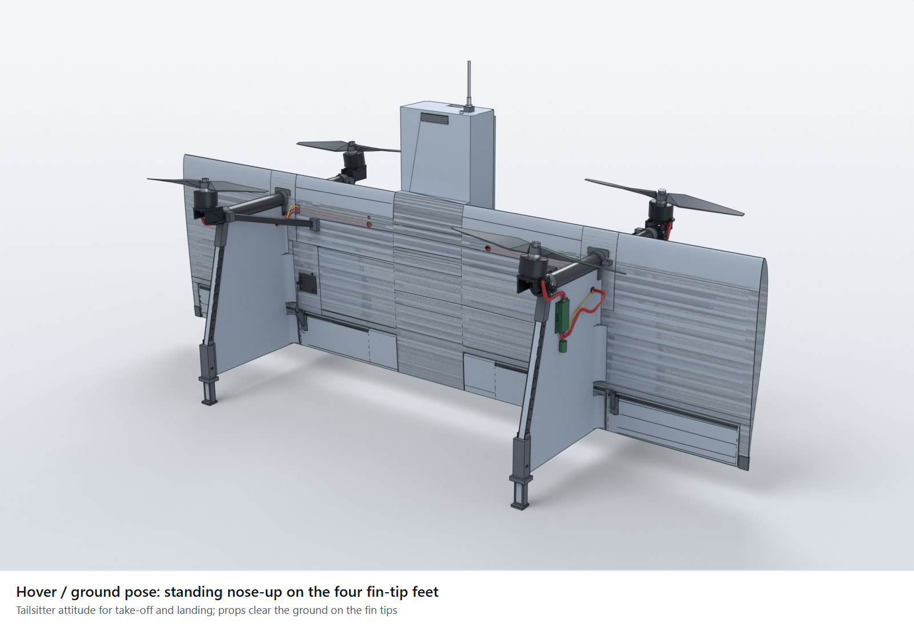

---

## Week-by-week plan

From [MANUFACTURING.md §5](review/MANUFACTURING.md#5-realistic-build-plan-week-by-week). Build week 1 = 19 Jan 2027.

| When | Work | Gate at the end |
|---|---|---|
| 11 Nov – 18 Dec (shop open) | All trainings; shop exporter; templates; hot-wire bow; 2 practice cores; jigs and gauges; coupons and fin test article; thrust stand, lever frame, CG jig | Design freeze 18 Dec (CG fix, fin tip, collar, pins, mount material); traveler issued |
| 19 Dec – 18 Jan (Jacobs closed) | Home printing: blocks, collars, pod prints, feet, pistons. Harness cut and labelled; ESCs and FC flashed; bus board and AS150U leads; SITL hours | All prints and electrical sub-assemblies on the shelf |
| Week 1 (19–25 Jan) | Cut cores 1 and 2; spar plugs; slot, pockets, grooves; fin laminates; pod board parts; mounts drilled | Core 1 accepted by template gauge |
| Week 2 (26 Jan – 1 Feb) | Spar + blocks in the jig; elevons free; anchors; motor tubes; recess fillet; pod walls; half-fin roots and fillets | Tubes vertical and parallel |
| Week 3 (2–8 Feb) | Collars, strips, pins, braces, ESC pads; pod into the recess, handle; harness; skin; mechanisms; shoes; power stack | Airframe complete; slip and throws checked |
| Week 4 (9–15 Feb) | Avionics and calibration; weigh, CG, tap test, bench and restrained run, range check; transport box | Restrained run passes (stretch: tethered hover) |
| **Week 5 (16–22 Feb)** | **First tethered hover** | Hover log, VIBE, compassmot |
| Weeks 6–7 | Free hover tuning; fixed-wing tune; first transition late week 7 at the earliest | Transition attempt |
| Weeks 8–9 | Transition round trips; crash-repair loop budgeted | One clean round trip |
| Weeks 10–14 (to 30 Apr) | Mission demonstrations, second repair, documentation | Complete by 30 Apr |
