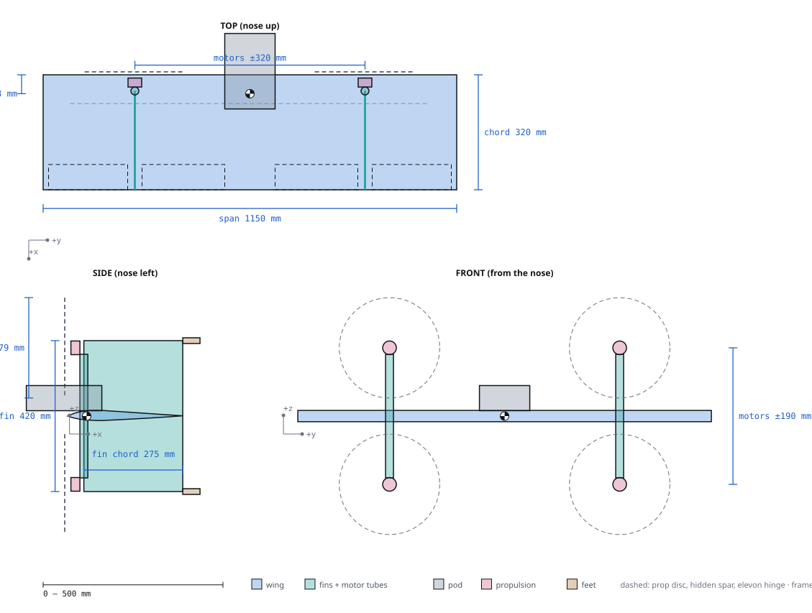

# Redesign v1 — K09-L quad tailsitter

Status: `PROPOSED` design, frame revision **A1-R5** (2026-11-10). Nothing is `VERIFIED`: no part has been bought,
weighed, built or flown. The configuration is reversible until the mid-December order on the conditions in
[`CONFIGURATION.md`](CONFIGURATION.md). Where things stand: [`STATUS.md`](STATUS.md). What the team does next:
[`HANDOFF.md`](HANDOFF.md).

## The aircraft

A 1.15 × 0.32 m flat flying wing (hot-wired XPS core, packing-tape skin, one 22 × 20 mm carbon spar, Selig S5010
reflexed section) with two vertical foam-board fins at ±0.32 m span. Through each fin root a vertical 22 mm carbon
tube passes through the wing core; a printed mount at each tube end carries a SunnySky X3108S motor with an APC
11 × 5.5MR prop, so four fixed motors sit in an X, two above and two below the wing, each canted 7° for hover yaw.
It stands on four crushable feet at the fin trailing-edge tips, takes off as a quadcopter, pitches 90° nose-down
onto the same four motors for cruise at 16 m/s, and pitches back up to land. Two elevon pairs give roll and pitch
in cruise; a pitot on the pod nose schedules the gains. One 4S 6500 mAh pack (Ovonic 120C, 551 g) rides in a pod on
the upper surface behind a crush block. ArduPilot Plane in tailsitter mode on a CoreWing F405 Wing V2. It travels in
one piece in one box; field set-up is four props, the pitot boom and a pack: five minutes, one person. It is the
cheapest and fastest-built concept of the study and the riskiest to fly: any motor failure is a crash, and the flight
card is limited to 5 m/s wind, mornings only.

## Key numbers

All at the 2.6 kg gate unless stated. Live values: `python -I redesign/team/A1/frame_claims.py`,
`python -I redesign/team/A3/mass_rollup.py`, then `python -I redesign/proofs/build_graph.py`.

| Parameter | Value | Limit | Unit | Status | Source |
|---|---|---|---|---|---|
| Take-off mass, basic / predicted (550 g pack) | 2 366 / 2 489 | ≤ 2 600 gate | g | `MODELLED` (+111 g after growth; 100 g of it is the first-build overrun) | [`MASS-CG.md`](MASS-CG.md) A3-R8 |
| Allocations + A1 reserve | 2 374 + 226 | = 2 600 | g | `CHECKED` (reserve = growth 123 + overrun 100 + 3 g free, D-95) | `params/mass_budget.json` |
| Pack acceptance line (heaviest pack the overrun still covers) | 560.8 (one number: A1 = A3 = E2); `T-E2-WEIGH` pass ≤ 560 | ≥ 556 SKU max | g | `MODELLED`; weigh on arrival | `MASS-CG.md`, D-95 |
| CG x, basic (551 g pack at its D-98 station) | 0.0484–0.0490 | 0.0466–0.0514 | m | `MODELLED` (aft margin 0.8 mm predicted for 546 g, set by the bay travel) | `MASS-CG.md` |
| CG height z | +0.0184 | 0.0165–0.025 (D-96) | m | `MODELLED` | `MASS-CG.md` |
| Static margin at the aft limit, 1.3 Vs, with the CG height | 5.0 | ≥ 5 | % | `UNVERIFIED` (range derived by B3 V1; B3 re-run owed) | `team/B3/SIMULATION-REPORT.md`, D-62 |
| Hover T/W, fresh pack with limiter / worst pack | 2.49 / 2.12 | ≥ 2.0 / 1.6 | — | `UNVERIFIED` (thrust stand) | `team/A1/SUMMARY.md`, `team/E1/SUMMARY.md` |
| Stall, forward CG / target / aft | 11.99 / 11.97 / 11.90 (worst corner 12.01) | ≤ 12.3 (D-96: 16 / 1.3 on the integer `AIRSPEED_MIN`) | m/s | `UNVERIFIED` (+2.4 % worst corner; fallback `AIRSPEED_MIN` 17 holds to 13.07; `T-B2-STALL` on the twin is the gate, D-71) | `team/B2/SIMULATION-REPORT.md`, D-96 |
| Transition 1.3 Vs at the forward CG | 15.52–15.62 | ≤ 16 `AIRSPEED_MIN` (integer), 16 cruise | m/s | `UNVERIFIED` (+2.4 %) | `team/B3/`, `team/B2/`, D-96 |
| Cruise speed / power / L/D | 16 / 253 / 5.66 | — | m/s, W, — | `UNVERIFIED` (E1 246.2 + 6 W carried, D-97; B1 as designed 239 W) | `params/params.json#performance` |
| Cruise after 2 min hover, base / pessimistic, at 253 W | 11.4 / 6.0 | ≥ 5 | min | `UNVERIFIED` (E2 phase model 12.0 / 6.4; B1 level cruise 16.3 / 12.0) | `team/E2/claims.json`, D-97 |
| Spiral doubling time | 3.51 | ≥ 3.3 (roll-stabilised modes only, D-66) | s | `UNVERIFIED` | `team/B3/SIMULATION-REPORT.md` |
| Hover yaw authority / 5 m/s disturbance | 1.30 | ≥ 1 | — | `UNVERIFIED` (`T-B4-YAW`) | `team/B3/claims.json` |
| Blade swept volume to the motor tube | 26.1 | ≥ 25 | mm | `MODELLED` (D-61; 25 mm gauge at build) | `team/E1/SUMMARY.md` |
| Fin station first mode vs 1P/2P | 0.29 | ≥ 0.20 | — | `MODELLED` (tap test) | `team/C4/SIMULATION-REPORT.md` |
| Hard landing: sink at ≤ 10° tilt, any direction; n | 1.2; 6.6 | design | m/s; — | `MODELLED` (D-65) | `team/C5/SIMULATION-REPORT.md` |
| Stance tip-over, worst CG | 31.0 | ≥ 30 | ° | `UNVERIFIED` (tilt board) | `team/A1/SUMMARY.md` |
| ESC peak / field ambient ceiling | 56.1 / 44 | ≤ 85 / mission | °C | `UNVERIFIED` (SU2 pad h; GT-04) | `team/E3/SIMULATION-REPORT.md` |
| Spend, pessimistic / reserve (Maker Pass paid outside the budget; hot-wire gear bought) | 1 716 / 284 | ≤ 2 000 / ≥ 309 (one crash) | USD | `FAIL` by $25.28 on the reserve line; all-in pessimistic reserve +$20.45 (was −$57.82); prices re-read at order | [`team/I1/ORDER-PLAN.md`](team/I1/ORDER-PLAN.md) I1-R4 |
| Build to first hover | 70–85 (older estimate); **111** on the BUILD-GUIDE stage times | ≤ 90 | h | `FAIL` on the guide's times (`CR-I2-02`) | `params/params.json#requirements`; [`team/G4/BUILD-STEPS.md`](team/G4/BUILD-STEPS.md) |
| Transport box, external / mass | 1.25 × 0.55 × 0.54 / 3.6 | two cars | m / kg | `PROPOSED` (`CAR-FIT.md` waits for the cars) | `subsystems/transport/SPEC.md` |

## General arrangement

`FIG A1-01 — General arrangement at A1-R5, drawn from params.json by team/A1/draw_ga.py.`

Frame: metres, right-handed, origin at the wing root leading edge on the chord line, **x aft, y right, z up** in
cruise. In hover the nose points up. Full station table: [`fusion/DATUMS.md`](fusion/DATUMS.md).

| Station | x | y | z | What |
|---|---|---|---|---|
| Wing LE / TE | 0 / 0.320 m | ±0.575 m | 0 | one-piece XPS core, chord 0.32 m |
| Spar | 0.080 m | ±0.50 m | +0.007 m | CF 22 × 20 × 1 000 mm |
| CG target (range) | 0.0490 (0.0466–0.0514) m | 0 | +0.0185 m | 15.3 % chord |
| Motor tubes | 0.045 m | ±0.32 m | ±0.172 m | CF 22 × 20 × 344 mm, through the core |
| Motors / prop planes | 0.045 / −0.013 m | ±0.32 m | ±0.19 m | stations `UR UL LR LL`, 7° cant, ⌀ 0.279 m props |
| Pod | −0.140 … 0.095 m | ±0.07 m | 0.015 … 0.085 m | pack bay, tray, FC, power frame, pitot socket |
| Feet | 0.320 … 0.368 m | ±0.32 m | ±0.218 m | crush feet on the fin TE tips, 35 mm usable stroke |
| Elevons | 0.250 … 0.320 m | 0.07–0.56 m per side | 0 | 22 % chord, two panels per servo |

## Subsystems

Folders under `subsystems/<key>/` (`SPEC.md`, `parts.csv`, `interfaces.json`, `params.json`, `fusion/<key>.py`,
`BUILD.md`). Masses are the A3-R7 roll-up, basic / allocated (g). Every physical part has one owner; the owner of
every joint is in `interfaces/REPORT.md`.

| Key | What it is | Designer · analysis | Mass g | Status | Spec |
|---|---|---|---|---|---|
| `wing` | XPS core, tape skin, CF spar, four plugs, four elevon panels | D1 · B2, C2 | 392 / 405 | `MODELLED` | [`subsystems/wing/SPEC.md`](subsystems/wing/SPEC.md) |
| `fins` | 4 half-fins, 2 motor tubes, through-core blocks, canted mounts, collars, braces, ESC pads | D3 · B3, B4, C4 | 436 / 437 | `MODELLED` (collar height open, CR-C6-37) | [`subsystems/fins/SPEC.md`](subsystems/fins/SPEC.md) |
| `pod` | shell, tray with stops and strut, hatch, straps, crush block, GPS mast, pitot socket, handle | D2 · C3 | 146 / 146 | `MODELLED` (D-62 bay, D-69 fixes) | [`subsystems/pod/SPEC.md`](subsystems/pod/SPEC.md) |
| `landing` | 4 crush feet (shoe, piston, cartridge, pad), wingtip corner caps | D5 · C5 | 48 / 48 | `MODELLED` (D-65 sleeve fix owed) | [`subsystems/landing/SPEC.md`](subsystems/landing/SPEC.md) |
| `propulsion` | 4 × X3108S, 4 × LANRC 45 A, 4 × APC 11×5.5MR/MRP, adapters | E1 · B4, E3 | 462 / 462 | `MODELLED`; thrust `UNVERIFIED` | [`subsystems/propulsion/SPEC.md`](subsystems/propulsion/SPEC.md) |
| `power` | Ovonic 4S 6500 pack, AS150U disconnect, power frame, bus, UBEC, fuse, ESC caps | F1 · E2, E3 | 638 / 648 | `MODELLED` | [`subsystems/power/SPEC.md`](subsystems/power/SPEC.md) |
| `avionics` | CoreWing F405 Wing V2, M100 GPS, RP3 receiver, MS4525DO airspeed + boom | F3 · F5 | 36 / 45 | `MODELLED` | [`subsystems/avionics/SPEC.md`](subsystems/avionics/SPEC.md) |
| `harness` | 36 wires, routes, supports, strain relief; the pack plug is the only field disconnect | F2 · F1 | 117 / 123 | `PROPOSED` | [`subsystems/harness/SPEC.md`](subsystems/harness/SPEC.md) |
| `mechanisms` | 2 Savox servos, horns, pushrods, inter-panel CF rod, tape hinges | D6 · C6 | 71 / 72 | `MODELLED` | [`subsystems/mechanisms/SPEC.md`](subsystems/mechanisms/SPEC.md) |
| `transport` | one-piece box, cradles, prop tray, field checklist (ground items) | D7 · C1 | 3 570 (ground) | `PROPOSED` | [`subsystems/transport/SPEC.md`](subsystems/transport/SPEC.md) |
| `flight-software` | `K09L.param` (161 lines), output map, failsafes, tuning and SITL plans | F4 | — | `PROPOSED` (never loaded or run in SITL) | [`subsystems/flight-software/SPEC.md`](subsystems/flight-software/SPEC.md) |
| `ground` | transmitter and ground station | F5 | — (ground) | `PROPOSED` | [`subsystems/ground/SPEC.md`](subsystems/ground/SPEC.md) |

## How the team worked

Forty single-role agents organised as an aircraft engineering team ([`TEAM.md`](TEAM.md)): leadership and systems
(A), aerodynamics (B), structures (C), CAD designers (D), propulsion and energy (E), electrical and avionics (F),
test (H), program (I), support (J). Each role owns one script that emits claims; every number in every document is
traceable through the proof graph (`proofs/`) to the parameter it read. Roles talk through change requests
(`team/<role>/CHANGE-REQUESTS.md`); the chief engineer (A1) dispositions them in
[`params/CHANGE-LOG.md`](params/CHANGE-LOG.md) (decisions D-01 … D-73) and owns
[`params/params.json`](params/params.json). Rules: [`BRIEF.md`](BRIEF.md).

## Simulation round

Every analysis role re-ran on the settled CAD. Four requirements failed as designed and were fixed by decisions
D-61 … D-73 (CHANGE-LOG "Revision A1-R5").

| Role | What was simulated | Tool | Headline result | Convergence | Report |
|---|---|---|---|---|---|
| B1 | Whole-aircraft drag, cruise power, endurance | AVL + XFOIL; SU2 2-D RANS on the fin and tube sections | CD0 0.0515 → 0.0579 (fins 1.23 × hand); 235 W, 16.2 min cruise; no requirement fails | 3–4 grids, GCI 5.8 % | [`team/B1/SIMULATION-REPORT.md`](team/B1/SIMULATION-REPORT.md) |
| B2 | Stall and transition over the CG range with the CG height; hinge moments | XFOIL + AVL; SU2 2-D RANS | stall 11.99 m/s at the forward CG (+0.05 %); 12.01 m/s at the bottom of the z range (CR-B2-20) | hinge moments converged; section clmax **not** converged (GCI 22–71 %), XFOIL value carried | [`team/B2/SIMULATION-REPORT.md`](team/B2/SIMULATION-REPORT.md) |
| B3 | Neutral point, CG limits, modes, control power on the CAD fins | AVL, 4 lattices; SU2 elevon effectiveness | CG 18.5 mm above the chord plane moves the NP 3.4 mm forward: SM 4.76 % `FAIL` → range re-derived (D-62); spiral 3.51 s → D-66 | Xnp GCI 0.002 % c; SU2 L3 not converged | [`team/B3/SIMULATION-REPORT.md`](team/B3/SIMULATION-REPORT.md) |
| B4 | Prop at incidence, tube + board drag in the slipstream, clearances | BEMT; SU2 2-D RANS | tube + board Cd 0.60 vs 1.48 hand; download 1.025; blade-to-tube 21.1 mm `FAIL` → 26.1 mm (D-61) | 3 grids, GCI 3.4 % | [`team/B4/SIMULATION-REPORT.md`](team/B4/SIMULATION-REPORT.md) |
| C2 | Wing 3-D FEA on C1 load cases | in-house hex8 + SU2 elasticity | foam at the block-pocket corners 203 / 199 kPa vs 150 / 120 `FAIL` → R 3 mm edges and fillet beads (D-68); beam model conservative on twist by 16 % | 3 levels, GCI 0.02 % at the peak | [`team/C2/SIMULATION-REPORT.md`](team/C2/SIMULATION-REPORT.md) |
| C3 | Pod bond and pack stops | SU2 elasticity, 2.5-D and plane strain | aft stop peels the board at 408 kPa vs 50 `FAIL` → strut, flange, brackets (D-69); bond R 1.40 → 0.56 | 4 levels; re-entrant corner singular (fillet + proof pull decide) | [`team/C3/SIMULATION-REPORT.md`](team/C3/SIMULATION-REPORT.md) |
| C4 | Fin quarters, station modes, shoe face | 3-D solid FE (hex8 + SciPy) | vibration separation 0.29 ≥ 0.20; the R4 shell tip `FAIL` does not reproduce (MS +0.11); `T-C4-FIN-PROOF` decides the cheek extension | 3 meshes, GCI 1–6 %; one corner non-converging | [`team/C4/SIMULATION-REPORT.md`](team/C4/SIMULATION-REPORT.md) |
| C5 | Touchdown on four crushing feet; shoe stress | 6-DOF rigid body with friction; SU2 shoe FEA | 1.5 m/s bottoms a foot from 5° of tilt, shoe SF 0.22 `FAIL` → 1.2 m/s at ≤ 10°, sleeve fix (D-65) | time step converged 0.01 %; FEA GCI 0.35 % | [`team/C5/SIMULATION-REPORT.md`](team/C5/SIMULATION-REPORT.md) |
| E3 | ESC film coefficient on its fin pad; mission temperatures | SU2 RANS (SST) + lumped RC network | ESC 56.1 °C (6.9 K cooler than hand); field ceiling 44.2 °C; no requirement fails | 3 grids, residuals down 3–7 orders | [`team/E3/SIMULATION-REPORT.md`](team/E3/SIMULATION-REPORT.md) |

## How to view things

| You want to… | Do this |
|---|---|
| Build the CAD in Fusion 360 | `git pull` (branch `redesign/v1`); Fusion **UTILITIES > ADD-INS > Scripts and Add-Ins**; add the folder `redesign/fusion/BuildAll`; **Run**. Steps and what to report: [`fusion/README.md`](fusion/README.md). The Fusion backend is `UNVERIFIED-IN-FUSION`: nobody has run it yet |
| Check the CAD without Fusion | `python -I redesign/fusion/check.py` (stub build, keep-outs, CAD vs interfaces) |
| Get the whole programme on one page | open [`index.html`](index.html): aircraft, team, subsystems, simulations, status |
| Pick up the work later | read [`RESUME.md`](RESUME.md) and [`STATUS.md`](STATUS.md) |
| See why K09-L was chosen | open [`config-study/web/index.html`](config-study/web/index.html) (summary, morph chart, concepts, trade matrix, decision) |
| Walk the aircraft in 3-D | open [`viewer/index.html`](viewer/index.html): Whole · Inside & wiring · Structure · Exploded; colour by subsystem or status |
| Trace a number to its source | open [`proofs/viewer/index.html`](proofs/viewer/index.html) (3-D claim graph) or read `proofs/out/CHAIN.md`; rebuild with `python -I redesign/proofs/build_graph.py` |
| Read the build guide with a clip per stage | in the site: `#build` (page "Build guide"); every stage section embeds its `assets/animation/build/stage-NN.mp4`. Generated from [`BUILD-GUIDE.md`](BUILD-GUIDE.md): `python -I redesign/site/make_build_guide.py`, then `python -I redesign/site/make_index.py` |
| Open a proof chain inside the site | in the site: `#proof` (page "Proofs"), `#proof-overview`, `#proof-<node id>`; the 3-D explorer's claims link there. Markup and CSS are generated from `site/proofs/index.html`: `python -I redesign/site/make_proof_embed.py`, then `make_index.py`; the standalone `site/proofs/index.html` still works |
| Plan the build, tests and flights | process [`team/G1/PROCESS-PLAN.md`](team/G1/PROCESS-PLAN.md), foam [`team/G2/COMPOSITES-FOAM-PLAN.md`](team/G2/COMPOSITES-FOAM-PLAN.md), prints [`team/G3/PRINT-LIST.md`](team/G3/PRINT-LIST.md), steps [`team/G4/BUILD-STEPS.md`](team/G4/BUILD-STEPS.md), schedule [`team/I2/SCHEDULE.md`](team/I2/SCHEDULE.md), flight tests [`team/H2/FLIGHT-TEST-PLAN.md`](team/H2/FLIGHT-TEST-PLAN.md), flight card and compliance [`team/H3/`](team/H3/FLIGHT-CARD.md), range test [`team/F5/RANGE-TEST.md`](team/F5/RANGE-TEST.md) |
| Read the requirements and their status | [`team/A2/REQUIREMENTS.md`](team/A2/REQUIREMENTS.md), [`team/A2/VERIFICATION-MATRIX.md`](team/A2/VERIFICATION-MATRIX.md) |
| See the design system | open `design-system/components.html` |

## Directory map

| Path | What |
|---|---|
| `CONFIGURATION.md` · `BRIEF.md` · `TEAM.md` | the decision, the rules, the roles |
| `STATUS.md` · `HANDOFF.md` · `MASS-CG.md` | where things stand · what the team does next · mass, CG and inertia roll-up |
| `params/` | `params.json` (every top-level number), `CHANGE-LOG.md` (every decision), `mass_budget.json`, `claims.json` |
| `config-study/` | how K09-L was chosen: requirements, morph chart, cards, reviews, tie-break, web page |
| `team/<role>/` | each role's `SUMMARY.md`, reports, scripts, `claims.json`, `CHANGE-REQUESTS.md` |
| `subsystems/<key>/` | CAD and build data per subsystem (table above) |
| `interfaces/` · `fusion/` | knowledge-graph schema and checker · Fusion framework, `BuildAll`, `check.py`, skeleton, datums |
| `proofs/` · `viewer/` | proof chains and 3-D claim viewer · three.js aircraft viewer |
| `blender/` · `manual-kit/` | render and build-manual tooling (examples only; K09-L output not started) |
| `design-system/` · `reviews/` · `inputs/` | the one look for every output · tooling review · advisor lessons, simulation tools |
