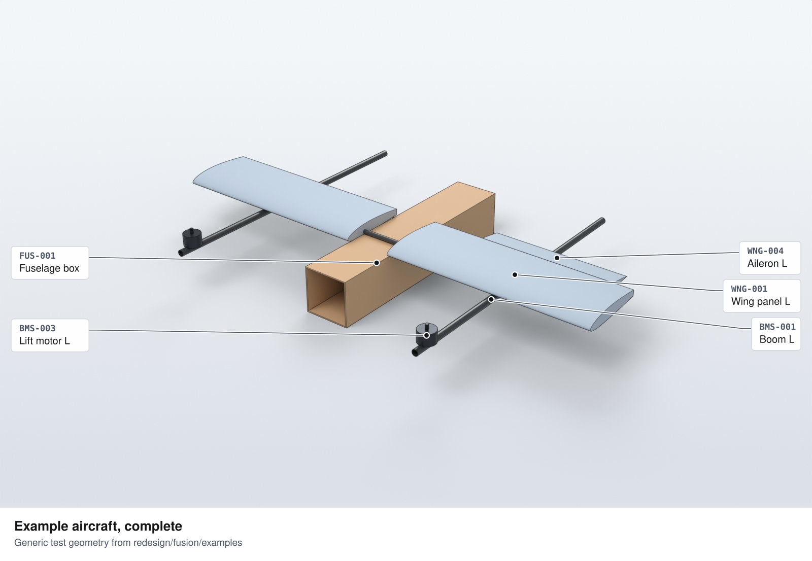
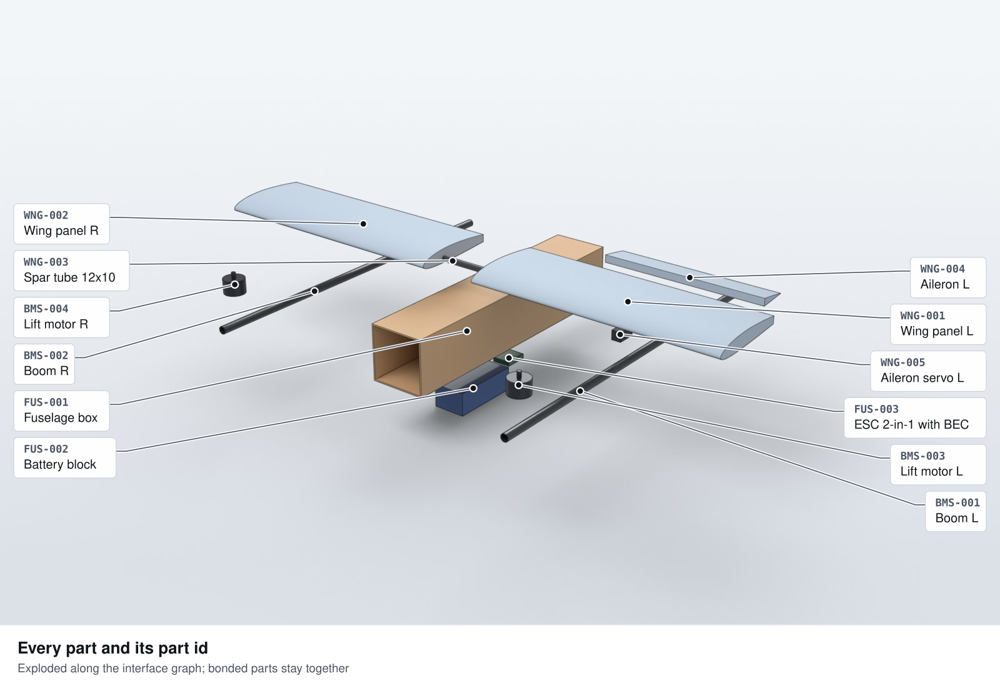
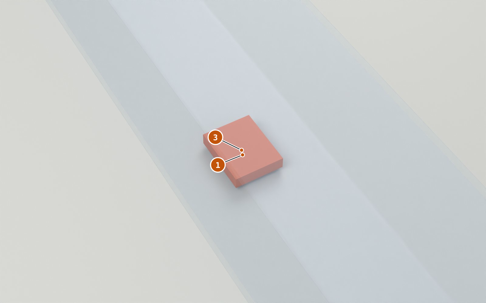
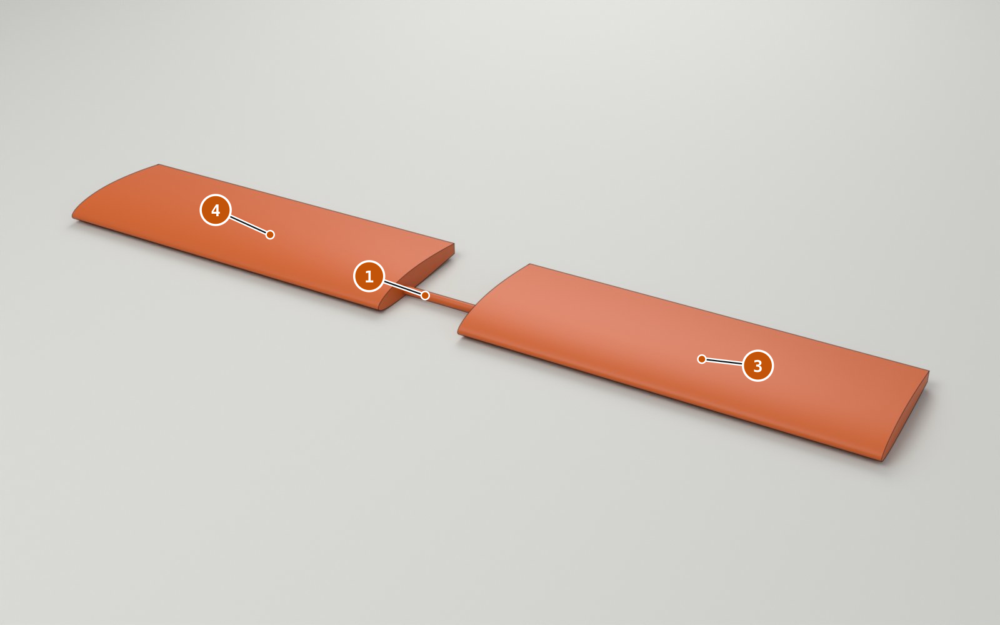
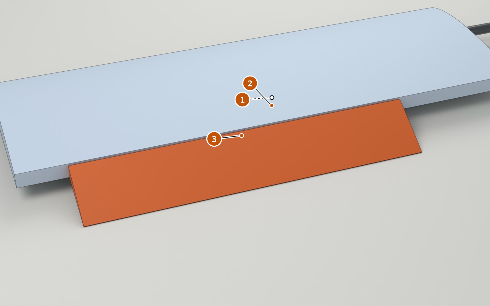
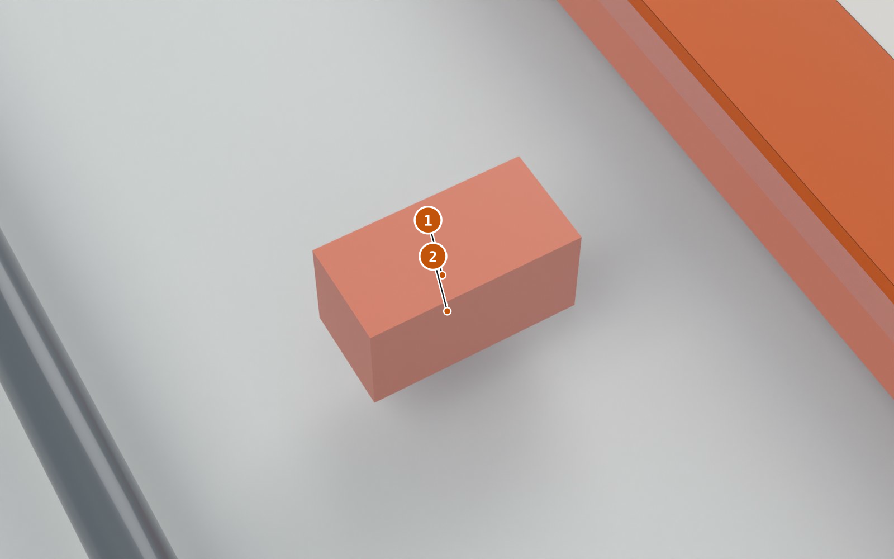
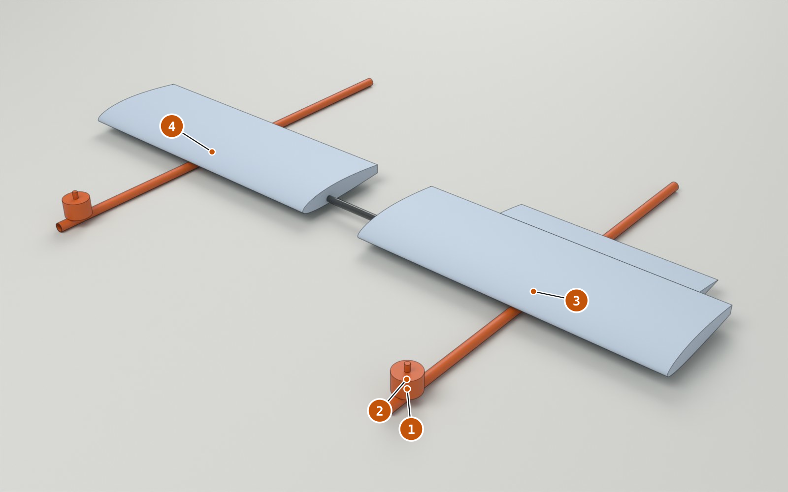
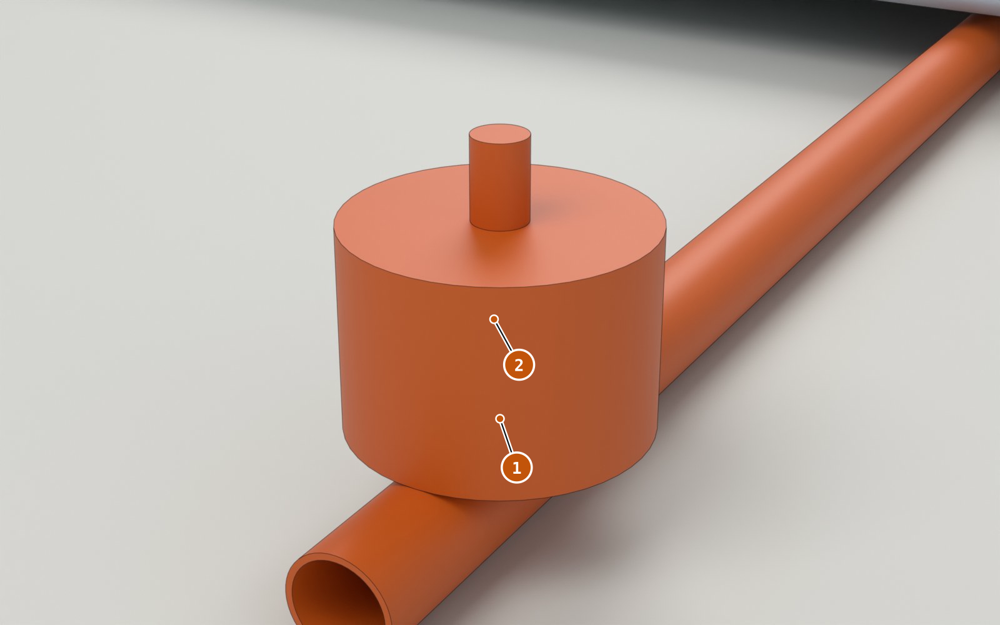
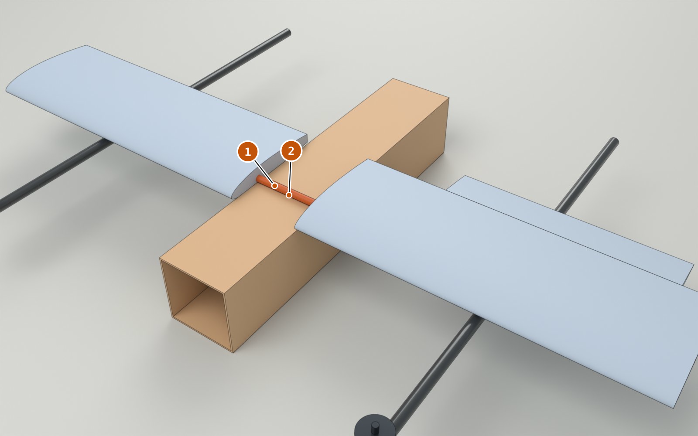
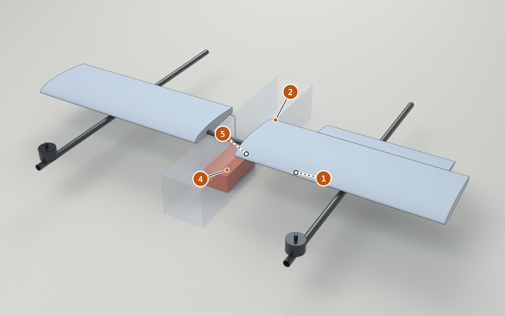

# Example aircraft build manual

`EX-MAN` rev A · 2026-11-09 · status `PROPOSED` · generated by `redesign/manual-kit/build_manual.py`. The HTML version (`manual.html`) adds tick boxes, hover cards and a progress bar.

Generic test geometry: fuselage box, wing with spar and aileron, two booms with lift motors

| Parameter | Value | Unit | Source |
|---|---|---|---|
| Steps | 6 |  | steps.json |
| Hands-on time | 2 h 15 min |  | sum of time_min |
| Waiting (cure) | 12 h |  | sum of wait_min |
| Parts | 12 |  | interfaces.json |
| Fasteners | 42 | pcs | joint stacks |
| Flying mass | 1470 | g | interfaces.json mass_g |

**How to read a step:** orange = fit now; own colour = already fitted; see-through = context. Each orange number in the picture is the action with the same number. Every step ends with a CHECK: measure, write the value, initial.

## Safety

- **Stop: LiPo.** Battery goes in last (step 6). Charge only in a LiPo bag, never unattended. A swollen or dented pack is not used.
- **Stop: Props.** No propeller on any motor during bench work. Props go on only for a test on the stand or a tied-down airframe.
- **Caution: Heat and fumes.** Insert iron and soldering iron run at 220-350 °C: heat-proof mat, fan or extraction on.
- **Caution: Epoxy.** Nitrile gloves, ventilated room. Mix on a card, not in a cup (heat builds up in a mass of epoxy).

## Build sequence

| Step | WP | Title | Parts fitted | Hands-on | Wait |
|---|---|---|---|---|---|
| 1 | WP1 | [Set the inserts and mount the ESC](#step-1) | `FUS-001` `FUS-003` | 20 min | — |
| 2 | WP2 | [Bond the spar into both wing panels](#step-2) | `WNG-001` `WNG-002` `WNG-003` | 30 min | 12 h |
| 3 | WP2 | [Fit the servo and hinge the aileron](#step-3) | `WNG-004` `WNG-005` | 25 min | — |
| 4 | WP3 | [Fit the motors and clamp the booms under the wing](#step-4) | `BMS-001` `BMS-002` `BMS-003` `BMS-004` | 30 min | — |
| 5 | WP4 | [Bolt the wing to the fuselage](#step-5) | — | 10 min | — |
| 6 | WP4 | [Connect the leads, then strap in the battery](#step-6) | `FUS-002` | 20 min | — |

## WP1 · Fuselage

Inserts and ESC in the fuselage box. 1 steps, 20 min hands-on, 0 min waiting.

**Kit for WP1** (pick before the first step):

| Kind | Item | Qty | Steps | Vendor / file |
|---|---|---|---|---|
| part | `FUS-001` Fuselage box | 1 | FUS-S01 | laser-cut DXF (example) |
| part | `FUS-003` ESC 2-in-1 with BEC | 1 | FUS-S01 | any 2-in-1 30 A ESC with 5 V BEC (example) |
| fastener | M3x10 SHCS A2-70 | 4 | FUS-S01 | — |
| fastener | M3 nylon washer | 4 | FUS-S01 | — |
| fastener | M3x5.7 brass heat-set | 4 | FUS-S01 | — |
| consumable | Threadlocker, medium strength (blue) | 4 drops | FUS-S01 | — |
| tool | 2.5 mm hex key |  | FUS-S01 | — |
| tool | Heat-proof mat |  | FUS-S01 | — |
| tool | Soldering iron with an M3 insert tip |  | FUS-S01 | — |

### Step 1 — Set the inserts and mount the ESC 

`FUS-S01` · `WP1` · 20 min · status `PROPOSED`

**Goal:** ESC held by 4 screws in brass inserts on the fuselage floor.

> **Caution** Insert tip at 220 °C. Park the iron in its stand between inserts.

1. Press 4 M3 heat-set inserts into the floor bosses with the iron at `220 °C`. Stop when the insert top is flush.
2. Let the bosses cool for `2 min`. An M3 screw turned into each insert must stand upright.
3. Place `FUS-003` on the bosses, wires toward the rear.
4. Fit 4x M3x10 SHCS with nylon washers, one drop of threadlocker on each thread. Tighten snug in a cross pattern.

| Parts | Fasteners | Tools | Consumables |
|---|---|---|---|
| 1x `FUS-001` Fuselage box 1x `FUS-003` ESC 2-in-1 with BEC | 4x M3x10 SHCS A2-70 4x M3 nylon washer 4x M3x5.7 brass heat-set | 2.5 mm hex key Heat-proof mat Soldering iron with an M3 insert tip | 4 drops Threadlocker, medium strength (blue) |

Joint stacks:

| Edge | Joins | Fastener | Nut / insert | Thread mm (min) | Torque | Tool | Access | In / out |
|---|---|---|---|---|---|---|---|---|
| `E-FUS-02` | `FUS-003` → `FUS-001` | 4x M3x10 SHCS | M3 nylon washer, M3x5.7 brass heat-set | 5.0 (4.5) | snug + threadlocker | 2.5 mm hex key | from above (+z) through the open top | 2 / 1 |

> **CHECK** Push the ESC firmly with a finger.  
> Target: `no movement; 4 of 4 screw heads seated on their washers`  
> Measured (pass / fail): ________  ☐ Pass  · initials ____

What can go wrong (2)

- **Insert goes in crooked or too deep** — Reheat it, pull it out on the iron tip, replace the boss. Do not shim.
- **Threadlocker on the boss cracks the plastic** — One drop on the screw thread only, never on the boss.

## WP2 · Wing

Spar bond, aileron hinge and servo. One overnight cure. 2 steps, 55 min hands-on, 12 h waiting.

**Kit for WP2** (pick before the first step):

| Kind | Item | Qty | Steps | Vendor / file |
|---|---|---|---|---|
| part | `WNG-001` Wing panel L | 1 | WNG-S01 | hot-wire template (example) |
| part | `WNG-002` Wing panel R | 1 | WNG-S01 | hot-wire template (example) |
| part | `WNG-003` Spar tube 12x10 | 1 | WNG-S01 | 12x10 mm pultruded CF tube 1 m (example) |
| part | `WNG-004` Aileron L | 1 | WNG-S02 | cut from WNG-001 core |
| part | `WNG-005` Aileron servo L | 1 | WNG-S02 | any 9 g digital micro servo (example) |
| fastener | M2x8 pan self-tapping steel, zinc | 2 | WNG-S02 | — |
| fastener | servo grommets | 2 | WNG-S02 | — |
| consumable | 30 min laminating epoxy | 15 g | WNG-S01 | — |
| consumable | Sandpaper 120 grit | 1 sheet | WNG-S01 | — |
| consumable | Isopropyl alcohol | 10 ml | WNG-S01 | — |
| consumable | Masking tape 24 mm | 0.5 m | WNG-S01 | — |
| consumable | Clear packing tape 48 mm | 0.6 m | WNG-S02 | — |
| tool | Flat table >= 1.3 m |  | WNG-S01 | — |
| tool | Mixing card and stick |  | WNG-S01 | — |
| tool | PH0 screwdriver |  | WNG-S02 | — |
| tool | Protractor or throw gauge |  | WNG-S02 | — |
| tool | Servo tester |  | WNG-S02 | — |
| tool | Steel rule 1 m |  | WNG-S01 | — |

### Step 2 — Bond the spar into both wing panels 

`WNG-S01` · `WP2` · 30 min + 12 h wait · status `PROPOSED`

**Goal:** One straight wing: both panels bonded on the spar, roots square, no twist.

> **Caution** Gloves on for epoxy. Mix no more than 15 g at a time.

1. Scuff `WNG-003` with 120 grit over the bonded length; wipe with isopropyl.
2. Mark the spar centre. Tape a stop `60 mm` each side of it: the panel roots.
3. Coat the bore of `WNG-001` and the spar. Slide the panel on up to the left tape stop.
4. Repeat for `WNG-002` on the right.
5. Lay the wing flat, tips weighted. Wipe off squeeze-out. Cure `12 h` at `>= 20 °C`.

| Parts | Fasteners | Tools | Consumables |
|---|---|---|---|
| 1x `WNG-001` Wing panel L 1x `WNG-002` Wing panel R 1x `WNG-003` Spar tube 12x10 | — | Flat table >= 1.3 m Mixing card and stick Steel rule 1 m | 15 g 30 min laminating epoxy 1 sheet Sandpaper 120 grit 10 ml Isopropyl alcohol 0.5 m Masking tape 24 mm |

Joint stacks:

| Edge | Joins | Fastener | Nut / insert | Thread mm (min) | Torque | Tool | Access | In / out |
|---|---|---|---|---|---|---|---|---|
| `E-WNG-02` | `WNG-001` → `WNG-003` | epoxy bond (30 min laminating epoxy), surfaces scuffed | — | — | — | — | — | — |
| `E-WNG-03` | `WNG-002` → `WNG-003` | epoxy bond (30 min laminating epoxy), surfaces scuffed | — | — | — | — | — | — |

> **CHECK** Measure on the flat table after the cure.  
> Target: `span 1200 ± 3 mm; root gap 120 ± 1 mm; both tips touch the table`  
> Measured (span mm / root gap mm): ________  ☐ Pass  · initials ____

What can go wrong (2)

- **Epoxy starts to set before the panel is fully on** — Bond one panel per batch; mix 15 g at most.
- **Panel twists on the spar while curing** — Keep the tips weighted flat on the table until the cure is complete.

### Step 3 — Fit the servo and hinge the aileron 

`WNG-S02` · `WP2` · 25 min · status `PROPOSED`

**Goal:** Aileron moves its full travel on a tape hinge, driven by a centred servo.

1. Centre `WNG-005` with the servo tester before it goes in.
2. Seat the servo in its pocket from below, lead toward the root. 2x M2x8 screws through the grommets, snug.
3. Hold `WNG-004` at full up. Run tape along the top hinge line.
4. Fold the aileron fully down; put a second strip into the open gap (V hinge).
5. Fit horn and pushrod; with the servo centred, set the aileron to neutral.

| Parts | Fasteners | Tools | Consumables |
|---|---|---|---|
| 1x `WNG-004` Aileron L 1x `WNG-005` Aileron servo L | 2x M2x8 pan self-tapping steel, zinc 2x servo grommets | PH0 screwdriver Protractor or throw gauge Servo tester | 0.6 m Clear packing tape 48 mm |

Joint stacks:

| Edge | Joins | Fastener | Nut / insert | Thread mm (min) | Torque | Tool | Access | In / out |
|---|---|---|---|---|---|---|---|---|
| `E-WNG-05` | `WNG-005` → `WNG-001` | 2x M2x8 pan self-tapping | servo grommets | 5.0 (3.0) | snug | PH0 screwdriver | from below (-z) through the servo hatch | 3 / 2 |
| `E-WNG-04` | `WNG-004` → `WNG-001` | tape hinge (top surface), control surface | — | — | — | — | — | — |

> **CHECK** Sweep the servo tester end to end; read the throw at the trailing edge.  
> Target: `+25° / -25° ± 2°, no binding`  
> Measured (up ° / down °): ________  ☐ Pass  · initials ____

What can go wrong (2)

- **Aileron does not reach full throw** — Hinge tape too tight: re-tape with the surface held at full deflection.
- **Up and down throws differ** — Servo was not centred: remove the horn, centre, refit.

## WP3 · Booms and motors

Motors onto the booms, booms clamped under the wing. 1 steps, 30 min hands-on, 0 min waiting.

**Kit for WP3** (pick before the first step):

| Kind | Item | Qty | Steps | Vendor / file |
|---|---|---|---|---|
| part | `BMS-001` Boom L | 1 | BMS-S01 | 16x14 mm roll-wrapped CF tube (example) |
| part | `BMS-002` Boom R | 1 | BMS-S01 | 16x14 mm roll-wrapped CF tube (example) |
| part | `BMS-003` Lift motor L | 1 | BMS-S01 | any 2810-class outrunner (example) |
| part | `BMS-004` Lift motor R | 1 | BMS-S01 | any 2810-class outrunner (example) |
| fastener | M3x8 SHCS A2-70 | 8 | BMS-S01 | — |
| fastener | M3x20 SHCS A2-70 | 4 | BMS-S01 | — |
| fastener | M3 nyloc | 4 | BMS-S01 | — |
| fastener | M3 washer | 4 | BMS-S01 | — |
| consumable | Threadlocker, medium strength (blue) | 8 drops | BMS-S01 | — |
| tool | 2.5 mm hex key |  | BMS-S01 | — |
| tool | 5.5 mm spanner |  | BMS-S01 | — |
| tool | Calipers 150 mm |  | BMS-S01 | — |
| tool | Torque screwdriver |  | BMS-S01 | — |

### Step 4 — Fit the motors and clamp the booms under the wing 

`BMS-S01` · `WP3` · 30 min · status `PROPOSED`

**Goal:** Both booms parallel under the spar line, a motor on the front of each.

> **Caution** A motor screw longer than the joint stack allows reaches the windings. Measure every screw before it goes in.

1. Measure each M3x8 against the saddle: thread in the motor base `4 mm` (minimum `3 mm`).
2. Fix `BMS-003` to the front of `BMS-001`: 4x M3x8, threadlocker, snug. Same for `BMS-004` on `BMS-002`.
3. Close a printed clamp round each boom under the spar line: 2x M3x20 from below, washer and nyloc.
4. Set both booms parallel to the fuselage axis, then tighten the clamps to `0.5 N m`.

| Parts | Fasteners | Tools | Consumables |
|---|---|---|---|
| 1x `BMS-001` Boom L 1x `BMS-002` Boom R 1x `BMS-003` Lift motor L 1x `BMS-004` Lift motor R | 8x M3x8 SHCS A2-70 4x M3x20 SHCS A2-70 4x M3 nyloc 4x M3 washer | 2.5 mm hex key 5.5 mm spanner Calipers 150 mm Torque screwdriver | 8 drops Threadlocker, medium strength (blue) |

Joint stacks:

| Edge | Joins | Fastener | Nut / insert | Thread mm (min) | Torque | Tool | Access | In / out |
|---|---|---|---|---|---|---|---|---|
| `E-BMS-03` | `BMS-003` → `BMS-001` | 4x M3x8 SHCS | — | 4.0 (3.0) | snug + threadlocker | 2.5 mm hex key | from below (-z) | 2 / 1 |
| `E-BMS-04` | `BMS-004` → `BMS-002` | 4x M3x8 SHCS | — | 4.0 (3.0) | snug + threadlocker | 2.5 mm hex key | from below (-z) | 2 / 1 |
| `E-BMS-01` | `BMS-001` → `WNG-001` | 2x M3x20 SHCS | M3 washer, M3 nyloc | 4.0 (3.0) | 0.5 N m | 2.5 mm hex key + 5.5 mm spanner | from below (-z) | 1 / 2 |
| `E-BMS-02` | `BMS-002` → `WNG-002` | 2x M3x20 SHCS | M3 washer, M3 nyloc | 4.0 (3.0) | 0.5 N m | 2.5 mm hex key + 5.5 mm spanner | from below (-z) | 1 / 2 |

> **CHECK** Measure centre to centre between the motor shafts; spin each motor by hand.  
> Target: `700 ± 2 mm; both motors spin freely, no rub`  
> Measured (spacing mm): ________  ☐ Pass  · initials ____

What can go wrong (2)

- **Boom rotates in the clamp** — Clamp halves touching before they grip: sand 0.3 mm off a mating face, re-torque.
- **Motor bell rubs after tightening** — Screw too long: swap to the length in the joint stack.

## WP4 · Final assembly

Wing onto the fuselage, leads connected, battery in last. 2 steps, 30 min hands-on, 0 min waiting.

**Kit for WP4** (pick before the first step):

| Kind | Item | Qty | Steps | Vendor / file |
|---|---|---|---|---|
| part | `FUS-002` Battery block | 1 | FUS-S02 | any 4S 3000 mAh LiPo (example) |
| fastener | M4x30 SHCS A2-70 | 2 | WNG-S03 | — |
| fastener | M4 nyloc | 2 | WNG-S03 | — |
| fastener | M4 washer | 2 | WNG-S03 | — |
| consumable | Zip ties 100 mm | 6 pcs | FUS-S02 | — |
| tool | 3 mm hex key |  | WNG-S03 | — |
| tool | 7 mm spanner |  | WNG-S03 | — |
| tool | Kitchen scale 5 kg x 1 g |  | FUS-S02 | — |
| tool | Multimeter |  | FUS-S02 | — |
| tool | Torque screwdriver |  | WNG-S03 | — |
| tool | Transmitter (bound) |  | FUS-S02 | — |

### Step 5 — Bolt the wing to the fuselage 

`WNG-S03` · `WP4` · 10 min · status `PROPOSED`

**Goal:** Wing held by 2 bolts through the spar saddle: the one transport joint.

1. Lower the wing, booms fitted, onto the fuselage. `WNG-003` sits in the saddle.
2. Pass 2x M4x30 SHCS from above through saddle and spar; washer and nyloc inside the fuselage.
3. Tighten to `1.0 N m`, alternating. Stop if the tube creaks (crushing).

| Parts | Fasteners | Tools | Consumables |
|---|---|---|---|
| — | 2x M4x30 SHCS A2-70 2x M4 nyloc 2x M4 washer | 3 mm hex key 7 mm spanner Torque screwdriver | — |

Joint stacks:

| Edge | Joins | Fastener | Nut / insert | Thread mm (min) | Torque | Tool | Access | In / out |
|---|---|---|---|---|---|---|---|---|
| `E-WNG-01` | `WNG-003` → `FUS-001` | 2x M4x30 SHCS | M4 washer, M4 nyloc | 6.0 (4.0) | 1.0 N m (check tube crush) | 3 mm hex key + 7 mm spanner | from above (+z), nut inside fuselage | 1 / 1 |

> **CHECK** Look at the nuts, then move each tip up and down by 20 mm.  
> Target: `2 full threads proud of each nyloc; no play at the saddle`  
> Measured (pass / fail): ________  ☐ Pass  · initials ____

What can go wrong (2)

- **Bolt will not pass through the spar** — Holes not aligned: rotate the wing a little; never drill the bonded spar oversize.
- **Tube creaks while tightening** — Stop: back off a quarter turn. Report it; the joint needs a crush sleeve.

### Step 6 — Connect the leads, then strap in the battery 

`FUS-S02` · `WP4` · 20 min · status `PROPOSED`

**Goal:** Every lead plugged and supported; battery strapped and connected last.

> **Stop** Props off. The XT60 is the last connection you make and the first you break.

> **Stop** Inspect the pack before it goes in: no swelling, dents or cut insulation.

1. Plug the left and right motor leads (MR30) at the wing root. Clip each lead to the fuselage side wall.
2. Plug the aileron servo lead (JR 3-pin). Tape it where it leaves the servo.
3. Multimeter on continuity across the ESC's XT60 pins: it must NOT beep (no short).
4. Lay `FUS-002` on the anti-slip pad and close the strap through both floor slots.
5. Plug the XT60 last. The ESC beeps its start-up tune.

| Parts | Fasteners | Tools | Consumables |
|---|---|---|---|
| 1x `FUS-002` Battery block | — | Kitchen scale 5 kg x 1 g Multimeter Transmitter (bound) | 6 pcs Zip ties 100 mm |

Joint stacks:

| Edge | Joins | Fastener | Nut / insert | Thread mm (min) | Torque | Tool | Access | In / out |
|---|---|---|---|---|---|---|---|---|
| `E-FUS-01` | `FUS-002` → `FUS-001` | hook-and-loop strap + anti-slip pad | — | — | — | — | — | — |

Wiring:

| Edge | From → to | Connector | AWG | Bend r mm | Supports | Strain relief | Disconnect |
|---|---|---|---|---|---|---|---|
| `E-FUS-04` | `FUS-003` → `BMS-003` | MR30 at wing root | 18 | 10 | clip at fuselage side wall; ties on boom every 100 mm | tie at each connector | yes |
| `E-FUS-05` | `FUS-003` → `BMS-004` | MR30 at wing root | 18 | 10 | clip at fuselage side wall; ties on boom every 100 mm | tie at each connector | yes |
| `E-FUS-06` | `FUS-003` → `WNG-005` | JR 3-pin at wing root | 26 | 5 | tape inside wing at mid-span | tape at servo exit | yes |
| `E-FUS-03` | `FUS-002` → `FUS-003` | XT60 | 14 | 15 | tie to floor at x 0.31 | heat-shrink over solder cups | yes |

> **CHECK** Weigh the complete aircraft, ready to fly, on the kitchen scale.  
> Target: `1470 g ± 5 % (1396.5 to 1543.5 g)`  
> Target from: sum of mass_g of 12 parts installed so far (interfaces.json)  
> Measured (mass g): ________  ☐ Pass  · initials ____

> **CHECK** Transmitter on, props off: run the motor test and move the aileron stick.  
> Target: `both motors spin, correct direction; aileron moves both ways`  
> Measured (pass / fail): ________  ☐ Pass  · initials ____

What can go wrong (3)

- **A lead is trapped under the battery strap** — Unplug the XT60 first, reroute the lead along the side wall, re-strap.
- **A motor spins the wrong way** — Reverse it in the ESC configurator. Do not cut or re-solder the phase wires.
- **Mass more than 5 % over** — Weigh each subassembly against parts.csv; report the part in CHANGE-REQUESTS.md, do not file foam off.

## Kitting list (all work packages)

**WP1 · Fuselage**

| Kind | Item | Qty | Steps | Vendor / file |
|---|---|---|---|---|
| part | `FUS-001` Fuselage box | 1 | FUS-S01 | laser-cut DXF (example) |
| part | `FUS-003` ESC 2-in-1 with BEC | 1 | FUS-S01 | any 2-in-1 30 A ESC with 5 V BEC (example) |
| fastener | M3x10 SHCS A2-70 | 4 | FUS-S01 | — |
| fastener | M3 nylon washer | 4 | FUS-S01 | — |
| fastener | M3x5.7 brass heat-set | 4 | FUS-S01 | — |
| consumable | Threadlocker, medium strength (blue) | 4 drops | FUS-S01 | — |
| tool | 2.5 mm hex key |  | FUS-S01 | — |
| tool | Heat-proof mat |  | FUS-S01 | — |
| tool | Soldering iron with an M3 insert tip |  | FUS-S01 | — |

**WP2 · Wing**

| Kind | Item | Qty | Steps | Vendor / file |
|---|---|---|---|---|
| part | `WNG-001` Wing panel L | 1 | WNG-S01 | hot-wire template (example) |
| part | `WNG-002` Wing panel R | 1 | WNG-S01 | hot-wire template (example) |
| part | `WNG-003` Spar tube 12x10 | 1 | WNG-S01 | 12x10 mm pultruded CF tube 1 m (example) |
| part | `WNG-004` Aileron L | 1 | WNG-S02 | cut from WNG-001 core |
| part | `WNG-005` Aileron servo L | 1 | WNG-S02 | any 9 g digital micro servo (example) |
| fastener | M2x8 pan self-tapping steel, zinc | 2 | WNG-S02 | — |
| fastener | servo grommets | 2 | WNG-S02 | — |
| consumable | 30 min laminating epoxy | 15 g | WNG-S01 | — |
| consumable | Sandpaper 120 grit | 1 sheet | WNG-S01 | — |
| consumable | Isopropyl alcohol | 10 ml | WNG-S01 | — |
| consumable | Masking tape 24 mm | 0.5 m | WNG-S01 | — |
| consumable | Clear packing tape 48 mm | 0.6 m | WNG-S02 | — |
| tool | Flat table >= 1.3 m |  | WNG-S01 | — |
| tool | Mixing card and stick |  | WNG-S01 | — |
| tool | PH0 screwdriver |  | WNG-S02 | — |
| tool | Protractor or throw gauge |  | WNG-S02 | — |
| tool | Servo tester |  | WNG-S02 | — |
| tool | Steel rule 1 m |  | WNG-S01 | — |

**WP3 · Booms and motors**

| Kind | Item | Qty | Steps | Vendor / file |
|---|---|---|---|---|
| part | `BMS-001` Boom L | 1 | BMS-S01 | 16x14 mm roll-wrapped CF tube (example) |
| part | `BMS-002` Boom R | 1 | BMS-S01 | 16x14 mm roll-wrapped CF tube (example) |
| part | `BMS-003` Lift motor L | 1 | BMS-S01 | any 2810-class outrunner (example) |
| part | `BMS-004` Lift motor R | 1 | BMS-S01 | any 2810-class outrunner (example) |
| fastener | M3x8 SHCS A2-70 | 8 | BMS-S01 | — |
| fastener | M3x20 SHCS A2-70 | 4 | BMS-S01 | — |
| fastener | M3 nyloc | 4 | BMS-S01 | — |
| fastener | M3 washer | 4 | BMS-S01 | — |
| consumable | Threadlocker, medium strength (blue) | 8 drops | BMS-S01 | — |
| tool | 2.5 mm hex key |  | BMS-S01 | — |
| tool | 5.5 mm spanner |  | BMS-S01 | — |
| tool | Calipers 150 mm |  | BMS-S01 | — |
| tool | Torque screwdriver |  | BMS-S01 | — |

**WP4 · Final assembly**

| Kind | Item | Qty | Steps | Vendor / file |
|---|---|---|---|---|
| part | `FUS-002` Battery block | 1 | FUS-S02 | any 4S 3000 mAh LiPo (example) |
| fastener | M4x30 SHCS A2-70 | 2 | WNG-S03 | — |
| fastener | M4 nyloc | 2 | WNG-S03 | — |
| fastener | M4 washer | 2 | WNG-S03 | — |
| consumable | Zip ties 100 mm | 6 pcs | FUS-S02 | — |
| tool | 3 mm hex key |  | WNG-S03 | — |
| tool | 7 mm spanner |  | WNG-S03 | — |
| tool | Kitchen scale 5 kg x 1 g |  | FUS-S02 | — |
| tool | Multimeter |  | FUS-S02 | — |
| tool | Torque screwdriver |  | WNG-S03 | — |
| tool | Transmitter (bound) |  | FUS-S02 | — |

## Tool list

| Tool | Steps |
|---|---|
| 2.5 mm hex key | FUS-S01 BMS-S01 |
| 3 mm hex key | WNG-S03 |
| 5.5 mm spanner | BMS-S01 |
| 7 mm spanner | WNG-S03 |
| Calipers 150 mm | BMS-S01 |
| Flat table >= 1.3 m | WNG-S01 |
| Heat-proof mat | FUS-S01 |
| Kitchen scale 5 kg x 1 g | FUS-S02 |
| Mixing card and stick | WNG-S01 |
| Multimeter | FUS-S02 |
| PH0 screwdriver | WNG-S02 |
| Protractor or throw gauge | WNG-S02 |
| Servo tester | WNG-S02 |
| Soldering iron with an M3 insert tip | FUS-S01 |
| Steel rule 1 m | WNG-S01 |
| Torque screwdriver | BMS-S01 WNG-S03 |
| Transmitter (bound) | FUS-S02 |

## Parts index

| Id | Name | Status | Mass g | Vendor / file | Fitted in |
|---|---|---|---|---|---|
| `BMS-001` | Boom L | `MODELLED` | 40 | 16x14 mm roll-wrapped CF tube (example) | BMS-S01 |
| `BMS-002` | Boom R | `MODELLED` | 40 | 16x14 mm roll-wrapped CF tube (example) | BMS-S01 |
| `BMS-003` | Lift motor L | `MODELLED` | 110 | any 2810-class outrunner (example) | BMS-S01 |
| `BMS-004` | Lift motor R | `MODELLED` | 110 | any 2810-class outrunner (example) | BMS-S01 |
| `FUS-001` | Fuselage box | `MODELLED` | 180 | laser-cut DXF (example) | FUS-S01 |
| `FUS-002` | Battery block | `MODELLED` | 400 | any 4S 3000 mAh LiPo (example) | FUS-S02 |
| `FUS-003` | ESC 2-in-1 with BEC | `MODELLED` | 40 | any 2-in-1 30 A ESC with 5 V BEC (example) | FUS-S01 |
| `WNG-001` | Wing panel L | `MODELLED` | 220 | hot-wire template (example) | WNG-S01 |
| `WNG-002` | Wing panel R | `MODELLED` | 220 | hot-wire template (example) | WNG-S01 |
| `WNG-003` | Spar tube 12x10 | `MODELLED` | 60 | 12x10 mm pultruded CF tube 1 m (example) | WNG-S01 |
| `WNG-004` | Aileron L | `MODELLED` | 30 | cut from WNG-001 core | WNG-S02 |
| `WNG-005` | Aileron servo L | `MODELLED` | 20 | any 9 g digital micro servo (example) | WNG-S02 |

## Glossary

- **aileron** — Hinged rear part of the wing that tilts up or down to roll the aircraft.
- **AWG** — American wire gauge: smaller number = thicker wire. 14 AWG for battery current, 26 AWG for servo signal.
- **bend radius** — Tightest curve a wire may be bent to without damage, measured to the wire centre.
- **boom** — A tube that carries a motor or tail away from the wing or fuselage.
- **calipers** — Sliding gauge that measures lengths and diameters to 0.01 mm.
- **clearance hole** — A hole slightly larger than the screw (3.4 mm for M3) so the screw passes through freely and only the nut or insert carries load.
- **continuity** — Multimeter test (beep mode) that shows whether two points are electrically connected.
- **cure** — Time for glue to reach full strength. Do not load the joint before the cure time is over.
- **epoxy** — Two-part glue: resin plus hardener, mixed by the ratio on the pack. Sets by chemical reaction, not by drying.
- **ESC** — Electronic speed controller: turns battery power into the three-phase drive a brushless motor needs.
- **heat-set insert** — Small threaded brass sleeve pressed into plastic with a hot iron. Gives a metal thread that survives many screw cycles.
- **hex key** — L-shaped tool for socket screws, sized across the flats of the hex (2.5 mm fits M3 SHCS).
- **hinge line** — The line about which a control surface turns.
- **horn** — Lever glued or screwed to a control surface; the pushrod attaches to it.
- **joint stack** — Everything in one fastened joint, top to bottom: screw, washer, parts, insert or nut, with torque, tool and order.
- **JR 3-pin** — Standard servo connector: signal, +5 V and ground in one plug.
- **LiPo** — Lithium-polymer battery. Light and powerful; catches fire if punctured, over-charged or shorted. Treat with care.
- **MR30** — Small three-pin connector for the motor phase wires, so a motor can be unplugged.
- **multimeter** — Meter for voltage, resistance and continuity.
- **nyloc** — A nut with a nylon ring that grips the thread so it cannot shake loose. Use once or twice, then replace.
- **outrunner** — Brushless motor whose outer case (the bell) spins; screws into its base must not reach the windings.
- **pushrod** — Stiff wire or rod from servo arm to control horn.
- **saddle** — A shaped seat that a tube or wing rests in, so it is located before the bolts go in.
- **scuff** — Roughen a surface with sandpaper so glue grips it.
- **servo** — Small motor with a gearbox and position control that moves a control surface through a horn and pushrod.
- **servo tester** — Hand-held box that powers a servo and sets its position with a knob; used to centre servos before fitting.
- **SHCS** — Socket head cap screw: a machine screw with a round head and a hex socket. Turned with a hex key.
- **snug** — Tight by hand with a short tool, without forcing: the parts stop moving and the screw just stops turning.
- **spanner** — Open or ring tool that holds a nut, sized across the flats (5.5 mm for M3, 7 mm for M4).
- **spar** — The main beam running through the wing that carries the lift load; here a carbon tube.
- **squeeze-out** — Glue pushed out of a joint as parts close; wipe it off while wet.
- **strain relief** — Tie, tape or heat-shrink that takes pulling load off a solder joint or connector.
- **threadlocker** — Liquid glue for screw threads (medium strength, blue). Stops vibration loosening; the screw still comes out with a hand tool. Metal threads only.
- **throw** — How far a control surface moves each way, in degrees or millimetres at the trailing edge.
- **torque** — How hard a fastener is turned, in newton-metres (N m). Set with a torque screwdriver; 1 N m is a firm two-finger turn on a short hex key.
- **trailing edge** — The rear, thin edge of a wing or control surface.
- **V hinge** — Tape hinge with one strip on top at full up and one in the open gap at full down; strong and free-moving.
- **washer** — Flat ring under a nut or screw head that spreads the load so it does not dig into wood, foam or plastic.
- **XPS** — Extruded polystyrene foam board, cut to shape with a hot wire. Dissolved by many solvents and CA glues.
- **XT60** — Yellow two-pin battery connector rated about 60 A. The battery plug.

## Open items

- none
