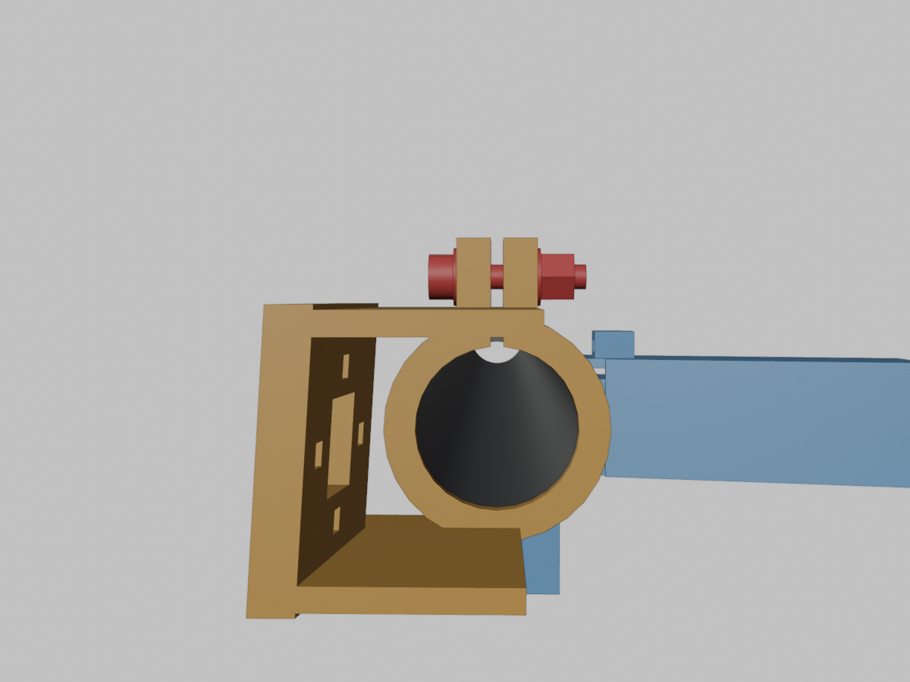
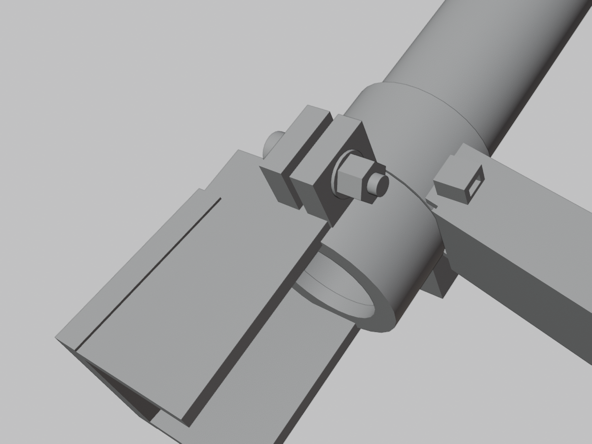
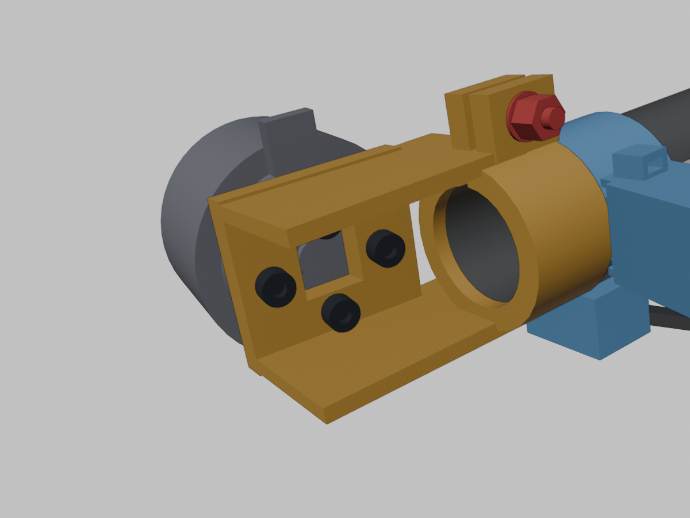
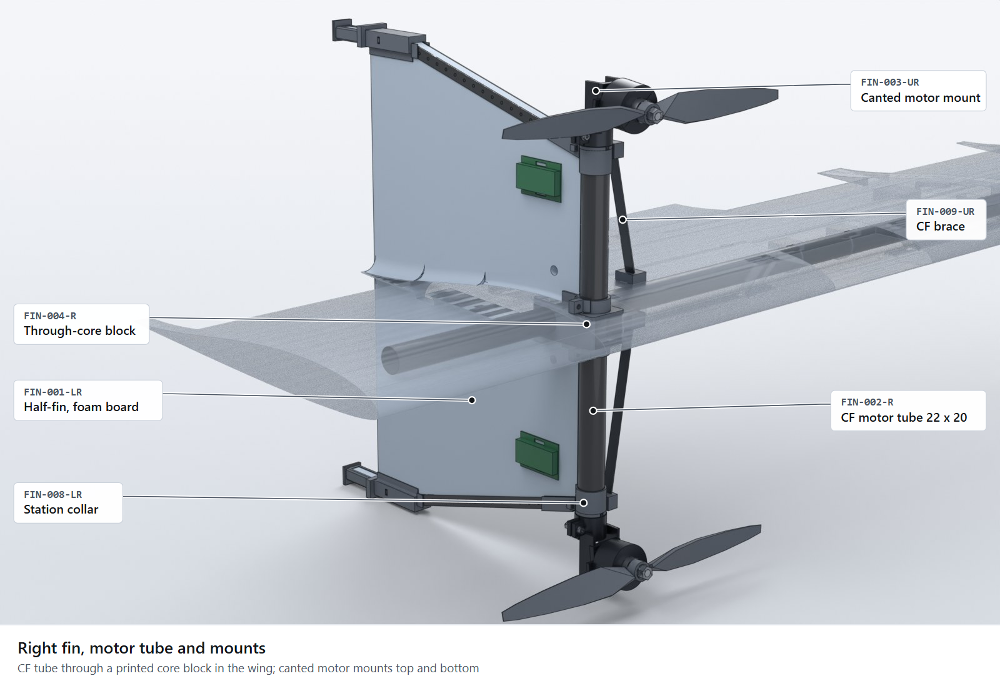

# K09-L buildability review: synthesis

Branch `redesign/v1`, frame A1-R5, 2026-11-11. This file merges five independent build reviews:
[structure and wing](STRUCTURE-WING.md) (SW), [motor mounts](MOTOR-MOUNTS.md) (MM),
[servos and controls](SERVOS-CONTROLS.md) (SC), [wiring and battery](WIRING-BATTERY.md) (WB) and
[manufacturing](MANUFACTURING.md) (MF). It answers the advisor's brief: look at how the selected concept would
actually be built (connections, motor mounts, servos, wiring, battery, wing construction, manufacturing) and find
the design problems before more CFD or FEA. The step-by-step companion is [`../BUILD-GUIDE.md`](../BUILD-GUIDE.md).

## Verdict

K09-L can be built by four students with hand tools: an XPS core, one carbon spar, foam-board fins, packing-tape
skin and small prints. No reviewer found a reason to change the configuration. The repo is not ready for the shop,
though. Two geometry errors would stop the build on day one (the fin tip and foot shoe overlap, and the motor-mount
cheek fills the clamp slit). There are no STLs, DXFs, hot-wire templates or jigs. The flight-controller stack the
pod is drawn around has never been in anyone's hands, and the Jacobs Hall Maker Pass fees are not in the budget.
Several FEA and CFD inputs rest on numbers a hand build will not hit, or on parts nobody has measured: mount
stiffness, cant and clocking tolerances, leading-edge finish, hinge gap, the fin-root notch and the wing grooves.
The latest proof re-run agrees, and it adds the most serious problem in this file: with the real landing-gear mass
counted, **the predicted CG is 1.2 mm aft of the allowed range** and the mass margin has nearly gone (BR-00). That
changes stability and therefore every downstream CFD, FEA and S&C input, so it comes first. Fix BR-00 and the
other items in "Fix before any more CFD/FEA", buy and measure the long-lead parts now, and plan first tethered
hover for build week 5.

## Blocker status (2026-11-11)

The findings below are kept as written. This table is the status of the six blockers since the review.

| Blocker | Status | Where |
|---|---|---|
| BR-00 CG aft of range | Fixed in design: predicted CG 50.2 mm in 46.6–51.4 mm. Modelled only; weigh the first feet and packs. | `params/CHANGE-LOG.md` D-75…D-78, `MASS-CG.md` |
| BR-01 fin tip vs foot shoe | Fixed in CAD: one datum, no overlap. | D-75 |
| BR-02 motor-mount slit bridged (MM-01) | Fixed in CAD: outboard cheek stops 1 mm ahead of the slit. Clocking key added for MM-02 (dog shear size still open, C6). | D-80, D-81 |
| BR-03 no shop files (MF-01) | Fixed: `manufacturing/make_shop_files.py`. The CAD defects it reported are fixed too: horn bore breakout (D-82), POD-007 sealed void, HRN-110 grommet now modelled (D-83). | `manufacturing/README.md` |
| BR-04 Maker Pass fees | **Closed 2026-11-13**: the owner pays the passes outside the $2 000; not a BOM line. Spring 2027 coverage to confirm. | `team/I1/ORDER-PLAN.md` R4 |
| BR-05 power board facts | Resolved from documents; bench check on arrival. | D-74, `subsystems/power/BOARD-CHECK.md` |

New since the review: `collision/collide.py` checks that no two parts overlap (static pose and both elevon
limits). It found 117 overlapping part pairs in the CAD. Seats (`interfaces/seats.json`) and the D-84 geometry fixes
brought that to 0.

## Top-tier problem: mass and CG now fail (BR-00)

Source: `PROOFS.md:48-60`, `STATUS.md` issue 6, `team/A3/rollup/ROLLUP.md:38-66` (re-run after
`team/D5/make_interfaces.py` put the D5-R6 feet, 69.9 g, into the roll-up). Claims failing went from 80 to 86, and
the mass and CG requirements now fail.

| Quantity | Now | Limit | Before the re-run |
|---|---|---|---|
| Basic / predicted take-off mass | 2 374 / 2 493 g | 2 600 g gate | 2 345 / 2 462 g |
| Gate margin vs the 100 g first-build overrun | 107 g (+7 %) | ≥ 100 g | +31 % |
| **Predicted CG x, 550 g pack** (`CL-A3-CG-X-PRED-RANGE`) | **52.6 mm** | 46.6–51.4 mm | 48.6 mm (inside) |
| Worst CG range use over the 546/551/590 g packs at their stations (`CL-A3-CG-X-STATIONS`) | **1.028** | ≤ 1 | — |
| Landing mass (`CL-D5-MASS-TOTAL`) | 69.9 g | 48 g allocation | 47.5 g carried |
| Gate margin with a 590 g pack (`CL-A3-GATE-MARGIN-590`) | 67 g | ≥ 100 g | 91 g |
| Heaviest pack the overrun still covers (`CL-A1-PACK-ACCEPT`) | 536 g | budget carries 550 g | 556 g |

Why it matters: the aft limit 51.4 mm is B3's 5 % static margin at 1.3 Vs (`params.json#cg.x_range_m`). A CG
aft of it is an unstable or barely stable flying wing in cruise and a different trim in hover. B1/B2 trim and
stall, B3 S&C, B4 hover trim split, the elevon hinge moments and C1 loads all use the CG. Running them on today's
CG would give answers for an aircraft that cannot be flown as designed.

Why it happened: the feet sit at x 0.311 m, 0.258 m behind the CG. Each gram there moves the CG about
**0.10 mm aft** (0.258 / 2.493). The R6 shoe grew 22 g (thicker walls, 2.8 mm rim, 25 mm engagement) to carry
the side load (BR-09), which is about 2.3 mm of CG on its own.

Options, from the A3 roll-up sensitivities (`ROLLUP.md:54-66`) and my arithmetic:

| Option | CG effect | Mass effect | Cost and catch |
|---|---|---|---|
| **A. Lighter feet**: bring the foot back to 48 g by making it the side-load fuse (BR-09), so the shoe no longer carries the full 59 N | about −2.3 mm (to ~50.3 mm, inside) | −22 g, gate margin back to ~129 g | D5 redesign, 1–2 days; C1/C4/C6 re-run on the capped load. Also fixes BR-01 and the 69.9 g FAIL. Best single lever |
| **B. Pack forward**: 0.23 mm CG per mm of pack | needs 9 mm for the 49 mm target; only **6 mm** of forward room at the nominal station (`CL-A3-PACK-FWD-ROOM`), giving about −1.4 mm | 0 g | Shorter crush block or spreader means less crash stroke (C5 must agree). Not enough alone |
| **C. Pod group forward** (822 g; 0.35 mm/mm) | 6 mm forward gives about −2 mm | 0 to a few g | Pod nose and recess CAD change; C3 pod FEA and B4 CFD re-run |
| **D. Nose ballast** (lead tape behind the nose, about 13 g per mm of CG, `team/H1/GROUND-TEST-PLAN.md:282`) | 16 g just reaches the limit; ~47 g reaches 49 mm | +16 to +47 g | Cheap in dollars, expensive in mass: 16 g takes the gate margin to ~91 g (FAIL), 47 g to ~60 g. Use it only as a field trim |
| **E. Lose aft mass**: D3 levers (fillet filler, block fill, cheeks, about −23 g), weigh every fillet batch (BR-34) | about −1 mm for 23 g at x ~0.15–0.2 m (est.) | −23 g | Some D3 levers conflict with BR-08 (collar and cheek growth) |
| **F. Motor stations forward** (0.19 mm/mm, 11 mm needed) | reaches the target | 0 g | Moves the fins, tubes and prop discs: a new aircraft for CFD and FEA. Not recommended |
| **G. Widen the CG range** | — | — | Means accepting less than 5 % static margin. Only B3 can propose it, and it was set deliberately (D-62). Not recommended |

**Recommendation:** A + B (feet back toward 48 g and the pack 6 mm forward) gives about 48.9 mm, near the middle of
the range, and returns ~22 g of mass margin. Add E for margin. Keep D as a field trim only. Decide which by
18 Dec; A1 owns the decision, D5 and A3 do the work, B3 confirms. Re-run A3, then B3, before any further CFD or
FEA.

Pack choice now pulls two ways: a heavier pack helps the CG (it sits forward) but the mass gate accepts only
536 g, below the 550 g the budget carries. Weigh the real packs (BR-27) before the A3 re-run.

## Counts

| | Blocker | Major | Minor | Total |
|---|---|---|---|---|
| Raw findings from the five reviews | 5 | 38 | 44 | 87 |
| After merging duplicates and verification | 5 | 30 | 37 | 72 |
| Plus BR-00 from the proof re-run (mass and CG FAIL) | **6** | **30** | **37** | **73** |

What changed during verification:

- **Every Blocker and Major was checked** against its cited file and line, the CAD source or a render. All were
  confirmed. None was dropped.
- **Downgraded:** MF-16 (transport-box blank 1 614 mm wide against a 1 219 mm sheet) from Major to Minor. The
  arithmetic is right (`subsystems/transport/BUILD.md:12`), but the fix is a cut pattern change and costs hours,
  not a week.
- **Reworded:** SC-06 said "the brief says the elevons work in hover". I found no such claim in the repo.
  `subsystems/flight-software/K09L.param:23` already says the elevons have no hover authority. What stays open is
  what ArduPilot does with the surfaces in Q modes and the back-transition. It remains a Major because it is a
  decision the team has to write down (see [Decisions](#decisions-the-team-must-make)).
- **Checked outside the repo:** the Jacobs Hall pages (fetched 2026-11-11) confirm a Maker Pass is $125 per
  student per semester for affiliated classes, fall access ends 18 Dec, and no hot-wire cutter or enclosed/ASA
  printer is listed.
- **Checked in code instead of the GLB:** SW-01. In `subsystems/fins/fusion/fins.py:495-501` the strap eyes run
  from the boss ring to `eye_len` 11 mm beyond it, starting at the skin surface. That puts them at |y| ≈ 0.345 m
  against a pocket edge at 0.3382 m (`subsystems/wing/SPEC.md:46`).
- **Merged:** 15 raw findings into other rows (listed in each row's ID column).
- **Not spot-checked:** the Minors. They are carried as the reviewers wrote them.

Severity: **Blocker** = the build cannot start, or the budget gate fails. **Major** = costs a week, a crash or a
re-analysis. **Minor** = fix in passing.

## Proof re-run FAILs, cross-referenced

The latest re-run (`PROOFS.md:48-60`, `STATUS.md` issue 6) lists nine real FAILs. All tie to findings here.

| Proof claim | Result | Finding |
|---|---|---|
| `CL-A3-CG-X-PRED-RANGE` predicted CG x, 550 g pack | 52.6 mm vs 46.6–51.4 mm (range use 1.51) | **BR-00** |
| `CL-A3-CG-X-STATIONS` worst range use over three packs | 1.028 vs 1 | **BR-00**, BR-27 |
| `CL-A1-PACK-ACCEPT` / `CL-E2-PACK-MASS` | 536 g accepted vs 550 g carried | **BR-00**, BR-27 |
| `CL-D3-TIP-STEP-MISMATCH` D3 fin tip vs D5-R6 step | 13 mm vs 0.5 mm | **BR-01** (SW-02, MF-08): two drawings of one fin tip |
| `CL-C4-SIM-FACE-DRAWN` fin face hot spot at the drawn D5 shoe | 10.3 vs 10 MPa | **BR-01** (computed on a shoe that overlaps the fin) and **BR-12** (paper-face peel) |
| `CL-D5-MASS-TOTAL` landing mass, D5-R6 shoe | 69.9 g vs 48 g | **BR-01** and **BR-09**: the R6 shoe grew to carry the side load that SW-03 says should be capped by a fuse |
| `CL-C4-SIM-SEP` fin station mode separation | 0.181 vs 0.20 | **BR-06** (MM-07): it rests on an estimated mount stiffness, and **BR-02** changes that stiffness |
| `CL-A3-GATE-MARGIN-590` gate margin with a 590 g pack | 67 g vs 100 g (was 91 g) | **BR-00**, **BR-27** (WB-06, WB-16): weigh the real packs now and set an accepted pack mass |

## Fix before any more CFD/FEA

These change a simulation input. Running the sims again first would waste the run.

| # | Finding | What to fix | Sim affected |
|---|---|---|---|
| 0 | **BR-00** CG 1.2 mm aft, mass margin thin | Pick the CG fix (lighter feet + pack forward recommended), re-run A3, then B3 | Everything that uses the CG: B1/B2 trim and stall, B3 S&C, B4 hover trim, hinge moments, C1 loads |
| 1 | **BR-01** fin tip vs shoe | A1 picks one tip (x 0.2746 or 0.2616). D3 and D5 redraw to it. Re-derive the shoe bond area and the pin row | C4 fin-station re-solve (CR-C6-38), C6 shoe bond, D5 foot FEA |
| 2 | **BR-02** mount slit closed by the cheek | Cut the 1.5 mm slit through the whole body after the union in `fins.py` | Mount clamp FEA, `CL-D3-SLIP-*`, C4 mount rocking stiffness, C6 `E-FIN-05…08` |
| 3 | **BR-06** mount stiffness is an estimate | Print one fixed mount and run `T-C4-MOUNT-STIFF` cold and at 66 °C | C4 modal and Campbell (now 0.181 vs 0.20) |
| 4 | **BR-09** foot side load has no fuse | Decide whether the foot is the side-load fuse and at what load | C1/C4/C6 side-load case (D-65), D5 mass |
| 5 | **BR-08** fin joint chain | Freeze collar height, strip tail and pins in one params value after BR-09 | C4/C6 joint model, `CL-C6-COLLAR-RF` |
| 6 | **BR-10** lower fin-root notch | Model the 24 × 12 mm notch and fillet gap in the lower root | C4 fin root under D-65 and 1.5 m/s landing |
| 7 | **BR-11** wing grooves | Add the ESC grooves, slot cap seam and JR recess to C2's mesh | C2 wing FEA, D-68 re-run (CR-D1-14) |
| 8 | **BR-12** board peel and 3M 77 laminate | Peel coupon and laminate short-beam test; model the glue line | C4 laminate interface, C6 peel allowable |
| 9 | **BR-07**, **BR-13**, **BR-14** tolerances | Give analysts as-built bands: cant ±1°, tube ±0.5°, LE radius ±0.5 mm, TE 0.6–1.0 mm | B4 blade clearance, B3/B4 thrust-line trim and yaw, B2 stall (+0.05 % margin) |
| 10 | **BR-16**, **BR-15**, SC-14, BR-28 | Model the as-built hinge gap and panel twist. Run no hover wash-on-elevon case. Check the ESC caps are in the CFD body list | Elevon CFD, back-transition S&C, B4 body list |

Also feeds analysis, lower priority: BR-05 (pod deck may grow 10 mm, C3 and A3), BR-26 (the 1.94 N·m unplug load
case goes away), BR-18 (add a prop-strike tip-over case), BR-19 (motor-to-plate joint stiffness), BR-22 (rod
misalignment preload), BR-34 (fillet mass and CG), SW-10 (C3 bridge boundary condition).

## Fix before ordering or cutting

| Finding | Action | When |
|---|---|---|
| **BR-04** Maker Pass | Ask the instructor or Jacobs now whether the capstone counts as an affiliated class with comped passes. If the team pays, $500 has to come from somewhere | This week |
| **BR-05** CoreWing V2 | Buy one board now (A01, $67, already in the BOM). Caliper both boards, map S1–S12, Vx, current sense and the battery pads. Then freeze the pod deck. Decide the UBEC at the same bench session | Before the mid-December order |
| **BR-20** motor bolt pattern | Buy one X3108S now (or get the drawing from SunnySky). Check the pattern fits y ≤ 17.5 mm. Never drill through the motor | Before printing mounts |
| **BR-21** prop adapters | LH/RH set is out of stock. Find a matched set whose post leaves ≥ 2 threads past an M6 nyloc | With the early order |
| SC-09 servo dimensions | Buy the three servos first, measure, then print frames and cut pockets | Before cutting servo pockets |
| WB-18 ESC firmware | Buy one ESC 4-pack, identify the MCU, flash Bluejay, check bidirectional DShot over 0.7 m | Before the December order |
| BR-27 packs | Buy both packs, weigh, caliper the leads, measure IR | Early order |
| **BR-29**, **BR-30** Jacobs gaps | Treat the hot-wire gear (X11, $62.54) as bought. Find an enclosed printer for ASA or get C4 sign-off on PETG/CF-PETG | Before 18 Dec |
| **BR-01**, **BR-02**, **BR-17** geometry | Print no shoes, collars, mounts or blocks, and cut no fin tips, until these are fixed in CAD | Before any flight print |
| **BR-03** shop outputs | One owner writes the per-part STL, DXF, template and jig exporter | Start this week |
| **BR-33** spares | Decide on a second spar-bonded core and a spare spar/tube before the Aloft order | Before the Aloft cart |
| **BR-32** consumables | I1 adds a consumables group from the BUILD.md tool rows and re-runs the gate | Before the December order |

## Fix during the build

These do not change sims or orders. Each is a note in [`../BUILD-GUIDE.md`](../BUILD-GUIDE.md) at the step
where it applies: BR-19 spreader plate under the motor screws, BR-22 slip-fit the outboard horn, BR-23 pre-pinned
spare servo leads, BR-16 two-sided hinge tape, BR-24 one traveler, BR-26 AS150U on a pigtail and the new arming
card, BR-27 per-pack spacer kits, BR-28 named 35 V caps bedded in silicone, BR-34 weigh every fillet batch, and
the Minors (service loops, groove depth sled, torque driver, prop balancing, pitot coupler colours, post-cure tent).

## Master table: Blockers and Majors, ranked

Ranked by how much later work each one blocks. Owner roles are the team role codes in `TEAM.md`. "G" is the
manufacturing role group (G1–G4), which has no owner yet. Costs marked "est." are reviewer estimates and are not
in the repo.

| ID | Sev. | Area | Problem | Evidence | Sim impact | Fix | Owner | Cost / time |
|---|---|---|---|---|---|---|---|---|
| BR-00 (proof re-run) | **Blocker** | Mass and CG | With the real 69.9 g feet, predicted CG is 52.6 mm vs 46.6–51.4 mm; worst pack range use 1.028; 590 g pack margin 67 vs 100 g; accepted pack 536 g vs 550 g carried | `PROOFS.md:52-56`; `team/A3/rollup/ROLLUP.md:44,66` | **Yes**: every CG-dependent sim | Lighter feet via BR-09 + pack 6 mm forward; aft-mass levers; ballast as field trim only. See [BR-00](#top-tier-problem-mass-and-cg-now-fail-br-00) | A1, D5, A3, B3 | D5 1–2 days; A3/B3 re-runs; $0 |
| BR-01 (SW-02, MF-08) | **Blocker** | Fin tip / foot shoe | Landing R6 puts the tip step at x 0.2616; fins BUILD, params and CAD strips end at 0.2746. The CAD shoe overlaps the fin board. The pins reach x 0.264, past the R6 strip end. Proof: 13 mm vs 0.5 mm, face 10.3 vs 10 MPa, foot mass 69.9 vs 48 g | `landing/BUILD.md:19`; `fins/BUILD.md:23,66,85-87`; `landing/SPEC.md:69` admits the overlap; CR-D5-31 absent from CHANGE-LOG | **Yes**: C4 station, C6 shoe bond, D5 FEA | A1 decides one tip; D3 and D5 redraw; re-derive shoe bond and pin row; then C4 re-solve | A1, D3, D5, C4 | 1–2 CAD days (est.); blocks fin and foot prints |
| BR-02 (MM-01) | **Blocker** | Motor mount `FIN-003` | The outboard cheek box spans the clamp slit and joins both pinch ears for the top 8.4 mm. The clamp cannot close as designed; slip tests on this print mean nothing. All four mounts | `fins/fusion/fins.py:549-554` (cheek), `:534-537` (slit); [render](img/mm01-mount-top-cheek-across-slit.png) | **Yes**: clamp FEA, slip claims, C4 mount stiffness | Cut the slit through the full body after the union, or stop the cheek 1 mm short of the front ear. Feeler-check one print | D3 | ~1 h CAD + 1 test print |
| BR-03 (MF-01, MF-19, MF-23) | **Blocker** | Shop outputs | No per-part STLs in print orientation, no DXF (fins, pod board), no S5010 templates, no jigs. Fusion has never run. G1–G4 have no folder. Test fixtures have no hours | `showcase/stl/` holds one mesh per subsystem; no DXF writer in any `.py`; no `team/G*` | No | `fusion/export_shop.py` on the stub/Blender backend: STL per part, DXF, template DXF from `s5010.dat`, jigs as `flight: false` parts | G (unassigned), H3 | 3–5 person-days (est.) |
| BR-04 (MF-02) | **Blocker** | Budget | Maker Pass $125 per student per semester is not in the $2 000. Four spring passes = $500 against a $17.41 margin over the $309 crash reserve | Jacobs "Get Maker Pass" page (checked); `team/I1/ORDER-PLAN.md:23`; not in `BOM.csv` | No | Ask the instructor/Jacobs about comped passes now; else the team lead decides where $500 comes from | Team lead, I1 | $0–500 |
| BR-05 (WB-01, WB-09) | **Blocker** (pod CAD freeze) | CoreWing F405 Wing V2 | The pod layout assumes the power board separates, fits 42 × 32 × 9 mm, links over GH-6 without Vx, and has a 4.5 A servo BEC. None is published; sources disagree (4 A vs 8 A BEC). The UBEC exists only because of the 4.5 A figure | `power/SPEC.md:69` (CR-F1-21); `team/F1/POWER.md`; ArduPilot and Banggood pages | **Yes**: C3 pod FEA if the deck grows 10 mm; A3 mass | Buy one board now, map it, decide split vs whole stack on gel, then freeze. Run the servo stall test on the board BEC; delete the UBEC if it holds ≥ 5.8 V | F1, F3 | $67 pulled forward (A01); 1 day; may save 16.5 g and ~$24 |
| BR-06 (MM-07) | Major | Mount rocking stiffness | C4 needs ≥ 971 N·m/rad for 0.20 separation; the input is an estimated 3 000. Proof now fails at 0.181. BR-02, BR-07 and BR-19 all change the real value | `team/C4/BOOM-STRUCTURES.md:84-94`; `PROOFS.md:54` | **Yes**: C4 modal, Campbell | Fixed mount on a 100 mm tube stub, `T-C4-MOUNT-STIFF` cold and at 66 °C, before more modal runs | C4, D3 | ½ day |
| BR-07 (MM-02, MF-07) | Major | Cant and yaw alignment | The 7° cant and yaw authority rest on friction in a hot ASA collar set at its own breakaway point. Cant ±1° tilts the blade ~2.4 mm against a 1.1 mm clearance margin. Slip spec differs: 70–80 N, 74 N, 85–100 N | `fins/BUILD.md:96-105`; `fins/SPEC.md:38`; `team/C6/JOINTS.md:102` | **Yes**: CFD thrust vector, B4 clearance re-run, FEA mount boundary | Key the mount to the station collar (dog and notch, or a shear pin sized by C6). One slip number. Printed cant gauge; tighten cant to ±0.5° | D3, C6, B4 | Reprint 4 mounts + 4 collars; ~2 h CAD; decide before fins step 13 |
| BR-08 (SW-04, SW-18, MF-13) | Major | Fin-station joint chain | Collar is 15 mm in CAD, 13 mm in D-70, 22 mm in H7. Strip tail est. RF 0.67–0.74, collar 0.77, pins est. 0.93. The strip tail is a blind 40 mm FDM slot that scrapes epoxy off; pins are drilled on a standing fin. PETG-epoxy lap coupon not run | `team/C6/JOINTS.md:125-128`; `fins/BUILD.md:68-72`; `HANDOFF.md:30` (H7) | **Yes**: C4/C6 joint model | After BR-09: one collar value in params. Coupon a tow-lashed strip end. Groove the PETG bores. Fit strips and drill pins on the bench | C6, D3, C4 | Tow ~$10 (est.); 1 coupon day; freeze by 18 Dec |
| BR-09 (SW-03) | Major | Foot side-load path | D-23 makes the mounts the crash fuse. A sideways landing instead runs pad → shoe → strips → collar → tube, through joints already below RF 1. The first break is a 24 h fin-top repair | `params/CHANGE-LOG.md:44` (D-23), D-65; `team/C6/JOINTS.md:125-132` | **Yes**: cap the C1/C4/C6 side-load case | Make the foot (piston snap or rim) the side-load fuse at a load below the fin chain's capacity, with a tethered insert | D5, C1, C4 | 1–2 days design (est.); may save the +4.4 g collar growth |
| BR-10 (SC-04) | Major | Lower fin root | The bridge rod passes a 24 × 12 mm notch in the lower root, with no fillet over x 0.2376–0.2616. That fillet already fails (RF 0.81) and the feet load this end. C4's model has the root "free" there but no cut-out | `fins/SPEC.md:41`; `fins/params.json:146`; `team/C4/fin_structures_d3.py:39` | **Yes**: C4 lower root with notch | C4 runs it first. If it fails: CF/glass patch both faces (~3 g), or one servo per panel (+32 g, +$84) | C4, D3, D6 | Analysis; patch 1 h |
| BR-11 (SW-05) | Major | Wing core at the fin station | ESC grooves 2.4–3.1 mm deep on both faces end 6 mm from the block pocket where C2's peak foam stress sits. The slot cap seam and JR recess are also not modelled | `wing/SPEC.md:41-53`; no "groove" in `team/C2/fea/*.py`; `team/C2/SIMULATION-REPORT.md:31` | **Yes**: C2 geometry | Add grooves and seam (no-tension line) before the D-68 re-run, or stop the lower grooves short with a rounded end | C2, D1, F2 | ~1 day re-mesh (est.) |
| BR-12 (SW-12) | Major | Foam-board joints | Shoe legs and fillet toes load the paper face in peel; there is no peel allowable or coupon. The 3M 77 glue line is the laminate's mid-plane, modelled as perfect | `team/C6/JOINTS.md:147,178`; `team/C4/SIMULATION-REPORT.md:29`; `fins/BUILD.md:20` | **Yes**: C4 laminate, C6 peel | Peel coupon and laminate short-beam test. Consider laminating epoxy. Wrap shoe legs and fillet toes with light glass | C6 | ½ day coupons; a few g |
| BR-13 (SW-06, MF-06) | Major | Fixtures; block clocking | The blocks rotate freely on a round spar; spec says block 1° but tube 0.5°. After the tubes go in, the wing can never lie flat again. Spar jig, G1 jig and stand are named but not designed | `fins/BUILD.md:42-43,62`; `wing/BUILD.md:46-51` | **Yes**: B3/B4 thrust-line misalignment band | Clocking jig with two 22 mm dummy tubes through both blocks; one ±0.5° tolerance; flip-able build stand on LE/TE saddles | D3, D1, G | Ply + hardware ~$30 (est.); 1–2 shop days in December |
| BR-14 (MF-05, SW-16) | Major | Wing core finish | One 1.15 m hot-wire pass; stall margin is +0.05 %; B2 says a turbulent LE costs 7 %. TE spec is "≥ 0.6 mm" with no upper bound | `wing/BUILD.md:20-23`; `README.md` stall 11.99 / 12.0 | **Yes**: B2 stall at as-built tolerance, B1 TE base drag | 2–3 practice cores; accept by template gauge; cut a 300 mm test section and measure the TE | D1, B2 | 1–2 days; XPS already in W01 |
| BR-15 (SC-06) | Major | Hover control | Elevons sit 46 mm outside the hover wash; hover is motors only. `Q_TAILSIT_GSCMSK 1` still drives the surfaces in Q modes; in the back-transition flare they regain authority under copter gains | `team/B3/S-AND-C.md:208`; `K09L.param:23,171` | **Yes**: drop any hover wash-on-elevon CFD; back-transition uses commanded deflections | Write the intent down; SITL check of QHOVER, QLAND and the flare; log servo current in first hover | F4, B3, B4 | ½ day SITL |
| BR-16 (SC-02) | Major | Elevon hinge `MEC-010` | Each panel hangs on one 25 mm strip of packing tape on the upper skin. No lower hinge, no peel test. A peeled hinge is invisible from the ground | `mechanisms/SPEC.md:54` | **Yes**: CFD should use the as-built open lower bevel | Blenderm or filament tape, two-sided figure-8 hinge; 10 min warm peel test; preflight tug test | D6 | ~$10, +1 g |
| BR-17 (SW-01) | Major | Through-core block `FIN-004` | The strap eyes reach |y| ≈ 0.345 m above and below the skin, outside the 0.3382 m pocket. Threaded on the spar, the block can go neither up nor down into the pocket | `fins/fusion/fins.py:495-501`; `wing/SPEC.md:46-47`; `fins/BUILD.md:42` | CFD: eyes and bosses stand 7.6 mm proud | Print the eyes as clips bonded on afterwards, or move them inside the pocket outline. Do not notch the core | D3 | CAD + 1 reprint |
| BR-18 (MM-05) | Major | Tip-over | Lying on its side, the props reach z 0.33 m against 0.218 m at the feet, so the props and shafts take the hit along the tube axis. The slip clamp cannot release in that direction. No spare mounts in parts.csv | `fusion/DATUMS.md:73-88`; `fins/parts.csv:4` | **Yes**: add a prop-tip impact case to mount, tube and cheek FEA | Crash disarm and landed-disarm in F4; carry 2 spare motors, 8 props, 4 spare mounts; break one mount in the tip-over direction | C5, D3, E1, F4 | +$24.99 motor, +$15.32 props |
| BR-19 (MM-03) | Major | Motor screws | M3×8 at 0.20 N·m straight onto ASA at 66 °C, no washer. ASA creeps; Loctite hides the lost preload, so the creep test can pass with zero clamp | `fins/BUILD.md:96`; `team/C6/JOINTS.md:183` | **Yes**: motor-plate stiffness in modal; head-bearing FEA | 1–1.5 mm G10/aluminium spreader under the heads; check thread length; re-run creep test without threadlocker | D3, C6 | ~$5; +1–2 g per station |
| BR-20 (MM-04) | Major | Motor bolt pattern | Pattern unpublished; plan is to "drill to the measured motor" and use "motor as template", which ruins the motor threads. Heads clear the cheeks only if the y pattern ≤ 17.5 mm | `fins/params.json:256`; `fins/BUILD.md:38-40` | **Yes** if out of envelope (prop plane x, mount FEA) | Get the pattern now; parametric plate; transfer punch or printed drill guide, no motor on the plate | E1, D3 | 0–4 reprints |
| BR-21 (MM-06) | Major | Prop retention | 0.11 mm of thread past a full nut, no locking element, active braking can back the nut off, LH/RH adapters out of stock | `propulsion/SPEC.md:22`; `propulsion/parts.csv:5` | No | Adapters with ≥ 2 threads past an M6 nyloc; nylocs on all four; witness marks | E1 | Unknown (`UNVERIFIED`) |
| BR-22 (SC-03) | Major | Bridge rod `MEC-005` | Rod bonded rigidly in both horns across two independent tape hinges. Small hinge misalignment preloads the horns (~10 N est. vs ~7 N working load). An outboard panel cannot come off without cutting the rod | `mechanisms/SPEC.md:66` (`E-MEC-19…22`) | **Yes**: misalignment preload case for horn bonds | Bond inboard only; outboard slides in a brass sleeve | D6 | $2, 15 min |
| BR-23 (SC-01) | Major | Servo field swap | Servo lead is cut and crimped after passing a 4 mm straw; a JR housing does not pass it. Lead hole is 4 mm in SPEC, 5 mm in BUILD | `harness/SPEC.md:50`; `wing/SPEC.md:49`; `wing/BUILD.md:39` | No | 8 × 4 mm lead slot (ask D1/C2), or spare servos pre-pinned without housing plus a pin tool | D6, F2, D1 | $0–5 |
| BR-24 (WB-02, MF-09, MF-22) | Major | Build order | The ten BUILD files disagree in at least eight places: ESC leads soldered to the bus bars before or after routing; grooves cut twice; servos before or after skin; "no CA on XPS" vs CA for straws; 4 vs 6 spar plugs; pod bonds to a slot fill that does not exist; mounts "bonded" though slip-clamped; render shows props in the box | `power/BUILD.md:3,29`; `harness/BUILD.md:3-6`; MF-09 list | No | One traveler (order by day and person); delete duplicate steps | G4, H3 | 1 day |
| BR-25 (WB-03) | Major | Wing-to-pod power | No disconnect between the bus bars and the ESCs. A lead fault or broken half-fin means peeling skin tape and desoldering inside the pod | `harness/SPEC.md:66`; `fins/BUILD.md` repair table | No (pod fit check) | One keyed 2-pin plug per ESC pair at the pod side exits; re-run `CL-F1-DROP-PEAK` | F2, F1 | < $15 (est.); 2 h |
| BR-26 (WB-04, WB-05) | Major | Main disconnect, post-crash kill | The AS150U is the only hardware kill, inside the hatch between the upper props. Mating force 4–8 kg goes into a cradle on nylon screws (RF 1.11 `UNVERIFIED`). The card says "plug in after the RC link is up", which is impossible. No fuse in the propulsion path, so a crushed lead is a dead short | `pod/BUILD.md:48`; `pod/SPEC.md:49`; `team/F1/POWER.md:129` | **Yes**: pod FEA unplug case goes away | AS150U on a ~0.10 m 10 AWG pigtail; rewrite the arming card; post-crash line; LiPo bag and sand in the field kit | F1, D2, H3 | $10–20 field kit; 1 h |
| BR-27 (WB-06, WB-16) | Major | Pack station and mass | Each pack has its own spacer stack (16/14/8 mm) and block (26.2/28.2/34.2 mm). The wrong set moves the CG ~3.5 mm in a 4.8 mm band. Proof: gate margin 67 g vs 100 g with a 590 g pack; accepted pack 536 g (BR-00) | `pod/BUILD.md:37`; `params.json#cg.x_range_m`; `PROOFS.md:56` | A3 CG and mass | One tethered kit per pack, colour-matched; CG balance on every pack change; weigh the real packs now and set the accepted pack mass | A3, H3 | $0 |
| BR-28 (WB-07) | Major | ESC caps, FC input cap | 680 µF cap is unnamed, 25 V on a 16.8 V pack, ripple unchecked, hanging on its legs in the prop wash. The CoreWing's own 470 µF 35 V input cap is missing | `power/params.json:34`; ArduPilot CoreWing page | **Yes**, if the caps are not in the CFD body list | Named 35 V low-ESR part; bed the can; fit the supplied 470 µF cap | F1, B4 | ~$5; +1–3 g |
| BR-29 (MF-03) | Major | Hot-wire gear | Jacobs does not list a hot-wire cutter; the order plan counts on borrowing it | Jacobs labs page (checked); `team/I1/ORDER-PLAN.md:100` | No | Send the loan request but buy X11 early; tune the bow before 18 Dec | I1, H1 | +$62.54 |
| BR-30 (MF-15) | Major | ASA printing | D-42 needs an enclosed printer; Jacobs lists none as enclosed | `fins/BUILD.md:11`; Jacobs labs page (checked) | Yes if the material changes (C4, E3) | Teammate's enclosed printer, staffed Fortus, or PETG/CF-PETG with C4 sign-off | D3, I1 | $0 to a service fee |
| BR-31 (MF-04) | Major | Shop access | Fall access ends 18 Dec; spring training runs only in the first half of term. Build starts 19 Jan | Jacobs Maker Pass page (checked) | No | All trainings, templates, bow, jigs and test articles before 18 Dec; home work over the break | Team lead | ~3 days moved into Nov–Dec |
| BR-32 (MF-11) | Major | Consumables | Missing from the BOM: TPU, 3M 77, foam-safe CA, 100 mm tape, filament tape, microballoons, ball bits, drills, Z-bend pliers, scales, heat box, extra PETG colours. One $14 "small kit" of epoxy covers everything | `BOM.csv` C05, W05, W06 | No | I1 prices a consumables group and re-runs the gate; buy epoxy by the quart | I1 | est. $80–150 (not priced in repo) |
| BR-33 (SW-11, MF-10, MF-20) | Major | Spares and repair | After the spar bond, core, blocks, tubes, fins and pod are one bonded part on ~8 serial 24 h cures. No spare spar (W03 is the bend specimen) or motor tube. Proof tests load the only airframe | `wing/BUILD.md:91`; `BOM.csv` W03/W04; `GROUND-TEST-PLAN.md` GT-08 | No | Cut and spar-bond two cores in week 1; keep #2 un-finned; re-designate W03 or buy one more tube | A1, I1, D1 | ~$125 + 2 shop days (est.) |
| BR-34 (MF-14) | Major | Fillet mass vs CG | ~112 cm³ of fillet sits aft of the CG; a heavy mix adds ~1 mm of CG shift against a 0.8 mm aft margin | `fins/BUILD.md` fillet row; `MASS-CG.md` | A3 mass, B3 CG | Weigh a cup from every batch; practise on coupons; ballast plan | D3, A3 | $0 |
| BR-35 (MF-12) | Major | Schedule | First hover in week 4 needs every print, jig and electrical sub-assembly done before 19 Jan. The wing alone has ≥ 8 serial cures before ground tests | `params.json#schedule.first_hover_week` 4 | No | Plan first tethered hover for week 5; keep week 4 as a stretch | Team lead | One week |

## Minor findings

| ID | Area | Problem | Fix |
|---|---|---|---|
| SW-07, MF-17 | Spar slot | Slot cutter undefined; fence on a curved LE; slotted core cracks if lifted | Cut in the lower bed, fence on the bed edge; never lift the slotted core |
| SW-08 | Block-to-spar bond | Two adhesives named for one joint; microballoon mix cannot fill the bore gap | Bond blocks to the spar first with silica-thickened epoxy; fix plug wording |
| SW-09 | Skin order | Skin laid last breaks round fins, braces, bosses; tab tape lands on the fillet toe | Consider skinning before tubes and half-fins, hot-knife the footprints |
| SW-10 | Pod handle bridge | Pod docs bond to a "slot fill" the wing does not have; C3 models a spar bridge | Fix pod docs; C3 re-run with the saddles as the only support |
| SW-13 | Collar tongue | FDM slots near 1 mm × 40 mm deep will not hold tolerance | Laminate first, measure, then set slot widths |
| SW-14 | Post-cure | "+4 h at 50 °C" on a whole airframe; no oven | Local heat tent with a thermocouple, or post-cure bench sub-assemblies |
| SW-15 | Pod spar ties | Ties get glued in by the spar pour | Sleeve and wax the ties |
| SW-17, MF-18 | Torque-tube groove | 1.1 mm foam left; routed on a loose panel | Route with a depth stop while the core is still in its bed |
| MM-08 | Cant docs | Propulsion SPEC issue 3 says the cant opposes the torque; CAD is right | Rewrite issue 3 |
| MM-09 | Adapter screws | 0.5 vs 0.6 N·m; hole depth measured on one motor only | One torque value; probe every motor |
| MM-10 | Field service | Motor swap needs an iron | Pre-spliced spare motor, battery iron, timed swap card |
| MM-11 | Torque method | Luggage scale is coarse at 0.2 N·m | Preset torque screwdriver |
| MM-12 | Phase leads | Bundle tied to the rotating ear, crosses the pinch bolt | Sleeve; tie to fixed structure with a service loop |
| MM-13 | Shaft E-clip | Rear opening "UNVERIFIED against the motor" | Check clip seating and clearance at incoming inspection |
| MM-14 | Vibration | Fin panel mode 21 % below 1P; no prop balancing step | Balance props; review first-hover FFT |
| SC-05 | Servo torque | Margin quoted at 6.0 V; harness gives 5.74 V (+7 %, not +11 %) | Quote at 5.74 V; fix D-50 text |
| SC-07 | Pushrod hole | 1.83 mm wire into a 1.6 mm hole | Drill #49 after checking arm holes |
| SC-08 | Throw adjustment | One clevis hole, one arm hole; 17° spline steps | Three-hole horn; centre by spline, clevis, then trim |
| SC-09 | Servo dimensions | Ear geometry is a D6 guess | Buy and measure first; test pocket in scrap foam |
| SC-10 | Servo cover | 0.8 mm cover is retainer, stop and service part; bosses split | 1.5 mm cover; stop on the frame; bigger bosses or inserts |
| SC-11 | Panel mode | ~220 Hz rod mode inside the prop band | Tap test; slow run-up with slow-motion video |
| SC-12 | Ground and tip-over | Outboard panel end 1 mm from the corner cap in a sideways tip-over | Inset the panel 10 mm or let the cap stand proud; gust lock for transport |
| SC-13 | Servo JR joint | No latch in a vibrating recess; +1 % voltage margin | Safety clip; measure rail at the servo under stall |
| SC-14 | Panel twist | CFD uses rigid panels; D6 predicts 2.8–3.0° lag | Run T-D6-TWIST before the elevon CFD re-run |
| WB-08 | Fin-root leads | No service loop where the fin is meant to move | 20–30 mm loop; silicone at the grommet |
| WB-10 | Wing grooves | 0.05–0.35 mm clearance; reel OD unmeasured | Caliper the reel; groove to OD + 0.5 mm with a sled |
| WB-11 | Voltage drop | 4.89 % vs a self-set 5 % limit | Treat as a guideline; measure `T-F1-DROP` |
| WB-12 | Compass | 0.247 interference at 100 A; chip variant unknown | Twist pairs to the exit; compassmot; check chip ID |
| WB-13 | Pitot lines | T and S can be swapped inside the hatch | Different coupler sizes or colours; blow and suck check |
| WB-14 | Pod heat | FC 68 °C sealed; ground time not modelled | Hatch open until pre-arm passes |
| WB-15 | Pack swap | Loose block and spacers fall out when standing | Lift loop; swap lying flat; edge guard |
| WB-17 | Current sense | Analog lines near the 16 AWG tunnel | Twist with ground; calibrate with motors running |
| WB-18 | ESC firmware | Bluejay layout unidentified; DShot length margin +4 % | Buy one 4-pack, flash, test before the December order |
| MF-16 (downgraded) | Transport box | Base blank 1 614 mm wide vs 1 219 mm sheet | Separate panels with taped corners |
| MF-19 | Repetitive parts | 48 pin holes and 108 cartridge sticks with no jig | Drill guide; fence and crush block |
| MF-21 | Foam board | Two board sources; slots depend on 4.8 ± 0.2 mm | One brand; measure before printing |
| MF-23 | Test fixtures | Stand, lever frame, whiffletree, CG jig have no hours | Put them in the traveler with an owner |

(MF-20, MF-22, SW-16, SW-18, WB-09 and WB-16 are merged into rows above.)

## Decisions the team must make

0. **How to bring the CG back into range** (BR-00): lighter feet and the pack forward (recommended), the pod
   forward, or ballast. A1 decides; A3 and B3 re-run before any other sim. This also settles the accepted pack mass.
1. **Hover control is motors only.** The elevons sit outside the prop wash (BR-15). Write it down, confirm in SITL
   what the surfaces do in QHOVER, QLAND and the back-transition, and stop expecting a hover elevon CFD case. If
   the team wants hover roll/pitch help from the surfaces, that needs a configuration change; gains alone will not do it.
2. **Fin tip:** D3/D-54 (step at x 0.2746) or D5-R6 (x 0.2616). Nothing on the fin or foot can be printed or cut
   until this is decided (BR-01). Owner: A1.
3. **Crash fuse philosophy.** The mounts are the fuse only for a slip about the tube. A sideways landing loads the
   fin top (BR-09) and a side tip-over hits the props (BR-18). Decide whether the foot becomes the side-load fuse
   and whether props are accepted as consumables.
4. **Spare wing core.** Build a second spar-bonded core (about $125 and 2 shop days, est.) in week 1, or accept
   that a crash in Jan–Feb ends the schedule (BR-33).
5. **Pod/wing power connector.** One plug per ESC pair at the pod exits (BR-25) costs a few grams and some
   voltage-drop margin. Without it, every fin repair is a desolder inside the pod.
6. **AS150U on a pigtail** and a rewritten arming card (BR-26).
7. **Bridge rod or four servos.** Patch the fin-root notch, or drop the rod and fit one servo per panel (+32 g,
   +$84) (BR-10, BR-22).
8. **Who pays the Maker Pass** (BR-04), and **who owns tooling** (G1–G4 have no owner, BR-03).
9. **Mount material** if no enclosed printer is found: PETG/CF-PETG needs C4 and E3 sign-off (BR-30).
10. **Design freeze on 18 Dec**: collar, pins, cheek, sleeve, mount material. Anything not frozen ships at the
    conservative option (BR-08).

## Budget impact

Baseline from `team/I1/bom_summary.json`: pessimistic reserve **$326.41**, baseline reserve $411.62, against a
**$309** crash reserve floor. Margin over the floor: **$17.41**. If every gated line were bought, the pessimistic
reserve is already **−$46.80**. (`team/I1/SUMMARY.md` still shows $319.65; the JSON is newer.)

| Item | Finding | Pessimistic cost |
|---|---|---|
| Hot-wire supply, wire, bow (gate X11 bought) | BR-29 | $62.54 |
| Second spar-bonded core kit (blocks, plugs, spare tube) | BR-33 | ~$125 (est.) |
| Spare motor + 4 flight props | BR-18 | $40.31 |
| Ply, dowels and hardware for jigs and build stand | BR-13 | ~$30 (est.) |
| Field kit: LiPo sand bucket, pin tool, housings, iron tips | BR-26, BR-23 | ~$20 (est.) |
| ESC-pair connectors | BR-25 | ~$15 (est.) |
| Hinge tape, tow, heat-tent parts | BR-16, BR-08, SW-14 | ~$30 (est.) |
| Spreader plates, caps, couplers, nylocs, ASA for spare mounts | BR-19, BR-28, WB-13, BR-21 | ~$20 (est.) |
| **Subtotal, near-certain** | | **~$343** |
| Consumables missing from the BOM | BR-32 | est. $80–150 |
| Maker Pass, 4 students | BR-04 | $0–500 |
| **Total exposure** | | **~$423 to ~$993** |

Every case exceeds the $17.41 margin. Even the near-certain subtotal is larger than the whole $326.41
pessimistic reserve. Some of it is what the crash reserve is for (the spare core, spare motor and props), so the
team should decide how much of the $309 to spend now on spares rather than hold for a crash. Ways back: comped
Maker Passes, borrowed tools (gate X10 is already assumed borrowed), dropping the UBEC and fuse if BR-05 allows
(~$24), and buying the four-servo option only if BR-10 fails. BR-00 is a mass problem. Nose ballast is a few
dollars of lead tape but 13 g per mm of CG against a 7 g mass margin above the overrun.

## Schedule impact

`params.json#schedule.first_hover_week` is 4. The reviews put the honest target at **week 5** (16–22 Feb 2027),
with week 4 as a stretch. Reasons:

- The wing path has at least eight serial 24 h cures before ground tests (BR-35, BR-33).
- Jacobs closes 18 Dec; spring training runs only in the first half of term (BR-31). Everything printable,
  every template and jig, and the electrical sub-assemblies have to be finished before 19 Jan for week 4 to hold.
- The fin-station decisions (BR-01, BR-08, BR-09) must freeze by 18 Dec, or the fin prints slip into January.
- No shop outputs exist yet (BR-03): 3–5 person-days before anything can be printed or cut.

Week 4 stays reachable only if all of that lands before 19 Jan. The week-by-week plan is in
[`../BUILD-GUIDE.md`](../BUILD-GUIDE.md#week-by-week-plan) and in [MANUFACTURING.md §5](MANUFACTURING.md#5-realistic-build-plan-week-by-week).

## Review renders

| | |
|---|---|
|    BR-02: top view of `FIN-003-UR`. The cheek (left) is joined to the collar across the slit; the pinch ears cannot close. |    BR-02: outboard-aft view of the same mount, ears and pinch bolt. |
|    BR-19: motor screws bear straight on the ASA plate; spreader plate goes between. |    BR-01, BR-08, BR-17: fin station, block, collar and mounts. |
