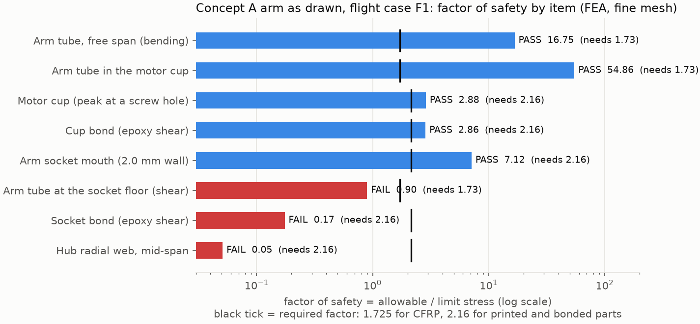
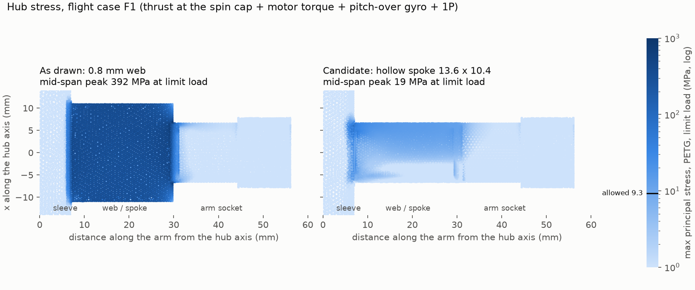

# QP-5 FEA-ARM: 3-D FEA of the concept A arm in its worst flight case

Structures engineer, 2026-11-16. Status `CALC` (finite-element analysis); nothing tested. Asked by the user: "run an FEA on
the system while it is in its most stressful flight stage ... the main part of concern would be the arm connected to the
propeller". Script `qp/A/structures/fea_arm.py` (geometry read from `cad/amodel/wing.py` and `common.py`), figures
`fea_arm_figs.py`, results `qp/A/structures/out_fea/result_*.json`.

## 1. Answer

> **Update 2026-11-17:** the hub found failing here was redesigned (D-202: continuous carbon arms, crossing hub, pins;
> D-205: mass trim). The new hub passes the same FEA: see [FEA-HUB.md](FEA-HUB.md).

- **The arm tube and the motor cup have good factors of safety in flight.** At the worst flight case (F1: thrust at the
  spin cap, motor torque, the gyroscopic moment of the pitch-over and the 1P imbalance), the 12 x 10 carbon tube carries
  20.9 MPa in its free span against 350 (factor of safety 16.7, required 1.725). The printed motor cup peaks at 7.0 MPa at a
  screw-hole edge against 20 (2.9, required 2.16). The cup bond is at 2.9. The FEA matches beam theory in the tube
  (1.246 vs 1.252 MPa per newton, 0.5 %).
- **The hub, as drawn, would fail in flight.** Each arm socket is joined to the hub's centre sleeve only by one radial web,
  0.8 mm thick and 22 mm deep (`wing.py` `hub_arm_spoke`). Because the motors are canted 17 deg about the arm, 29 % of the
  thrust pushes across the web's thin direction. FEA: 392 MPa at limit load in the middle of the web, away from any corner
  (factor of safety 0.05 against the printed-PETG allowable of 20 MPa; required 2.16); 1,170-1,440 MPa peaks where it joins
  the sleeve and the socket floor. The arm tip moves 56 mm per newton of thrust: the web works as a hinge. A hand check
  agrees (0.69 N m of cross-web bending on a 22 x 0.8 mm section: 295 MPa, plus 53 MPa from the motor torque).
- **No earlier check covered this web.** ARMS.md, `arm_cup_checks.md` and `qp5_checks.md` assumed the hub socket was held
  rigidly; their tube and cup numbers stand (the FEA confirms them), but the answer "the arms are structurally good enough"
  in ARMS.md section 1 holds only for the tube and the cup, not for the hub that carries them.
- **Because the web bends, the socket bond and the tube end are also overloaded** (bond shear 11.4 MPa against 2.0; tube
  shear at the socket floor 33.5 against 30). These fall away once the hub is stiff: with a stiffer spoke (section 4) they
  drop to 3.8 MPa and 3.6 MPa.
- **What this means for investors today:** the analysis shows the arm and motor mount are sound, and it found a hub weakness
  before anything was printed. The hub needs a redesign (section 5) and that redesign must pass this same FEA before the
  factor of safety can be claimed for the whole arm.





## 2. Model

| Item | Value | Source |
|---|---|---|
| Parts | hub bridge sleeve (r 7.2, bore 12), radial web (0.8 x 22 mm), arm socket (6.8 mm boss, 8.0 mm over the 12 mm mouth, 2 mm floor), arm tube 12 x 10 x 245 mm, motor cup (plate 33 x 33 x 5, R 6 corners, 4 holes 2.9 mm on 19 x 16, 2 head pockets, 8 mm relief, sleeve OD 19.2 / 28.5 mm) rotated by the 17 deg cant | `wing.py` constants, read by the script |
| Not modelled | phase-lead holes in the floor and plate, the lead collar, the hub conduits, the tray and struts (so the web carries every arm load: conservative), fillets (none drawn) | - |
| Bonds | tied (perfect epoxy); interface tractions reported against the bond allowable | - |
| Support | sleeve bore fixed (the bonded 12 x 10 bridge tube is about 30 x stiffer than PETG) | - |
| Load path into the cup | RBE3 from the motor base point onto the base footprint (r 13 mm `EST`) on the plate front face and the four screw-head annuli on the rear face | `arm_cup_checks.md` (heads on the rear face) |
| Materials | PETG E 2.1 GPa, nu 0.35 `EST`; CFRP transversely isotropic, E axial 70 GPa (`fe_a.py` nominal), E transverse 7, G 4 GPa, nu 0.30/0.40 `EST` | `structures/fe_a.py` |
| Allowables | CFRP axial 350, hoop 40, shear 30 MPa; printed PETG 20 MPa; epoxy bond 2.0 MPa (all `EST`, no coupon) | `structures_a.py` |
| Required factors | 1.5 x 1.15 = 1.725 on CFRP; x 1.25 more = 2.16 on printed and bonded parts | `structures_a.py` KF, KP |
| Elements | 10-node tetrahedra (gmsh 4.15, second order), 4-point Gauss; element passes the patch test (constant strain exact, rigid motion force 2e-11) | `fea_arm.py` |
| Solver | assembly in numpy / scipy; the sparse Cholesky solve in MATLAB R2025a (backslash / CHOLMOD) through binary files: scipy's SuperLU cannot hold 0.85-1.6 M unknowns, and installing a faster Python solver was not allowed in this session | `fea_arm.py` `solve()` |

## 3. Load cases (limit; the factors are applied to the stresses)

| Case | What | Values |
|---|---|---|
| F1 (worst flight) | thrust at the 0.90 spin cap + shaft torque, both signs; gyroscopic moment of the pitch-over about either axis across the shaft, both signs; 1P imbalance force at the prop plane in four directions (32 combinations, the worst kept per item) | 8.81 N, 0.130 N m (`arm_cup_checks.md`); gyro 0.156 N m = I 5.3e-5 kg m2 (prop 11.06 g as a 9 in rod + bell 25 g at 14 mm, `EST`) x 979 rad/s x pitch rate 3 rad/s (`EST`: no SITL pitch rate recorded); 1P 0.96 N (`iter3_run.md` `EST`) at 47 mm |
| F2 (fault) | as F1 with the uncapped motor | 10.38 N, 0.153 N m |
| S1-S3 (ground, not flight) | prop strike 30 N along the shaft, 30 N across at the prop plane, blade stop 30 N x 80 mm | `structures_a.py` (30 N `EST`) |

Inertia relief from the motor mass is left out (conservative).

## 4. Results (limit-load stresses, MPa; factor of safety = allowable / stress)

Fine mesh (level 1: 317,004 elements, 1.56 M unknowns), as drawn:

| Item | F1 | F2 | Allowable | FoS at F1 | Required | Result |
|---|---|---|---|---|---|---|
| Arm tube, free span (axial) | 20.9 | 24.2 | 350 | 16.7 | 1.725 | PASS |
| Arm tube in the cup (axial) | 6.4 | 7.1 | 350 | 54.9 | 1.725 | PASS |
| Motor cup, peak at a hole edge | 7.0 | 7.3 | 20 | 2.88 | 2.16 | PASS (MS +0.33) |
| Cup bond, shear | 0.70 | - | 2.0 | 2.86 | 2.16 | PASS |
| Socket mouth, 2.0 mm wall | 2.8 | 3.3 | 20 | 7.1 | 2.16 | PASS |
| Arm tube at the socket floor, shear | 33.5 | 38.1 | 30 | 0.90 | 1.725 | FAIL (follows from the web) |
| Socket bond, shear | 11.4 | 13.1 | 2.0 | 0.17 | 2.16 | FAIL (follows from the web) |
| Hub web, middle (y 12-24 mm, no corners) | 392 | - | 20 | 0.05 | 2.16 | FAIL |
| Hub web / floor / sleeve peaks at the junctions | 617-1,444 | 692-1,637 | 20 | - | - | FAIL (sharp corners: the peaks grow with refinement) |

Mesh check, coarse (level 0: 167,457 elements, 0.85 M unknowns) vs fine: tube free span 20.90 / 20.90; tip deflection
56.29 / 56.38 mm per N; cup peak 5.8 / 7.0 (a hole edge, still under the allowable at the required factor); web and junction
peaks 998-1,164 / 1,170-1,444 (corners). Equilibrium: reactions balance each unit load to 1e-6 N. Ground cases S1-S3 load the
hub several times harder than flight (S2 web 6,400 MPa coarse); they need the redesign too.

Candidate fix, coarse mesh (`--variant spoke`): the web replaced by a hollow round spoke 13.6 x 10.4 mm (the boss OD,
1.6 mm wall, its bore could carry the phase leads). Spoke middle 19.4 MPa at limit (FoS 1.03, required 2.16: still FAIL);
spoke-to-sleeve junction 102 MPa, sleeve 75 MPa (the 1.2 mm sleeve wall bends locally); socket floor 16, bond shear 3.8,
tube root 44 / 7.7 / 3.6 (axial / hoop / shear, all PASS); tip deflection 0.87 mm per N. So the spoke fixes the hinge but
is not enough on its own: the centre of the hub also has to be solid or carbon.

## 5. Proposed fixes (not decided; each needs this FEA to pass before CAD)

1. **Carbon carries the moment through the hub.** Run each pair of opposite arms (UR-LL, UL-LR, colinear through the hub
   axis) as one continuous 12 x 10 tube, offset in x so the two cross, with the printed hub only locating them. The arm
   root moments then cancel inside the carbon. Conflict to solve: the bridge tube runs along x through the hub centre and
   would cross both arm tubes; it would have to be split or moved.
2. **Printed hub sized for the moment.** A solid printed core round the bridge tube (about r 14 mm over the web depth)
   and spokes of at least 18 mm OD x 2 mm wall (section modulus about 360 mm3: about 15 MPa at ultimate, MS +0.36 by hand),
   with fillets at both ends. Hand mass about +12-15 g (`EST`): the predicted take-off mass (1,456 g) would pass the 1,470 g
   gate but not the 1,460 g target, so it needs a mass decision.
3. Whichever is chosen: a hub coupon (print one arm socket with its spoke on a sleeve, bond a tube, load the arm tip to
   8.81 N x 2.16 = 19 N across and along the cant) before the flight hub is printed.

## 6. What this does not cover

Contact and slip in the bonds, the epoxy fillet shape, print orientation (the allowable is the XY knock-down; across layers
it is 9.5 MPa, which makes the web worse), heat from the motor into the cup, fatigue (ARMS.md section 4), buckling of the
thin web (not needed: it fails in bending first), large-deflection effects (the as-drawn web deflects far outside the
linear range, so its numbers show that it fails, not by how much).

## 7. Re-run

```
python -I redesign/qp/A/structures/fea_arm.py --level 0            # as drawn, coarse (about 3 min; needs MATLAB on the PATH)
python -I redesign/qp/A/structures/fea_arm.py --level 1            # fine (about 6 min)
python -I redesign/qp/A/structures/fea_arm.py --level 0 --variant spoke
python redesign/qp/A/structures/fea_arm_figs.py
```
