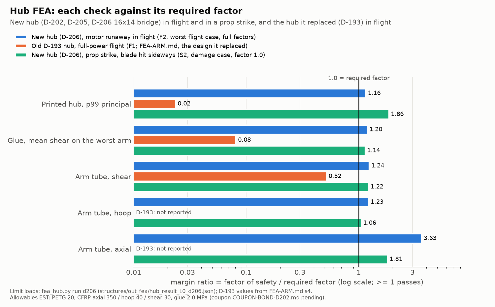
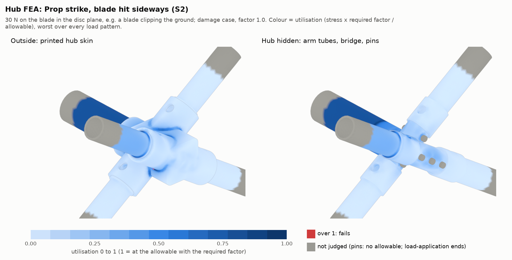

# QP-5 FEA-HUB: 3-D FEA of the concept A hub (continuous carbon arms, 16 x 14 bridge)

Structures engineer, 2026-11-17. Status `CALC` (finite-element analysis); nothing printed or tested. Follows
[FEA-ARM.md](FEA-ARM.md), which found the D-193 hub's 0.8 mm web failing in flight (factor of safety 0.05). The hub was
redesigned (D-202), moved 6 mm aft and trimmed for mass (D-205), and its bridge tube went from 12 x 10 to 16 x 14 after this
FEA's stress map showed it overloaded in torsion (D-206). Script `qp/A/structures/fea_hub.py` (geometry from
`cad/amodel/wing.py` and `common.py`), figures `fea_hub_figs.py` and `fea_hub_render_blender.py`, results
`qp/A/structures/out_fea/hub_result_L0_d206.json` (run `d205`: the 12 x 10 bridge, kept for comparison).

## 1. Answer

- **The hub passes in flight at the full safety factors.** At the worst flight case (F2: an uncapped motor fault, every
  thrust pattern), the printed hub's 99th-percentile stress is 8.0 MPa against 9.3 allowed (20 MPa / 2.156). The arm tubes
  reach 18.9 MPa hoop at the pin holes (23.2 allowed) and 14.0 MPa shear (17.4). The glue carries 0.77 MPa mean shear along
  the worst arm (0.93 allowed).
- **A 30 N prop strike is held at limit load (damage case, factor 1.0, D-202).** S2 (strike in the disc plane): tube hoop
  37.9 MPa against 40 (the tightest item), shear 24.5 against 30, axial 194 against 350, hub 99th percentile 10.8 against 20.
- **The bridge tube, found by this map and fixed (D-206).** The first map (run `d205`) showed the 12 x 10 bridge over 1 along
  most of its length: it carries the cage's roll moment in torsion (F2 shear 28.3 MPa at limit, 49 at the factor; S2 53.0;
  allowed 30). Earlier checks covered the bridge in bending only. How much the two V struts share depends on how stiff their
  printed hub sockets and spar clamps are: between about 1 % (pinned) and 60 % (rigid) for the 12 x 10 bridge
  ([bridge_torsion_d206.md](../../qp/A/structures/bridge_torsion_d206.md)), so the bridge was sized to carry it alone. A
  16 x 14 bridge (from the R02 fin-tube offcut, no purchase, +2.1 g) brings the bridge to utilisation 0.87 in F2 and 0.92 in
  S2 in this FEA (hand check 22.6 and 23.8 MPa against 30, claims `CL-A-BRIDGE-TORSION-F2` / `-S2`).
- **One input is unproven: the glue.** The strike needs a mean bond shear of 1.75 MPa and flight 0.77 x 2.156 = 1.66. The
  analysis uses 2.0 MPa (`EST`). The glue coupon ([COUPON-BOND-D202.md](../../qp/A/structures/COUPON-BOND-D202.md),
  5 push-out specimens) must show at least 2.0 MPa before the flight hub is printed.
- **Open item: the strut sockets.** If the struts take their upper-bound share of the roll moment, their printed hub sockets
  see bending (about 1.5 N m each in the strike with the 16 x 14 bridge) that no analysis has checked; they are not in this mesh.
- **Before and after:** the D-193 hub reached margin ratios of 0.02 (web), 0.08 (socket glue) and 0.52 (tube shear); the new
  hub's lowest is 1.06 (tube hoop in the strike).






Colour: utilisation = stress x required factor / allowable, enveloped over every load pattern in the case. 0 to 1 runs from
pale to dark blue; over 1 is red: the sharp inside corners where the sleeves and the bridge boss meet the centre block. They have no fillet in the CAD or the mesh, so the stress there is a singularity that grows with refinement and is judged by the 99th percentile; fillets and a refined run are the next hub step; grey is not judged (the pins, which have no allowable in the
analysis, and the 15 mm at each loaded tube end where the load is applied). The same map turns in 3-D on the Explorer's
Structures page (case buttons, part toggles, value under the cursor).

## 2. Model

- **Geometry** (D-205, D-206): two continuous 12 x 10 carbon tubes crossing at x -6.5 / +6.5 mm from the hub axis, modelled 60 mm
  each side of the hub (`S_END` 60). Printed PETG hub: 28 x 20 x 20 mm centre block with 3 mm edge radii, 1.5 mm sleeves over
  s +-24 mm, a bridge boss to the tray face (24 mm aft of the hub axis after D-205). 14 x 12 carbon doublers at s 11-25 mm
  over each lead-exit hole. Five 3 mm carbon pins along x: one through both tubes at the crossing, one per tube at s +-8 mm.
  Bridge tube 16 x 14 (D-206), axis 2 mm below the hub axis, in a boss of radius 10 mm (2 mm wall), 40 mm modelled,
  fixed at its end.
- **Mesh:** quadratic tetrahedra (tet10), 305,814 elements, 1.45 M unknowns (level 0, `MS` 1.1).
- **Materials:** PETG isotropic; CFRP tubes transversely isotropic along each tube axis (`fea_arm.py` constants); pins
  isotropic 70 GPa (`EST`). Glue is a perfect tie (the bond check reads the shear on the sleeve-tube interface).
- **Solver:** MATLAB CHOLMOD with nested-dissection ordering, 24 unit load cases (6 per motor station) combined by
  superposition. Residual 1.0e-8; reactions balance each unit load to 5.7e-10.

## 3. Load cases (limit; factors applied to the stresses)

| Case | What | Factor |
|---|---|---|
| F1 | Thrust at the spin cap, motor torque, gyroscopic pitch-over, 1P imbalance; every on/off pattern of the four motors (512 combinations) | PETG and glue 2.156, CFRP 1.725 |
| F2 | As F1 with one motor uncapped (fault) | as F1 |
| S1 | 30 N prop strike along the motor axis, on UR | 1.0 (damage case, D-202) |
| S2 | 30 N prop strike in the disc plane, four directions, on UR | 1.0 |
| S3 | Strike torque about the motor axis | 1.0 |

## 4. Results (limit-load stresses, MPa)

| Item | F1 | F2 | Allowed (flight) | S1 | S2 | S3 | Allowed (strike) | Result |
|---|---|---|---|---|---|---|---|---|
| Printed hub, p99 principal (bridge boss) | 6.8 | 8.0 | 9.3 | 13.3 | 10.8 | 2.8 | 20 | PASS |
| Printed hub, peak (bridge-tube end, sharp edge) | 22.0 | 25.3 | - | 34.9 | 39.3 | 9.9 | - | judged by p99 (peaks at sharp edges grow with refinement) |
| Glue, mean shear on the worst arm | 0.68 | 0.77 | 0.93 | 1.34 | 1.75 | 0.47 | 2.0 `EST` | PASS if the coupon shows >= 2.0 |
| Arm tube, shear | 12.1 | 14.0 | 17.4 | 20.3 | 24.5 | 7.3 | 30 | PASS |
| Arm tube, hoop | 16.5 | 18.9 | 23.2 | 24.2 | 37.9 | 10.0 | 40 | PASS (S2 the tightest item, margin ratio 1.06) |
| Arm tube, axial | 47.9 | 55.9 | 203 | 129.0 | 193.7 | 60.3 | 350 | PASS |
| Bridge tube 16 x 14, utilisation (sole support in this model) | 0.77 | 0.87 | 1.0 | 0.37 | 0.92 | - | 1.0 | PASS (D-206; 12 x 10 in run d205: 1.44 / 1.63 / 0.63 / 1.77) |
| Printed hub, skin vertices over 1 (local peaks above) | 1.5 % | 2.1 % | - | 0.7 % | 0.4 % | - | - | local; judged by the volume p99 above |
| Pins, von Mises (max) | 50.4 | 59.1 | - | 83.2 | 76.9 | 21.0 | - | no allowable set for the pin rod |

Tube values are the larger of tubes A and B; the hoop and shear peaks sit at the pin holes. With the glue released (pins
and bearing only, run `pinsrel`, 12 x 10 bridge), the strike fails (hoop 59.6, shear 37.4): the pins back up the glue, they
do not replace it. From D-205 (run `d205`) to D-206 (`d206`) only the bridge changed: the stiffer bridge takes the roll moment
with less hub rotation, so the glue and the tube shear went down, while the arm-tube hoop at the pin holes in the strike rose
from 31.8 to 37.9 and the pins from 73.7 to 76.9.

## 5. What this does not cover

- The glue allowable (coupon), the printed PETG allowable (20 MPa `EST`, 0.2 mm layers) and any layer-line weakness.
- Pin holes are drilled in the real tubes; their edge quality and any fibre damage are not modelled.
- The pin-access holes in the hub block (D-204) and the hub's strut sockets are not in the mesh.
- Fine mesh: level 0 only. The peaks at the bridge-tube end are mesh-dependent; a level-1 run of the drawn hub is next.
- Fatigue and vibration (see `fe_a.py` for the modes).
- The supports: the model is held only at the bridge-tube end. The V struts, the tray pad and inertia relief in flight
  are not modelled. The bridge is sized to carry the roll moment alone (s1); the strut sockets are an open item.

## 6. Re-run

```bash
cd redesign/qp/A/structures
python -I fea_hub.py --level 0 --tag d206 --fields --p S_END=60 SLV_W=1.5 MS=1.1
python fea_hub_figs.py --tag d206
blender -b --factory-startup -P fea_hub_render_blender.py
python fea_hub_figs.py --compose
```

The first step takes about 15 min and 25-30 GB of RAM (MATLAB); never run it alongside Blender on the 64 GB machine.
