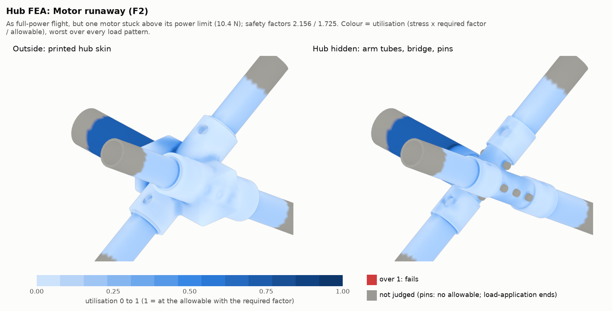

# QP-5 FEA-HUB: 3-D FEA of the concept A hub (continuous carbon arms, 16 x 14 bridge)

Structures engineer, 2026-11-17. Status `CALC` (finite-element analysis); nothing printed or tested. Follows
[FEA-ARM.md](FEA-ARM.md), which found the D-193 hub's 0.8 mm web failing in flight (factor of safety 0.05). The hub was
redesigned (D-202), moved 6 mm aft and trimmed for mass (D-205), and its bridge tube went from 12 x 10 to 16 x 14 after this
FEA's stress map showed it overloaded in torsion (D-206). D-207 filleted the hub's inside corners and seated the bridge on a
conical floor in its bore (s1a). Script `qp/A/structures/fea_hub.py` (geometry from
`cad/amodel/wing.py` and `common.py`), figures `fea_hub_figs.py` and `fea_hub_render_blender.py`, results
`qp/A/structures/out_fea/hub_result_L0_d209.json` (earlier runs kept for comparison: `d205` 12 x 10 bridge, `d206` sharp
corners, `d207` fillets, `d207r` refined, `d208` bridge 1 mm short of the floor).

## 1. Answer

- **The hub passes in flight at the full safety factors.** At the worst flight case (F2: an uncapped motor fault, every
  thrust pattern), the printed hub's 99th-percentile stress is 5.9 MPa against 9.3 allowed (20 MPa / 2.156). The arm tubes
  reach 17.8 MPa hoop at the pin holes (23.2 allowed) and 12.3 MPa shear (17.4). The glue carries 0.73 MPa mean shear along
  the worst arm (0.93 allowed).
- **A 30 N prop strike is held at limit load (damage case, factor 1.0, D-202).** S2 (strike in the disc plane): tube hoop
  30.0 MPa against 40, shear 24.5 against 30 (the tightest item), axial 194 against 350, hub 99th percentile 7.7 against 20.
- **The bridge tube, found by this map and fixed (D-206).** The first map (run `d205`) showed the 12 x 10 bridge over 1 along
  most of its length: it carries the cage's roll moment in torsion (F2 shear 28.3 MPa at limit, 49 at the factor; S2 53.0;
  allowed 30). Earlier checks covered the bridge in bending only. How much the two V struts share depends on how stiff their
  printed hub sockets and spar clamps are: between about 1 % (pinned) and 60 % (rigid) for the 12 x 10 bridge
  ([bridge_torsion_d206.md](../../qp/A/structures/bridge_torsion_d206.md)), so the bridge was sized to carry it alone. A
  16 x 14 bridge (from the R02 fin-tube offcut, no purchase, +2.1 g) brings the bridge to utilisation 0.75 in F2 and 0.83 in
  S2 along its free length in this FEA (0.96 / 1.00 in a thin ring at the edge where it leaves the hub's aft face, where the
  bond ends at a sharp edge: a mesh-dependent local peak, 0.87 / 0.92 before D-207) (hand check 22.6 and 23.8 MPa against 30, claims `CL-A-BRIDGE-TORSION-F2` / `-S2`).
- **One input is unproven: the glue.** The strike needs a mean bond shear of 1.50 MPa and flight 0.73 x 2.156 = 1.57. The
  analysis uses 2.0 MPa (`EST`). The glue coupon ([COUPON-BOND-D202.md](../../qp/A/structures/COUPON-BOND-D202.md),
  5 push-out specimens) must show at least 2.0 MPa before the flight hub is printed.
- **Open item: the strut sockets.** If the struts take their upper-bound share of the roll moment, their printed hub sockets
  see bending (about 1.5 N m each in the strike with the 16 x 14 bridge) that no analysis has checked; they are not in this mesh.
- **Before and after:** the D-193 hub reached margin ratios of 0.02 (web), 0.08 (socket glue) and 0.52 (tube shear); the new
  hub's lowest is 1.22 (tube shear in the strike).

## 1a. D-207: fillets and the bridge-bore floor

The d206 map showed small red spots at the hub's sharp inside corners (sleeve to block, and the bridge-tube end). Their
stress grows with mesh refinement (a singularity), so they were judged by the 99th percentile, but they are also where a
printed part cracks first. D-207 changed the hub (CAD `wing.py`, `amodel/hub_body.py`; FEA `--p FIL=2.0 BR_CH=0.8`):

- The centre block now runs on the bridge axis (z -2 mm) to the tray face (38 mm long), replacing the separate bridge boss.
- Fillets on the concave junctions: 2.0 mm where sleeve B meets the block, 1.5 mm for sleeve A (OpenCASCADE, staged: B
  first, then A; the same geometry is the CAD's hub body). Hub 18.3 g (was 17.1 g).
- The bridge's 0.8 mm x 45 deg end chamfer (already in the CAD, D-202) now seats on a matching 45 deg cone at the bore floor.

| Run | Change | F2 hub p99 | F2 hub peak | S1 hub peak | S2 hub peak | Where the peak is |
|---|---|---|---|---|---|---|
| d206 | sharp corners | 8.0 | 25.3 | 34.9 | 39.3 | sleeve / block corners, bore floor |
| d207 | fillets 2.0 / 1.5 | 5.5 | 15.8 | 24.7 | 18.3 | bore floor (sharp 90 deg corner) |
| d207r | d207 on a refined mesh (2.4 M unknowns) | - | - | 27.7 | 18.8 | fillets converged (18.3 -> 18.8); the bore floor grows |
| d208 | bore floor rounded r 1, bridge 1 mm short of it | 6.5 | 34.0 | 56.0 | 30.6 | tube end edge: the bond alone carries the load and ends at a sharp edge |
| **d209** | **bridge seated on a 45 deg cone** | **5.7** | **19.2** | **31.6** | **18.3** | inner edge of the cone (135 deg), where the tube's 0.2 mm end face meets its chamfer |

Values in MPa (hub peak: the single highest point; p99: the bridge-end zone). d208 was worse in every case, so the bridge
seats on the floor again. d209 keeps d207's p99, glue, pin and tube values (most slightly lower) and leaves one 135 deg edge
whose peak is mesh-dependent; the real chamfer is sanded and the glue fills that edge. Rounding it too would add a run for a
value that is not used to judge the hub. The hub skin over utilisation 1 fell from 2.1 % (d206, F2) to 0.8 %, and to 0.0 %
in S2.





Colour: utilisation = stress x required factor / allowable, enveloped over every load pattern in the case. 0 to 1 runs from
pale to dark blue; over 1 is red: only a thin ring at the bridge-bore floor where the tube's chamfered end seats (s1a; a
singular edge judged by the 99th percentile); grey is not judged (the pins, which have no allowable in the
analysis, and the 15 mm at each loaded tube end where the load is applied). The same map turns in 3-D on the Explorer's
Structures page (case buttons, part toggles, value under the cursor).

## 2. Model

- **Geometry** (D-205, D-206, D-207): two continuous 12 x 10 carbon tubes crossing at x -6.5 / +6.5 mm from the hub axis, modelled 60 mm
  each side of the hub (`S_END` 60). Printed PETG hub: 38 x 20 x 20 mm centre block on the bridge axis to the tray face (24 mm aft of the
  hub axis) with 3 mm edge radii, 1.5 mm sleeves over s +-24 mm, junction fillets 2.0 / 1.5 mm (D-207). 14 x 12 carbon doublers at s 11-25 mm
  over each lead-exit hole. Five 3 mm carbon pins along x: one through both tubes at the crossing, one per tube at s +-8 mm.
  Bridge tube 16 x 14 (D-206), axis 2 mm below the hub axis, in a bore from 15 mm aft of the hub axis, its 0.8 mm x 45 deg
  end chamfer seated on a matching cone (D-207), 40 mm modelled aft of the hub, fixed at its end.
- **Mesh:** quadratic tetrahedra (tet10), 318,871 elements, 1.50 M unknowns (level 0, `MS` 1.1). Refinement check `d207r`:
  2.4 M unknowns, fillet stresses within 3 %.
- **Materials:** PETG isotropic; CFRP tubes transversely isotropic along each tube axis (`fea_arm.py` constants); pins
  isotropic 70 GPa (`EST`). Glue is a perfect tie (the bond check reads the shear on the sleeve-tube interface).
- **Solver:** MATLAB CHOLMOD with nested-dissection ordering, 24 unit load cases (6 per motor station) combined by
  superposition. Residual 1.0e-8; reactions balance each unit load to 5.7e-10.

## 3. Load cases (limit; factors applied to the stresses)

| Case | What | Factor |
|---|---|---|
| F1 | Thrust at the spin cap, motor torque, gyroscopic pitch-over, 1P imbalance; every on/off pattern of the four motors (512 combinations) | PETG and glue 2.156, CFRP 1.725 |
| F2 | As F1 with one motor uncapped (fault) | as F1 |
| S1 | 30 N prop strike along the motor axis, on UR | 1.0 (damage case, D-202) |
| S2 | 30 N prop strike in the disc plane, four directions, on UR | 1.0 |
| S3 | Strike torque about the motor axis | 1.0 |

## 4. Results (limit-load stresses, MPa)

| Item | F1 | F2 | Allowed (flight) | S1 | S2 | S3 | Allowed (strike) | Result |
|---|---|---|---|---|---|---|---|---|
| Printed hub, p99 principal (bridge end) | 4.8 | 5.7 | 9.3 | 9.2 | 7.7 | 2.1 | 20 | PASS |
| Printed hub, peak (bore-floor cone edge, s1a) | 16.4 | 19.2 | - | 31.6 | 18.3 | 4.8 | - | judged by p99 (peaks at sharp edges grow with refinement) |
| Glue, mean shear on the worst arm | 0.64 | 0.73 | 0.93 | 1.16 | 1.50 | 0.42 | 2.0 `EST` | PASS if the coupon shows >= 2.0 |
| Arm tube, shear | 10.6 | 12.3 | 17.4 | 20.9 | 24.5 | 7.3 | 30 | PASS (S2 the tightest item, margin ratio 1.22) |
| Arm tube, hoop | 15.5 | 17.8 | 23.2 | 29.7 | 30.0 | 7.8 | 40 | PASS |
| Arm tube, axial | 45.1 | 51.7 | 203 | 128.9 | 194.0 | 60.9 | 350 | PASS |
| Bridge tube 16 x 14, utilisation along its free length (x 30-50 mm; sole support in this model) | - | 0.75 | 1.0 | - | 0.83 | - | 1.0 | PASS (D-206; 12 x 10 in run d205: 1.63 F2 / 1.77 S2) |
| Bridge tube, utilisation at the hub's aft face (bond end, sharp edge) | 0.85 | 0.96 | 1.0 | 0.53 | 1.00 | - | 1.0 | local, mesh-dependent; 0.77 / 0.87 / 0.37 / 0.92 in d206 |
| Printed hub, skin vertices over 1 (local peaks above) | 0.5 % | 0.8 % | - | 0.4 % | 0.0 % | - | - | local; judged by the volume p99 above |
| Pins, von Mises (max) | 39.7 | 46.5 | - | 83.4 | 65.7 | 18.9 | - | no allowable set for the pin rod |

Tube values are the larger of tubes A and B; the hoop and shear peaks sit at the pin holes. With the glue released (pins
and bearing only, run `pinsrel`, 12 x 10 bridge), the strike fails (hoop 59.6, shear 37.4): the pins back up the glue, they
do not replace it. From D-205 (run `d205`) to D-206 (`d206`) only the bridge changed: the stiffer bridge takes the roll moment
with less hub rotation, so the glue and the tube shear went down, while the arm-tube hoop at the pin holes in the strike rose
from 31.8 to 37.9. D-207 (`d209`) brought that hoop back to 30.0 and the pins to 65.7: the longer, filleted block stiffens
the sleeves where the pins pass through.

## 5. What this does not cover

- The glue allowable (coupon), the printed PETG allowable (20 MPa `EST`, 0.2 mm layers) and any layer-line weakness.
- Pin holes are drilled in the real tubes; their edge quality and any fibre damage are not modelled.
- The pin-access holes in the hub block (D-204) and the hub's strut sockets are not in the mesh.
- Fine mesh: level 0, with one refined run (`d207r`) that confirmed the fillet stresses. The edges where the bridge seats
  and where it leaves the hub stay mesh-dependent.
- Fatigue and vibration (see `fe_a.py` for the modes).
- The supports: the model is held only at the bridge-tube end. The V struts, the tray pad and inertia relief in flight
  are not modelled. The bridge is sized to carry the roll moment alone (s1); the strut sockets are an open item.

## 6. Re-run

```bash
cd redesign/qp/A/structures
python -I fea_hub.py --level 0 --tag d209 --fields --p S_END=60 SLV_W=1.5 MS=1.1 FIL=2.0 BR_CH=0.8
python fea_hub_figs.py --tag d209
blender -b --factory-startup -P fea_hub_render_blender.py
python fea_hub_figs.py --compose
```

The first step takes about 75 min with the fillets and `--fields`, and 25-30 GB of RAM (MATLAB); never run it alongside Blender on the 64 GB machine.
