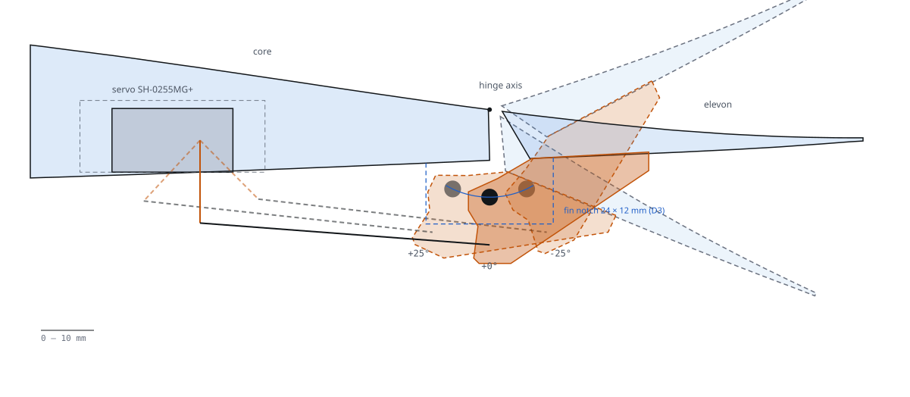

# Mechanisms (MEC)

Designer D6 · revision D6-R1 (2026-11-09, params A1-R3) · status `MODELLED` (CAD passes `check.py`, 0 errors) ·
numbers `UNVERIFIED` until the servo bench (`T-D6-THROW`, `T-B2-HINGE`).

## Purpose

Drive the four elevon panels: one servo per side moves the inboard panel through a pushrod and horn, and a rigid
1/8 in steel rod bonded in two horns carries the motion across the fin root to the outboard panel. K09-L has no tilt
mechanism; the only moving joints are the four tape hinges (declared by `wing`, designed here).

`FIG MEC-01 — Linkage at the arm plane y 0.285 m, −25 / 0 / +25°; blue: bridge-rod sweep in D3's fin notch.`

## Key numbers

| Parameter | Value | Unit | Source | Status |
|---|---|---|---|---|
| Servo | Savox SH-0255MG+, 3.9 / 3.1 kgf·cm at 6.0 / 4.8 V, 15.8 g, 12 mm thick | — | `SRC-D6-SH0255` | `UNVERIFIED` |
| Hinge moment per servo, 25° at VD 27.2 / VA 20.5 / cruise trim | 0.440 / 0.250 / 0.037 | N·m | `CL-D6-H-VD-FULL`, `-VA-FULL`, `-CRUISE` | `UNVERIFIED` |
| Servo angle for −25 / +25° surface (TE up / down) | +44.7 / −42.9 (≤ 45) | deg | `CL-D6-THROW-NEED` | `UNVERIFIED` (+1 %) |
| Linkage ratio at neutral · worst torque factor over travel | 0.612 · 0.518 | — | `CL-D6-K-NEUTRAL`, `CL-D6-TORQUE-FACTOR` | `CHECKED` |
| Servo torque required: 1.5 × H at VD, at the output | 3.49 (rating 3.9) | kgf·cm | `CL-D6-SERVO-TORQUE-REQ` | `UNVERIFIED` (+11 %) |
| Same if the linkage were 1:1 (B2's basis) | 6.73 | kgf·cm | `CL-D6-SERVO-TORQUE-1TO1` | information |
| Pushrod force at VD, full travel · Euler factor | 20.2 · 17.9 | N · — | `CL-D6-PUSHROD-F`, `-BUCKLING` | `UNVERIFIED` |
| Horn bonded area (each) vs C6 minimum | 1 385 vs 1 002 | mm² | `CL-D6-BOND-HORN`, `CL-C6-LINK-BOND-AREA-MIN` | `UNVERIFIED` (+38 %) |
| Smallest running clearance, ±30° (clevis slot; notch sides 2.2, bottom 3.5) | 1.10 (≥ 1.0) | mm | `CL-D6-CLEAR-MIN` | `CHECKED` (+10 %) |
| Surface free play, worst sum | 0.84 (≤ 1.0) | deg | `CL-D6-SLOP` | `UNVERIFIED` |
| Effectiveness loss at VA, outboard / inboard (mean lag / 25°) | 7.1 / 6.8 (≤ 10) | % | `CL-D6-EFF-LOSS-OUT`, `-IN` | `UNVERIFIED` |
| Panel twist without tube and closed skin (why MEC-009) | 16.3 | deg | `CL-D6-TWIST-FOAM-ONLY` | information |
| Servo supply needed (2 × 1.4 A × 2) vs UBEC | 5.6 vs 8.0 | A | `CL-D6-SERVO-SUPPLY` | `UNVERIFIED` |
| Mechanical stops (bevel TE down, cover slot TE up) | ±30 (software ±25) | deg | `P:mec.mech_stop_deg` | `PROPOSED` |
| Mass vs allocation | 82.3 vs 65 | g | `CL-D6-MASS` | `FAIL` → CR-D6-01 |

Calcs: `team/D6/mech_calcs.py` (four-bar from the CAD module). Local numbers: `params.json` (`mec.*`).

## Parts

| Id | Part | Qty | g each | Make / buy |
|---|---|---|---|---|
| `MEC-001-L/R` | Servo SH-0255MG+, laid on its side, shaft along y at x 0.195 | 2 | 15.80 | buy |
| `MEC-002-L/R` | Servo arm (supplied), hole drilled 1.6 mm at 15.6 mm | 2 | 0.60 | buy |
| `MEC-003-L/R` | Pushrod 2-56 steel, Z-bend at the arm, steel clevis + keeper at the horn, 54.8 mm | 2 | 1.58 | buy |
| `MEC-004-L/R` | Control horn, inboard panel, y ±0.285: clevis hole 25.5 mm and rod boss 16.5 mm below the axis | 2 | 3.48 | print PETG |
| `MEC-005-L/R` | Inter-panel rod, 1/8 in music wire, 67 mm, bonded in both bosses | 2 | 4.16 | buy |
| `MEC-006-L/R` | Link horn, outboard panel, y ±0.355 (rod boss only) | 2 | 3.08 | print PETG |
| `MEC-007-L/R` | Servo cover with arm slot (slot ends = TE-up stops) | 2 | 1.73 | print PETG |
| `MEC-008-L/R` | Servo frame: ear slots, cover bosses, bonded in the lower-skin pocket | 2 | 4.18 | print PETG |
| `MEC-009-LI/LO/RI/RO` | Torque tube CF 5 × 4 mm along each panel, 7.5 mm aft of the hinge | 4 | 3.00 | buy |
| `MEC-010-L/R` | Hinge tape, 25 mm strip per panel on the upper skin (carried) | 2 | 0.56 | buy |

## Interfaces

| Edge | With | How | Data |
|---|---|---|---|
| `E-MEC-01/02` | wing core `WNG-001` | frame bonded in the lower pocket (D1: x 0.1722–0.2075, ceiling z 0.0075) | bond ≈ 2 600 mm² |
| `E-MEC-03/04` | frame | servo ears in end-wall slots, held by the cover (`CT-SERVO-EAR-SLOT`) | retention |
| `E-MEC-35/36` | frame | cover, 2 × M2 × 6 self-tapping, from below | joint stack |
| `E-MEC-05/06` | servo | arm on the spline, supplied M2 + Loctite 222 | joint stack |
| `E-MEC-07…10` | arm, horn | Z-bend / clevis, revolute about y | motion, clearance |
| `E-MEC-11/12`, `23/24` | panels `WNG-011/012` | through-panel horns, epoxy on bare foam | bond 1 385 mm² |
| `E-MEC-19…22` | horns | rod bonded 10 mm in each boss | bond |
| `E-MEC-25…32` | panels, horns | torque tubes in routed grooves; horn blades bonded on the tubes | bond |
| `E-MEC-17/18`, `33/34` | skin `WNG-003`, core | cover edges and hinge tape | retention |
| `E-HRN-28/29` | FC (harness owns) | servo lead, 6 V rail, PWM outputs 5/6 | waiting for F2 |
| fin notch | `FIN-001-LR/LL` (D3) | rod passes the 24 × 12 mm notch, no contact | ≥ 2.2 mm |

## Mass

82.3 g against 65 g (`FAIL`, +17.3 g): servos 31.6, torque tubes 12.0 (not in the allocation), rods 8.3, frames 8.4,
horns 13.1, arms + pushrods + covers + tape 8.9. CR-D6-01 asks A1 for 83 g from the reserve; the 3/32 in rod option saves 3.6 g (loss 8.5 %).

## Open issues

| Issue | Owner | Status |
|---|---|---|
| R-SERVO-TORQUE met only at the servo output via the linkage (1:1 would need 6.7 kgf·cm) | A2 (CR-D6-07) | `PROPOSED` |
| Servo throw ±45° and ear geometry not published; throw margin 1 % | D6 (`T-D6-THROW`) | `UNVERIFIED` |
| Lower half-fin root fillet must stop at the notch, or the rod hits it | D3, C6 (CR-D6-04) | open |
| Torque-tube G (5 GPa) and closed-skin credit are estimates | D6 (`T-D6-TWIST`) | `UNVERIFIED` |
| Servo leads not yet in harness `edges` (2 WARN) | F2 (CR-D6-05) | open |
| Outboard panel rotation mode on the rod ≈ 300 Hz (hand estimate), inside the 80–330 Hz motor band | D6, H1 (tap test) | `UNVERIFIED` |

## How to verify

`python -I redesign/subsystems/mechanisms/make_mechanisms.py` → `python -I redesign/team/D6/mech_calcs.py` →
`python -I redesign/fusion/check.py` (mechanisms row: 0 errors) → bench tests `T-D6-THROW`, `T-D6-SLOP`,
`T-D6-TWIST`, `T-B2-HINGE`, `T-D6-WEIGH` (`team/D6/claims.json`).
