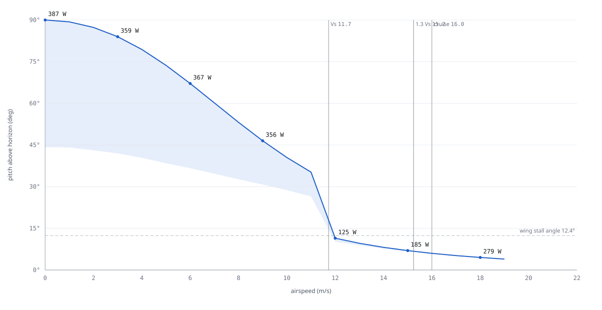
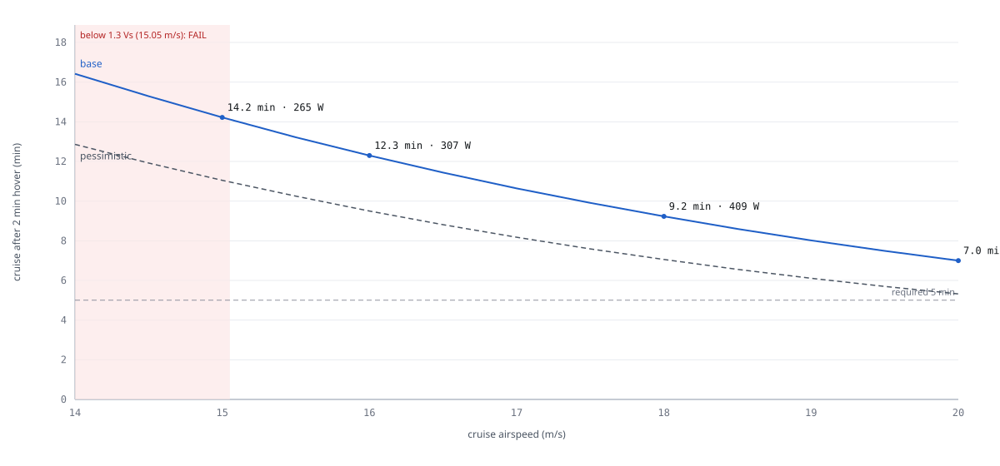

# K09-L whole-aircraft performance

Status: `PROPOSED` (B1, 2026-11-09). First-order analysis. B2 (XFOIL), B3 (AVL) and B4 (prop) inputs were not
available yet, so the marked assumptions stand in for them. Re-check: `python -I redesign/team/B1/performance.py`
then `python -I redesign/proofs/build_graph.py` (result 2026-11-09: OK, 617 nodes, no drift).

**Verdict.** The transition gate closes if cruise goes to **16 m/s**. 1.3 Vs at the 2.6 kg gate is 15.05 m/s, so
16 m/s leaves 6 % margin. **Cruise power is about 58 % above the 194 W in `params.json`.** The 11×4.5MR runs at
J ≈ 0.49 in cruise, where APC's own data gives η 0.37. At 16 m/s the aircraft draws **307 W**, which leaves
**12.3 min** of cruise after the 2 min hover (**9.3 min** in the pessimistic case). That still clears the 5 min
requirement but misses the 10 min stretch target in the pessimistic case. Hover, the transition corridor and the
5 m/s wind card all pass with margin. The wing is stalled from 0 to 11 m/s in level transition. That is acceptable
because the motors carry the aircraft at ≤ 47 % of available thrust there.

## Inputs and assumptions

| Item | Value | Unit | Source | Status |
|---|---|---|---|---|
| Mass: gate / sized / lightest flying | 2.600 / 2.482 / 2.132 | kg | `params.json#requirements`, `CL-A1-MASS-SIZED`, sized − growth | `PROPOSED` |
| Wing S, AR, e | 0.345, 3.83, 0.80 | m², —, — | `CL-A1-WING-AREA`, `params.json#wing.oswald_e` | `UNVERIFIED` (e) |
| CLmax, α₀ | 0.90, −1.0 | —, ° | `ASM-A1-CLMAX`, `ASM-B1-ALPHA0` | `UNVERIFIED` |
| Drag build-up coefficients | Cf 0.006/0.007, FF 1.25/1.20/1.30, tube Cd 0.30, IF 1.15 | — | `ASM-B1-DRAG` (K09 card, accepted by REVIEW) | `UNVERIFIED` |
| Post-stall wing | CN = 1.28 sin α, 4° e-fold from CLmax | — | `ASM-B1-CD90` (Hoerner) | `PROPOSED` |
| Prop Ct(J), Cp(J) | APC PER3 11×4.5MR, 6 000 rpm block, 30 rows | — | `ASM-B1-PROP`, `SRC-B1-APC-PER3` (read 2026-11-09) | `PROPOSED` |
| Motor Kv, Rm, I₀ | 900, 0.080, 0.6 | rpm/V, Ω, A | `ASM-B1-MOTOR` | `UNVERIFIED` |
| Chain calibration to maker table (690 gf → 89 W) | 1.18 | — | `CL-B1-KCAL` | `PROPOSED` |
| Hover download, ESC η, avionics | 1.06, 0.95, 6 | —, —, W | `params.json#propulsion.download_factor`, `ASM-B1-ESC`, `ASM-B1-AVIONICS-W` | `PROPOSED` |
| Trim drag factor | 1.05 | — | `ASM-B1-TRIM` | `PROPOSED` |
| Pessimistic case | CD0 × 1.3, η_prop × 0.85, hover × 1.10 | — | `ASM-B1-PESS` | `PROPOSED` |
| Steady thrust allowed (control reserve 20 %) | 0.80 of available, sagged | — | `ASM-B1-CTRL-RESERVE` | `PROPOSED` |
| Pack energy, reserve | 96.2, 20 % | Wh | `params.json#battery`, `#requirements` | `UNVERIFIED` (pack) |

## Aerodynamics

| Parameter | Value | Unit | Source | Status |
|---|---|---|---|---|
| CD0 (wing 0.0176 · fins 0.0174 · motor tubes 0.0185 · motors 0.0053 · pod 0.0023) | 0.061 | — | `CL-B1-CD0` | `PROPOSED` |
| Induced factor k | 0.104 | — | `CL-B1-K` | `PROPOSED` |
| Lift slope (Helmbold) | 3.81 | 1/rad | `CL-B1-CLA` | `PROPOSED` |
| Stall angle of attack | 12.5 | ° | `CL-B1-ALPHA-STALL` | `UNVERIFIED` |
| L/D max (at CL 0.77, ≈ 12 m/s) | 6.3 | — | `CL-B1-LDMAX` | `PROPOSED` |

The fins and the two motor tubes cause 59 % of CD0. The wing alone causes 29 %.

## Stall and the transition gate (closes CR-A1-05)

| Parameter | Value | Unit | Source | Status |
|---|---|---|---|---|
| Vs at 2.6 kg / 2.48 kg | 11.58 / 11.31 | m/s | `CL-B1-VS-GATE`, `CL-B1-VS-SIZED` | `UNVERIFIED` (CLmax) |
| Vs in a 30° bank at 2.6 kg | 12.44 | m/s | `CALC-B1-STALL` | `UNVERIFIED` |
| 1.3 Vs at 2.6 kg | 15.05 | m/s | `CL-B1-VT-GATE` | `UNVERIFIED` |
| Proposed cruise / margin over 1.3 Vs | 16.0 / +6 % | m/s | `ASM-B1-VCRUISE` | `PROPOSED` |
| CLmax that keeps 15 m/s cruise | ≥ 0.906 | — | `CL-B1-CLMAX-FOR-15` | `PROPOSED` |

| CLmax | Vs at 2.6 kg | 1.3 Vs | 16 m/s over 1.3 Vs |
|---|---|---|---|
| 0.80 | 12.28 m/s | 15.97 m/s | +0.2 % |
| 0.90 | 11.58 m/s | 15.05 m/s | +6.3 % |
| 1.00 | 10.98 m/s | 14.28 m/s | +12.0 % |

Raising CLmax to 0.906 would satisfy the gate arithmetically, but it leaves no room for airspeed-hold or sensor
error, and the elevon up-trim that J1 found necessary for static margin lowers CLmax. Raising cruise speed is the
robust fix. Cost: about 2 min of base cruise against 15 m/s (FIG B1-02). B2's XFOIL CLmax can bring cruise back to
15 m/s if CLmax with up-trim is ≥ 1.04, which gives 1.3 Vs ≤ 14 m/s.

## Hover

| Parameter | Value | Unit | Source | Status |
|---|---|---|---|---|
| Power at 2.6 kg / 2.48 kg (pessimistic 2.6 kg) | 380 / 355 (418) | W | `CL-B1-HOVER-P-GATE`, `CALC-B1-HOVER`, `CL-B1-HOVER-P-PESS` | `UNVERIFIED` (table is 11×4.7) |
| Current at 2.6 kg / 2.48 kg | 25.7 / 24.0 | A | `CL-B1-HOVER-I-GATE` | `UNVERIFIED` |
| Hover-only endurance at 2.6 kg, 20 % reserve | 12.2 | min | `CL-B1-HOVER-ONLY` | `UNVERIFIED` |
| Hover thrust fraction, sagged pack, with download | 0.47 | — | `CL-B1-HOVER-THROTTLE` (≤ 0.60) | `UNVERIFIED` |
| T/W with sag and download | 2.13 | — | `CL-B1-HOVER-TW-SAG` (≥ 1.6) | `UNVERIFIED` |
| APC static figure of merit (cross-check) | 0.72 | — | `CL-B1-FM` | `PROPOSED` |
| Vertical climb 2.5 m/s, power | 447 | W | `CL-B1-VCLIMB-P` | `PROPOSED` |

## Transition corridor (level flight, 2.6 kg)

`FIG B1-01 — Transition corridor, 2.6 kg. Blue line: steady level pitch, labelled with pack power. Shaded band:
pitch range that holds altitude within 80 % of available thrust (below the line the aircraft accelerates).`

| V (m/s) | Pitch, steady (°) | Pitch, lowest (°) | T/W | T / T_avail | P (W) | Wing |
|---|---|---|---|---|---|---|
| 0 | 90.0 | 33.8 | 1.06 | 0.47 | 380 | stalled |
| 3 | 84.3 | 32.3 | 1.00 | 0.44 | 353 | stalled |
| 6 | 68.2 | 29.7 | 0.94 | 0.44 | 367 | stalled |
| 9 | 48.0 | 26.5 | 0.77 | 0.42 | 375 | stalled |
| 11 | 36.6 | 23.9 | 0.65 | 0.41 | 382 | stalled |
| 12 | 11.2 | 9.7 | 0.16 | 0.13 | 164 | flying |
| 14 | 8.1 | 7.6 | 0.16 | 0.16 | 219 | flying |
| 16 | 6.0 | 5.7 | 0.18 | 0.24 | 296 | flying |
| 19 | 4.0 | 4.0 | 0.22 | 0.65 | 457 | flying |

| Corridor result | Value | Unit | Source | Status |
|---|---|---|---|---|
| Peak steady thrust fraction, 0–16 m/s | 0.47 | — | `CL-B1-CORR-THRUST` (≤ 0.80) | `PROPOSED` |
| Peak steady power, 0–16 m/s (≈ hover) | 382 | W | `CL-B1-CORR-P-PEAK` | `PROPOSED` |
| Lowest speed where the unstalled wing holds level flight | 12 | m/s | `CL-B1-V-WINGBORNE` | `UNVERIFIED` (CLmax) |
| Steady pitch jump between the stalled and flying branches (11 → 12 m/s) | 37° → 11° | ° | `CALC-B1-CORRIDOR` | `PROPOSED` |

Between 11 and 12 m/s the controller must pitch down about 25° once the wing can carry the aircraft. The pitch-over
simulation does exactly that. The flat-plate post-stall model under-predicts lift, so the real jump will be
smaller and will happen at a lower speed.

### Pitch-over (forward transition), time simulation

2-D point mass. Pitch is rate-limited and never drops below the angle at which wing lift plus 80 % of thrust can
hold altitude. Thrust holds altitude below 1.1 Vs and holds speed above it.

| Pitch rate | To 1.3 Vs | To 16 m/s | Altitude lost | Peak thrust fraction | Energy |
|---|---|---|---|---|---|
| 15 °/s | 6.0 s | 7.4 s | 0.2 m | 0.67 | 0.83 Wh |
| **20 °/s (proposed)** | **5.0 s** | **6.4 s** | **0.2 m** | **0.77** | **0.73 Wh** |
| 30 °/s | 4.0 s | 5.4 s | 0.1 m | 0.94 | 0.64 Wh |
| 50 °/s | 3.5 s | 4.9 s | 0.2 m | 1.00 (saturated) | 0.59 Wh |

Claims: `CL-B1-TRANS-TIME` 4.96 s, `CL-B1-TRANS-ALT-LOSS` 0.16 m (≤ 10 m), `CL-B1-TRANS-THRUST` 0.77 (≤ 0.80),
`CL-B1-TRANS-ENERGY` 0.73 Wh. The altitude loss assumes an ideal controller. The number to take from this table is
the thrust fraction: **at pitch rates above about 20 °/s the pitch-over uses nearly all available thrust**, because
thrust falls with inflow (at J 0.23 the prop gives 69 % of its static thrust).

## Cruise and endurance

| Parameter (16 m/s, 2.6 kg) | Value | Unit | Source | Status |
|---|---|---|---|---|
| CL, L/D | 0.47, 5.60 | — | `CL-B1-CRUISE-LD` | `PROPOSED` |
| Drag (with trim) / per prop | 4.78 / 1.19 | N | `CALC-B1-CRUISE` | `PROPOSED` |
| J, rpm, η_prop | 0.49, 6 970, 0.37 | —, rpm, — | `CL-B1-CRUISE-J`, `CL-B1-CRUISE-ETA-PROP` | `PROPOSED` |
| Pack power (pessimistic) | 307 (397) | W | `CL-B1-CRUISE-P`, `CL-B1-CRUISE-P-PESS` | `UNVERIFIED` |
| Pack power with no table calibration (optimistic) | 261 | W | `performance_results.json#sensitivity` | `PROPOSED` |
| Current | 20.7 | A | `CL-B1-CRUISE-I` | `UNVERIFIED` |
| Overall efficiency, drag power / pack power | 0.25 | — | `CALC-B1-CRUISE` | `PROPOSED` |
| Energy: usable / hover 2 min / two transitions | 77.0 / 12.7 / 1.5 | Wh | `CALC-B1-MISSION` | `PROPOSED` |
| **Cruise after 2 min hover (pessimistic)** | **12.3 (9.3)** | min | `CL-B1-CRUISE-TIME`, `CL-B1-CRUISE-TIME-PESS` (≥ 5) | `UNVERIFIED` |
| Range in that cruise | 11.8 | km | `CALC-B1-MISSION` | `PROPOSED` |

`FIG B1-02 — Cruise time after 2 min hover, 2.6 kg, 20 % reserve. Red band: speeds below 1.3 Vs, which the
transition requirement does not allow.`

| V (m/s) | 14 | 15 | 16 | 17 | 18 | 20 |
|---|---|---|---|---|---|---|
| Power, base / pessimistic (W) | 230 / 293 | 265 / 341 | 307 / 397 | 354 / 461 | 409 / 534 | 539 / 709 |
| η_prop | 0.40 | 0.38 | 0.37 | 0.36 | 0.35 | 0.34 |
| Cruise time, base / pessimistic (min) | 16.5 / 12.9 | 14.3 / 11.1 | 12.3 / 9.5 | 10.7 / 8.2 | 9.3 / 7.1 | 7.0 / 5.3 |

Power rises steeply with speed for two reasons: the airframe's minimum-power speed (≈ 10 m/s) is below stall, and
η_prop falls as J approaches the prop's zero-thrust value of 0.545. **Fly the slowest speed the transition rule
allows.**

## Climb, top speed, wind

| Parameter | Value | Unit | Source | Status |
|---|---|---|---|---|
| Fixed-wing climb at 16 m/s, 80 % thrust | 6.3 (23°) | m/s | `CL-B1-ROC-FW` | `PROPOSED` |
| Top level speed (prop thrust runs out at J 0.545) | 19.7 | m/s | `CL-B1-VMAX` (≥ 18) | `UNVERIFIED` |
| Hover lean, flat plate, 5 / 8 m/s | 14.9 / 34.2 | ° | `CL-B1-LEAN-5MS`, `CALC-B1-WIND` | `PROPOSED` |
| Hover lean with wing lift counted, 5 / 8 m/s | 15.5 / 35.4 | ° | `CL-B1-LEAN-5MS-LIFT`, `CALC-B1-CORRIDOR` | `PROPOSED` |
| Lean allowed at touchdown (tip-over 37.2° − 10° error) | 27.2 | ° | `CL-B1-LEAN-ALLOWED` | `PROPOSED` |
| Steady wind for a fin-tip landing | 7.0 | m/s | `CL-B1-WIND-HOVER-MAX` (≥ 5) | `PROPOSED` |
| Thrust fraction holding the 8 m/s gust lean | 0.57 | — | `CL-B1-GUST-8-THRUST` (≤ 0.80) | `PROPOSED` |
| Wind that tips the parked aircraft (motors off, 2.13 kg) | 9.6 | m/s | `CL-B1-GROUND-TIP-WIND` (≥ 8) | `PROPOSED` |
| Upwind ground speed at 16 m/s in 5 m/s wind | 11 | m/s | `CALC-B1-WIND` | `PROPOSED` |

The 5 m/s flight-card limit stands. The binding limit is landing (7.0 m/s steady), not thrust.

## How to verify (planned tests)

| Test | Verifies | Owner |
|---|---|---|
| `T-B1-TETHER-HOVER`: gate mass by ballast, 60 s tethered hover, pack W and throttle | hover power, throttle | H2 (after H1 thrust stand) |
| `T-B1-CRUISE-POWER`: 60 s legs at 14, 16, 18 m/s both ways, calm morning, airspeed, V, A, ESC rpm | cruise power, CD0, η_prop | H2 (twin first) |
| `T-B1-TRANSITION-LOG`: first transitions at ≥ 50 m, airspeed, pitch, altitude, throttle | corridor, pitch-over | H2, F4 SITL first |

## Limits of this analysis

- Steady 2-D model. It ignores prop normal force, edgewise inflow, slipstream over the wing and pitch-moment
  balance. The pitch moment is B3's to check: the elevons sit 0.05 m outside the prop discs and get no prop wash,
  so at low airspeed pitch control is differential thrust only.
- Hover power comes from the 11×4.7 maker table. Cruise power uses APC's predicted 11×4.5MR data, scaled by the
  same table point. The thrust stand (P13) replaces both.
- All numbers are at 2.6 kg except where marked. At the 2.48 kg sized mass, hover is 355 W and stall is 11.31 m/s.
- Outputs, tables and time histories are in `performance_results.json`.
