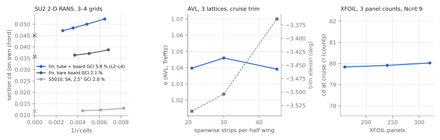
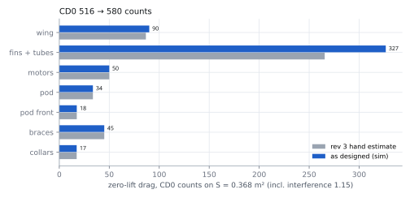
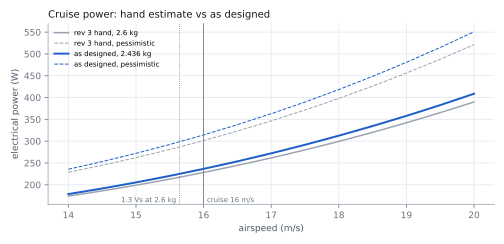
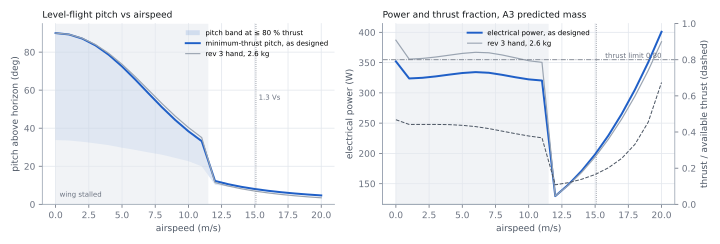
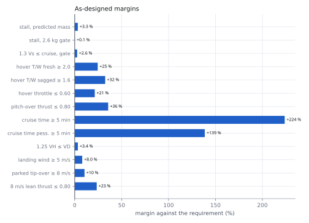

# K09-L performance on the as-designed aircraft: simulation and verification

Status: `MODELLED` (B1, simulation round, 2026-11-10). Chain claims `CL-B1V-*` are in `claims.verify.json`, and they
stay `UNVERIFIED` until the flight and stand tests in the last table close them. Re-run, in order:
`python -I redesign/team/B1/cfd_sections.py` (about 1 h on 3 × 4 threads; fin A L4 is a separate 25 min run, see the script header), then `vlm_xfoil.py`, `sim_to_params.py`
and `sim_verify.py`, all with `python -I redesign/team/B1/...`.

**Verdict.** The as-designed aircraft meets every B1 requirement, and no requirement fails. The simulations raise
CD0 by 12.5 % over the rev 3 hand estimate, from 0.0515 to **0.0579**. The cause is the fins: their square board edges
and the 22 mm motor tubes give 1.23 × the hand drag. The lower A3 mass (2.436 kg against 2.6 kg) and the
4 % lower hover power almost cancel that increase. Cruise at 16 m/s takes **235 W** (312 W pessimistic), which leaves
**16.2 min** of cruise after the 2 min hover (11.9 min pessimistic) against a 5 min requirement. Three margins are
thin and need care, though none fails:

- stall at the 2.6 kg gate is 11.99 m/s against 12.0 m/s (+0.1 %)
- 1.25 VH is 3.4 % under VD, and this holds only while F4 keeps THR_MAX at 70 %
- the fin-tip landing wind is 5.4 m/s against 5.0 m/s (+8 %)

**The committed partial results (commit a391d56) are wrong and are replaced here.** The fine fin-A grid in that run
had not converged (cd oscillating by 0.88), so it reported CD0 0.0786, 269 W and 14.1 min. This round converged
it, added a fourth fin-A level to bring its GCI from 9.8 % to 5.8 %, re-ran the wing section and corrected the
numbers.

## Inputs (as designed)

| Parameter | Value | Unit | Source | Status |
|---|---|---|---|---|
| Mass, A3 basic / predicted / gate | 2.322 / 2.436 / 2.6 | kg | `CL-A3-MASS-BASIC`, `CL-A3-MASS-PREDICTED`, `requirements.mtow_gate_kg` | `UNVERIFIED` |
| CG x, A3 predicted | 0.0536 | m | `CL-A3-CG-X-PRED` | `UNVERIFIED` |
| Wing span × chord, S5010, area | 1.15 × 0.32, 0.368 | m, m² | `params.json#wing` | `PROPOSED` |
| Fins: chord, half height, board, tube OD × length | 0.275, 0.21, 2 × 4.8, 22 × 344 | m, m, mm, mm | `subsystems/fins/params.json` R4 | `PROPOSED` |
| Motor cant | 7 | deg | `propulsion.stations.cant_deg` | `PROPOSED` |
| Fixed-wing rpm cap, THR_MAX 70 % | 7 749 | rpm | `CL-F4-FW-RPM-CAP` | `UNVERIFIED` |
| Prop, motor, ESC, sag, pack | rev 3 chain unchanged (11×5.5MR, E1 constants, sag 0.76, 4S) | — | `team/B1/claims.json` | `UNVERIFIED` |
| Air | ρ 1.225, ν 1.48e-5 | kg/m³, m²/s | `env.rho_kgm3`, `ASM-B2-NU` | `PROPOSED` |

## Tool choice

| Question | Tool | Why this fidelity |
|---|---|---|
| Wing lift, induced drag, trim, neutral point, CLmax | AVL 3.52, 3 lattices, wing + fins, trimmed at the A3 CG | Attached flow at AR 3.6: VLM is the right tool, and 3-D RANS would add cost without changing the answer |
| Wing profile drag and section CLmax | XFOIL, 3 panel counts, Ncrit 9 / 5 and tripped | Re 3.5e5 with laminar bubbles. XFOIL resolves transition, and SA RANS cannot |
| Fin + motor-tube drag (56 % of CD0) | SU2 8.5 2-D INC_RANS, SA, 3 grids per section (4 on fin A) | Square board edges, a blunt 9.6 mm base and a 22 mm tube 6 mm proud of the board all separate. XFOIL cannot run them and AVL does not see them |
| Cross-check of the SU2 set-up | SU2 S5010 at α 2.5° against XFOIL tripped | Same physics in both codes, so it tests the mesh and numerics |
| Hover, transition corridor, pitch-over, cruise, climb, wind | `performance.py` chain (BEMT-fitted APC tables, E1 motor model), re-run at the as-designed mass and polar | Mission-level integration, which no field solver provides |

No 3-D CFD was run. Junction and tip effects on the fins are bounded in the sensitivity table (fins + tubes × 1.2
moves cruise time by 0.7 min), so 3-D RANS cannot change any verdict. FEA of primary structure is outside this role:
it belongs to the C roles. B1 supplies their speed inputs (VH, VD ratio).

## Numerical verification

FIG B1-03 — Grid, lattice and panel convergence (`fig-b1-convergence.svg`)

| Section (SU2, SA, 16 m/s) | Cells L1 / L2 / L3 (/ L4) | cd L1 / L2 / L3 (/ L4) | Order p | Extrapolated cd | GCI fine | Status |
|---|---|---|---|---|---|---|
| Fin A: tube + board, 3 mm fillet, square TE | 23 623 / 42 699 / 78 374 / 146 397 | 0.05233 / 0.05001 / 0.04834 / **0.04721** | 1.3 (L2–L4) | 0.04501 | 5.8 % (L2–L4); 9.8 % on L1–L3 | `CHECKED` |
| Fin B: bare board, square LE and TE | 21 373 / 39 039 / 72 062 | 0.03873 / 0.03713 / 0.03639 | 2.6 | 0.03578 | 2.1 % | `CHECKED` |
| S5010, α 2.5° (cross-check only) | 14 621 / 26 805 / 50 506 | 0.01301 / 0.01221 / 0.01189 | 3.1 | 0.01170 | 2.0 % | `CHECKED` |

The refinement ratio is √2 in every size: surface, first cell (y+ about 1 on L2 and L3), wake box and far field
(20 c). Every case ran until rms[p] reached 1e-10, with a cd band below 0.4 % over the last 200 iterations. S5010
L1 diverged at CFL 20 and was re-run at CFL ≤ 5. Fin A L3 was run twice: the first run was interrupted at rms[p]
1e-9, which gave 0.0491 against 0.0483 converged. On L1–L3, fin A converged at a low observed order (p 1.2, GCI
9.8 %), so a fourth level (146 k cells) was added. Every level moves cd down, so the fine-grid value the chain uses
sits on the conservative (high-drag) side of the extrapolated value.

| Other numerical check | Result | Status |
|---|---|---|
| AVL, 21 / 30 / 45 strips per half wing | e 1.040 / 1.046 / 1.039 (spread 0.66 %); trim elevon −3.54 / −3.50 / −3.36° | `CHECKED` |
| XFOIL, 160 / 240 / 320 panels | cd at cruise cl 0.00798 / 0.00799 / 0.00800 (spread 0.24 %) | `CHECKED` |
| SU2 against XFOIL tripped at 2 % c, S5010 α 2.5° | cd 0.01189 against 0.01354 (-12 %), cl 0.3705 against 0.3743 (-1.0 %) | `CHECKED` |
| SU2 fin base pressure against Hoerner's blunt-base formula | base Cp −0.194 (L3) against −0.19 (0.135 / Cd_fore^(1/3), Cd_fore 0.34 on base height) | `CHECKED` |
| B1 AVL CLmax and NP against B2's simulation round | NP 0.0708 m (B1) against 0.0738 m (B2), both wing + fins, props off. The chain uses B2's table, whose CLmax at SM 0.063 is 0.787 in both the B2 rev and the sim tables | `CHECKED` |

The SU2 and XFOIL lift agree within 1 %, and the drag within the usual SA-against-e^N gap at this Reynolds number.
The fin base drag matches an independent empirical correlation. Together these give confidence in the separated-flow
fin numbers that drive the CD0 change.

## Hand calculation against as-designed simulation

FIG B1-04 — CD0 build-up, rev 3 hand vs as designed (`fig-b1-drag-breakdown.svg`)

The fins and tubes rise from 266 to 327 counts. The SU2 pressure split shows why: on the bare board, the square
front face costs 0.027 of the 0.036 section cd, and the square base 0.007. The hand model had only skin friction
with a form factor, plus a cylinder cd of 0.30 for the tube. The wing (90 counts) is within 4 % of the hand value.

| Parameter | Rev 3 hand (2.6 kg) | As designed | Change | Unit | Claim | Status |
|---|---|---|---|---|---|---|
| CD0 | 0.0515 | **0.0579** | +12.5 % | — | `CL-B1V-CD0` | `UNVERIFIED` |
| k (trimmed, AVL + XFOIL) | 0.0943 | 0.0957 (e 0.925) | +1.5 % | — | `CL-B1V-K` | `UNVERIFIED` |
| Fin + tube drag, sim / hand | 1 | 1.23 | +23 % | — | `CL-B1V-FIN-RATIO` | `UNVERIFIED` |
| L/D max / cruise L/D | 7.18 / 6.33 | 6.72 / 5.57 | −6 % / −12 % | — | `CL-B1V-LDMAX`, `CL-B1V-CRUISE-LD` | `UNVERIFIED` |
| Trimmed CLmax used (B2 at SM 0.063) / B1 critical section | 0.80 | 0.787 / 0.862 | −1.6 % | — | `CL-B1V-CLMAX`, `-CLMAX-SIM` | `UNVERIFIED` |
| Vs at 2.6 kg / at 2.436 kg | 11.91 / — | **11.99** / 11.60 | +0.7 % | m/s | `CL-B1V-VS-GATE`, `-VS-PRED` | `UNVERIFIED` |
| 1.3 Vs at 2.6 kg / at 2.436 kg | 15.48 / — | 15.58 / 15.08 | +0.6 % | m/s | `CL-B1V-VT-GATE`, `-VT-PRED` | `UNVERIFIED` |
| Hover power at 2.6 kg / at 2.436 kg (7° cant) | 387 / — | 392 / 355 | +1.4 % | W | `CL-B1V-HOVER-P` | `UNVERIFIED` |
| Hover thrust fraction, sag 0.76 (2.436 kg) | 0.50 | 0.47 | −6 % | — | `CL-B1V-HOVER-THROTTLE` | `UNVERIFIED` |
| Hover T/W, sagged / fresh (2.436 kg) | 2.00 / — | 2.12 / 2.49 | +6 % | — | `CL-B1V-HOVER-TW-SAG`, `-HOVER-TW` | `UNVERIFIED` |
| Cruise drag / power / current, 16 m/s | — / 228 / 15.4 | 4.37 / **235** / 15.9 | +3 % | N, W, A | `CL-B1V-CRUISE-DRAG`, `-P`, `-I` | `UNVERIFIED` |
| Cruise power, pessimistic / at 2.6 kg | 301 / 228 | 312 / 239 | +4 % / +5 % | W | `CL-B1V-CRUISE-P-PESS`, `-P-GATE` | `UNVERIFIED` |
| **Cruise after 2 min hover / pessimistic** | 16.3 / 12.0 | **16.2 / 11.9** | −0.5 % | min | `CL-B1V-CRUISE-TIME`, `-TIME-PESS` | `UNVERIFIED` |
| Pitch-over, 12 °/s: peak thrust fraction / time / energy / height loss | 0.59 / 7.8 / 0.88 / 0.15 | 0.52 / 7.3 / 0.83 / 0.01 | −13 % | —, s, Wh, m | `CL-B1V-TRANS-*` | `UNVERIFIED` |
| Corridor peak steady thrust fraction | 0.50 | 0.47 | −6 % | — | `CL-B1V-CORR-THRUST` | `UNVERIFIED` |
| Top level speed (C1's VH) | 25.7 at 9 350 rpm | **21.0** at THR_MAX 70 % | cap changed | m/s | `CL-B1V-VH-FW` | `UNVERIFIED` |
| 1.25 VH / VD 27.2 m/s | 1.18 | **0.967** | — | — | `CL-B1V-VH-RATIO` | `UNVERIFIED` |
| Fixed-wing climb, 16 m/s, worst pack | 13.6 | 12.0 | −12 % | m/s | `CL-B1V-ROC-FW` | `UNVERIFIED` |
| Landing wind / parked tip-over wind (lightest, 2.275 kg) | 5.77 / 8.99 | 5.40 / 8.84 | −6 % / −2 % | m/s | `CL-B1V-WIND-HOVER-MAX`, `-GROUND-TIP-WIND` | `UNVERIFIED` |

FIG B1-05 — Cruise power vs airspeed (`fig-b1-cruise-power.svg`)

## Transition corridor

FIG B1-07 — Level-flight pitch band, power and thrust fraction vs airspeed, A3 predicted mass, sag 0.76
(`fig-b1-corridor-asdesigned.svg`)

| Airspeed | Minimum-thrust pitch | Lowest pitch at 80 % thrust | Thrust fraction | Power | Wing |
|---|---|---|---|---|---|
| 0 m/s | 90.0° | 33.8° | 0.47 | 352 W | stalled |
| 6 m/s | 65.6° | 28.6° | 0.43 | 334 W | stalled |
| 11 m/s | 33.2° | 20.0° | 0.37 | 320 W | stalled |
| 12 m/s | 12.3° | 10.3° | 0.11 | 130 W | flying |
| 16 m/s (cruise) | 7.1° | 6.9° | 0.20 | 230 W | flying |
| 20 m/s | 4.7° | 4.7° | 0.67 | 401 W | flying |

The steady corridor never needs more than 0.47 of available thrust below cruise speed. The step at 11–12 m/s is
where the wing unstalls: below it the rotors carry the weight, and above it the wing does. The model's sharp CLmax
makes this step look abrupt; in flight the pitch-over passes through it dynamically in about 1 s (CL-B1V-TRANS-TIME
7.3 s in total). The 20 m/s row lies outside the transition range, close to the 21.0 m/s top speed, and is shown only for continuity.

## Sensitivity (report only, not in the chain)

| Case | CD0 | Cruise power | Cruise time / pessimistic |
|---|---|---|---|
| Baseline (claims) | 0.0579 | 235 W | 16.2 / 11.9 min |
| Fin above the tube end as in CAD (collar-capped, 83° swept top edge, 0.67 of the strip area) | 0.0548 | 230 W | 16.5 / 12.3 min |
| Fin sections at the upper end of the GCI | 0.0598 | 238 W | 16.0 / 11.7 min |
| Wing at Ncrit 5 (gusty field) | 0.0578 | 235 W | 16.2 / 11.9 min |
| Wing fully turbulent (tripped at 2 % c, no tape factor) | 0.0634 | 244 W | 15.6 / 11.4 min |
| All fins + tubes × 1.20 (3-D junctions beyond the 1.15 factor) | 0.0644 | 246 W | 15.5 / 11.3 min |

The claims keep the conservative 2-D fin-B section, which assumes a square front face over the full strip. With
every adverse case stacked (CD0 about 0.072), the pessimistic cruise time stays above 10 min against 5 min.

## Margins

FIG B1-06 — Margin of each B1 requirement, as designed (`fig-b1-margins.svg`)

| Requirement | Value | Limit | Margin | Watch |
|---|---|---|---|---|
| Stall at 2.6 kg | 11.99 m/s | ≤ 12.0 m/s | +0.1 % | The 2.6 kg gate is the stall limit: 2.605 kg reaches 12.0 m/s. A3 must not raise the gate (CR-B1-22) |
| Stall at 2.436 kg | 11.60 m/s | ≤ 12.0 m/s | +3.3 % | — |
| 1.3 Vs ≤ cruise, 2.6 kg | 15.58 m/s | ≤ 16 m/s | +2.6 % | `AIRSPEED_MIN` 15.6 stays valid |
| 1.25 VH ≤ VD | 26.3 m/s | ≤ 27.2 m/s | +3.4 % | Only with THR_MAX 70 %. Without the cap VH is 25.4 m/s, and VD must become 31.8 m/s (CR-B1-21) |
| Hover T/W, fresh / sagged | 2.49 / 2.12 | ≥ 2.0 / ≥ 1.6 | +25 % / +32 % | — |
| Hover thrust fraction, sagged | 0.47 | ≤ 0.60 | +21 % | — |
| Pitch-over peak thrust | 0.52 | ≤ 0.80 | +36 % | — |
| Cruise time / pessimistic | 16.2 / 11.9 min | ≥ 5 min | +224 % / +139 % | — |
| Fin-tip landing wind | 5.40 m/s | ≥ 5.0 m/s | +8 % | Tip-over angle 30.6° (CR-B1-14 open) |
| Parked tip-over wind | 8.84 m/s | ≥ 8.0 m/s | +10 % | — |
| Thrust to hold the 8 m/s lean | 0.61 | ≤ 0.80 | +23 % | — |
| SU2 fine-grid GCI, largest | 5.8 % (fin A, L2–L4) | ≤ 10 % | +42 % | — |

## Limits of this analysis

| Limit | Effect | Closes with |
|---|---|---|
| Fin drag from 2-D sections × 1.15 interference | Junctions, tips and the collar are 3-D. The sensitivity table bounds the effect at 0.7 min of cruise | T-B1-CRUISE-POWER legs at 14, 16 and 18 m/s |
| Props-off aerodynamics | The slipstream over the inboard wing raises lift in transition and cruise, so props-off is conservative for the corridor | F4 SITL, then transition logs |
| Sharp CLmax in the corridor model | The 11–12 m/s step is idealised | T-B2-STALL slow flight |
| The prop/motor chain is unchanged from rev 3 | Hover and VH rest on APC tables, E1 Rm and sag 0.76 | H1 stand points (CR-B1-16) |
| Fully turbulent SA on the fins | Correct for square-cut foam edges, which trip the boundary layer at the LE | — |
