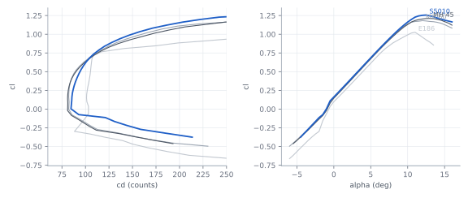
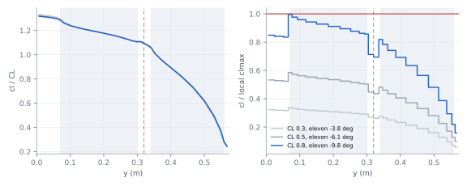
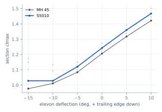
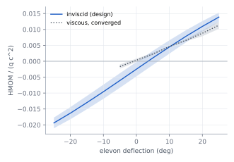

# Wing aerodynamics — K09-L (B2)

Status: `PROPOSED` (analysis complete, nothing flown). Section, planform, twist, stall progression, elevon hinge
moments and the spanwise loading that C1/C2 size the wing from. Props-off, no pod; tools XFOIL 6.99 and AVL 3.52.

**Verdict.** Use the **S5010** section (not the MH 45), keep the wing **rectangular and untwisted**, and centre the
spar on the camber line. The trimmed wing reaches **CLmax 0.80** at 5 % static margin, which puts the stall at the
2.6 kg gate at **12.25 m/s**: `R-STALL` (≤ 12 m/s) fails by 2 % and 1.3 Vs = 15.9 m/s needs a 16 m/s cruise.
The fix is a 0.32 m chord, or CLmax ≥ 0.84 (CR-B2-01). Each elevon servo needs **≥ 3.0 kgf·cm**.

## 1. Key numbers

| Parameter | Value | Unit | Source | Status |
|---|---|---|---|---|
| Section | S5010, t/c 9.82 % | — | `team/B2/airfoils/s5010.dat` | `PROPOSED` (CR-B2-02) |
| Re at stall / cruise / dive (c 0.30 m) | 2.5e5 / 3.2e5 / 4.0e5 | — | `CL-B2-RE-STALL`, ν 1.48e-5 m²/s | `UNVERIFIED` |
| Section clmax, elevon neutral, Re 2.3e5 | 1.24 | — | `P:b2.xfoil.clmax_2d_re2.3e5` | `UNVERIFIED` |
| Trimmed wing CLmax (critical section, SM 5 %) | 0.80 | — | `CL-B2-CLMAX-DESIGN` | `UNVERIFIED` (T-B2-STALL) |
| Stall at 2.6 kg / 2.48 kg | 12.25 / 11.96 | m/s | `CL-B2-STALL-GATE` | `FAIL` −2 % |
| 1.3 Vs at 2.6 kg | 15.9 | m/s | `CL-B2-TRANSITION-GATE` | `FAIL` vs 15 m/s; passes 16 m/s by 0.4 % |
| Wing lift slope (wing + fins) | 3.58 | 1/rad | `CL-B2-CLA-3D` | `UNVERIFIED` |
| Neutral point, wing + fins (no pod, props off) | 0.0695 (23.2 % c) | m | `P:b2.avl.xnp_m` | agrees with B3 0.0696 |
| CG for 5 % static margin (this model) | 0.0545 | m | Xnp − 0.05 c | B3 owns the CG range |
| Oswald factor, trimmed, wing + fins | 0.93 | — | `P:b2.avl.e_oswald` | `UNVERIFIED` |
| Elevon effectiveness η (XFOIL / thin airfoil) | 0.61 | — | `CL-B2-ELEVON-ETA` | `UNVERIFIED` |
| Viscous cm correction to AVL | −0.0103 | — | `CL-B2-DCM-VISC` | `UNVERIFIED` |
| Elevon trim, 16 m/s / at CLmax (SM 5 %) | −5.8 / −9.8 | deg | `out/avl_results.json#cg_sweep` | `UNVERIFIED` |
| Hinge moment per servo, 25°, 19.5 m/s | 0.199 | N·m | `CL-B2-HINGE-MOMENT` | `UNVERIFIED` |
| Servo stall torque required (× 1.5) | 3.04 | kgf·cm | `CL-B2-SERVO-TORQUE-REQ` | `UNVERIFIED` (T-B2-HINGE) |
| Spar centre z for equal foam cover | +6.6 | mm | `CL-B2-SPAR-Z-MID` | `UNVERIFIED` (tube OD); params z = 0 `FAIL` (CR-B2-03) |
| Twist | 0 | deg | §4 | `PROPOSED` |

## 2. Section selection

Four reflexed plank sections, same XFOIL set-up (220 panels, Ncrit 9), same AVL wing, trimmed at CG 0.060 m.
The deciding number is the **trimmed** CLmax: on a plank the elevons trim up, which costs section clmax.

| Section | clmax Re 2.3e5 | cm c/4 at cl 0.7 | cd at cl 0.3 / 0.5, Re 3e5 | Post-stall cl drop (3°) | Trimmed CLmax, wing | Elevon at CL 0.5 |
|---|---|---|---|---|---|---|
| **S5010** | **1.24** | **−0.003** | 0.0082 / 0.0088 | 0.07 | **0.856** | −4.1° |
| MH 45 (params baseline) | 1.21 | −0.007 | 0.0077 / 0.0085 | 0.12 | 0.822 | −5.0° |
| MH 60 | 1.17 | −0.011 | 0.0077 / 0.0084 | 0.06 | 0.794 | −5.7° |
| E186 | 1.01 | +0.013 | 0.0096 / 0.0098 | 0.06 | 0.772 | −1.0° |

S5010: +4 % trimmed CLmax over the MH 45 (−2 % stall speed), the softest stall of the two, less up-trim; costs
+0.0003–0.0005 cd at cruise (≈ +1 % cruise power). Same thickness, same hot-wire process. Coordinates: UIUC, t/c
checked against the published value (`SRC-B2-S5010-COORD`).

`FIG B2-01 — Section polars, Re 2.3e5, Ncrit 9; blue = S5010.`

## 3. Trimmed CLmax and stall progression

Method: AVL trims Cm = 0 with the elevons, with the XFOIL section cm added (`CL-B2-DCM-VISC`) and the elevon gain set
to η; each strip's cl is compared with the XFOIL clmax at that strip's deflection. The clmax(δ) used is the lower
of Re 2.3e5 and 3.0e5 at each δ, made non-increasing towards up-elevon (XFOIL scatter ±0.07, FIG B2-02).

| CG x (m) | Static margin | Trimmed CLmax | Elevon at CLmax | First strip to stall |
|---|---|---|---|---|
| 0.045 | 8.2 % | 0.78 | −15.3° | y 0.07 m (inboard end, inboard elevon) |
| **0.0545** | **5.0 %** | **0.80** | **−9.8°** | y 0.07 m |
| 0.060 (params target) | 3.2 % | 0.86 | −6.9° | y 0.07 m |
| 0.075 (params aft limit) | −1.8 % (unstable) | 1.02 | +3.5° | y 0.06 m |

Stall starts at the inboard end of the inboard elevon (y 0.07–0.17 m) and spreads outboard along that panel; the
unflapped centre is at 0.85, the outboard elevons at 0.3–0.8 and the tips below 0.2 of their limit when it starts (FIG B2-03). Root
first, tips last: benign, roll authority kept at the break.

`FIG B2-03 — Left: cl/CL along the half-span. Right: cl / local clmax; red = stall; shaded = elevons; dashed = fin.`

`FIG B2-02 — Section clmax vs elevon deflection; line = envelope used, dots = Re 2.3e5 / 3.0e5 runs.`

## 4. Planform and twist

| Option | Trimmed CLmax (SM 5 %) | CD at CL 0.5 | Decision |
|---|---|---|---|
| **Rectangular, 0° twist** | **0.80** | 0.0293 | **keep** |
| −2° linear washout | 0.79 | 0.0294 | no: the critical strip is inboard, washout loads it more |
| −4° linear washout | 0.77 | 0.0296 | no |

The rectangular wing already stalls at the root and carries its lift centroid at 0.424 of the semi-span
(elliptic 0.424). Washout buys nothing and costs CLmax and template complexity. Taper or sweep would cut root chord
where the pack and spar sit and break the one-piece box fit; not studied further.

## 5. Elevons (hinge moments; B3 sizes the area)

| Item | Value | Unit | Note |
|---|---|---|---|
| Hinge line | 0.78 c, upper-surface tape hinge | — | `params.json#wing.elevon` |
| XFOIL η (cm per degree vs thin airfoil) | 0.61 | — | −10…0°, cl 0.5, mean Re 2.3/3.0e5 |
| AVL control derivatives (η applied, CG 0.060) | Cm_δe −0.0052 /deg · CL_δe 0.0158 /deg · Cl_δa −0.0030 /deg · Clp −0.33 | — | inputs to B3 |
| Hinge coefficient HMOM/(q c²), ±25°, α −4…8° | 0.0211 (inviscid, design) / 0.0126 (viscous, converged, +25°) | — | FIG B2-04 |
| Per servo (two panels, 0.45 m), 19.5 m/s, q 233 Pa | 0.199 | N·m | restoring in both directions |
| Required servo stall torque (× 1.5) | 0.298 (3.04) | N·m (kgf·cm) | a 9 g micro servo (≈ 1.5–2 kgf·cm) is not enough |
| Pushrod force, 12 mm horn arm, one servo | 16.6 | N | for C6 / D6 |

Viscous up-deflection cases do not converge (the flow separates on the lower-surface kink), so the inviscid value
is the design value for both directions (`ASM-B2-HINGE-INVISCID`). Hover slipstream q (≈ 250 Pa at full thrust)
is similar to the dive case if the wash reaches the elevons; B3 finds a 49 mm gap (`CL-B3-ELEVON-WASH-GAP`).

`FIG B2-04 — S5010 hinge moment vs deflection, Re 4e5; band = α −4…8°.`

## 6. Loads inputs for C1 and C2

Trimmed, SM 5 %, per N of half-wing lift (multiply by n·m·g/2). Full strip data: `out/loads_spanwise.json`.

| y (m) | 0 | 0.05 | 0.10 | 0.20 | 0.30 | 0.32 (fin) | 0.40 | 0.50 (spar end) | 0.575 |
|---|---|---|---|---|---|---|---|---|---|
| Shear / half-lift | 1.000 | 0.886 | 0.792 | 0.596 | 0.366 | 0.328 | 0.213 | 0.040 | 0 |
| Bending (m) | 0.243 | 0.196 | 0.154 | 0.087 | 0.041 | 0.034 | 0.0135 | 0.0017 | 0 |
| Torsion about spar, nose-up + (m), CL 0.8 | 0.029 | 0.027 | 0.026 | 0.021 | 0.014 | 0.013 | 0.010 | 0.002 | 0 |
| Torsion, CL 0.3 (dive) | 0.036 | 0.034 | 0.032 | 0.025 | 0.018 | 0.017 | 0.012 | 0.003 | 0 |

| Item for C1 | Value | Unit | Source |
|---|---|---|---|
| Root bending / torsion at 1 g, 2.6 kg | 3.10 / 0.36 | N·m | `CL-B2-ROOT-BM-1G`, `CL-B2-ROOT-TORSION-1G` |
| Trimmed CLmax (manoeuvre envelope) | 0.80 | — | `CL-B2-CLMAX-DESIGN` |
| Negative section clmax | −0.38 (use −0.4) | — | `CL-B2-CLMIN-2D`; 3-D negative CLmax ≈ −0.25 `EST` |
| Wing lift slope for gusts | 3.58 | 1/rad | `CL-B2-CLA-3D` (section 6.5 /rad) |
| Broadside CN (hover, wind on the face) | 1.2 | — | flat plate AR 3.8 (Hoerner); same as `ASM-C1-CD-PLATE` |

The loading shape barely changes with CL (centroid 0.242–0.243 m from CL 0.3 to 1.0), so one shape serves all
symmetric cases. Not included: pod, prop slipstream, fin side loads (B3/B4/C4).

## 7. Spar placement

At x = 0.08 m the S5010 is +21.3 / −8.1 mm about the chord line (29.4 mm thick). A 22 mm tube on the chord line
(`params.json#wing.spar.z_m` = 0) breaks 2.9 mm through the lower skin. Centred on the camber line (z = +6.6 mm) it
has 3.7 mm of foam above and below (`CL-B2-SPAR-COVER-CENTRED`, ≥ 2 mm). The MH 45 has the same problem (z +5.0 mm).

## 8. Checks

| Check | Result |
|---|---|
| XFOIL panels 160 / 220 / 300 (MH 45, Re 3e5) | clmax 1.211 / 1.222 / 1.234 (±1 %); cm0 and cd at cl 0.5 unchanged to 1e-4 |
| AVL lattice, 3 levels (8×0.6, 12×1, 18×1.6) | CLα 3.577 / 3.582 / 3.585; Xnp 0.06948 / 0.06950 / 0.06956 m; elevon at CL 1.0 ±2 % |
| Ncrit 5 vs 9 (outdoor, tape skin), S5010 Re 2.3e5 | clmax 1.263 vs 1.242 (+2 %): Ncrit 9 is the conservative choice |
| Hand: Helmbold lift slope, AR 3.83 | 3.81 /rad (elliptic) vs AVL 3.58 (rectangular with elevon gaps): −6 %, expected sign |
| Hand: thin-airfoil flap effectiveness | dcm/dδ −0.0113 /deg vs XFOIL −0.0069: η 0.61, within the 0.5–0.7 usual for plain flaps at low Re |
| Lift centroid | 0.424 b/2, equal to the elliptic 4/(3π) |
| Coordinates | t/c from the files 9.82 / 9.84 / 10.08 / 10.27 % = published; second-difference smoothness checked |
| Independent model (B3 AVL) | Xnp 0.0696 m, Cn_β −0.105 /rad: same as this model |
| Proof chain | `python -I redesign/proofs/build_graph.py`: OK, every stored number re-computes |

## 9. Open issues

| Issue | Owner | Effect |
|---|---|---|
| Trimmed CLmax 0.80 fails `R-STALL` by 2 % at 2.6 kg | A1, B1 (CR-B2-01) | chord 0.32 m or lighter aircraft |
| Fins make the aircraft directionally unstable (Cn_β −0.105 /rad: fin centre ahead of the CG) | B3, D3 | not a wing-section problem; fin area must move aft |
| params CG range 0.045–0.075 m: aft end is unstable props-off | B3, A1 | CG ≤ 0.0545 m for 5 % SM before pod and props |
| XFOIL clmax not validated against test data at Re 2.5e5 | B2, H2 | twin / XPS slow-flight stall (`T-B2-STALL`) |
| XFOIL cm at low Re is bubble-sensitive (S5010 cm0 −0.004 at 2.3e5, +0.003 at 3e5) | B2, F4 | trim elevon ±1.5°; first flight trims in FBWA |
| Hinge moment excludes gap and tape friction | D6 | covered by the 1.5 factor; bench test `T-B2-HINGE` |

## 10. Re-run

From the repo root, in order (XFOIL ~10 min cold, cached after; AVL ~40 s):
`python -I redesign/team/B2/xfoil_wing.py` → `python -I redesign/team/B2/avl_wing.py` →
`python -I redesign/team/B2/results_to_params.py` → `python -I redesign/team/B2/wing_claims.py` →
`python redesign/team/B2/plots_wing.py` (matplotlib needs the user site, so no `-I`) →
`python -I redesign/proofs/build_graph.py`. Raw inputs and outputs: `out/xfoil/`, `out/avl/`.
