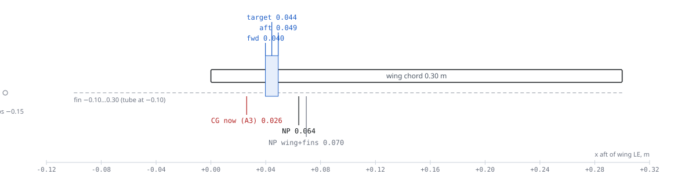

# K09-L stability and control (B3)

Status: `PROPOSED` (B3, 2026-11-09). AVL 3.52 whole-aircraft model plus hand models for what AVL leaves out.
Re-check: `python -I redesign/team/B3/xfoil_elevon.py` (once), `python -I redesign/team/B3/sc_analysis.py`,
`python -I redesign/team/B3/run_avl_study.py`, `python -I redesign/team/B3/draw_cg.py`, then
`python -I redesign/proofs/build_graph.py` (result 2026-11-09: OK, every stored number re-computes).

**Verdict.** Pitch is fine: the CG range is **x = 0.040–0.049 m** (13.2–16.4 % chord) and the 5 % margin is met.
Hover pitch and roll have plenty of authority. Three things fail. **(1) Cruise yaw is unstable:** Cn_β = −0.105 /rad.
The fins' area sits mostly ahead of the CG, and the props and tubes add to it. The divergence doubles every 0.16 s,
so yaw has to be closed by motor differential thrust (F4), or the motor tubes have to move into the wing (CR-B3-02).
**(2) Hover yaw needs the 3° motor cant** (B4): 1.08× the 5 m/s disturbance without it, 3.75× with it.
**(3) Elevon up-trim costs lift:** the trimmed stall is 12.7 m/s and the transition 16.6 m/s at 2.6 kg, so cruise at
15 or 16 m/s fails `R-TRANSITION`.

## Model

| Item | What | Source | Status |
|---|---|---|---|
| Geometry | wing 1.15 × 0.30 m, MH 45 camber line (UIUC file), 4 elevon panels (hinge 0.78 c) driven as `elevator` (d1) and `aileron` (d2); fins as flat plates x −0.10…0.30, z ±0.19 at y ±0.32 | `params.json#wing`, `#fins`; `avl/k09l.avl` | `CHECKED` |
| Lattice | 16 chordwise (wing), spanwise 8 mm, 2 mm control tapers at the panel edges | `avl_model.py` | `CHECKED` |
| Convergence | Xnp coarse / medium / fine = 0.06950 / 0.06954 / 0.06959 m (Δ 0.014 % c); Cm_δ medium→fine 3.9 %; Cn_β Δ 1e-5 | `CL-B3-AVL-CONV` | `CHECKED` |
| Section viscous terms | XFOIL Re 3e5: cm −0.0092 vs thin +0.0063 → Δcm −0.0155; up-elevon effectiveness 0.63 (0.59–0.69), down 0.80–0.84 | `xfoil/summary.json`, `ASM-B3-DCM-VISC`, `ASM-B3-FLAP-EFF` | `UNVERIFIED` (B2 owns) |
| Added by hand | Ribner prop normal force (4 props, dCN/dα 0.10 /rad per disk, upwash 1.15), tube and motor drag in sideslip, Munk pod term | `flight_models.py` | `UNVERIFIED` |
| Mass | 2.6 kg gate; inertias from A3, scaled by 2.6 / 2.166 | `CL-A3-IXX/IYY/IZZ`, `avl/k09l.mass` | `PROPOSED` |
| Cross-check | AVL `MODE` (aero only) vs B3 4×4 linear model: short period −3.15 ± 7.47i vs −3.44 ± 7.03i; directional divergence +3.58 vs +4.30 /s (props add 0.7) | `results/study.json` | `CHECKED` |

## Neutral point and CG range

`FIG B3-01 — Chordwise stations, 1 m = 2 364 px, drawn from results/sc_results.json by draw_cg.py.`

| Parameter | Value | Unit | Source | Status |
|---|---|---|---|---|
| NP, wing + fins (AVL) | 0.0696 (23.2 % c) | m | `CL-B3-XNP-AERO` | `CHECKED` |
| NP shift: props / pod | −4.9 / −0.6 | mm | `CALC-B3-NP` | `UNVERIFIED` |
| **NP, whole aircraft** | **0.0641 (21.4 % c)** | m | `CL-B3-XNP` | `UNVERIFIED` |
| Lift slope (AVL, fins as end plates) | 3.56 | /rad | `CL-B3-CLA` | `CHECKED` |
| Aft limit (SM 5 %, `requirements.static_margin_min`) | 0.0491 (16.4 % c) | m | `CL-B3-CG-AFT` | `UNVERIFIED` |
| Forward limit (elevon trim at trimmed CLmax ≤ 10° up) | 0.0397 (13.2 % c, SM 8.1 %) | m | `CL-B3-CG-FWD` | `UNVERIFIED` |
| **CG target** | **0.0444 (14.8 % c), SM 6.6 %** | m | `CL-B3-CG-TARGET`, `CL-B3-SM-TARGET` | `UNVERIFIED` |
| Range width / pack-slide CG travel (A3) | 9.3 / ±7.6 | mm | `CALC-B3-CG-LIMITS`, A3 | `PROPOSED` |
| Current CG (A3 roll-up) | 0.026: 13.7 mm ahead of the forward limit | m | `CL-B3-CG-NOW-FWD` | `FAIL` |
| Hover pitch-trim split allowed / now | 1.25 (12.5 % of differential) / 1.16 (8 %) | — | `CL-B3-HOVER-TRIM-USE` | `UNVERIFIED` |

The A1 range (0.045–0.075 m) is wrong at its aft end: the props pull the NP forward, and above 0.049 m the margin
falls below 5 %. To reach the target from today's layout the CG needs **+18 mm**. That is the pod group 52 mm aft,
the pack alone 72 mm aft, or the motor stations 54 mm aft. A3's CR-A3-02 asked for 96 / 134 / 100 mm.

## Trim across speeds (2.6 kg, CG target, cm_ac −0.0096)

| V m/s | 12.7 (Vs trimmed) | 13 | 14 | 15 | 16 | 18 | 20 | 25 |
|---|---|---|---|---|---|---|---|---|
| CL | 0.745 | 0.714 | 0.616 | 0.536 | 0.471 | 0.372 | 0.302 | 0.193 |
| α deg | 14.2 | 13.6 | 11.7 | 10.2 | 9.0 | 7.2 | 5.8 | 3.8 |
| Elevon deg (− = TE up) | −8.9 | −8.6 | −7.6 | −6.8 | −6.2 | −5.2 | −4.5 | −3.4 |

| Trimmed stall at 2.6 kg | cm_ac −0.0096 (XFOIL) | +0.0059 (thin) | +0.0141 (Hepperle) | Source |
|---|---|---|---|---|
| CG at the aft limit (SM 5 %) | 12.54 m/s | 12.25 | 12.10 | `results/study.json` |
| CG target (SM 6.6 %) | **12.73** (`CL-B3-VS-TRIM` `FAIL` vs 12.0) | 12.44 | 12.30 | `CL-B3-VS-TRIM` |
| SM 3 % (rejected) | 12.27 | 11.96 | 11.81 | `results/study.json` |
| Untrimmed (A1, CLmax 0.9) | 11.58 | | | `CL-A1-STALL-GATE` |

1.3 × 12.73 = **16.55 m/s** (`CL-B3-VT-TRIM`, `FAIL` against 15 m/s and also against B1's proposed 16 m/s). At
16 m/s: α 9.0°, elevon −6.2°. AVL induced trim drag +0.2 % (negligible). The real trim drag is elevon profile drag (B2).

## Control surfaces (elevons)

| Elevon chord | Area / S | Cm_δ /deg (AVL) | Trimmed Vs m/s | pb/2V at 15° | Decision |
|---|---|---|---|---|---|
| 0.18 c | 14.1 % | −0.0096 | 12.67 | 0.132 | below the 15 % floor |
| **0.22 c** | **17.2 %** | **−0.0101** | **12.73** | **0.144** | **keep: freeze on the twin** |
| 0.26 c | 20.4 % | −0.0105 | 12.78 | 0.156 | more lift lost per unit trim |
| 0.30 c | 23.5 % | −0.0105 | 12.84 | 0.164 | same |

Keep 22 % chord, both panels per side, ±25° travel. The inboard panels are needed: outboard alone is 8.4 % of S.
Roll at the trimmed stall with 15° left after trim: pb/2V **0.151** (`CL-B3-ROLL-PB2V`, ≥ 0.07), 192°/s, τ 0.34 s,
60° bank in **0.59 s** (`CL-B3-ROLL-T60`, ≤ 1.3 s). Adverse yaw is negligible (Cn_δa +0.0003 /deg, proverse).
Elevon area ≤ 25 % `CHECKED` (`CL-B3-ELEVON-FRAC-MAX`).

## Dynamic modes at 15 m/s (CG target, props included)

| Mode | Eigenvalue /s | Meaning | Claim | Status |
|---|---|---|---|---|
| Short period | −3.44 ± 7.03i (ωn 7.8 rad/s, ζ 0.44) | well damped | `CL-B3-SP-ZETA` ≥ 0.30 | `UNVERIFIED` |
| Phugoid | −0.025 ± 0.84i (7.5 s, ζ 0.03) | lightly damped: TECS holds it | — | `PROPOSED` |
| Roll subsidence | −6.24 | fast | — | `PROPOSED` |
| **Directional divergence** | **+4.30** (doubles in 0.16 s) | Cn_β < 0: nose swings away from the wind | `CL-B3-LAT-T2` ≥ 4 s | `FAIL` |
| Spiral | +0.12 (doubles in 5.8 s) | Cl_β ≈ 0 (flat wing, symmetric fins) | — | `PROPOSED` |

| Cn_β build-up at the CG target | /rad | Source |
|---|---|---|
| Wing + fins (AVL) | −0.083 | `CALC-B3-LATDIR` |
| 4 props (Ribner) | −0.012 | `ASM-B3-PROP-CNA` |
| Tubes + motors (drag in sideslip) | −0.009 | `ASM-B3-CD-CYL` |
| **Total** | **−0.105** (need ≥ +0.02) | `CL-B3-CNB` `FAIL` |

## Fixing cruise yaw (CG held on target)

| Option | Cn_β /rad | Pod-group move | Cost | Verdict |
|---|---|---|---|---|
| O0 as configured (tube −0.10) | −0.105 | +52 mm aft | — | `FAIL` |
| O1 tube −0.045 | −0.046 | none | CG fixed without moving the pod | `FAIL` alone |
| O3 tube −0.045, fin LE swept to +0.06 at the tips | −0.002 | none | tube braced to the fin tips | `FAIL` |
| **O4 tube +0.03 through the wing (t 23 mm), fin LE on the tube** | **+0.030** | **73 mm forward** | tube in a hole at 10 % c; tube–spar offset 0.05 m (was 0.18) | **recommended** |
| O4b tube +0.045 (t 27 mm) | +0.044 | 87 mm forward | thicker foam around the tube | best margin |
| O5 tip fins 0.25 × 0.38 m only | −0.064 | +52 mm aft | +2 parts | `FAIL` |
| O7 O3 + tip fins | +0.035 | none | braces + 2 tip fins (~45 g) | fallback |

Even after a passive fix, motor yaw damping in fixed-wing mode is wanted (Cn_r −0.037 is weak). With today's
geometry it is mandatory. Holding total thrust, it gives 1.38 N·m against 1.00 N·m at β = 10°
(`CL-B3-YAW-ACTIVE-RATIO` 1.38 `FAIL` vs 2). The mixer must be free to raise one side's throttle, which gives up to
8.5 N·m.

## Hover (tailsitter axes) and transition

| Axis (hover) | Actuator | Control moment | 5 m/s disturbance | Ratio | Status |
|---|---|---|---|---|---|
| Pitch (cruise y) | upper vs lower pair, arm 0.19 m | 4.76 N·m (72 rad/s²) | 0.57 N·m (wing face, CP 0.45 c) | 8.3 | `UNVERIFIED` |
| Roll (cruise z) | left vs right pair, arm 0.32 m | 8.01 N·m (40 rad/s²) | 0.31 N·m (fins broadside) | 25.8 | `UNVERIFIED` |
| Yaw (thrust axis), no cant | reaction torque × 0.47 swirl recovery (B4) | 0.20 N·m (1.0 rad/s²) | 0.18 N·m (10 % gust asymmetry) | **1.08** | `FAIL` |
| Yaw, 3° tangential cant | + thrust side component, r 0.37 m | 0.68 N·m (3.5 rad/s²) | 0.18 N·m | **3.75** | `UNVERIFIED` |

The elevons give no hover authority. The contracted slipstream (radius 99 mm about z = ±0.19 m) clears a fully
deflected elevon by 49 mm (`CL-B3-ELEVON-WASH-GAP`; B4 gets 26 mm).

| V m/s | 0 | 4 | 6 | 8 | 10 | 11 | 12 | 15 |
|---|---|---|---|---|---|---|---|---|
| Body angle α deg (level, quasi-steady) | 90 | 81 | 70 | 57 | 45 | 39 | 13 | 8 |
| T/W | 1.06 | 0.99 | 0.94 | 0.85 | 0.72 | 0.65 | 0.11 | 0.09 |
| Aero pitch moment N·m (− nose-down) | 0 | −0.38 | −0.70 | −0.91 | −0.94 | −0.90 | −0.49 | −0.54 |
| Share of motor pitch differential used | 0 | 0.07 | 0.13 | **0.17** | 0.15 | 0.11 | 0 (elevons) | 0 |

Stalled-wing transition (0–11 m/s) pitch is carried by the motors, using at most 17 % (18 % at the forward CG) of
the differential against an allowance of 60 % (`CL-B3-TRANS-PITCH-USE` 0.18). The wing pitches the nose down, which
helps the forward transition. In the back-transition the motors must hold up to 1.0 N·m nose-up.

## Responses to requests addressed to B3

| Request | Answer |
|---|---|
| CR-A1-06 | `cg.x_range_m` 0.040–0.049, target 0.0444; keep `static_margin_min` 0.05; elevons 22 % c, both panels, ±25° (CR-B3-01) |
| CR-A3-03 | Props move the NP 4.9 mm forward; the range moves forward and the needed shift drops from 96 to 52 mm (pod group) |
| CR-A3-04 | Allowed split 1.25 (`ASM-B3-SPLIT-MAX`); 1.16 uses 8 % of the pitch differential: accept, no tube offset needed |
| CR-J1-01 | Cn_β −0.105 /rad including fins, tubes and props: fix per CR-B3-02 |
| CR-J1-02 | Keep 5 % at the aft limit; trim penalty now in `CL-B3-VS-TRIM` / `CL-B3-VT-TRIM` |
| CR-B1-04 | CLα 3.56 /rad; AVL span efficiency 1.03 (inviscid, fins as end plates); 16 m/s: α 9.0°, elevon −6.2°, induced trim drag +0.2 %; corridor pitch balance: motors 17 % below 11 m/s, elevons above |
| CR-B4-03 | Used: no elevon hover authority, swirl factor 0.47, Q 0.113 N·m, 3° cant |

## Open issues

1. The MH 45 cm_ac decides 0.4 m/s of trimmed stall: XFOIL −0.009 vs Hepperle +0.0145 (B2).
2. The prop normal-force slope is ±50 %: ±2.5 mm on the NP and ±0.006 on Cn_β. The twin glide test (`T-B3-TWIN-NP`) closes it.
3. The transition model is quasi-steady, level flight with a flat-plate post-stall wing and no prop-wash on the wing. F4's SITL is the next check.
4. ArduPilot fixed-wing yaw by differential thrust for a copter tailsitter is not confirmed (J1, F4).
