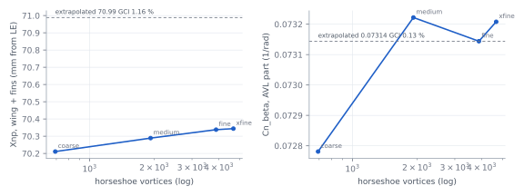
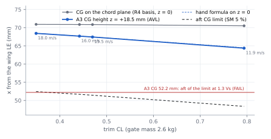
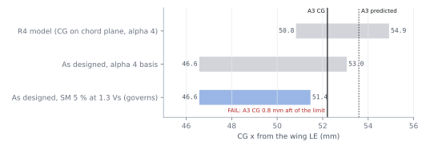
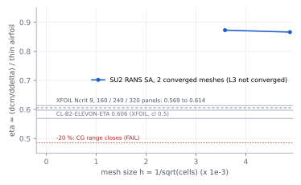
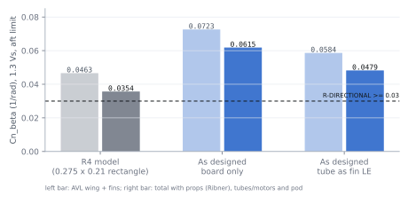
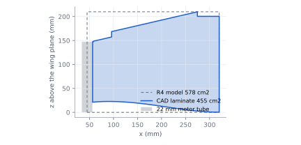

# B3 simulation and verification report (V1): K09-L stability and control on the as-designed geometry

Status: `MODELLED` (B3, 2026-11-10). Inputs: fins CAD `subsystems/fins/fusion/fins.py` (D3 R4), wing CAD elevon gaps
`subsystems/wing/params.json` (D1 R1), A3-R6a mass roll-up (`team/A3/rollup/rollup.json`, A3 claims), params A1-R4a
(D-60). Claims: `claims.verify.json` (32 claims, `CL-B3-V-*`). Requests: `CHANGE-REQUESTS.md` CR-B3-24 … -29.

**Result.** The as-designed aircraft **fails R-STATIC-MARGIN at A3's CG** and the **spiral limit**. Both come from
one item the R4 chain did not model: A3's take-off CG is **18.5 mm above the chord plane** (R4 used
`cg.z_target_m` = 0). With the CG above the wing the effective NP moves forward as CL rises: −3.4 mm at 1.3 Vs, so
the SM-limited aft CG is **0.0514 m** and A3's 0.0522 m is **0.77 mm aft of it** (SM 4.76 %). The same height gives
Cl_β +0.023 and a spiral doubling time of **3.51 s** (< 4 s). The as-designed fins are better than the R4 rectangle
(Cn_β 0.048–0.062 vs 0.035) and every other requirement still passes.

## 1 What was re-run, with which tool and why

| Question | Tool (fidelity) | Why this tool is enough | Convergence | Independent check |
|---|---|---|---|---|
| NP, CG limits, trim, Cn_β, Cl_β, control derivatives | AVL 3.52 vortex lattice, S5010 camber, CAD fin outline, as-built elevon spans, A3 CG (x, z) | Attached flow, M < 0.06, α ≤ 13°: linear potential flow is the standard method; viscous terms enter only through the elevon η and the trimmed CLmax table (XFOIL, B2) | 4 lattices, 692 → 4 676 vortices, GCI (Celik 2008) | own flat-plate VLM; hand formula for the CG-height term; DATCOM-type fin Cn_β; strip roll power |
| Elevon effectiveness η (sets the forward CG limit) | SU2 8.5 INC_RANS, Spalart-Allmaras, 2-D, Re 2.6e5 | XFOIL is the only prior source and is panel-sensitive with a separation at the hinge kink; a second viscous method brackets it | 3 meshes 42 k / 78 k / 170 k cells (L3 not converged, §4) | XFOIL on the same paneled geometry, 160 / 240 / 320 panels |
| Rigid-body modes | Etkin 4 × 4 on the AVL derivatives (`sc_analysis.modes`) | Small-perturbation, 16 m/s | follows the AVL lattice | R4 values; z sweep (`sens_zcg.py`) |
| Hover authority | unchanged R4 model | A3-R6a inertia was already in R4 (Ixx/Iyy/Izz × 2.6/2.322); E1 CAD motors (\|y\| 0.321, \|z\| 0.189) are within 1 mm of params | — | R4 `CL-B3-HOVER-*` stand |

3-D CFD is not justified: the decisions here are set by planform, CG position and a 2-D section property. FEA of
primary structure belongs to the structures roles (C-series), not B3.

## 2 Grid convergence and independent checks



| Quantity (CL 0.47, A3 CG) | coarse 692 | medium 1 924 | fine 3 884 | xfine 4 676 | GCI fine | Limit | Status |
|---|---|---|---|---|---|---|---|
| Xnp wing + fins (m) | 0.070211 | 0.070289 | 0.070338 | 0.070344 | fine → xfine 0.006 mm (0.002 % c) | ≤ 0.5 % c | `CHECKED` |
| CL_α (1/rad) | 3.3873 | 3.4001 | 3.4015 | 3.4025 | 0.01 % | — | `CHECKED` |
| Cn_β AVL part (1/rad) | 0.07278 | 0.07322 | 0.07314 | 0.07321 | 0.13 % | ≤ 2 % | `CHECKED` |
| Cm_δe (1/deg) | −0.00907 | −0.00951 | −0.00969 | −0.00968 | 3.9 % | — | `MODELLED` |
| Cl_δa (1/deg) | −0.00455 | −0.00482 | −0.00493 | −0.00495 | 5.8 % | — | `MODELLED` |

All design numbers use the fine lattice; the control derivatives on it are within 4–6 % of the extrapolated value
(conservative: the extrapolated authority is higher).

| Independent check | Hand / own code | AVL | Difference | Verdict |
|---|---|---|---|---|
| Flat rectangular wing CL_α (own 10 × 40 horseshoe VLM) | 3.505 /rad | 3.417 | −2.5 % | `CHECKED` |
| Flat wing Xnp | 0.07377 m | 0.07342 | −0.11 % c (limit 1 %) | `CHECKED` |
| CG-height NP shift at 1.3 Vs, −z(sin α + CL cos α / CL_α − 2CL/(π e AR)) | −3.406 mm | −3.421 mm | −0.4 % (limit 10 %) | `CHECKED` |
| Fin Cn_β increment (DATCOM-type, Helmbold CL_α on AR 1.78) | 0.0852 | 0.0747 | +14 % | consistent (hand has no wing interference) |
| Roll power Cl_δa (strip theory, thin-airfoil τ) | 0.0074 /deg | 0.0051 | +46 % | expected: strip theory has no 3-D relief at AR 3.6; AVL is the conservative one |

## 3 Neutral point and CG range: R4 hand-off vs as designed



| Speed (gate 2.6 kg) | CL | α (deg) | Xnp, CG on chord plane (m) | Xnp, A3 z +0.0185 (m) | Aft limit SM 5 % (m) | SM at A3 CG 0.0522 |
|---|---|---|---|---|---|---|
| 18.0 m/s (`AIRSPEED_MAX`) | 0.349 | 5.27 | 0.07091 | 0.06844 | 0.05244 | 5.07 % |
| 16.0 m/s cruise | 0.442 | 6.82 | 0.07088 | 0.06768 | 0.05168 | 4.83 % **FAIL** |
| 15.52 m/s = 1.3 Vs | 0.470 | 7.29 | 0.07086 | **0.06744** | **0.05144** | **4.76 % FAIL** |
| 11.94 m/s Vs (test point) | 0.794 | 12.87 | 0.07053 | 0.06437 | 0.04837 | 3.80 % |

Whole-aircraft Xnp includes R4's prop (Ribner) and pod terms, −2.91 mm. At z = 0 the as-designed NP equals R4's
(0.0709 m): the CAD fins do not move the longitudinal NP. **The 3.4 mm loss is the CG height alone**
(dXnp/dz −0.185 at 1.3 Vs, `CL-B3-V-DXNP-DZ`).



| Quantity | R4 (D-60 params) | As designed | Margin vs A3-R6a 0.0522 / predicted 0.0536 | Claim | Status |
|---|---|---|---|---|---|
| Forward limit (elevon ≤ 12.5° at trimmed stall, D6 terms) | 0.0509 m | **0.0466 m** | +5.6 / +7.0 mm | `CL-B3-V-CG-FWD` | `UNVERIFIED` (η, D6) |
| Aft limit, SM 5 % at α 4° (R4 basis) | 0.0549 m | 0.0530 m | +0.83 / −0.55 mm | `CL-B3-V-CG-AFT` | superseded |
| **Aft limit, SM 5 % over the wingborne envelope** | — | **0.05144 m** | **−0.77 / −2.15 mm FAIL** | `CL-B3-V-CG-AFT-ENV` | `UNVERIFIED` (fails) |
| Range width (≥ 4 mm) | 3.9 mm | 4.85 mm | +0.85 mm | `CL-B3-V-CG-WIDTH-ENV` | `UNVERIFIED` |
| Proposed target (mid-range) | 0.0529 m | **0.0490 m** (15.3 % c) | A3 must move −3.2 / −4.6 mm | `CL-B3-V-CG-SHIFT-REQ(-PRED)` | `PROPOSED` (CR-B3-25) |

The forward limit moves 4.3 mm forward for the same reason: at the stall CL the raised CG costs 6.2 mm of NP, so
less up-elevon is needed to trim. The range keeps its width; it slides forward.

| Fix (CR-B3-25) | Effect | Cost |
|---|---|---|
| Move the CG 3.2 mm forward to 0.0490 | SM 6.3 % at 1.3 Vs; range centred | ~41 g at the pod nose, or the pack bay ~10 mm forward (pack slide alone gives 0.8 mm) |
| Lower the CG 10 mm (z 0.0085) | aft limit +1.85 mm to 0.0533 | packaging (pod is on the upper surface) |
| Minimum to pass, basic CG | 0.8 mm forward or 4.1 mm lower | no margin for growth (predicted needs 2.2 mm / 11.6 mm) |

## 4 Elevon effectiveness: XFOIL vs SU2 RANS



η = (dcm/dδ)_viscous / (dcm/dδ)_thin-airfoil, S5010, hinge 0.78 c, δ 0 and −10°, α 4°, Re 2.6e5.

| Method / level | Cells or panels | cl (δ 0) | cm (δ −10°) | η_cm | η_cl | Converged |
|---|---|---|---|---|---|---|
| SU2 SA L1 | 41 901 | 0.5331 | 0.0985 | 0.866 | 0.915 | yes (rms[P] −9) |
| SU2 SA L2 | 77 874 | 0.5383 | 0.0994 | 0.873 | 0.923 | yes (rms[P] −9 / −7.7) |
| SU2 SA L3 | 169 510 | oscillating (cl 0.1–0.54) | 0.0998 | — | — | δ −10° yes; δ 0 no (unstable on this mesh) |
| XFOIL Ncrit 9 | 160 / 240 / 320 | 0.582 / 0.580 / 0.578 | 0.060 / 0.063 / 0.066 | 0.569 / 0.598 / 0.614 | 0.614 / 0.638 / 0.652 | panel GCI 15 %, extrapolated η_cm 0.69 |
| B2 `CL-B2-ELEVON-ETA` (XFOIL, cl 0.5) | — | — | — | 0.606 | — | used in all B3 limits |

The CFD mesh study has two converged levels (L1 → L2 change 0.8 % in η_cm, 0.9 % in η_cl) and an incomplete third;
it is a cross-check, not a decision input. Fully turbulent SA keeps the boundary layer attached past the hinge kink,
where XFOIL predicts a laminar separation on the lower surface, so SA is the upper bound and XFOIL the lower bound
of η. A transitional SST-LM attempt on L2 did not converge (cl 1.6–2.8, discarded). **B2's 0.606 sits at the low
end, so the forward limit is conservative**, and the −20 % case that closed the R4 range is not supported by either
method (CR-B3-28).

## 5 Directional stability with the CAD fins

 

| Case (1.3 Vs, aft limit 0.0530 m, conservative) | AVL part | Total with props, tubes, pod | Limit ≥ 0.03 | Status |
|---|---|---|---|---|
| R4 rectangle 0.275 × 0.21, LE on the tube axis | 0.0463 | 0.0354 | +18 % | superseded |
| As designed, laminate only (`CL-B3-V-CNB`) | 0.0723 | **0.0615** | +105 % | `UNVERIFIED` (T-B3-YAW-DOUBLET) |
| As designed, tube as the fin LE (`CL-B3-V-CNB-TUBE`) | 0.0584 | **0.0479** | +60 % | `UNVERIFIED` |
| As designed, swept top strip at half effectiveness (bracket) | ~0.052 | ~0.041 | +37 % | sensitivity |

The CAD fin has 21 % less area than the R4 rectangle but more Cn_β: its LE is 11.5 mm further aft (+10 % in AVL
for that alone) and the swept top strip (z 0.16–0.21 m, LE 0.06 → 0.27 m) carries load far aft of the CG. That
strip gives 0.041 of the 0.072 AVL value, and a 77°-swept edge is where a VLM is least reliable, hence the
half-effectiveness bracket. All brackets pass. Lattice GCI on Cn_β 0.13 %.

## 6 Stall, transition speed and modes

| Quantity | R4 | As designed | Limit | Claim | Status |
|---|---|---|---|---|---|
| Trimmed stall at A3 CG, gate mass | 11.90 m/s (target) | 11.77 m/s (11.39 at 2.436 kg) | ≤ 12 | `CL-B3-V-VS-A3` | `UNVERIFIED` |
| 1.3 Vs at the forward limit | 15.51 m/s | 15.52 m/s | ≤ 16; `ARSPD_FBW_MIN` 15.6 holds | `CL-B3-V-VT` | `UNVERIFIED` |
| Short-period ζ, cruise | 0.45 | 0.48 | ≥ 0.30 | `CL-B3-V-SP-ZETA` | `UNVERIFIED` |
| Dutch-roll ζ | 0.33 | 0.28 | ≥ 0.08 | `CL-B3-V-DR-ZETA` | `UNVERIFIED` |
| **Spiral time to double** | 4.08 s | **3.51 s FAIL** | ≥ 4 s | `CL-B3-V-LAT-T2` | `UNVERIFIED` (fails) |

| CG height z (m), `sens_zcg.py` | 0 | 0.006 | 0.012 | **0.0185** | 0.025 |
|---|---|---|---|---|---|
| Aft limit at 1.3 Vs (m) | 0.05486 | 0.05375 | 0.05264 | **0.05144** | 0.05024 |
| SM at x 0.0522 | 5.83 % | 5.48 % | 5.14 % | **4.76 %** | 4.39 % |
| Cl_β (1/rad, + = unstable) | 0.004 | 0.011 | 0.017 | **0.023** | 0.030 |
| Spiral t2 (s) | 4.01 | 3.84 | 3.68 | **3.51** | 3.34 |

The spiral is set by the CG sitting above the fins' side-force centre (Cl_β), not by the fin change (z 0: 4.01 s,
R4 4.08 s). Lowering the CG fixes both failures; otherwise A2 decides the spiral rule (CR-B3-26).

## 7 Requirement status after V1

| Requirement | Claim(s) | As designed | Verdict |
|---|---|---|---|
| R-STATIC-MARGIN (≥ 5 % in wingborne flight) | `CL-B3-V-SM-A3-ENV` | 4.76 % at A3 CG | **FAIL** → CR-B3-25 |
| R-CG-RANGE | `CL-B3-V-CG-A3-AFT-ENV`, `-A3PRED-AFT-ENV` | −0.77 / −2.15 mm | **FAIL** → CR-B3-25 |
| Spiral ≥ 4 s (`CL-B3-LAT-T2` limit) | `CL-B3-V-LAT-T2` | 3.51 s | **FAIL** → CR-B3-26 |
| R-DIRECTIONAL (Cn_β ≥ 0.03, DR ζ) | `CL-B3-V-CNB(-TUBE, -CRUISE)`, `-DR-ZETA` | 0.048–0.063 | pass |
| R-STALL (≤ 12 m/s) | `CL-B3-V-VS-A3` | 11.77 m/s | pass (+2 %) |
| R-TRANSITION (1.3 Vs ≤ 16) | `CL-B3-V-VT` | 15.52 m/s | pass (+3 %) |
| CG range width ≥ 4 mm | `CL-B3-V-CG-WIDTH-ENV` | 4.85 mm | pass |
| Hover authority, cant, hover trim | R4 `CL-B3-HOVER-*` | unchanged | pass (R4) |

## 8 Assumptions and limits of this round

| Item | Value | Basis | Effect if wrong |
|---|---|---|---|
| `ASM-B3-V-ZCG` | +0.0185 m | A3 `rollup.json` (no claim yet, CR-B3-24) | 1 mm of z = 0.185 mm of aft limit |
| Fin outline `ASM-B3-V-FIN-CAD` | 0.0455 m² board per half-fin | `fins.py` geometry, re-read every run (`cad_check`) | the script stops if the CAD moves > 0.5 mm |
| Props + pod NP terms | −2.91 mm, CL-independent | R4 `CALC-B3-NP` | small; not re-derived |
| SA η (upper bound), XFOIL η (lower bound) | 0.87 / 0.61 | §4 | limits use 0.606 (conservative) |
| Forward limit | at the gate mass, D6 terms, half the 0.84° play | R4 method | lighter aircraft → lower CL → limit unchanged or wider |

## 9 How to re-run

```
python -I redesign/team/B3/verify_asdesigned.py   # AVL 4 lattices + checks -> claims.verify.json, results/verify.json
python -I redesign/team/B3/sens_zcg.py            # CG-height sweep -> results/sens_zcg.json
python -I redesign/team/B3/cfd_elevon.py --core   # SU2 mesh study (B3_SU2_EXE, B3_SU2_THREADS); --parse to re-read
python redesign/team/B3/plot_verify.py            # figures fig/B3-V1..V6.svg (matplotlib needs the user site)
```
