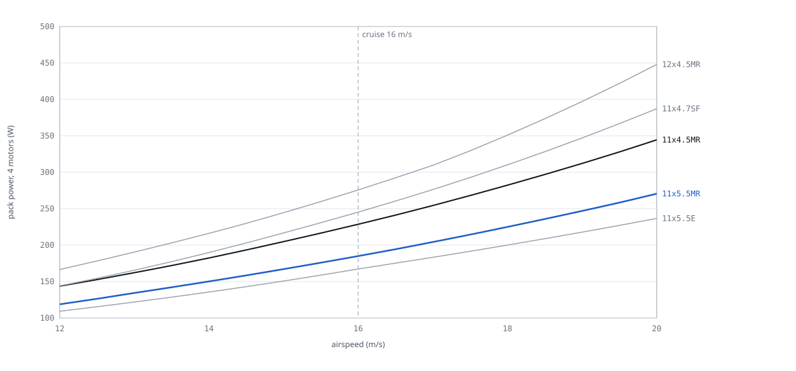
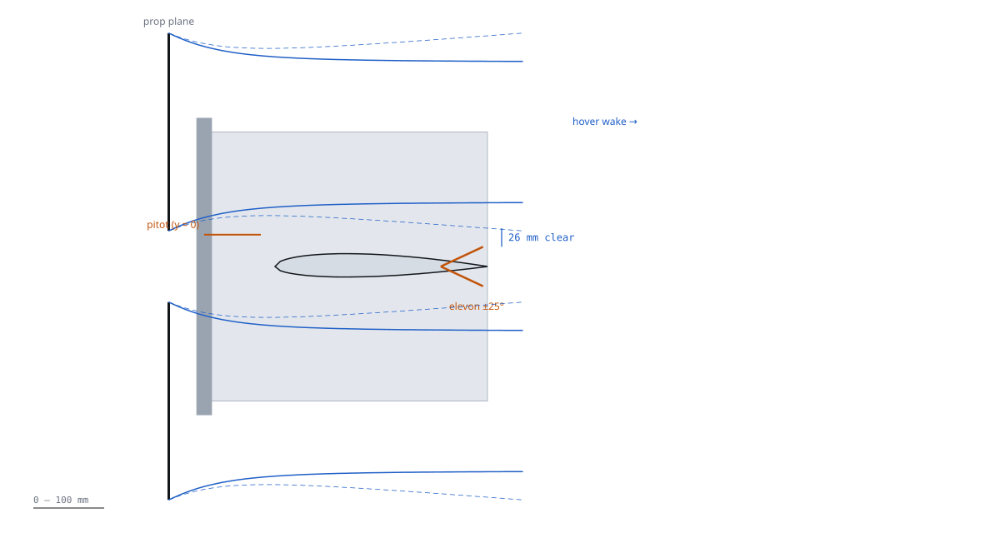

# Props and rotor aero (B4)

Status `PROPOSED`, 2026-11-09. Everything below is `UNVERIFIED` until the thrust stand runs (`T-B4-STAND`,
`T-E1-STAND`). Calculations: `team/B4/props.py` → `claims.json` (38 claims), `out/props_results.json`. Figures:
`team/B4/figures.py`. Data: `team/B4/data/` (APC PER3 tables for five props, UIUC measurements for two). Python
standard library only.

**Verdict.** Fly the **APC 11×5.5MR / 11×5.5MRP**, which agrees with E1's CR-E1-06. Compared with the 11×4.5MR it
cuts cruise power by 17 % and costs 3 % in hover. It is the only MR prop in the set that stays under APC's rpm limit
at full throttle on a 14.8 V bus. On a fresh pack it still needs an output cap of about 0.85. Three installation
results matter more than the prop choice:
1. **The elevons are outside the hover slipstream**, so the aircraft has no elevon authority at zero airspeed.
2. **The fins straighten the prop swirl**, which removes about half of the hover yaw authority. A 3° motor cant
   restores it.
3. **The pitot belongs on the pod nose.** The prop-induced error there is under 1 %.

## 1. Prop selection

Conditions: 2.6 kg gate, download 1.06 (6.76 N per prop in hover), 15 m/s cruise at L/D 5.9 (1.08 N per prop),
ρ 1.225 kg/m³. Props are from APC PER3. Electrical power uses E1's motor constants (`ASM-E1-*`: Kv 900, R 86 mΩ,
I0 0.9 A, ESC 10 mΩ + 0.5 W, pack 24 mΩ); E1 owns the electrical numbers.

| Prop | Hover rpm | FM | Hover pack W | Cruise J | η_prop | Cruise pack W | Full-throttle rpm, 14.8 V hot / APC limit | Mass | Verdict |
|---|---|---|---|---|---|---|---|---|---|
| **11×5.5MR/MRP** | 5 396 | 0.711 | 343 | 0.568 | **0.474** | **181** | 9 319 / 9 545 (+2 %) | 17 g | `PROPOSED` (selected) |
| 11×4.5MR/MRP | 5 795 | 0.718 | 333 | 0.492 | 0.383 | 219 | 9 778 / 9 545 (**−2 %**) | 17 g | stand A/B only |
| 11×5.5E/EP | 5 808 | 0.696 | 343 | 0.560 | 0.522 | 165 | 9 735 / 13 636 | 23 g | alternate |
| 11×4.7SF | 5 079 | 0.757 | 325 | 0.537 | 0.363 | 232 | 9 019 / **5 909** | 20 g | rejected: SF rpm limit |
| 12×4.5MR | 5 047 | 0.715 | 315 | 0.469 | 0.323 | 259 | 9 087 / 8 750 (−4 %) | 20 g | rejected: cruise, clearance |

- **The 11×4.7SF never flies.** The maker's thrust table was measured on it, but its APC limit (65 000 / D) is
  5 909 rpm and hover alone needs 5 079 rpm (`CL-B4-SF-RPM` `FAIL`).
- **The 11×5.5E** is the most efficient cruise prop: 165 W, against 181 W for the 11×5.5MR. It is 6 g heavier per
  prop, has more rotational inertia (slower thrust response) and a 0.41 in hub. Keep it as the alternate if the
  stand shows the MR worse than predicted.
- **Data trust.** UIUC wind-tunnel measurements of two APC 11 in props match the PER3 cruise efficiency to within
  3.5 % (ratios 0.99 and 1.03, `CL-B4-UIUC-ETA`, `-E`). In static thrust, PER3 over-predicts FM by 4.5 % for both
  props (`CALC-B4-XCHECK`). **Plan hover shaft power about 5 % above the PER3 numbers.**

`FIG B4-01 — Pack power for four motors at 2.6 kg and L/D 5.9, by prop; 11×5.5MR blue, 11×4.5MR ink. Source CALC-B4-CRUISE.`

## 2. Key numbers (selected prop)

| Parameter | Value | Unit | Source | Status |
|---|---|---|---|---|
| Hover thrust per prop / disk loading | 6.76 / 110 | N / N/m² | `CL-B4-HOVER-T`, `CL-B4-DL` | `UNVERIFIED` |
| Hover rpm / torque / shaft power | 5 396 / 0.113 / 63.8 | rpm / N·m / W | `CL-B4-HOVER-RPM`, `-Q`, `-SHAFT` | `UNVERIFIED` |
| Hover FM (PER3; × 0.955 measured trend) | 0.711 (≈ 0.68) | — | `CL-B4-FM`, `CALC-B4-XCHECK` | `UNVERIFIED` |
| Cruise rpm / J / η_prop / shaft power | 5 668 / 0.568 / 0.474 / 34.2 | rpm / — / — / W | `CL-B4-CRUISE-*` | `UNVERIFIED` |
| Cruise pack power, 4 motors (E1 constants) | 181 (11×4.5MR: 219) | W | `CL-B4-CRUISE-W`, `-OLD` | `UNVERIFIED` |
| Full-throttle rpm, 16.8 V fresh, no cap | 10 637 (limit 9 545) | rpm | `CL-B4-RPM-MAX-FULL` | `FAIL` (cap below) |
| Output cap for ≤ 9 350 rpm on a fresh pack | 0.85 | — | `CL-B4-SPIN-MAX` | `UNVERIFIED` |
| T/W at the rpm cap (installed) | 3.03 (≥ 2.0) | — | `CL-B4-TW-CAP` | `UNVERIFIED` |
| Tip Mach hover / at the cap | 0.23 / 0.40 | — | `CL-B4-TIPMACH` | `UNVERIFIED` |

## 3. Installation effects

| Effect | Result | Consequence | Claim |
|---|---|---|---|
| Download: tube 0.115 N, fin skin 0.043 N, fin base 0.050 N, foot 0.022 N per station | k = 1.036 (mean loading), 1.046 (peaked) | **Keep 1.06** until `T-B4-INSTALLED`; release 0.01–0.02 then | `CL-B4-DOWNLOAD`, `-HIGH` |
| Hover slipstream edge vs elevon tip at 25° | 26 mm clear (edge z 0.054–0.059 m incl. mixing; elevon tip 0.028 m) | **No blown elevon**: at zero airspeed, pitch, roll and yaw come from the motors only | `CL-B4-ELEVON-HOVER` |
| Cruise slipstream edge vs elevon | tip 14 mm inside the mixing layer at full throw; core increment ≈ 1 m/s | Negligible (+≤ 13 % q locally) | `CL-B4-ELEVON-CRUISE` |
| Fin straightens swirl (16.5° swirl, 0.98 N side force per fin half) | yaw authority × 0.47 (× 0.74 if half as effective) | Hover yaw (about body x) is weak; E1's 0.149 N·m becomes ≈ 0.07 N·m | `CL-B4-YAW` |
| 3° tangential motor cant | yaw authority 1.64 × isolated (1.17 × even with no reaction torque); thrust cost 0.14 % | **Recommend** printed mounts with 3° cant (minimum 1.4°) | `CL-B4-YAW-CANT` |
| Rotor–rotor: vertical tip gap 0.101 m (0.36 D), lateral 0.361 m, coplanar | mean thrust change < 2 % (rotor-pair data); thrust fluctuation and noise rise | No correction; watch vibration | `CL-B4-GAP-V` |
| Prop–tube: tube face 39 mm (0.14 D) behind the prop plane | steady tube load 0.12–0.15 N; unsteady at blade passing | Do not reduce this gap (D3) | `CALC-B4-GEOM` |
| Vortex ring state in vertical descent | v_h 6.71 m/s → onset ≈ 1.9 m/s | Descent ≤ 1.5 m/s, landing 0.5 m/s (F4) | `CL-B4-DESCENT` |
| Ground effect at take-off | prop plane 0.46 m (3.3 R) above ground: +0.6 % | Ignore | `CALC-B4-GEOM` |

`FIG B4-02 — Side view at y = 0.32 m, 1 m = 850 px. Blue: hover slipstream edge (solid: momentum theory; dashed: with the mixing layer). Orange: elevon at ±25° and the pitot. Source CALC-B4-WAKE.`

## 4. Pitot placement

Model: four semi-infinite vortex cylinders (actuator disks, Γ = 2v), ring velocities from elliptic integrals, three
wake lengths and grids (convergence 0.02 % of V, self-test 0.9999). The error is the axial induced velocity at the
probe tip divided by airspeed, for cruise (15 m/s, 1.08 N), transition (14.6 m/s at hover thrust) and hover.

| Probe tip (x, y, z) m | Cruise | Transition | Hover induced | Verdict |
|---|---|---|---|---|
| **Pod nose (−0.10, 0, 0.045)** | 0.14 % | **0.75 %** | 0.29 m/s | **use** (`POD-006` mount, 80 mm ahead of the pod) |
| Pod boom (−0.25, 0, 0.045) | 0.24 % | 1.33 % | 0.51 m/s | acceptable, longer boom, no gain |
| Wing LE (−0.08, 0.15, 0) | 0.35 % | 1.90 % | 0.73 m/s | marginal; also in the wing's own upwash |
| Wing LE (−0.25, 0.15, 0) | 0.42 % | 2.30 % | 0.88 m/s | reject (> 2 %) |
| Outboard LE (−0.08, 0.53, 0) | 0.23 % | 1.25 % | 0.48 m/s | acceptable; long tube run, tip-strike exposure |

Limits of the model: axial inflow only. In transition, the body angle of attack reaches tens of degrees and a pitot
on the body x-axis under-reads (cosine error, then stall of the probe above about 20°). Use airspeed for gain
scheduling only after the transition is nearly complete (F4).

## 5. Noise and vibration inputs

| Item | Hover | Full throttle (cap) | Use |
|---|---|---|---|
| 1P (shaft) | 90 Hz | 156 Hz | C4: tube and mount first modes outside 80–330 Hz |
| BPF (2-blade) | 180 Hz | 311 Hz | F4: ESC-rpm harmonic notch; tonal noise |
| Tip Mach | 0.23 | 0.40 | Low; no compressibility correction |

SPL is not estimated: no validated model for this installation. Measure it at 10 m on the twin (phone meter, A-weighted)
if a site limit is ever imposed.

## 6. Assumptions

| Id | Value | Basis | Status |
|---|---|---|---|
| `ASM-B4-VSAG` | 13.6 V | 3.4 V/cell loaded, end of flight | `PROPOSED` |
| `ASM-B4-CD-TUBE` | 1.1 | cylinder, Re ≈ 1.3e4 (Hoerner) | `PROPOSED` |
| `ASM-B4-PROFILE` | 1.3 | peak/mean slipstream q | `UNVERIFIED` |
| `ASM-B4-FIN-T` / `-FOOT` | 10 mm / 900 mm² | fin and foot not drawn yet | `PROPOSED` |
| `ASM-B4-MIX` | 0.08 | mixing-layer spread per side (Brown and Roshko) | `PROPOSED` |
| `ASM-B4-VRS` | 0.28 v_h | VRS onset (Leishman) | `PROPOSED` |
| `ASM-B4-SPAN-AR` | 2 | wing as end plate for the fin | `PROPOSED` |
| `ASM-B4-PITOT-ERR` | 2 % | thrust-dependent airspeed error limit | `PROPOSED` |
| `ASM-B4-CANT` | 3° | B4 proposal | `PROPOSED` |

## 7. How to verify

| Test | What it checks | Owner |
|---|---|---|
| `T-B4-STAND` | A/B of 11×5.5MR and 11×4.5MR: thrust, torque and rpm at 10 % steps, 14.8 V and a fresh pack; FM, rpm at the cap | H1 (shared with `T-E1-STAND`) |
| `T-B4-INSTALLED` | Same stand with a 22 mm tube (face 39 mm behind the prop) and a 0.40 m foam-board fin: installed/isolated thrust → download | H1 |
| `T-B4-YAW` | Reaction torque with and without the fin mock-up → swirl recovery fraction | H1 |
| `T-B4-CRUISE` | Car-top rig at 15 m/s, or a logged twin cruise: rpm, current, voltage against `CALC-B4-CRUISE` | H1 / H2 |
| Pitot | Constant-groundspeed legs in calm air at two throttles: airspeed must not step with throttle | H2 |

Re-run everything: `python -I redesign/team/B4/props.py`, `python -I redesign/team/B4/figures.py`, then
`python -I redesign/proofs/build_graph.py` (result 2026-11-09: "OK: every stored number re-computes").

## Sources

APC PER3 files ([11×4.5MR](https://www.apcprop.com/files/PER3_11x45MR.dat), 11×5.5MR, 11×5.5E, 11×4.7SF,
12×4.5MR), [APC rpm limits](https://www.apcprop.com/technical-information/rpm-limits), APC product pages
([11×4.5MR](https://www.apcprop.com/product/11x4-5mr/), [11×5.5EP](https://www.apcprop.com/product/11x5-5ep/)),
[UIUC Propeller Database vol. 1](https://m-selig.ae.illinois.edu/props/volume-1/propDB-volume-1.html), rotor-pair
interaction: [Zhou, Ning, Hu (ISPIV)](https://journals.library.iit.edu/index.php/ISPIV/article/view/39) (abstract
only, `UNVERIFIED`). All read 2026-11-09.
