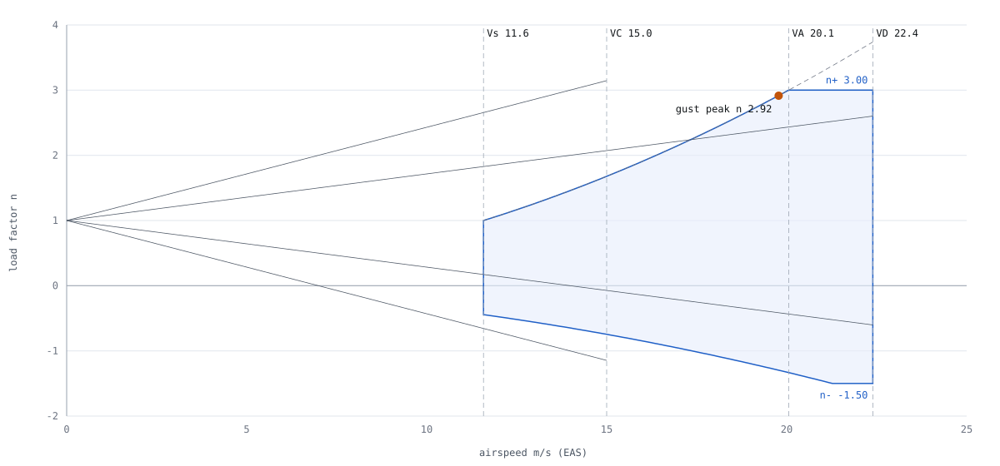
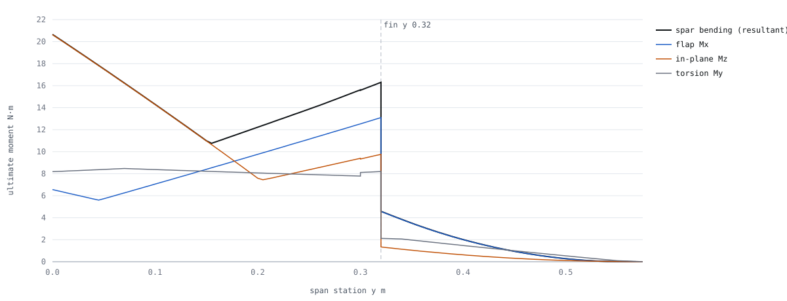

# Loads — K09-L quad tailsitter

Owner: C1 (loads engineer). Revision C1-R2 (CR-A1-15), 2026-11-09, at params revision A1-R2 (R1 geometry: chord
0.32 m, S5010, motor tubes at x 0.045 m, 45 mm feet, pack at `CL-A3-PACK-X-REQ`). Status: the calculation is
`CHECKED` (equilibrium, convergence, hand check, proof chain 0 drift); its inputs are `PROPOSED`/`UNVERIFIED`
(thrust, CLmax, masses), so every load is `UNVERIFIED` until the stand, the twin and the scale replace them.
Re-run in 1 s: `python -I redesign/team/C1/loads.py`, then `python -I redesign/proofs/build_graph.py`.

Every number is a **limit** load (largest expected in service) unless marked ultimate; ultimate = 1.5 × limit.
Frame: x aft, y right, z up in cruise (`params.json#frame`); in hover +x points at the ground.

## What changed in R2

| Item | R1 | R2 | Why |
|---|---|---|---|
| Inputs | `ASM-A2-*`, `ASM-C1-N-LAND` | `params.json#requirements.*` (D-14 keys) | one source (CR-A1-15) |
| Spanwise lift | Schrenk, centroid 0.462 b/2 | B2 AVL strip shape + section cm, centroid 0.423 b/2 | CR-B2-07 |
| CLmax / CL_α / elevon η | 0.9 / Helmbold 3.59 /rad / 0.70 | 0.80 / 3.58 /rad / 0.606 | `CL-B2-CLMAX-DESIGN`, `CL-B2-CLA-3D`, `CL-B2-ELEVON-ETA` |
| Prop, thrust basis | 11×4.5MR, 1.15 × maker table | 11×5.5MR, APC data at the 9 350 rpm cap × E1 k_T | D-05; B4, E1 claims |
| VD | 1.25 × pitch speed (11×4.5MR) = 22.4 m/s | 1.25 × VH (11×5.5MR at the cap) = 27.2 m/s | re-derived at VC 16 m/s |
| Landing factor claim | `CL-C1-N-LAND-NOW` (10 mm foot) **retired** | `CL-C1-N-LAND-STROKE-MIN` at the 40 mm requirement | D-11, D-14 |
| Box foam stroke | 20 mm | 70 mm (D-22) | CR-C1-05 closed |
| G3 bench case | feet + tube ends (the foot went into tension) | the contacts that bracket the CG (lower motors + tube ends) | CG now ahead of the tubes |

## Basis

| Item | Value | Unit | Source | Status |
|---|---|---|---|---|
| Design mass | 2.600 (gate) | kg | `P:requirements.mtow_gate_kg` | `PROPOSED` |
| Mass configurations | MC-C: 402 g gap to the gate in the pod (CG x 0.036 m); MC-P: every item × 1.18 (CG x 0.044 m) | — | `data/mass_model.csv` | `PROPOSED` |
| Lumped model | 540 masses: wing in 5 mm strips, fins 4 × 8, tubes 8, 4 stations, pod group, pack at x −0.034 m | — | `loads.py#build_items` | `CHECKED` |
| Method | quasi-static rigid body (d'Alembert); cut load = sum over the outboard part | — | `loads.py#solve` | `CHECKED` |
| Spanwise lift and cm | B2 AVL + XFOIL, trimmed CL 0.80, re-trimmed chordwise to the CG | — | `ASM-C1-B2-SPANLOAD` | `UNVERIFIED` (B2 ran c 0.30) |
| Factor of safety | 1.5 | — | `P:requirements.safety_factor_ult` | `PROPOSED` |
| Fitting factor (every joint) / printed PETG or bond into foam | 1.15 / 1.25 on top | — | `ASM-C1-FITTING-FACTOR`, `ASM-C1-PRINTED-FACTOR` | `PROPOSED` / `UNVERIFIED` (C6 coupons) |
| Crash loads | ultimate as stated, no further factor | — | FAR 23.561 practice | `PROPOSED` |
| Fatigue | not a design case (< 50 flight hours) | — | — | `PROPOSED` |

## Load cases

`F` flight · `H` hover · `T` transition · `L` landing · `G` ground handling · `X` transport · `C` crash · `A`
assembly. F, H, T, L1–L5 and G form the **sizing envelope**; L6/L7 (damage), X, C and A are reported separately.
Every envelope case runs on both mass configurations.

| Case | What | Key numbers | Sizes |
|---|---|---|---|
| F1 / F2 | symmetric pull-up at VD / VA | n +3.36, V 27.2 / 20.5 m/s | spar flap bending, wing shear |
| F3 | push-over at VD | n −1.5 | negative bending |
| F4 / F5 | vertical gust peak (Pratt, stall-limited), U 8 m/s at VC → 4 m/s at VD | n +3.36 at 21.8 m/s; −1.40 at 19.9 m/s | sets n+ |
| F6 / F7 | full roll elevon ±25° at VD, n 1 / rolling pull-up n 2.24 | Δcl 0.95 on the elevon strips, q 454 Pa | wing torsion and shear, elevon roots |
| F8 | cruise 1 g at 16 m/s | reference, deflection check | — |
| H1 / H2 | hover trimmed / all four motors at T_lim | T_lim 21.1 N each, n_hover 3.31 | in-plane spar, mounts |
| H3 / H4 | upper / lower pair at T_lim, other pair off, + gyro at 3 rad/s | M_gyro 0.37 N·m per rotor | fin pitch moment, mounts |
| H5 | right pair at T_lim, left off | in-plane yaw | spar in-plane |
| H6 / H7 | diagonal pair at T_lim (yaw) | Q 0.42 N·m per motor | mounts, motor screws |
| H8 / H9 | hover in an 8 m/s gust broadside on the wing / on the fins | N 17.3 / 9.8 N, lean 43° / 23° | out-of-plane fin loads |
| T1 | transition at 45°, CLmax 0.80 at 1.3 Vs (15.42 m/s), four motors at T_lim | L 43.1 N | biaxial spar bending |
| T2 / T3 | back-transition flare at 30°, CLmax at 16 m/s, one pair at T_lim + gyro | L 46.4 N | mount moments |
| L1 | level landing on four feet, 1.5 m/s sink, n_L 6, rotor lift 2/3 W | 38.2 N per foot | spar in-plane, pod, fin joint force |
| L2 / L3 | one foot pair first, 10° pitch / roll error | 26.9 / 27.8 N per foot | fin halves |
| L4 / L5 | one foot first + friction 0.5 across / along the fin | 32.9 N + 16.5 N side | fin out-of-plane bending, torsion |
| L6 | wingtip TE strikes first (damage case) | 86 N at the TE tip | — (the 45 mm feet clear it, finding 6) |
| L7 | tip-over onto the upper motor-tube ends (damage case) | 4.6 J, 1.56 m/s at the tube end | — (CR-C1-03) |
| G1 | lifted by the pod, 2 g | handling factor 2.0 | pod bond |
| G2 | carried by one upper motor tube, 2 g | 51 N at the tube end | fin joint moment, fin half (CR-C1-04) |
| G3 | set down flat, 2 g; CG x 0.036–0.044 m is ahead of the tubes, so it rests on the lower motors and tube ends | 6.2 N per motor, 19.3 N per tube end | lower motor cans, tube ends |
| X1–X3 | 0.3 m box drop along x, y, z; spar cradles at y ±0.20 m, 70 mm foam stroke; props and pack out | n_T 9.57 | compared with the envelope |
| C1 | crash 5 m/s arrested in 0.10 m, any axis (ultimate) | n_c 12.75 | pack strap, avionics mounts |
| A1 / A2 | prop-nut torque at set-up / pack strap preload | 1.5 N·m about the shaft / 40 N | mount torsion, tray |

## Flight envelope

| Parameter | Value | Unit | Source | Status |
|---|---|---|---|---|
| Stall Vs (gate, trimmed CLmax 0.80) | 11.86 | m/s | `CL-C1-VS` (= `CL-A1-STALL-GATE`) | `UNVERIFIED` (T-B2-STALL) |
| Manoeuvre speed VA = Vs √3.36 | 20.55 | m/s | `CL-C1-VA` | `UNVERIFIED` |
| Highest level speed VH = max(pitch speed at 9 350 rpm, B1 top speed) | 21.77 | m/s | `CL-C1-VH` | `UNVERIFIED` (B1 re-runs with the 11×5.5MR) |
| Design dive speed VD = 1.25 × max(VC 16, VH) | 27.21 vs requirement 22.4 | m/s | `CL-C1-VD` | `FAIL` −21 % → CR-C1-13 |
| Envelope VD = max(requirement, derived), q at VD | 27.21, 454 | m/s, Pa | `CL-C1-VD-ENV`, `CL-C1-Q-VD` | `CHECKED` |
| Gust peak positive / negative | +3.36 / −1.40 | — | `CL-C1-GUST-N-POS/NEG` | `FAIL` +12 % over n+ 3.0 → CR-C1-16 |
| Limit n positive / negative (envelope) | +3.36 / −1.5 | — | `CL-C1-N-LIMIT-POS/NEG` | `UNVERIFIED` (a 3.58 /rad, μ 10.1, k_g 0.58) |
| Stall-line n at VD | 5.26 | — | `CL-C1-N-STALL-VD` | `FAIL` against 3.36 → F4 limits (CR-C1-08) |

`FIG C1-01 — V-n diagram at 2.6 kg: manoeuvre envelope (blue), stall lines (dashed), gust lines, gust peak (orange).`
The 8 m/s gust line crosses the stall line at 21.8 m/s, above VA, so the gust sets n+.

## Rotor loads per motor

| Parameter | Value | Unit | Source | Status |
|---|---|---|---|---|
| Peak static thrust at the F4 rpm cap 9 350 rpm (APC 11×5.5MR × E1 k_T 1.039) | 21.08 vs requirement 17.8 | N | `CL-C1-T-CAP` | `FAIL` −18 % → CR-C1-12 |
| Thrust held by the 100 A limiter (steady, fresh pack) | 15.89 | N | `CL-C1-T-ILIM` | `UNVERIFIED` |
| Limit thrust T_lim = max(requirement, cap), used in every case | 21.08 | N | `CL-C1-T-LIMIT` | `UNVERIFIED` (T-C1-THRUST-FRESH) |
| Reaction torque at T_lim (B4 APC torque × E1 k_P 1.24) | 0.42 | N·m | `CL-C1-MOTOR-TORQUE` | `UNVERIFIED` |
| Gyroscopic moment at 3 rad/s | 0.37 | N·m | `CL-C1-GYRO-MOMENT` | `UNVERIFIED` |
| Prop-nut torque at set-up | 1.5 | N·m | `ASM-C1-PROP-NUT-TORQUE` | `UNVERIFIED` — governs mount torsion about the shaft |

## Results by structure (envelope, both sides folded)

| Structure (consumer) | Quantity | Limit | Ultimate | Unit | Governing case | Claim |
|---|---|---|---|---|---|---|
| Spar root (C2) | bending resultant √(Mx²+Mz²) | 13.6 | 20.4 | N·m | L1 (in-plane) | `CL-C1-SPAR-MB-ULT` |
| Spar (C2) | flap bending Mx, max along span | 9.3 | 14.0 | N·m | G2 at y 0.32 m | `CL-C1-SPAR-MX-ULT` |
| Spar root (C2) | flight-only flap bending Mx | 3.8 | 5.6 | N·m | F1 | `data/joints.csv` |
| Wing (C2) | torsion about the spar | 4.6 | 7.0 | N·m | F7 | `CL-C1-WING-TORSION-ULT` |
| Wing (C2) | shear Vz / in-plane shear Vx | 28.6 / 50.5 | 42.9 / 75.8 | N | F7 / L1 | `CL-C1-WING-SHEAR-ULT` |
| Fin group → wing, each side (C4, C6) | force / moment | 56.3 / 9.4 | 84.5 / 14.1 | N / N·m | L1 / G2 | `CL-C1-FINJOINT-F/M-ULT` |
| Same, if lifting by a tube is ruled out | moment | 7.2 | 10.8 | N·m | L4 | `CL-C1-FINJOINT-M-FLIGHT-LIM` |
| Same, joint design (× 1.15 × 1.25) | force / moment | — | 121.4 / 20.3 | N / N·m | — | `CL-C1-FINJOINT-M-DESIGN` |
| Fin + tube at the wing plane (C4) | bending / torsion | 8.7 / 5.3 | 13.1 / 8.0 | N·m | G2 / L4 | `CL-C1-FINHALF-MB-ULT` |
| Mount → tube (C4, C6) | force / moment | 19.6 / 0.57 | 29.4 / 0.85 | N / N·m | H6 / T3 | `CL-C1-MOUNT-F/M-ULT` |
| Motor → mount screws (C6) | force / moment | 19.8 / 0.57 | 29.8 / 0.85 | N / N·m | H6 / T3 | `CL-C1-MOTOR-F-ULT` |
| Pod → wing (C3) | force / moment | 81.1 / 2.3 | 121.7 / 3.5 | N / N·m | L1 | `CL-C1-POD-F-ULT` |
| Pack → tray, flight and landing (C3) | force | 41.5 | 62.3 | N | L1 | `data/envelope.json` |
| Pack → tray, crash any axis (C3) | force (ultimate) | — | 85.0 | N | C1, 680 g pack × 12.75 g | `CL-C1-PACK-CRASH-LOAD` |
| Foot → fin tip (C5) | force | 37.8 | 56.6 | N | L1 | `CL-C1-FOOT-F-ULT` |
| Elevon panel, hinge tape and horn (D6) | normal load per metre of span at VD, CN 1.0 | 31.9 | 47.9 | N/m | q 454 Pa | `data/envelope.json` |

`FIG C1-02 — Ultimate spanwise moments on the spar axis, right half (left mirrored), envelope of all sizing cases.`
Landing and handling size the spar, the fin joint, the pod and the feet; flight sizes only wing torsion and shear.

**Sensitivity to the open requirement numbers** (envelope re-run at T_lim 17.8 N, VD 22.4 m/s, n+ 3.0): spar,
fin joint, fin half, pod and foot loads are **unchanged** (landing and handling govern); mount and motor forces
are 16 % lower, mount moment 12 %, wing shear Vz 27 %, torsion 5 %, elevon loads 32 %. Adopting 21.1 N and
27.2 m/s costs grams only at the motor mounts and at the elevon hinge and servo (CR-C1-12, -13, -15).

## Findings

| # | Finding | Number | Status | Action |
|---|---|---|---|---|
| 1 | The 100 A pack-current limiter is time-filtered: a step to full throttle on a fresh pack reaches the 9 350 rpm cap, 21.1 N per motor, before it acts | 21.1 vs 17.8 N | `FAIL` | A1 raises `thrust_limit_per_motor_n` to 21.1 N, or F4 lowers the cap to 8 590 rpm (CR-C1-12) |
| 2 | VD is set by the 11×5.5MR's pitch speed at the cap (21.8 m/s), not by VC 16 m/s | 27.2 vs 22.4 m/s | `FAIL` | A1 raises `vd_ms` to 27.2 m/s (CR-C1-13); B1 confirms VH (CR-C1-14) |
| 3 | With B2's lift slope and VD 27.2 m/s the 8 m/s gust peaks at n 3.36 | 3.36 vs 3.0 | `FAIL` | A1 raises `load_factor_limit_pos` to 3.4 (CR-C1-16) |
| 4 | 40 mm of stroke at η 0.5 gives n_L 6.07; 40.5 mm is needed. A 45 mm linear foam foot bottoms at ~70 % strain (~32 mm, n_L ≈ 7.6), so the foot needs a constant-force core (η ≥ 0.8, ≥ 26 mm) | 6.07 vs 6.0 | `FAIL` −1 % | requirement text and D5 foot core (CR-C1-17) |
| 5 | Above VA 20.5 m/s a full pull can reach 5.26 g before stall | 5.26 vs 3.36 | `FAIL` | F4 airspeed and pitch limits (CR-C1-08) |
| 6 | With the 45 mm foot the wingtip TE touches at a 10.01° roll error: the 10° requirement holds with 0.01° to spare | 10.01 vs 10° | `CHECKED` (+0.1 %) | keep the foot ≥ 45 mm; a splay must not shorten it |
| 7 | Parked on its feet, motors off, the aircraft tips at 8.8 m/s but slides at 8 m/s (μ needed 0.68 > 0.5) | 0.68 vs 0.5 | `FAIL` (8 m/s) | CR-C1-02 (lay it flat, or grip pads μ ≥ 0.7) |
| 8 | Tip-over onto the upper tube ends: 4.6 J at 1.56 m/s, ~920 N on a 10 mm contact | 4.6 J | damage case | props and mounts are the fuse (CR-C1-03, D-23) |
| 9 | Lifting by one motor tube (G2) sets the fin-joint moment: 9.4 vs 7.2 N·m without it | +30 % | `PROPOSED` | carry point + label, or C4 sizes to G2 (CR-C1-04) |
| 10 | Box drop with 70 mm stroke: 9.57 g vs 10.3 g tolerated (pod bond moment governs); 64 mm needed | 9.57 vs 10.34 | `CHECKED` (+7 %) | D7 provides 70 mm of **stroke** (~0.10–0.12 m block) |
| 11 | Prop-nut tightening (1.5 N·m) is 3.6 × the motor reaction torque | 1.5 vs 0.42 N·m | `PROPOSED` | C6 sizes the mount clamp to 3.2 N·m design (CR-C1-11) |

## Data files (`team/C1/data/`)

All loads are limit, SI units, aircraft frame. Cut loads are the resultant on the outboard part about the cut
point, i.e. the load the cut passes inboard.

| File | Content | Columns | Consumer |
|---|---|---|---|
| `wing_spanwise.csv` | every case × mass config, cut on the spar axis (x 0.08, z 0) every 5 mm, left half at −y | `case, mass_config, family, y_m, Fx…Mz, Mbend_Nm` | C2, D1 |
| `wing_envelope.csv` | signed max/min of each component per station + governing case (left half mirrored), ultimate Mbend | `y_m, <comp>_max/min_limit/_case …` | C2 |
| `fin_heightwise.csv` | fin + tube section cut at height z (reference point on the tube axis, x 0.045), each side and half | `case, …, side, half, z_cut_m, Fx…Mz, Mbend_Nm` | C4, D3 |
| `fin_envelope.csv` | fin + tube envelope per height (bending, torsion, shears, axial), limit and ultimate | — | C4 |
| `joints.csv` | 6-component load at every named joint (fin root, fin halves, motor/mount ×4, feet ×4, pod, pack, spar root), per case | `…, joint, Fx…Mz, F_res_N, M_res_Nm, Mbend_Nm` | C3, C4, C5, C6 |
| `envelope.json` | per joint class: limit, ultimate, joint design, printed/bonded design, governing case; landing, crash, assembly, elevon, rotor, transport numbers | — | C3–C6, D5–D7 |
| `feet.csv` | foot-to-fin load per foot per case | — | C5, D5 |
| `cases.json` | per case: CG, rigid-body accelerations, gravity vector, case inputs | — | review |
| `mass_model.csv` | the lumped masses grouped, both configurations | — | A3 cross-check |
| `checks.json` | equilibrium residual, strip convergence, hand check | — | review |

## Checks

| Check | Result | Status |
|---|---|---|
| Free-body equilibrium, every case and config | residual 5.7e-13 N or N·m | `CHECKED` |
| Strip convergence, F1 root Mx at dy 10 / 5 / 2.5 mm | 3.7615 / 3.7624 / 3.7624 N·m (0.02 %) | `CHECKED` |
| Hand check, F8 root Mx = W/2 · ȳ_B2 − Σ m g y, with B2's own centroid 0.2419 m | 1.101 hand vs 1.115 model N·m (1.3 %: drag and cm terms) | `CHECKED` |
| Proof chain `build_graph.py` | 0 C1 drift (other roles' drift remains) | `CHECKED` |
| Physical tests (planned) | `T-C1-WING-PROOF`, `T-C1-FOOT-DROP`, `T-C1-THRUST-FRESH`, `T-C1-STATION-PROOF` | `PROPOSED` |

## Open issues

1. B2's strip loads are at c 0.30 (AR 3.83); B2 re-runs at c 0.32 (CR-C1-18). Pod lift and slipstream excluded.
2. VH rests on the pitch-speed proxy until B1 re-runs `CL-B1-VMAX` with the 11×5.5MR (CR-C1-14).
3. The fin–tube–block load path (P25) is undesigned: loads are given at the fin-group resultant and the fin + tube
   section; C4 splits them between board, tube and block.
4. Quasi-static only: no dynamic overshoot, no ω² terms (0.2 g at 3 rad/s), no prop imbalance (C4, `R-VIBRATION`).
5. Rotor spin senses UR/LL vs UL/LR assumed; F4's motor map may swap torque and gyro signs (magnitudes unchanged).
