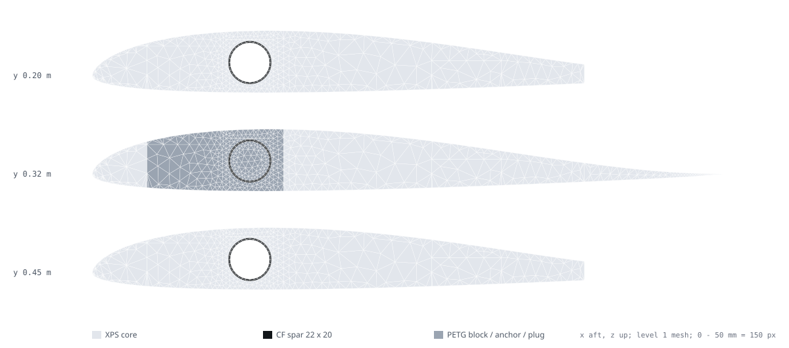
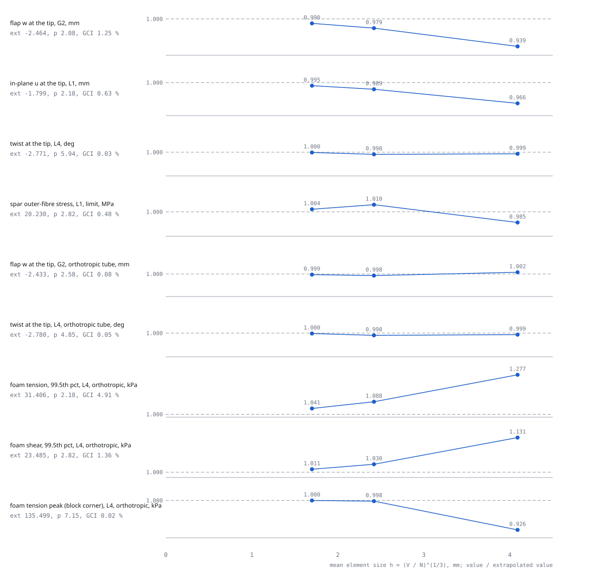
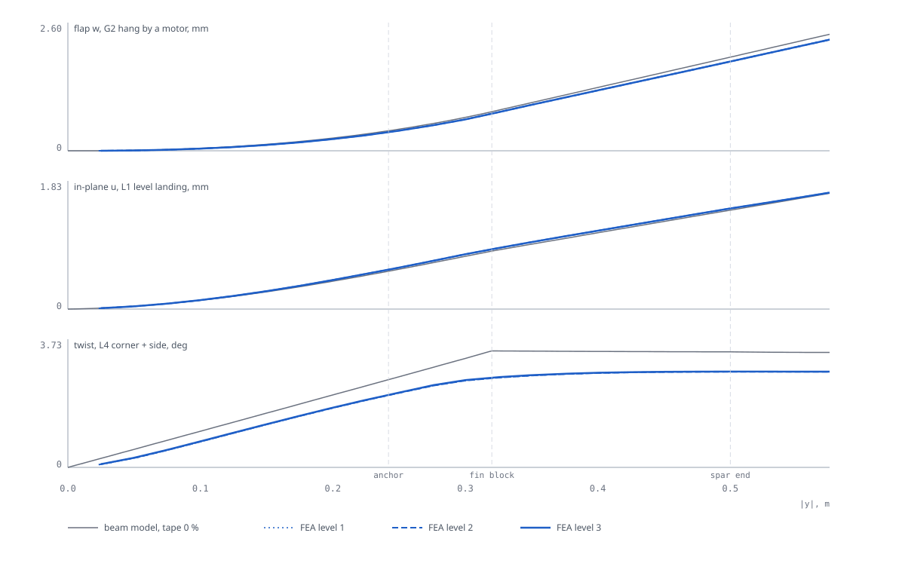

# Wing structure — simulation report (3-D FEA of the as-designed wing)

Owner: C2. Revision **C2-R2-SIM**, 2026-11-10. Geometry D1-R1 (`subsystems/wing/fusion/wing.py` read live through
`team/D1/wing_data.py`), params A1-R4, loads C1-R4 (limit), masses A3-R5 via C1 (A3-R6a moved take-off mass 1 g).
Status: model and numerics `CHECKED`; every material value `UNVERIFIED` until T-C4-TUBE-BEND, T-C2-XPS-COUPON and
T-C2-WING-PROOF run.

**Verdict.** The 3-D model confirms the beam model and the hand calculations it replaces checks for: tip deflection
within 5 %, in-plane within 1 %, spar stress between the composite-beam and spar-alone hand values, and the wing
**16 % stiffer in twist** than the beam model (so every aeroelastic and torsion-mode claim is conservative). Spar,
bulk foam and PETG pass with MS ≥ +1.8. **Two things fail and are new:**

1. **Foam at the inboard corners of the through-core block pockets** (L4 corner + side landing, ultimate): tension
   peak 203 kPa vs 150 kPa (MS −0.26), compression peak 199 kPa vs 120 kPa (MS −0.40). The peak is mesh-converged
   (GCI 0.02 %), so it is a real stress concentration at the PETG–foam corner. Fix: radius / fillet the pocket edges
   (CR-C2-11), then proof-test.
2. **If the half-fin root fillet carries station load into the core** (fillet intact), the fin-root tab between the
   elevons fails in shear (99.5th percentile 222 kPa vs 100 kPa). The wing passes on the C4 primary path (tube →
   block → spar). C4 must keep the fillet fail-safe and give C2 its load share (CR-C2-12); D1 radius the cut-out
   corners (CR-C2-13).

`R-VIBRATION` stays `FAIL` (beam modal result unchanged; CR-C2-04).

## 1. What was simulated

| Item | Model | Source |
|---|---|---|
| Geometry | right half-wing y 0 → 0.575 m, S5010 c 0.32 m; cut-outs as drawn: pod recess and saddle windows, brace-anchor pockets (PETG), through-core blocks (PETG, x 0.028–0.097, \|y\| 0.302–0.338), 36 mm block plugs and 20 mm anchor plugs in the spar, servo pockets (void), elevon cut-outs aft of the hinge x 0.2496 (void), spar end \|y\| 0.50 | `team/D1/wing_data.py` → `wing.py` (D1-R1) |
| Materials | XPS E 10 MPa, ν 0.25; PETG printed 1.1 GPa (2.0 GPa × fill 0.55), ν 0.35; CF tube **set O**: transversely isotropic about its axis, E axial 70 GPa, E hoop/radial 8 GPa, G axial 3 GPa (`ASM-C2-TUBE-ET`) | `params.json#c2.inputs` (low corner) |
| Isotropic tube sets (SU2 can only do isotropic) | **B**: E 70 GPa (bending exact, torsion 9 × too stiff); **T**: E = 2 G (1 + ν) = 7.8 GPa (torsion exact, bending 9 × too soft). They bracket set O | — |
| Not modelled | tape skin (stiffness-conservative; compared with the beam model at tape 0 %), bond lines, foam non-linearity, the pod (conservative at the root) | — |
| Boundary | clamped at the centreline plane y = 0 (all dofs) | as the beam model |
| Loads | C1-R4 cut loads (`team/C1/data/wing_spanwise.csv`) differenced into ≤ 25 mm strips; each strip's 3 forces + 3 moments about the spar axis applied as uniform tractions on its skin patches (least-norm, exact resultants). **Station strips** (block and anchor spans) load only the skin over the hard point (C4 primary path); the **sensitivity** variant spreads them over the whole strip (fin root fillet carrying load) | `fea/wing_fea.py#tractions` |
| Cases | G2 hang by a motor (max flap), L1 level landing (max in-plane / spar root), L4 corner + side (max twist / station torque), F1 pull-up at VD (flight) | C1 envelope |
| Equilibrium check | root reactions = −applied load in every run, to 0.01 N | `out/fea_report.json#cases.*.root_reaction_N` |

`FIG C2-05 — Level-1 section mesh at y 0.20, 0.32 (through-core block) and 0.45 m; the same mesh is extruded along the span.`

## 2. Mesh levels

| Level | Section nodes | Span layers | Nodes | Elements (hex / wedge) | Free dofs | h = (V/N)^⅓ | Tube wall (θ × r) |
|---|---|---|---|---|---|---|---|
| 1 | 853 | 54 | 36 510 | 51 955 (3 456 / 48 499) | 107 397 | 4.09 mm | 32 × 2 |
| 2 | 1 975 | 99 | 154 313 | 250 827 (19 008 / 231 819) | 458 298 | 2.42 mm | 64 × 3 |
| 3 | 3 605 | 146 | 424 852 | 724 746 (56 064 / 668 682) | 1 266 123 | 1.70 mm | 96 × 4 |

## 3. Solvers and their checks

| Check | Method | Result | Status |
|---|---|---|---|
| SU2 ELASTICITY solver setting | tube cantilever, CG + ILU(0) / ILU(2) / Jacobi / LU_SGS, 3 000 iterations | **ILU diverges** (residual grows, tip w ≈ 0, run still says "Exit Success"); LU_SGS reaches 1e-8 in 2 830 iterations | `CHECKED` (CR-C2-14) |
| Element vs beam theory | spar tube alone, 0.5 m cantilever, level-2 tube mesh, tip shear 10 N / tip torque 1 N·m | w −2.3 % (linear hex, 3 through the wall), twist +0.3 %; SU2 and PCG give the same 1.6004 mm | `CHECKED` `CL-C2-FEA-TUBE-VALID` |
| SU2 vs in-house solver, same mesh and loads | level 1, 12 runs (8 sensitivity + 4 primary): SU2 CG + LU_SGS to 1e-8 (11–12 k iterations, 690–1 430 s each) vs in-house assembly + two-level PCG | largest tip w / u / twist difference **1.7 × 10⁻⁸** | `CHECKED` `CL-C2-FEA-SU2-AGREE` |
| Why a second solver | SU2's Krylov solve needs 11–12 k iterations at level 1; at levels 2–3 that is hours per case on the shared machine. The in-house path (same hex/wedge formulation, full Gauss integration) uses CG with a two-level preconditioner (exact LU of every span layer + 12 section modes per layer) | 510–1 170 iterations, ≤ 1e-7 true residual, 5–20 min per level-3 case | `CHECKED` |

## 4. Mesh convergence (3 levels, GCI after Celik et al. 2008, Fs 1.25)

| Quantity (limit load) | L1 | L2 | L3 | Extrapolated | Order p | GCI fine |
|---|---|---|---|---|---|---|
| Flap w at the tip, G2, set B | 2.313 mm | 2.414 mm | 2.440 mm | 2.464 mm | 2.1 | 1.25 % |
| Flap w at the tip, G2, set O | 2.437 mm | 2.430 mm | 2.432 mm | 2.433 mm | 2.6 | 0.08 % |
| In-plane u at the tip, L1, set B | 1.739 mm | 1.780 mm | 1.791 mm | 1.799 mm | 2.2 | 0.63 % |
| Twist at the tip, L4, set T | 2.767° | 2.766° | 2.770° | 2.771° | 5.9 | 0.03 % |
| Twist at the tip, L4, set O | 2.777° | 2.775° | 2.779° | 2.781° | 4.9 | 0.05 % |
| Spar outer-fibre stress near the root, L1, set B | 19.92 MPa | 20.44 MPa | 20.31 MPa | 20.23 MPa | 2.8 (oscillating) | 0.48 % |
| Foam tension, 99.5th-percentile element, L4, set O | 40.1 kPa | 34.2 kPa | 32.7 kPa | 31.4 kPa | 2.2 | 4.9 % |
| Foam shear, 99.5th-percentile element, L4, set O | 26.6 kPa | 24.2 kPa | 23.7 kPa | 23.5 kPa | 2.8 | 1.4 % |
| Foam tension peak at the block pocket corner, L4, set O | 125.4 kPa | 135.3 kPa | 135.5 kPa | 135.5 kPa | 7.2 | 0.02 % |

Every quantity a decision rests on has GCI ≤ 4.9 % against the 5 % limit (`CL-C2-FEA-GCI`). The corner peak
converges rather than growing, so it is a resolved concentration (soft PETG against softer foam), not a
mesh-driven singularity.

`FIG C2-04 — Each governing quantity at the three levels, divided by its extrapolated value, against element size.`

## 5. Results and margins (ultimate = 1.5 × limit; finest level available; MS = allowable / stress − 1)

| Check | 3-D FEA | Earlier value (hand / beam) | Allowable / limit | MS | Claim | Status |
|---|---|---|---|---|---|---|
| Spar stress, max anywhere (G2, y 0.301 at the block face, set O) | 38.3 MPa | 59.8 MPa (hand, brace couple, spar alone) | 350 MPa | **+8.1** | `CL-C2-FEA-SPAR-SIGMA-ULT` | `UNVERIFIED` (allowable) |
| Spar stress near the root, L1, limit | 20.3 MPa | 16.8 composite beam / 37.1 spar alone | — | — | §6 | `CHECKED` |
| Tip deflection / semi-span (G2, extrapolated, no tape) | 0.0043 (2.46 mm) | 0.0044 (beam, tape 50 %) | 0.05 | +10.7 | `CL-C2-FEA-TIP-DEFL-FRAC` | `UNVERIFIED` |
| Foam tension, 99.5th-percentile element (L4, set O) | 49.0 kPa | 36.3 kPa (beam, root) | 150 kPa | **+2.06** | `CL-C2-FEA-FOAM-S1` | `UNVERIFIED` |
| Same, bracket of isotropic sets B / T | 64.7 kPa (G2, T) | — | 150 kPa | +1.32 | `fea_report.json#margins` | — |
| Foam shear, 99.5th-percentile element (L4, set O) | 35.6 kPa | 6.2 kPa (slot bond) | 100 kPa | **+1.81** | `CL-C2-FEA-FOAM-TAU` | `UNVERIFIED` |
| PETG block / anchor / plug, von Mises peak (L4, set O) | 2.7 MPa | 5.3 MPa (plug bearing hand calc) | 20 MPa | **+6.3** | `CL-C2-FEA-PETG` | `UNVERIFIED` |
| **Foam tension peak, block pocket inboard-front-lower corner** (x 0.029, y 0.301, z −0.006) | 203 kPa | not in the beam model | 150 kPa | **−0.26** | `CL-C2-FEA-FOAM-CORNER-S1` | `FAIL` |
| **Foam compression peak, block pocket inboard-aft corner** (x 0.097, y 0.301, z −0.008) | 199 kPa | — | 120 kPa | **−0.40** | `CL-C2-FEA-FOAM-CORNER-S3` | `FAIL` |
| Foam shear peak, same corner (upper) | 90 kPa | — | 100 kPa | +0.11 | `fea_report.json#margins` | `UNVERIFIED` |

The corner peaks occupy the first 1–2 mm of foam at the block's inboard face, under the L4 corner landing (lower fin
tip hits with side load) at ultimate. XPS yields locally before it cracks, and the 60 mm tape doubler over the pocket
(not modelled) adds a tension face. Neither is a credited margin: CR-C2-11 removes the corner, and T-C2-WING-PROOF
inspects it.

## 6. Comparison with the earlier analysis

| Quantity | 3-D FEA (L3) | Beam model, tape 0 % | Ratio | What it means |
|---|---|---|---|---|
| Flap w at the tip, G2 | 2.44 mm (B) / 2.43 mm (O) | 2.55 mm | 0.955 | the beam model is 4.5 % conservative: the blocks and plugs stiffen the wing more than the D1 cut-outs soften it |
| Flap w at the tip, F1 (flight) | 1.008 mm | 1.021 mm | 0.987 | same |
| In-plane u at the tip, L1 | 1.790 mm | 1.811 mm | 0.989 | same |
| Twist at the tip, L4 | 2.77° (T) / 2.78° (O) | 3.30° | **0.84** | FEA is stiffer in torsion (blocks, plugs and root warping restraint): effective GJ about +19 %, torsion modes about +9 %; all reversal, divergence, flutter and roll-effectiveness claims are conservative |
| Spar stress near the root, L1 | 20.3 MPa | 16.8 MPa (composite section) / 37.1 MPa (spar alone) | 1.21 / 0.55 | the pod recess and saddle windows at y 0.03–0.07 remove foam that the beam model lets share in-plane bending; the spar-alone hand calc (the design claim) stays the upper bound |
| Spar stress, max | 25.5 MPa limit at the block face (G2) | 39.9 MPa limit (hand, brace couple, spar alone) | 0.64 | hand calc conservative |

`FIG C2-03 — Flap w (G2), in-plane u (L1) and twist (L4) along the half-span: FEA levels 1–3 (blue) against the beam model at tape 0 % (grey).`

## 7. Sensitivity: station loads through the fin root fillet

D3's half-fin root is filleted to the core along the chord (15 mm aft of the hinge). C4 treats that fillet as
fail-safe only. Spreading each station strip's load over its whole skin (block to TE) bounds the case where the
fillet carries it:

| Case (finest run) | Foam tension, 99.5th pct, ult | Foam shear, 99.5th pct, ult | Peak tension at the elevon cut-out corner (sharp, grows with mesh) |
|---|---|---|---|
| L4, set B, L2 | 192 kPa | **222 kPa** | 1.9 MPa (x 0.31, y 0.339) |
| L4, set T, L3 | 133 kPa | 126 kPa | 2.1 MPa (x 0.31, y 0.339) |
| G2, set B, L3 | 150 kPa | 124 kPa | 0.8 MPa (hinge, y 0.342) |

Shear exceeds 100 kPa in both governing cases (`CL-C2-FEA-FOAM-FILLET-SENS`, expected FAIL). Flap deflection
changes 4 %, spar stress 9 %. So the tab between the elevons cannot be a load path for the fins: CR-C2-12, CR-C2-13.

## 8. Requirements after this round

| Requirement | Result | Claim | Status |
|---|---|---|---|
| `R-STRUCT-MARGIN`, spar, PETG, bulk foam | MS +8.1, +6.3, +1.81 | `CL-C2-FEA-SPAR-SIGMA-ULT`, `-PETG`, `-FOAM-S1`, `-FOAM-TAU` | `UNVERIFIED` (allowables) |
| `R-STRUCT-MARGIN`, foam at the block pocket corners | MS −0.26 / −0.40 | `CL-C2-FEA-FOAM-CORNER-S1`, `-S3` | **`FAIL`** → CR-C2-11 |
| Tip deflection ≤ 5 % semi-span | 0.43 % | `CL-C2-FEA-TIP-DEFL-FRAC` | `UNVERIFIED` |
| `R-VIBRATION` (wing modes ≥ 20 % from rotor orders) | 0.072 (beam modal; the FEA stiffnesses move torsion modes +9 %, flap modes +2 %) | `CL-C2-WING-MODE-SEP` | **`FAIL`** → CR-C2-04 (tap test + notch) |
| Aeroelastic clearance to 1.2 VD | reversal 53 m/s, divergence 91 m/s, flutter none to 80 m/s; FEA says conservative | `CL-C2-V-*` | `UNVERIFIED` |

## 9. Files and re-run

| Step | Command (repo root) | Time | Output |
|---|---|---|---|
| SU2 runs, level 1 (primary loads, 4 governing runs) | `python -I redesign/team/C2/fea/wing_fea.py --levels 1 --workers 4 --no-validation --intro block --out su2_blk_L1.json --jobs L1-LEVEL/B G2-HANG-MOTOR/B L4-CORNER-SIDE-Y/T F1-PULLUP-VD/B` | ~15 min | `fea/out/su2_blk_L1.json` |
| SU2 tube validation + level 1 sensitivity | `python -I redesign/team/C2/fea/wing_fea.py --levels 1 --workers 8 --intro distributed --out su2_dist_L1.json` | ~40 min | `fea/out/su2_dist_L1.json` |
| In-house solves | `python -I redesign/team/C2/fea/wing_fea_direct.py --levels L --sets B T O [--cases …] --intro block --out blk_<tag>.json` (one process per level/set; level 3 needs ~6 GB) | 5–20 min per level-3 case | `fea/out/blk_*.json`, `direct_*.json`, `dist_L1.json` |
| Post-process, figures, params | `python -I redesign/team/C2/fea/fea_report.py` | ~30 s | `fea/out/fea_report.json`, `fea/params.json`, `fig/C2-03…05` |
| Claims, proof chain | `python -I redesign/team/C2/fea/fea_claims.py` → `python -I redesign/proofs/build_graph.py` | < 1 min | `fea/claims.json` |

SU2 logs and configs of the level-1 runs: `fea/out/su2_logs/`. Code: `fea/su2fea.py` (mesh, SU2 I/O, element
library, orthotropic tube), `fea/wing_fea.py` (geometry, loads, SU2 driver), `fea/wing_fea_direct.py` (PCG solver).
