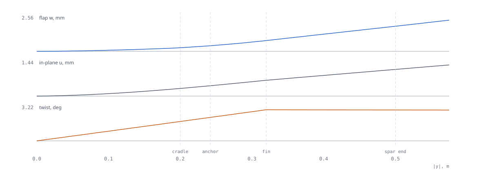
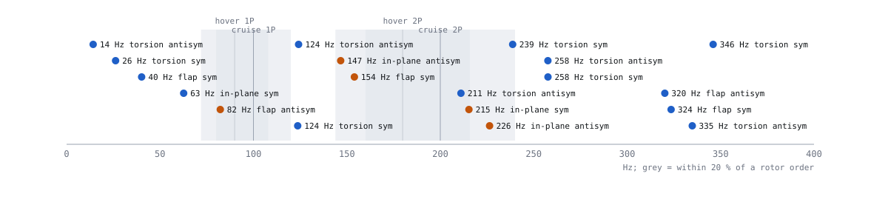

# Wing structure — K09-L

Owner: C2 (wing structures). Revision **C2-R2**, 2026-11-10, at params A1-R4, C1-R4 loads (A3-R5 masses; A3-R6a moved
the take-off mass by 1 g) and D1-R1 geometry. Status: calculations `CHECKED` (convergence, two beam methods, hand
checks, and since R2 a 3-D FEA of the as-designed wing: [`SIMULATION-REPORT.md`](SIMULATION-REPORT.md)). Every
material value stays `UNVERIFIED` until the coupons, the tube bend test and the wing proof test run.
Re-run (about 25 s): `python -I redesign/team/C2/wing_struct.py` → `python -I redesign/team/C2/c2_claims.py` →
`python -I redesign/proofs/build_graph.py`. 3-D FEA: see the report.

**Verdict.** The 22 × 20 mm spar, the one-piece XPS core and one layer of tape carry every C1 case with margin. All
spar margins are ≥ +1.4 and tip deflection is 9 % of the allowed value. The 3-D FEA of the as-designed wing (all D1
cut-outs) agrees with the beam model on deflection (within 5 %) and shows it is conservative on twist (16 %). Four
things need action:
1. **Plugs inside the spar** at the through-core blocks and at the brace anchors. Without them the 1 mm wall cracks
   as a ring.
2. **The wing is soft in torsion.** The first two wing modes (12–29 Hz) are the fin stations rocking about the spar.
   They sit in the hover pitch and yaw control path.
3. **Wing modes fall inside the 80–330 Hz rotor band** (`R-VIBRATION` FAIL). No reasonable spar fixes this, so the
   tap test and the F4 harmonic notch close it.
4. **Foam at the block-pocket corners** (3-D FEA, L4 ultimate): MS −0.26 tension, −0.40 compression. Radius or
   fillet the pocket edges (CR-C2-11) and inspect them in the proof test.

## 1. What the structure is

| Item | Definition | Part | Status |
|---|---|---|---|
| Spar | CF tube 22 × 20 × 1 000 mm, unspliced, \|y\| ≤ 0.50 m, x 0.080, z +0.0066 m; foam cover 5.0 mm upper / 4.3 mm lower | `WNG-002` | `MODELLED` (D1) |
| Core | one-piece XPS F-250, S5010, c 0.32 m; **no ribs**: the core is the rib, the PETG blocks are the hard points at \|y\| 0.32 m | `WNG-001` | `MODELLED` (D1) |
| Skin | packing tape, 1 layer each side, spanwise strips, 10 % overlap, 15 mm round the LE | `WNG-003` | `MODELLED` (D1) |
| Spar plugs | PETG Ø 19.8 × 36 mm at \|y\| 0.32 m (block, `WNG-004`) and Ø 19.8 × 20 mm at \|y\| 0.242 m (brace anchor; upper and lower anchors share one, `WNG-005`); 4 in all, bonded inside the tube | `WNG-004`, `WNG-005` | `MODELLED` (D1) |
| Wing joint | **none**: one-piece wing, one-piece transport (P6). The attachments are the 2 through-core blocks, 4 brace anchors, the pod bond and 2 cradle contacts | — | — |

Load path: air load on the skin and foam → spar through the slot bond (98 % of flap bending, 44 % of in-plane
bending, 81 % of torsion goes to the spar by stiffness) → across the centreline. Fin-group loads come in through the
block bore and the brace saddles straight onto the spar (C4 load path). Root, centreline and pod carry no joint.

## 2. Basis

| Input | Value | Unit | Source | Status |
|---|---|---|---|---|
| Loads | C1-R4 cut loads on the spar axis, every 5 mm, all cases × 2 mass configurations | — | `team/C1/data/wing_spanwise.csv` | `UNVERIFIED` (C1) |
| VD / q at VD | 26.7 / 453 | m/s / Pa | `CL-C1-VD`, `CL-C1-Q-VD` | `CHECKED` (C1) |
| Factor of safety / fitting / printed-bonded | 1.5 / 1.15 / 1.25 | — | `P:requirements.safety_factor_ult`, C1 | `PROPOSED` |
| Spar E (nominal / low corner used for every stiffness claim) | 100 / 70 | GPa | `ASM-J1-E-TUBE`, `ASM-C4-E-TUBE-LO` | `UNVERIFIED` (T-C4-TUBE-BEND) |
| Spar G (nominal / low) | 5 / 3 | GPa | `ASM-C4-G-TUBE`, `-LO` | `UNVERIFIED` |
| Spar allowables: bending / shear / hoop | 350 / 30 / 40 | MPa | `ASM-C2-SPAR-SIGMA`, `-TAU`, `-HOOP` | `UNVERIFIED` |
| XPS: E, G / allowable compression, tension, shear | 10, 4 / 0.12, 0.15, 0.10 | MPa | `ASM-C2-XPS` | `UNVERIFIED` (T-C2-XPS-COUPON) |
| Tape: E, t, allowable; stiffness effectiveness | 2 GPa, 44 µm, 60 MPa; 50 % | — | `ASM-C2-TAPE`, `-TAPE-EFF` | `UNVERIFIED` |
| PETG bearing allowable | 20 | MPa | `ASM-C4-PETG-BEARING` (C4) | `UNVERIFIED` |
| Rotor forcing: hover 1P / 2P, cruise 1P / 2P | 90.3 / 180.5, 99.1 / 198.2 | Hz | `CL-B4-HOVER-RPM`, `CL-B4-CRUISE-RPM` | `UNVERIFIED` |

All inputs sit in `params.json#c2.inputs` (one place); the claims read them from there.

## 3. Section properties (S5010, structural box LE → hinge x 0.2496 m)

| Property | Low corner (E 70, G 3) | Nominal (E 100, G 5) | Unit | Spar share (low) |
|---|---|---|---|---|
| EI flap | 262 | 372 | N·m² | 98 % |
| EI in-plane (chordwise) | 723 | 833 | N·m² | 44 % |
| GJ (foam 4.6 + tape cell 4.2 + spar) | 30.7 | 45.2 | N·m² | 81 % |
| Shear centre x / modulus-weighted x | 0.0800 / 0.0807 | 0.0800 / 0.0805 | m | spar at 0.080 (25 % c) |
| Mass per metre (core, tape, spar, fill) | 0.333 | 0.333 | kg/m | section CG x 0.114 m |

## 4. Strength (ultimate = 1.5 × limit; MS = allowable / stress − 1)

| Check | Stress | Allowable | MS | Claim | Status |
|---|---|---|---|---|---|
| Spar root bending, spar alone, envelope (L1, 19.6 N·m) | 59.3 MPa | 350 MPa | +4.9 | `CL-C2-SPAR-SIGMA-ULT`, `-ENV` | `UNVERIFIED` (allowable) |
| Spar, 3-D FEA, max anywhere (G2, block face) | 38.3 MPa | 350 MPa | +8.1 | `CL-C2-FEA-SPAR-SIGMA-ULT` | `UNVERIFIED` |
| Spar shear: all torsion + shear on the spar | 12.3 MPa | 30 MPa | +1.4 | `CL-C2-SPAR-TAU-ULT` | `UNVERIFIED` |
| Spar local buckling vs bending stress | 2 000 vs 59.3 MPa | — | +33 | `CL-C2-SPAR-BUCKLE` | `CHECKED` |
| Spar between anchor and block, brace couple added | 59.8 MPa | 350 MPa | +4.9 | `CL-C2-SPAR-SIGMA-BRACE` | `UNVERIFIED` |
| Spar wall ring bending at the block bore, **no plug** (961 N design couple, C4) | 911 MPa | 40 MPa | **−0.96** | `CL-C2-RING-NO-PLUG` | `FAIL` → plug |
| Spar wall under the brace saddle, **no plug** (143 N design, 16 mm saddle) | 76.4 MPa | 40 MPa | **−0.48** | `CL-C2-RING-ANCHOR` | `FAIL` → plug |
| Plug bearing with the plug fitted (block, design) | 5.3 MPa | 20 MPa | +2.7 | `CL-C2-PLUG-BEARING` | `UNVERIFIED` |
| Slot bond / foam shear, air load into the spar | 6.2 kPa | 100 kPa | +15 | `CL-C2-SPAR-BOND-TAU` | `UNVERIFIED` |
| Tape at the root, in-plane + flap, full tape stiffness | 7.3 MPa | 60 MPa | +7.3 | `CL-C2-ROOT-TAPE` | `UNVERIFIED` |
| Chordwise bending of the core aft of the spar, CN 1 at q_VD: tape faces | 13.0 MPa | 60 MPa | +3.6 | `CL-C2-CHORD-TAPE` | `UNVERIFIED` |
| Same with the tape lost (bare foam) | 109 kPa | 150 kPa | +0.37 | `CL-C2-CHORD-FOAM` | `UNVERIFIED` |
| Core foam, 3-D FEA, 99.5th-percentile element (tension / shear) | 49 / 36 kPa | 150 / 100 kPa | +2.06 / +1.81 | `CL-C2-FEA-FOAM-S1`, `-TAU` | `UNVERIFIED` |
| Core foam, 3-D FEA, block-pocket inboard corners (tension / compression) | 203 / 199 kPa | 150 / 120 kPa | **−0.26 / −0.40** | `CL-C2-FEA-FOAM-CORNER-S1`, `-S3` | `FAIL` → CR-C2-11 |
| Foam outboard of the spar end (y 0.50–0.575), flight/landing | 3.7 kPa | 150 kPa | +40 | `CL-C2-TIP-FOAM` | `UNVERIFIED` |
| Pod bond shear in the wing foam (design) | 5.4 kPa | 100 kPa | +18 | `CL-C2-POD-FOAM` | `UNVERIFIED` |
| Transport cradle: pad area for the X3 drop | ≥ 1 165 mm² | — | — | `CL-C2-CRADLE-AREA` | `PROPOSED` (D7: 40 × 40 mm) |
| Damage case L6 wingtip strike (86 N at the TE tip) | tape 169 MPa at y 0.50 | 60 MPa | fails | `out/results.json#tip_foam` | the tip is the fuse: re-cut 75 mm, re-tape |

The spar is sized by **stiffness, torsion and robustness, not strength**. Spar trade at the same loads
(`out/results.json#spar_trade`):

| Tube | Spar mass | σ ult | Tip w, G2 | First mode (torsion) | Verdict |
|---|---|---|---|---|---|
| 16 × 14 | 73 g | 118 MPa | 6.6 mm | 8.8 Hz | strong enough, −29 g, torsion mode −26 %, own stock |
| 20 × 18 | 93 g | 73 MPa | 3.4 mm | 10.7 Hz | −10 g |
| **22 × 20** | **102 g** | **59 MPa** | **2.5 mm** | **11.9 Hz** | **kept**: same stock as the motor tubes (one order), the block bores are drawn for it |
| 25 × 23 | 117 g | 45 MPa | 1.7 mm | 13.8 Hz | +15 g, cover 3.1 mm |

## 5. Deflection and twist (limit, low corner E 70 / G 3, tape 50 %)

| Quantity | Value | Limit | Case | Claim | Status |
|---|---|---|---|---|---|
| Tip deflection / semi-span, all envelope cases | 0.0044 (2.52 mm) | 0.05 | G2 hang by a motor | `CL-C2-TIP-DEFL-FRAC` | `UNVERIFIED` |
| Same, 3-D FEA (no tape, extrapolated) | 0.0043 (2.46 mm) | 0.05 | G2 | `CL-C2-FEA-TIP-DEFL-FRAC` | `UNVERIFIED` |
| Tip deflection, flight cases | 1.00 mm | — | F1 pull-up at VD | `params.json#c2.fe.w_tip_flight_m` | `UNVERIFIED` |
| In-plane deflection, max | 1.43 mm | — | L1 landing | `c2.fe.u_max_env_m` | `UNVERIFIED` |
| Twist, flight (nose-down at the tip) | 1.84° | — | F7 rolling pull-up at VA | `CL-C2-TWIST-FLIGHT` | `UNVERIFIED` (T-C2-TWIST) |
| Twist, envelope | 2.88° | — | L4 corner + side | `c2.fe.twist_env_rad` | `UNVERIFIED` |
| Elevon roll effectiveness at VD, flexible / rigid | 0.78 | — | strip theory, root held | `CL-C2-ROLL-EFF-VD` | `UNVERIFIED` |
| Roll reversal (spar-only GJ bound) | 53.3 m/s | ≥ 1.2 VD = 32.0 | — | `CL-C2-V-REVERSAL` | `UNVERIFIED` |
| Divergence (spar-only GJ, shear centre 20 mm aft) | 91.1 m/s | ≥ 32.0 | at the computed shear centre: none below 3 000 m/s | `CL-C2-V-DIVERGENCE` | `UNVERIFIED` |
| Flutter screen, modal p-k, 6 modes, Theodorsen strips | no unstable root to 80.1 m/s (3 VD) | ≥ 32.0 | every mode damps more with speed | `CL-C2-V-FLUTTER` | `UNVERIFIED` (tap test) |

`FIG C2-01 — Limit-load envelope along the half-span: flap w, in-plane u, twist (all sizing cases, both sides, low corner).`

## 6. Modes (free-free, all masses on board, motor stations rigid)

| Mode (nominal / low corner) | Hz | Motor/mount energy | Nearest rotor order, separation | Meaning |
|---|---|---|---|---|
| Antisymmetric torsion: fin stations rock in opposite senses | 14.4 / 11.9 | 63 % | — | `CL-C2-F-TORSION-ANTI`; in the hover yaw path |
| Symmetric torsion: both stations pitch against the pod | 29.0 / 24.1 | 34 % | — | `CL-C2-F-TORSION-SYM`; in the hover pitch path |
| Symmetric flap | 40.6 / 34.1 | 38 % | — | — |
| Symmetric in-plane | 64.0 / 58.8 | 16 % | hover 1P, 0.29 | — |
| **Antisymmetric flap** | **83.8** / 70.3 | 61 % | hover 1P, **0.072** | `CL-C2-WING-MODE-SEP` = 0.072 vs ≥ 0.20: `FAIL` |
| Symmetric flap (2nd) | 146.6 | — | hover 2P, 0.19 | `FAIL` |

Over the 12 stiffness corners (E 70/100 GPa × G 3/5 GPa × tape 0/50/100 %) some station mode always sits within 1 %
of a rotor order (worst 0.007). Re-sizing the spar cannot clear the band reliably (trade table above). The route is
the one `R-VIBRATION` allows: measure (T-C2-TAP-TEST), then let F4 notch the measured peaks (CR-C2-04). The 3-D FEA
finds the wing about 19 % stiffer in torsion than the beam model ([report §6](SIMULATION-REPORT.md)), which moves
the torsion modes up about 9 %; it changes nothing above.

`FIG C2-02 — Wing modes below 400 Hz at nominal stiffness against the ±20 % windows round hover and cruise 1P and 2P; orange = station mode inside a window.`

## 7. Method and checks

| Step | Method | Check | Result | Status |
|---|---|---|---|---|
| Hand calcs | spar σ = M r / I, τ = T r / J + 2V/A, Roark buckling, ring | proof chain re-runs them from C1's claims | 0 drift | `CHECKED` |
| Beam integration (every case, both sides) | curvature M/EI + shear V/GA, twist rate T/GJ, integrated from the centreline on C1's cut loads | step 20 / 10 / 5 mm: 0.733 / 0.748 / 0.756 mm | 1.1 % last step | `CHECKED` |
| NumPy 3-D Timoshenko frame FE | 6 dof/node, lumped rigid items at their true offsets; 6 → 96 elements per half | static 0.05 %, modes 0.03 % (48 → 96) | `CL-C2-FE-CONV-STATIC`, `-FREQ` | `CHECKED` |
| FE vs beam integration | independent load paths, same C1 loads | 0.22 % | `CL-C2-FE-VS-BEAM` | `CHECKED` |
| Ring model | thin ring, Castigliano | vs Roark 0.37 % | `CL-C2-RING-VALIDATION` | `CHECKED` |
| Aeroelastic statics / flutter screen | strip theory / modal p-k at 12, 24, 48 elements | 0.3 % | — | `CHECKED` |
| **3-D FEA (R2)** | gmsh mesh of the as-designed wing (D1 cut-outs, blocks, anchors, plugs, servo pockets, elevon gaps); SU2 ELASTICITY and an in-house PCG solve of the same mesh; 3 levels | GCI, SU2 = PCG, tube vs theory | [`SIMULATION-REPORT.md`](SIMULATION-REPORT.md) | `CHECKED` |

## 8. Tests (planned)

| Test | What | Closes |
|---|---|---|
| `T-C2-WING-PROOF` | wing on padded V-blocks under the spar at \|y\| 0.32; F1-equivalent sand bags; then G2: 51 N on one upper tube end; no crack, set < 0.5 mm; inspect the block-pocket and elevon cut-out corners | strength, deflection, FEA foam peaks |
| `T-C2-TAP-TEST` | aircraft on bungees, phone accelerometer at the pod and a fin tip, tap motors and fin tips, FFT to 400 Hz | modes, notch frequencies, flutter model |
| `T-C2-TWIST` | pod clamped, 2.9 N·m on a lever at one block, inclinometer at the block and the tip; pass GJ ≥ 25 N·m² | twist, reversal, divergence |
| `T-C2-XPS-COUPON` | density block; bare and taped 300 × 40 × 30 mm strips in 3-point bending to failure | all foam and tape allowables |
| `T-C4-TUBE-BEND` (C4) | spar E | every stiffness claim: re-run at the measured E |

## 9. Open issues

| # | Issue | Owner |
|---|---|---|
| 1 | Wing modes inside the rotor band (`CL-C2-WING-MODE-SEP` FAIL): tap test + harmonic notch (CR-C2-04) | F4, A2, H1 |
| 2 | Wing torsion modes 12–29 Hz sit in the hover pitch/yaw control path (CR-C2-03) | B3, F4 |
| 3 | All material values unverified; re-run after T-C4-TUBE-BEND and T-C2-XPS-COUPON | H1, G2 |
| 4 | 3-D FEA: foam at the block-pocket inboard corners MS −0.26 (tension) / −0.40 (compression) at ultimate (CR-C2-11); fin-root tab fails if the root fillet carries station load (CR-C2-12, -13) | D1, D3, C4, C6 |
