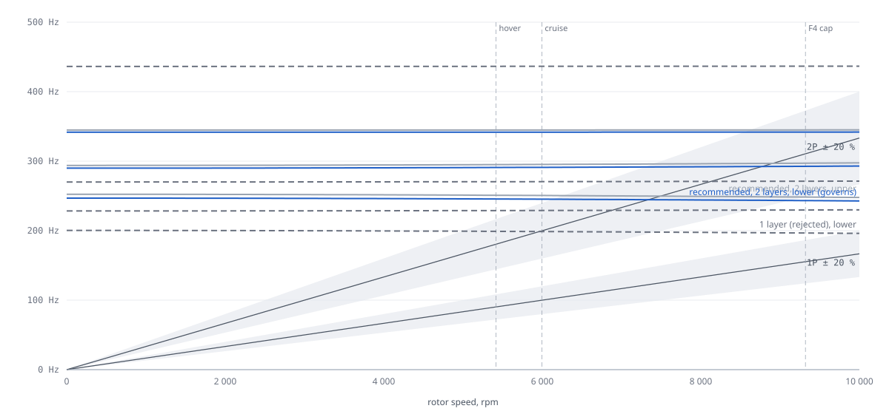

# Fin and motor-tube structures — K09-L

Owner C4 (fin / motor-tube structures). Revision **C4-R3**, 2026-11-09: re-run at params A1-R3 (0.21 m half-fins,
two layers, tube 0.344 m, 7° tangential cant), D3's R3 fin (`subsystems/fins/params.json`: 16 mm station collar with
40 mm tail, 10 × 2 brace, Ø 2 mm strip pins), C1 loads and B4 rpm as of 2026-11-09 15:00. Analysis `MODELLED`; every
input that is not a catalogue value is `UNVERIFIED` until the tests at the end have run.

Re-run (about 40 s): `python -I redesign/team/C4/fin_structures_d3.py` and `python -I redesign/team/C4/fin_structures.py`,
then `python -I redesign/proofs/build_graph.py` (0 errors in C4's own calculations; the remaining C4-related errors are
C6 calculations that read C4 claims and need a C6 re-run). Numbers below are in `claims.d3.json` (`CL-C4-D3-…`) or
`out/results_d3.json`. R1 (`fin_structures.py`, `claims.json`) is the concept model. It no longer matches the
geometry: the fin top is now above the tube end. It is kept only because D3 and C2 still read `CL-C4-STRUT-LEN` and
`CL-C4-SPAR-COUPLE` from it. None of its claims verify a requirement, and its `FAIL` flags are not design findings.

## What changed in R3 and why it matters

| Change | Effect | Claim |
|---|---|---|
| Half-fin 0.19 → 0.21 m | lower-quarter station mode 278 → 273 Hz; panel mode 66.7 → 65.2 Hz | `results_d3.json` "half height 0.19 m (R2)" |
| B4 rpm: hover 5 416, cruise 5 894 (2P 196.5 Hz) | separation measured against the new 2P cruise | `CL-B4-*-RPM` |
| Brace 10 × 3 → 10 × 2 (D3 R3, CR-C4-16) | separation 0.40 → 0.39; buckling MS +5.06 → +0.82; −9.3 g | `CL-C4-D3-BRACE-*` |
| Station collar 12 → 16 mm (D3, CR-C6-03) | brace ear 2 mm lower; collar bond MS +0.99 | `CL-C4-D3-MS-COLLAR` |
| 7° cant | thrust side component 12.2 % of T on the mount, collar and tube; prop spin axis tilted in the whirl model | `CL-C4-D3-CANT-SIDE`, `CALC-C4-D3-MOUNT-CANT` |
| Foot friction 0.5 → 0.7 (CR-C5-09) | L4/L5 side load 20.4 N (was 15.2 N); face and strip loads +34 % | `CL-C4-D3-SIDE-LOAD` |
| New in the FE: LE fillet cracked case, tube-torque jump at the collar, strip shear flow | answers CR-C6-03 and CR-C6-02a | `CL-C4-D3-COLLAR-T`, `-STRIP-Q` |

## Verdict

| Question | Answer | Claim | Status |
|---|---|---|---|
| `R-VIBRATION`, design as drawn (2 layers, 10 × 2 brace, strips) | **Met.** 273 Hz lower / 281 Hz upper; **0.39** from 2P cruise (196.5 Hz) | `CL-C4-D3-SEP` | `UNVERIFIED` |
| Worst tube E/G corner; with prop gyroscopics (7° axis) | 0.32; 0.39 | `CL-C4-D3-SEP-WORST`, `-WHIRL` | `UNVERIFIED` |
| One board layer (CR-D3-02, rejected) on R3 geometry | 222 Hz, **0.13** | `CL-C4-D3-SEP-1L` | `FAIL` (kept as the record) |
| B4 whole-band rule 80–330 Hz | −0.17. `R-VIBRATION` on the operating points is the criterion of record (D-45); rpm notch is the backup | `CL-C4-D3-SEP-BAND` | `FAIL` (by intent) |
| Strength, every part, envelope of LE fillet intact and cracked | positive. Tightest: fin face **+0.10** (fillet cracked; +0.78 intact), anchor +0.35 | `CL-C4-D3-MS-*` | `UNVERIFIED` |
| Edge strip on bare paper (CR-C6-02a) | **Fails without pins:** 1.99 N/mm per face (limit), 0.43 MPa design against 0.10 MPa, MS −0.77. **Pins required** (D3 has them); 64 N per pin | `CL-C4-D3-MS-STRIP-PAPER`, `-STRIP-PIN-F` | `FAIL` bare / pins `PROPOSED` |
| Collar torsion (CR-C6-03) | **4.61 N·m limit** (9.95 N·m design) + brace 95 N limit; needs 8.0 mm of bond; 16 mm gives MS +0.99 | `CL-C4-D3-COLLAR-T`, `-H-REQ` | `UNVERIFIED` |
| Mount with 7° cant | slip clamp holds: utilisation 0.66 (MS +0.52) incl. C1's mount moment; pull-off 4.8 N design | `CL-C4-D3-MS-MOUNT-SLIP` | `UNVERIFIED` |
| Mass | fins **416.8 g** (D3 R3 CAD) vs 408 g allocated | `CL-C4-D3-FINS-MASS` | `FAIL` (A1, CR-D3-16) |

## Forcing and criterion

| Point | rpm | 1P Hz | 2P Hz | Source |
|---|---|---|---|---|
| Hover | 5 416 | 90.3 | 180.5 | `CL-B4-HOVER-RPM` |
| Cruise, 16 m/s | 5 894 | 98.2 | 196.5 | `CL-B4-CRUISE-RPM` |
| F4 cap | 9 319 | 155.3 | 310.6 (transient, not counted) | `CL-B4-RPM-MAX` |

`R-VIBRATION`: every station mode ≥ `P:requirements.vibration_sep_frac` 0.20 from each point above. A station mode
has ≥ 10 % of its kinetic energy in the motor + prop + mount body.

## Model (`fin_fe.build_q`, one quarter, upper UR and lower LR)

| Item | Value | Source | Status |
|---|---|---|---|
| Tube | CF 22 × 20, frame elements, clamp at the bore ends z +30.4 / −16.6 mm, root spring 10 000 N·m/rad (swept 3 000–rigid) | `ASM-C4-BORE-Z`, `ASM-C4-ROOT-K` | `UNVERIFIED` |
| Tube E, G | 100 GPa (70–135), 5 GPa (3–10) | `ASM-J1-E-TUBE`, `ASM-C4-G-TUBE` | `UNVERIFIED` |
| Tube end / motor axis | z 0.172 / 0.190 m | `fin_detail.tube_length_m` 0.344 | `PROPOSED` |
| Mount | spring tube end → motor body: rocking 3 000, twist 30 000 N·m/rad | `ASM-C4-MOUNT-K-*` | `UNVERIFIED` |
| Half-fin | mapped Q4 Mindlin shell between the S5010 skin and the straight top edge (collar top 0.1595 → TE tip 0.21 m); LE tied to the tube (epoxy fillet) or, in the cracked case, only inside the 16 mm collar band | `fin_detail`, `fin_fe.py` `le_bonds` | `PROPOSED` |
| Board | 2 layers × 4.8 mm, faces 0.10 mm paper E 4 GPa, core E 10 / G 4 MPa | `ASM-C4-FACE-*`, `-CORE-*` | `UNVERIFIED` |
| Edge strips | CF 10 × 1, both faces, top edge, collar to foot; beam with I = w t d²/2 (d = 10.6 mm) | `fin_detail.edge_strip` | `PROPOSED` |
| Brace | CF 10 × 2 as drawn (10 × 3 compared); L 0.143 / 0.155 m; anchor + spar 3e7 N/m in series | `fin_detail.brace` | `PROPOSED` |
| Prop spin axis | (−cos 7°, sin 7° t_y, sin 7° t_z), t = motor-circle tangent | `P:propulsion.stations.cant_deg` | `PROPOSED` |

| Check | Result | Limit | Claim | Status |
|---|---|---|---|---|
| Quad shell = R1 rectangle element on a rectangle | 1e-15 | ≤ 1e-9 | `CL-C4-D3-Q4-RECT` | `CHECKED` |
| Skewed 16 × 16 cantilever plate vs Leissa | 0.9 % | ≤ 2 % | `CL-C4-D3-Q4-SKEW` | `CHECKED` |
| Mesh 12 × 10 / 24 × 20 (used) / 36 × 30, station mode and separation | 0.25 % | ≤ 3 % | `CL-C4-D3-MESH-CONV` | `CHECKED` |
| Strip shear flow, mesh 24 × 20 / 36 × 30 / 48 × 40 (L4, upper, intact) | 1.85 / 1.84 / 1.84 N/mm | converged | diagnostic run | `CHECKED` |

## Modes (nominal E, G; first three station modes, Hz; separation = nearest operating point)

| Configuration | Upper | Lower | Separation | Source |
|---|---|---|---|---|
| **As drawn: 2 layers, 10 × 2 brace, strips** | **281**, 332, 365 | **273**, 331, 358 | **0.39** | `CL-C4-D3-SEP` |
| same, 10 × 3 brace | 283, 333, 371 | 275, 331, 364 | 0.40 | `CL-C4-D3-BRACE-10X3-SEP` |
| same, LE fillet cracked (boss to collar) | 268 | 259 | 0.32 | `results_d3.json` |
| same, half height 0.19 m (R2) | 286 | 278 | 0.42 | same |
| same, mount 1 000 N·m/rad | 255 | 250 | 0.27 | same |
| same, root 3 000 N·m/rad | 270 | 264 | 0.34 | same |
| 2 layers, no brace | 156 | 142 | 0.00 `FAIL` | same |
| 2 layers, no edge strips (or strips debonded) | 186 | 182 | 0.01 `FAIL` | same |
| 1 layer (rejected) | 228 | 222 | 0.13 `FAIL` | `CL-C4-D3-SEP-1L` |

Panel mode (TE tip with the foot) 65.2 Hz, below 1P hover, < 10 % energy at the motor (`CL-C4-D3-PANEL`).
Mount rocking stiffness needed for 0.20: **905 N·m/rad** (low E/G corner; 770 nominal), estimate 3 000
(`CL-C4-D3-MOUNT-K-REQ`, margin +70 %). The bench test pass level becomes **≥ 1 000 N·m/rad**.

The edge strips are the second structural member of the station: if they debond from the board, separation drops to
0.01. The strip-to-board joint (pins below) therefore governs the vibration margin as well as strength.

`FIG FIN-C4-02 — Station whirl frequency vs rpm with the 7° spin axis, against 1P and 2P ± 20 %; dashed: one layer (rejected).`

## Strength (as drawn; ultimate = 1.5 × C1 limit; joints × 1.15 × 1.25; envelope over both quarters and LE fillet intact / cracked)

Limit cases per quarter: L1 level foot 38.2 N; L4 foot 29.1 N + side 20.4 N (μ 0.7, both senses); L5 the same along;
G2 51 N lateral at the tube end (both senses); **H2c** thrust 21.1 N along the 7° canted shaft at the prop centre +
0.42 N·m about the shaft (four sign combinations, both prints). Foot load over 30 mm.

| Item | Ultimate / design | Allowable | MS | Governing | Claim |
|---|---|---|---|---|---|
| Fin face (paper), LE fillet cracked / intact | 9.1 / 5.6 MPa | 10 MPa | **+0.10** / +0.78 | L4 | `CL-C4-D3-MS-FACE` |
| Edge strips 10 × 1 | 63 MPa | 400 MPa | +5.3 | L4 | `CL-C4-D3-MS-EDGE` |
| Tube at the bore end | 19.8 MPa | 400 MPa | +19 | G2 | `CL-C4-D3-MS-TUBE` |
| Brace buckling, 10 × 2 (10 × 3) | 164 N design (G2) | P_cr 300 N (1 012 N) | +0.82 (+5.06) | G2 | `CL-C4-D3-MS-BRACE`, `-BRACE-10X2-MS` |
| Brace-end bond, 10 mm engagement | 0.86 MPa | 2 MPa | +1.34 | G2 | `CL-C4-D3-MS-BRACE-END` |
| Station-collar bond, 16 mm (torsion 9.95 N·m + brace shear, design) | 1.00 MPa | 2 MPa | +0.99 | L4 / G2 | `CL-C4-D3-MS-COLLAR` |
| Collar ear root, interlayer bending | 2.3 MPa | 15 MPa | +5.5 | G2 | `CL-C4-D3-MS-EAR` |
| Anchor bond on the spar (pull-off, 0.5 peel) | 0.74 MPa | 1 MPa | +0.35 | G2 | `CL-C4-D3-MS-ANCHOR` |
| **Edge strip on the paper face, no pins** | 0.43 MPa | 0.10 MPa | **−0.77** | L4 | `CL-C4-D3-MS-STRIP-PAPER` |
| Foot deflection, L4 limit | 6.8 mm | — | — | L4 | `CL-C4-D3-FOOT-DEFL` |

### Collar torsion (CR-C6-03)

The FE gives the torque that enters the tube across the 16 mm collar band as the jump in tube torque. The edge strips
carry the foot side load to the collar as a cantilever, so their out-of-plane moment (4.3 N·m) makes up most of it.

| Case | Collar torque, limit | Tube torque at the bore end | Source |
|---|---|---|---|
| LE fillet intact, worst (L4, upper) | 4.52 N·m | 4.63 N·m | `CL-C4-D3-COLLAR-T-INTACT`, `-TUBE-T-ROOT` |
| **LE fillet cracked, worst (L4, upper)** | **4.61 N·m** | — | `CL-C4-D3-COLLAR-T` |
| H2c with the 7° cant | ≤ 0.07 N·m | — | `CALC-C4-D3-STATIC` per case |
| C1 `J-FINHALF` Mz (whole half-fin about the tube, μ 0.5) | 5.29 N·m | — | `ASM-C6-FINHALF-MZ-ULT` / 1.5 |

C6's 9.3 N·m (`ASM-C6-C4-COLLAR-T`) is not a C4 number. It is close to C1's fin-joint bending moment of 9.4 N·m. The
agreed basis I propose: **the collar carries the larger of C1's 5.29 N·m and `CL-C4-D3-COLLAR-T`, plus the brace force
`CL-C4-D3-BRACE-F`**. On C1's 5.29 N·m the bond needs 9.0 mm (MS +0.33 at 12 mm, +0.78 at 16 mm). On C4's it needs
8.0 mm. **Both pass at 12 mm.** The 16 mm collar is justified only by the strip tail tongue (D3/C6 geometry), not by
torsion.

### Edge-strip shear flow (CR-C6-02a)

Per face, at each top-edge node outside the foot shoe: q = |ΔN|/2/Δs (axial) + |V|/d (couple). The couple term is
92–98 % of it and nearly constant along the strip. The strip pair carries about 18 N of the 20.4 N side load back to
the collar, and that shear has to cross the board between the two faces.

| Quantity | Limit | Design (× 2.16) | Allowable | Result | Claim |
|---|---|---|---|---|---|
| q per face, worst (L4, LE fillet cracked) | 1.99 N/mm | 4.29 N/mm | — | intact 1.85 N/mm | `CL-C4-D3-STRIP-Q` |
| τ on the paper face (w 10 mm) | 0.20 MPa | 0.43 MPa | 0.10 MPa (0.5 × 0.20) | **MS −0.77** | `CL-C4-D3-MS-STRIP-PAPER` |
| Pin shear, Ø 2 mm at 15 mm pitch, pins carry it all | — | **64 N** | C6 sized 77 N (RF 1.41) | holds | `CL-C4-D3-STRIP-PIN-F` |
| Strip force per face into the collar tail | — | **908 N** | C6 used 1 348 N; 40 mm two-face tail 1 600 N | RF 1.76 | `CL-C4-D3-STRIP-END-F` |

The FE confirms C6's finding (C6: 0.51 MPa from a hand estimate; FE 0.43 MPa). The pins and the 40 mm tail are
required; the drawn bare-paper bond is not enough on its own.

### Mount with the 7° cant (`CALC-C4-D3-MOUNT-CANT`)

| Quantity | Limit | Design | Note | Claim |
|---|---|---|---|---|
| Side component | 2.57 N (12.2 % of T) | — | sin 7° | `CL-C4-D3-CANT-SIDE` |
| Pull-off along the tube (t_z 0.86) | 2.21 N | 4.77 N | slip-clamp friction capacity 227 N; lip cap takes the push | `CL-C4-D3-MOUNT-AXIAL` |
| Twist about the tube | 0.11 N·m | 0.25 N·m | Fy 1.31 N × 53 mm + Q sin 7° | `CL-C4-D3-MOUNT-TWIST` |
| Rocking at the tube end | 0.91 N·m | 1.97 N·m | for C6 / D3 mount strength | `CL-C4-D3-MOUNT-ROCK` |
| Slip clamp (2.5 N·m) use, cant + C1 mount moment 0.85 N·m ult | 0.66 | — | MS +0.52 | `CL-C4-D3-MS-MOUNT-SLIP` |

The cant adds 2–6 % to the tube, collar and brace loads (H2c never governs). Its effect on the whirl frequencies is
below 1 %.

## Through-core block (`FIN-004-R/L`), unchanged geometry

| Check | Stress | Allowable | MS | Claim |
|---|---|---|---|---|
| Design moment 23.1 N·m, force 120 N | — | — | — | `CALC-C4-D3-BLOCK` |
| Tube-bore wall shear-out (7 mm walls) | 6.4 MPa | 10 MPa | **+0.55** | `CL-C4-D3-BLOCK-MS` |
| Couple on the spar / on the tube (design) | 961 N / 1 249 N | — | — | `CL-C4-D3-SPAR-COUPLE` |

## Sizing sheet for D3 (R3)

| Feature | Size | Basis | Status |
|---|---|---|---|
| Board | 2 layers (9.6 mm), laminated, all four half-fins | `CL-C4-D3-SEP` 0.39 vs 0.13 with 1 | `PROPOSED` |
| Edge strips | CF 10 × 1, both faces, collar to foot, **Ø 2 mm CF through-pins at ≤ 15 mm pitch** (as drawn) | MS −0.77 bare; 64 N/pin | `PROPOSED` |
| Strip tail in the collar | 40 mm, both faces on PETG (as drawn) | 908 N/face design | `PROPOSED` |
| Brace | **CF 10 × 2 confirmed** (CR-C4-16 closed); 10 × 3 adds 9.3 g for +0.01 separation | MS +0.82, sep 0.39 | `PROPOSED` |
| Station collar | ≥ 12 mm for torsion (8.0 / 9.0 mm needed); 16 mm as drawn is fine | `CL-C4-D3-COLLAR-H-REQ` | `PROPOSED` |
| LE fillet to the tube | keep it, but it is not credited: every margin holds with it cracked | face +0.10 cracked | `PROPOSED` |
| Mount | rocking stiffness **≥ 1 000 N·m/rad** (needed 905); slip torque 2.5 N·m holds with the cant | `-MOUNT-K-REQ`, `-MS-MOUNT-SLIP` | `UNVERIFIED` |
| Tube, block, anchor | 22 × 20 × 0.344 m; block 69 × 36 mm; anchor saddle 20 × 16 mm | +19 / +0.55 / +0.35 | `PROPOSED` |

## Open issues

| # | Issue | Owner | Status |
|---|---|---|---|
| 1 | Fins 416.8 g vs 408 g allocated | A1, A3 (CR-D3-16) | open |
| 2 | Tube E, G, board faces, paper bond, mount and root stiffness, prop inertia are assumptions | I1, H1, C6 | `UNVERIFIED` |
| 3 | Band rule (80–330 Hz) not met; `R-VIBRATION` met | A2, B4, F4 | closed by D-45 (tap test + notch) |
| 4 | C6 joints.py still carries 9.3 N·m and 1 348 N; needs a re-run on C4's R3 claims | C6 | open (CR-C4-23) |
| 5 | R1 concept model retired once D3 and C2 stop reading `CL-C4-STRUT-LEN` / `CL-C4-SPAR-COUPLE` | D3, C2 | open (CR-C4-26) |

## How to verify (planned tests in `claims.d3.json` / `claims.json`)

| Test | What | Verifies |
|---|---|---|
| `T-C4-TUBE-BEND`, `-TORSION` | E, G of the bought tube (I1 by 10 Dec) | `CL-C4-D3-SEP-WORST` |
| `T-C4-MOUNT-STIFF` | mount rocking stiffness ≥ 1 000 N·m/rad, both directions | `CL-C4-D3-MOUNT-K-REQ` |
| `T-C4-TAP-D3` | tap each motor bell of the finished wing, FFT vs 1P/2P | every frequency claim |
| `T-C4-FIN-PROOF` | 1.5 × L4 at μ 0.7 and 1.5 × G2, both senses; pins fitted; witness lines on collar and strips; one quarter with the LE fillet left unbonded | face, strips, pins, brace, collar, anchor |
| `T-C6-BOARD-LAP`, `T-C6-STRIP-ANCHOR` | paper allowable; strip tail pull-out | `-MS-STRIP-PAPER`, `-STRIP-END-F` |
| `T-D3-SLIP` | slip torque 2.5 N·m set and holding | `CL-C4-D3-MS-MOUNT-SLIP` |
| `T-C4-BLOCK-PROOF` | 30 N·m on a block in a core offcut, 1 min | `CL-C4-D3-BLOCK-MS` |
