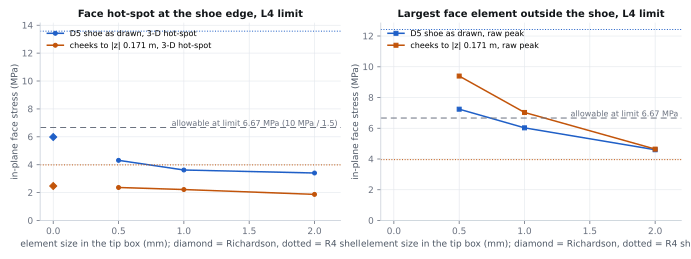
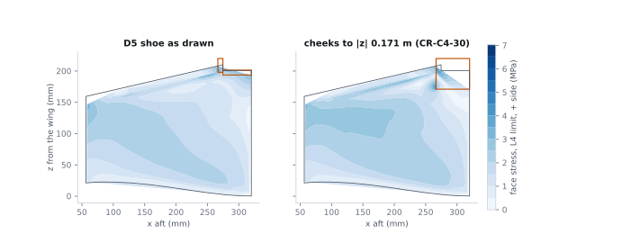
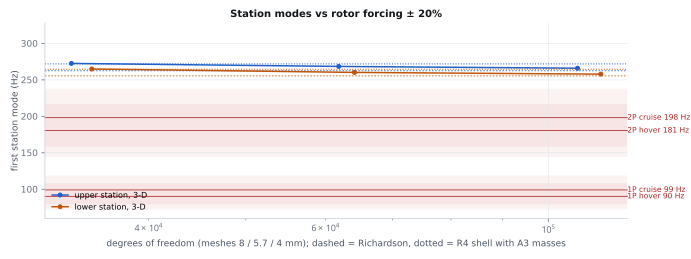

# Fin and motor-tube structures — simulation round (C4-S1)

Owner C4. 2026-11-10. 3-D solid FE of the as-designed fin quarters (D3-R4 fin, D5-R4 shoe, A3-R6a masses), checked
against the R4 shell/beam model (`fin_structures_d3.py`, the earlier calculation). Script `sim_fin.py`, claims
`claims.sim.json` (`CL-C4-SIM-…`), results `sim/out/sim_results.json`, figures `fig-c4-s*.svg`.

## Verdict

| Question | 3-D result | R4 shell | Claim | Status |
|---|---|---|---|---|
| `R-VIBRATION` (≥ 0.20 from 1P/2P) | **met: 0.29** (lower station, 255.5 Hz vs 2P cruise 198.2 Hz) | 0.35 (R4 re-run today); 0.33 with A3 masses | `CL-C4-SIM-SEP` | `MODELLED` |
| Fin face at the D5 shoe **as drawn**, L4 ultimate | **MS +0.11** (hot-spot 5.98 MPa limit, Richardson, corner-bounded) | **MS −0.54 `FAIL`** | `CL-C4-SIM-MS-FACE-DRAWN` | `MODELLED` |
| Same, cheeks to \|z\| 0.171 m (CR-C4-30) | MS +1.70 (GCI 5.6 %) | MS +0.67 | `CL-C4-SIM-MS-FACE-PROP` | `MODELLED` |
| Face away from the shoe and clamps, as drawn | MS +0.42 (converged, 4.68 MPa limit) | — | `CL-C4-SIM-MS-FACE-FAR` | `MODELLED` |
| Edge strips, L4 | MS +2.04 (87.8 MPa limit vs 400 MPa) | +3.63 | `CL-C4-SIM-MS-STRIP` | `MODELLED` |
| Foot deflection, L4 limit | 3.7 mm | 9.3 mm | `CL-C4-SIM-FOOT-DEFL` | `MODELLED` |

**The R4 tip `FAIL` does not reproduce in 3-D.** The shell model put the whole foot side-load moment (0.554 N·m) through
the bare board below the shoe legs (share 1.06). In 3-D the two edge strips, 9.6 mm apart on opposite faces and both
clamped in the D5 collar cheeks, resist the tip twist by bending in opposite senses in their own plane; the board
carries 0.47 of it. A mid-plane shell with the strips as one beam line cannot represent that couple. The drawn shoe
margin is thin and rests on a corner that does not converge (below), so **`T-C4-FIN-PROOF` on a test article built as
drawn decides** CR-C4-30 (CR-C4-36). No requirement newly fails; fins mass stays over, 434.8 g vs 418 g (CR-C4-34).

## What was modelled

| Item | 3-D model | Source | Status |
|---|---|---|---|
| Laminate | two 4.8 mm boards: paper faces 0.1 mm (4 GPa), foam core 2 hex per board (10 MPa, G 4 MPa) | `P:fins.board_t_m`, `ASM-C4-FACE-*`, `ASM-C4-CORE-*` | `UNVERIFIED` |
| Edge strips | CF 10 × 1 hex layer on both faces, LE to step front, **run on over the LE link to the tube** (strip tails) | `P:fin_detail.edge_strip.*` | `MODELLED` |
| Collar tail tongue | PETG 1 GPa replaces the board under the strip band from the tube to 40 mm aft, band + 1 mm deep | `ASM-C4-SIM-TAIL-E`, `P:fin_detail.station_collar.tail_m` | `PROPOSED` |
| Tube | square bar the laminate thickness, EI = CF 22 × 20 tube; G matched in the modal model (orthotropic) | `ASM-J1-E-TUBE`, `ASM-C4-G-TUBE` | `UNVERIFIED` |
| LE link | tube wall + epoxy fillet, 3 GPa | `ASM-C4-SIM-LINK-E` | `PROPOSED` |
| D5 shoe as drawn | rigid (50 GPa): legs 7 mm below the step + 8 mm collar cheeks over both strip ends | `P:landing.shoe.leg_depth_m`, `collar_len_m` | `MODELLED` |
| Brace | CF 10 × 2 swept hexahedra to the spar anchor (statics); axial spring (modes) | `ASM-C4-ANCHOR-K` | `MODELLED` |
| Station (modes) | rigid body on mount springs: motor 84.2 g, ESC 7.6 g, bullets 4 g (A3-R6a) | `ASM-C4-A3-STATION-MASS` | `PROPOSED` |
| Load L4 (limit) | 32.6 N along −x + 22.8 N side (μ 0.7), both senses, at the C1 ground point through the shoe | `CL-C1-FOOT-CORNER`, `ASM-C1-FRICTION` | `UNVERIFIED` |
| Forcing | 1P/2P at hover 5 416 rpm, cruise **5 946 rpm** (was 5 894), 1P at 9 319 rpm | `CL-B4-*-RPM` | `UNVERIFIED` |

Ultimate = 1.5 × limit (`P:requirements.safety_factor_ult`). Face allowable 10 MPa (`ASM-C4-FACE-SIGMA`), CF 400 MPa
(`ASM-C4-CF-SIGMA`). The first 3-D pass ended the strips at the board LE; that put 26 MPa into the paper at the LE top
corner, a modelling artefact. The tongue and strip tails as D3 drew them remove it.

## Solver and why

| Check | Result | Claim |
|---|---|---|
| SU2 ELASTICITY, two-modulus cantilever, 2/4/8 elements deep | error −13.3 / −4.4 / −1.8 %, Richardson **−0.68 %**, order 1.75, GCI 1.4 % | `CL-C4-SIM-BENCH-ERR` |
| In-house hex8 vs SU2, same meshes | max difference **4.7 × 10⁻¹¹** (same element, same integration) | `CL-C4-SIM-BENCH-CODES` |
| SU2 on the fin quarter (71 k DOF), CG + ILU(1) | **did not converge**: log₁₀ residual +0.15 after 6 000 iterations (80 min); see trials below | `CALC-C4-SIM-CODES` |
| SU2 trials, 1 500 iterations each | CG + ILU(1): log₁₀ residual **+0.50** after 1 500 iterations (434 s), field difference 1.00; restarted FGMRES(200) + ILU(2): **diverged at iteration 1** ("orthogonalization failed") | `CL-C4-SIM-CODE-DIFF` |
| hex8 direct solve (SuperLU, symmetric mode) | relative residual ≤ 1.5 × 10⁻⁸ after 2 refinement steps | `sim/out/sim_results.json` |

The quarter's stiffness spans 10 MPa foam to a 240 GPa bar with 0.1 mm faces; SU2's iterative solvers (this build
has no PaStiX direct solver) do not reduce the residual. The fin results therefore come from the in-house hex8, which
is SU2's element to 10⁻¹¹ on the benchmark, solved directly. SU2 stays the reference for the element.

## Mesh convergence (3 levels each)

| Quantity | Level 1 | Level 2 | Level 3 | Extrapolated | Order | GCI |
|---|---|---|---|---|---|---|
| Tip box element, mm (global 8 mm) | 2 | 1 | 0.5 | — | — | — |
| DOF, upper quarter as drawn | 71 484 | 179 100 | 571 092 | — | — | — |
| Face hot-spot, as drawn, MPa limit | 3.41 | 3.62 | 4.31 | **5.98** | < 0.5 (clamped 0.5) | 0.48 |
| Face hot-spot, cheeks to 0.171 m, MPa limit | 1.87 | 2.22 | 2.37 | 2.47 | 1.25 | 0.056 |
| Face max ≥ 1 t from shoe and clamps, as drawn, MPa limit | 4.60 | 4.62 | 4.68 | — | — | < 0.02 |
| Raw peak element at the cheek corner, as drawn, MPa limit | 4.60 | 6.03 | 7.24 | singular | — | — |
| First station mode, upper, Hz (mesh 8 / 5.7 / 4 mm) | 272.6 | 268.4 | 266.0 | **262.4** | 1.50 | 1.7 % |
| First station mode, lower, Hz | 264.9 | 260.2 | 257.9 | **255.5** | 2.00 | 1.1 % |

The as-drawn hot-spot is read along the 8 mm collar-cheek edge; its worst point sits next to the re-entrant corner
where the cheek meets the step, so it keeps rising with refinement. The extrapolation uses the lowest admissible order
(0.5) as a bound; a global refinement (4 mm instead of 8 mm at level 2) adds a further 8 %. Stacked, the as-drawn
margin is about +0.03. The cheek-extended case converges. The lower quarter at level 2 gives 3.59 / 2.22 MPa
(as drawn / extended): the upper quarter governs.

`FIG FIN-C4-S1 — Face hot-spot (left) and largest face element outside the shoe (right) vs tip mesh size; dotted: R4 shell.`

`FIG FIN-C4-S2 — Outer-face stress under L4 limit, level 2; orange: D5 shoe regions.`

## Comparison with the R4 calculation

| Quantity | 3-D | R4 shell (today's inputs) | Ratio | Why |
|---|---|---|---|---|
| Face hot-spot at the drawn shoe, MPa limit | 5.98 (bound) | 13.58 | 0.44 | strip-pair couple (above) |
| Moment share through the bare board | 0.47 | 1.06 | 0.44 | same |
| Foot deflection, L4 limit | 3.7 mm | 9.3 mm (R4) | 0.40 | strip tails run to the tube; tongue couples the strip pair |
| Station compliance x / y / torsion, matched tube, rigid mount | shell / 3-D = 1.04–1.07 | — | — | 3-D slightly stiffer |
| First station mode, upper / lower, A3 masses | 262.4 / 255.5 Hz | 271.9 / 264.6 Hz | 0.965 / 0.966 | converged 3-D mesh; laminate mass consistent |
| Separation (min) | 0.29 | 0.33 | — | cruise rpm 5 894 → 5 946, motor 81 → 84.2 g, 3-D −3.5 % |

## Sensitivity: tail tongue modulus (level 1, as drawn)

| Tongue E | 10 MPa (unbonded = foam) | 0.2 GPa | 1 GPa (nominal) | 2 GPa |
|---|---|---|---|---|
| Face hot-spot at the shoe, MPa limit | 3.58 | 3.43 | 3.39 | 3.38 |
| Largest face element, MPa limit (location) | **8.07** (LE tail corner) | 4.67 | 4.41 | 4.12 |
| Foot deflection, mm | 5.1 | 4.2 | 3.9 | 3.8 |

With the tongue unbonded the LE corner reaches 8.07 MPa limit (MS −0.17 at ultimate). The strip tails bonded in the
collar slots are load-bearing: build inspection item (CR-C4-37).

## Modes and forcing

`FIG FIN-C4-S3 — First station mode vs mesh against 1P/2P ± 20 %; dashed: extrapolated, dotted: R4 shell with A3 masses.`

| Mode (level 3) | Upper, Hz | Lower, Hz | Note |
|---|---|---|---|
| Fin panel (station KE < 4 %) | 73.2 | 70.9 | falls with refinement; 1P hover 90.3 Hz is 0.21–0.24 above it |
| Station 1, lateral-torsion | 266.0 | 257.9 | governs `R-VIBRATION` |
| Station 2, lateral-torsion | 330.9 | 322.4 | — |
| Station 3 | 421.1 fore-aft | 416.4 lateral-torsion | — |

The panel mode carries little station energy (as R4: 76.5 Hz), but it now sits 21 % below 1P hover. `T-C4-TAP-D3`
taps the board centre as well as the bells.

## Margins summary (ultimate, factor 1.5)

| Item | Demand | Allowable | MS | Claim | Status |
|---|---|---|---|---|---|
| Face at drawn shoe (bound) | 8.98 MPa | 10 MPa | +0.11 | `CL-C4-SIM-MS-FACE-DRAWN` | `MODELLED` |
| Face at extended cheeks | 3.71 MPa | 10 MPa | +1.70 | `CL-C4-SIM-MS-FACE-PROP` | `MODELLED` |
| Face away from discontinuities | 7.03 MPa | 10 MPa | +0.42 | `CL-C4-SIM-MS-FACE-FAR` | `MODELLED` |
| Edge strip | 132 MPa | 400 MPa | +2.04 | `CL-C4-SIM-MS-STRIP` | `MODELLED` |
| Station separation | 0.289 | ≥ 0.20 | — | `CL-C4-SIM-SEP` | `MODELLED` |

Strip-to-paper bond shear peaks at the strip ends (29 / 12 / 14 MPa limit on the three meshes): singular, not a
design value. It confirms R4: the strips need the Ø 2 mm pins (`CL-C4-D3-STRIP-PIN-F`); bare paper (0.10 MPa) cannot.

## Limits of this round

| Limit | Effect | Closed by |
|---|---|---|
| Hot-spot at the cheek corner does not converge | as-drawn margin between +0.03 and +0.85 | `T-C4-FIN-PROOF` built as drawn (CR-C4-36) |
| Tongue modulus and bond assumed | LE corner MS −0.17 if unbonded | CR-C4-37, build inspection |
| Material values (paper, foam, tube) | every number `UNVERIFIED` | `T-C6-BOARD-LAP`, `T-C4-TUBE-BEND`, `-TORSION` |
| Mount and root stiffness from R4 springs | separation −0.11 at 1 000 N·m/rad (R4) | `T-C4-MOUNT-STIFF` |
| Through-thickness: 2 core elements per board, not refined | small for in-plane face stress | — |

## How to re-run

| Step | Command | Time |
|---|---|---|
| All cases (cached in `sim/out/cache`) | `python -I redesign/team/C4/sim_fin.py` | ~3 h cold on a busy 20-core machine, < 2 min cached |
| Parallel cold run | `python -I sim/run_part.py stress`, `… modes`, `python -I sim/run_trial.py 0` and `1`, then `sim_fin.py` | ~1.5 h |
| Tongue sensitivity | `python -I redesign/team/C4/sim/sens_tail.py` | ~10 min |
| Figures | `python redesign/team/C4/sim/sim_plots.py` (matplotlib, not `-I`) | 10 s |
| Proof chain | `python -I redesign/proofs/build_graph.py` | < 1 min |
