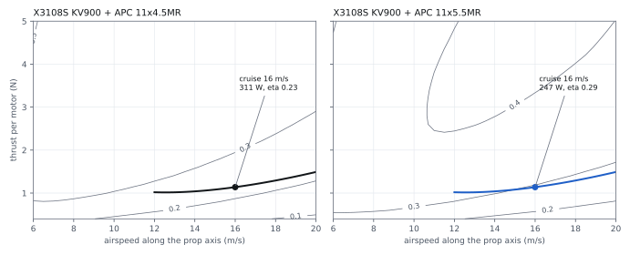
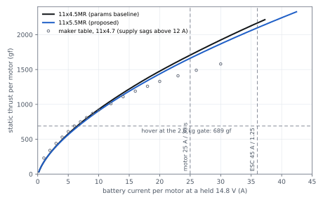

# Propulsion — K09-L quad tailsitter

Owner: E1 (propulsion engineer), revision 6, 2026-11-10. Model and claims: `team/E1/propulsion.py` →
`team/E1/claims.json` (64 claims, `CL-E1-…`), `subsystems/propulsion/parts.csv` and
`subsystems/propulsion/interfaces.json`; CAD clearance probe `team/E1/prop_clearance.py` → `prop_clearance.json`.
Figures: `team/E1/plots.py`. Every number is at the 2.6 kg gate and reads `params.json` as of this revision:
cruise 16 m/s, chord 0.32 m, CLmax 0.80, **7° motor cant, sense −1** (D-27, D-52), harness 6.5 mΩ (D-32), and
B1's rev 3 polar (CD0 0.0513, k 0.0943, trim 1.02).

**Verdict.** Keep the SunnySky X3108S KV900, the LANRC 45 A ESC and the APC 11×5.5MR/MRP. Full throttle stays
current-limited (`Q_M_BAT_CURR_MAX` 100 A). The worst-state hover T/W is **2.12** (limit 1.6). Propulsion is
**462.0 g** against the 462 g allocation (D-48), zero margin. The three rev 5 failures are closed (D3 now carries
D-51: prop gap 1.01, ESC slot 1.05). **One claim fails, new in rev 6:** with D-52's cant sense the wing-side blade tip
passes **21.1 mm** from the CF motor tube (`CL-E1-TIP-GAP-TUBE`, limit 25 mm, `R-PROP-CLEAR`). E1 proposes
`face_ahead_m` 0.0025 → **0.0075** (26.1 mm) for A1's CR-D3-26 decision. Every number is `UNVERIFIED` until
`T-E1-MOTOR-RM` and `T-E1-STAND` run.

## Revision 7 (2026-11-10): prop keep-out on the real envelope; mount chain not exempted

The task asked E1 to exempt the fin mount chain (`FIN-002/004/006-L/R`) from `KO-PROP-<st>`, or to make the keep-out an
annulus with a hub inner radius, on the premise that those parts sit inside the disc behind the hub. The measured
nearest points say otherwise:

| Body (UR station) | Gap to swept volume (+10 / −6 mm) | Axial aft of mid-plane | Radius from shaft | Where |
|---|---|---|---|---|
| `FIN-002-R` motor tube | 21.2 mm (`check.py` hull 21.0) | 26.8 mm | 143.8 mm | 4 mm **outboard** of the 139.7 mm tip |
| `FIN-004-R` bore boss | 25.4 mm | 22.7 mm | 158.9 mm | outboard of the tip |
| `FIN-006-R` tube plug | 26.1 mm (`check.py` 26.3) | 25.9 mm | 156.6 mm | outboard of the tip |

None of the critical points is behind the hub, so an annulus would remove nothing. An exemption would turn a real
tip-to-structure gap of 21 mm (requirement 25 mm) into a silent pass. E1 therefore did two things. `KO-PROP-<st>` now uses E1's swept
envelope through A5's `fwd=0.010, aft=0.006` arguments: 35 mm forward and 31 mm aft of the mid-plane (`CL-E1-KO-FWD`, `-KO-AFT`),
radius 164.7 mm. The exempt list stays the station's own motor, adapter and prop. `check.py` keep-out ERRORs went
from 8 to 4. The tube is the only part still inside, and `face_ahead_m` ≥ 0.0065 m clears it: in-memory `check.py` trials give
4 / 4 / 0 / 0 ERRORs at 0.0025 / 0.0060 / 0.0065 / 0.0075 m (`prop_clearance.json`). E1 asks A1 and D3 for 0.0075 m (CR-E1-48).

The aft envelope of 6 mm comes from the root section half-depth of 5.5 mm. At the tip, the section takes about 1 mm, which leaves about
5 mm for aft bending when the prop windmills in a throttle-cut descent. That allowance is `UNVERIFIED` and goes into
`T-E1-STAND` (`CL-E1-KO-AFT`).

## Revision 6 (2026-11-10): re-run on the R4 fins; prop clearance after D-52 (CR-D3-26)

| Item | Resolution | Numbers | Claim | Status |
|---|---|---|---|---|
| Re-run (params, README, MASS-CG re-read) | `propulsion.py`, `make_propulsion.py`, `check.py`, `build_graph.py` on the current tree | no `CALC-E1` drift; propulsion 462.0 / 462 g | `CL-E1-MASS-PRP` | `UNVERIFIED` (weigh) |
| D3 keys adopted (CR-E1-38 closed) | `face_ahead_m` 0.0025, `prop_stack_m` 0.0373, pad 31 mm, `cant_sense_UR` −1 now in `fins/params.json` | prop gap **1.017**, CAD gap **1.01**, ESC slot **1.05**; CAD hub x **−0.0077** = datum (+0.03 mm) | `CL-E1-PROP-GAP`, `-CAD-PROP-GAP`, `-ESC-SLOT`, `-CAD-HUB-VS-DATUM` | `MODELLED` |
| CAD centroids (CR-A1-48) | regenerated on the reversed cant: motor 0.0156 / 0.321 / 0.1885, prop −0.0077 / 0.3223 / 0.1861, adapter −0.0046 (UR); ESC unchanged | — | `interfaces.json` | `MODELLED` |
| Acknowledgements | F2, D3 and D7 have declared every planned edge | **36 acknowledged, 0 pending** (`E-HRN-13…20`, `-24…27`, `-34…37`, `E-TRN-17…20`, `E-FIN-61…68`, `-81…88`) | `make_propulsion.py` | `CHECKED` |
| Prop keep-out (CR-A5-21) | unchanged as A1 set it: `k9.prop_keepout(..., rotate=rot, blade_half=0.010)` | R 164.7 mm, half 35 mm | `CL-E1-KO-HALF` | `MODELLED`; `check.py` now **16 hits** |
| True blade-to-structure gap | analytic calc on the tube + dense-surface CAD probe | motor tube **21.1 mm** (E1 envelope −6 / +10 mm), 17.1 mm with the symmetric 10 mm; next: bore boss 25.4, plug 26.1, brace ≥ 28.3, wing ≥ 33.5 mm | `CL-E1-TIP-GAP-TUBE` | **`FAIL`** −16 % |
| Fix for A1 (CR-D3-26) | least `face_ahead_m` for 25 mm: **0.0065**; E1 proposes **0.0075** | tube gap 26.1 mm; prop plane x −0.0077 → about −0.0127 | `CL-E1-FACE-AHEAD-FOR-CLR`, `-TIP-GAP-AT-75` | `PROPOSED` |
| Adapter screws (CR-A4-43, D-58) | unchanged from rev 5; C6 lists D-58 in `JOINTS.md` | thread ≥ 2.5 mm for M3×4; M3×5 if ≥ 3.0 mm thread and ≥ 4.0 mm free depth | `CL-E1-ADAPTER-*` | `UNVERIFIED` (measure) |
| `CL-E1-IPACK-LIM` (CR-E1-36) | A2's matrix now lists it under `R-ESC-CURRENT` | 100 A, margin 0 % | — | closed |
| `ASM-E1-PACK` | kept: B4's `props.py` line 305 still reads it | — | — | open (CR-E1-44) |

**Prop clearance after D-52.** The 7° cant is tangential; reversing its sense (D-52, for yaw authority) tips the
disc so that the blade passing the wing-side of the station runs about 15 mm further aft. There it crosses the 22 mm
CF tube that carries the mount. Gap from the blade's swept volume to the tube surface, by trial `face_ahead_m`
(`prop_clearance.json`):

| `face_ahead_m` (m) | Stack added (mm) | Tube gap, E1 envelope (mm) | Tube gap, symmetric 10 mm (mm) | `check.py` box hits |
|---|---|---|---|---|
| 0.0025 (now) | 0 | 21.2 | 17.3 | 16 |
| 0.0065 | 4.0 | 25.2 | 21.3 | 12 |
| **0.0075 (E1)** | 5.0 | **26.2** | 22.3 | 12 |
| 0.010 | 7.5 | 28.7 | 24.7 | 10 |
| 0.0165 | 14.0 | 35.2 | 31.2 | 2 |
| 0.020 (D3 a) | 17.5 | 38.6 | 34.7 | 0 |

The box hits that remain at 0.0075 are bounding-box corners, not material: the nearest real surfaces are 26.2 mm
(tube), 29.3 mm (bore boss) and 30.4 mm (plug). Going to 0.020 to silence the box test would add 12.5 mm more
cantilever to the mount (C4 rocking stiffness, D3 mass) for clearance the geometry already has. The aft blade
envelope is 6 mm, not 10: APC MR blades cone forward under thrust and K09-L never reverses. CR-E1-45 asks A5 for a
surface test so `check.py` can certify the 0.0075 station; until then `R-PROP-CLEAR` evidence is the probe.

## Revision 5 (2026-11-09): CR-A1-48, CR-A4-43, CR-A5-21, CR-D3-22, CR-B4-20

| Item | Resolution | Numbers | Claim | Status |
|---|---|---|---|---|
| Re-run on current inputs (CR-E2-17) | `CALC-E1-WORST` reads `P:electrical.r_ext_mohm` ÷ 1000; stored map rewritten | T/W worst **2.12**, sag 0.851, pack R 22.5 / 30.5 mΩ warm / cold | `CL-E1-TW-WORST`, `CL-E1-SAG-FACTOR` | `UNVERIFIED` |
| `PRP-002` stripped (D-48) | F2 removes the factory power leads and solders 16 AWG to the pads | ESC 11.0 → **7.6 g**; propulsion **462.0 / 462 g** | `CL-E1-MASS-PRP` | `UNVERIFIED` (weigh) |
| Tilted keep-outs (CR-A5-21) | `k9.prop_keepout(..., rotate=rot, blade_half=0.010)` in `fusion/propulsion.py` | cylinder on the 7° axis, R 164.7 mm, half **35 mm** (10 + 25) | `CL-E1-KO-HALF` | `MODELLED` (`check.py` 0 hits) |
| Adapter screws (CR-A4-43, D-58) | M3×4 at 2.5 mm stays under deviation D-58 (a), minimum 2.0 mm; the condition is now a claim and a test step; M3×5 is the compliant swap if the bell allows | thread needed **2.5 mm**; M3×5 engages 3.5 mm (rule 3.0, +0.5 mm) and needs **4.0 mm** free depth; RF 2.12 at 2.5 mm, 1.70 at 2.0 mm | `CL-E1-ADAPTER-THREAD-D58`, `-M3X5-ENGAGE`, `-M3X5-DEPTH`, `-RF-NOM`, `-STRIP` | `UNVERIFIED` (measure) |
| Motor interface (CR-D3-22) | added to `T-E1-MOTOR-RM`: base Ø ≥ 28 mm, 16 × 19 mm pattern, base hole depth ≥ 4.0 mm | M3×8 through the 4.5 mm plate → 3.5 mm | `CL-E1-HOLE-DEPTH-MIN`, `CL-E1-SCREW-ENGAGE` | `UNVERIFIED` |
| Lead reach (CR-F2-07) | motor phase-lead length measured against F2's routed **0.121 m**; if it reaches, no splice (F2 −12 g) | — | `CL-F2-PHASE-REACH` | `UNVERIFIED` |
| ESC envelope for B4 (CR-B4-20) | body 45 × 20 × 6 mm in shrink + 1.5 mm strap over a 10 mm band | **7.5 mm** proud of the pad (B4 assumed 6.8), 23 mm wide, 172.5 mm² frontal | `CL-E1-ESC-PROUD`, `CL-E1-ESC-FRONTAL` | `UNVERIFIED` |
| Acknowledgements | declared edges in `acknowledges` (16); A4's plan edges not yet declared in `acknowledges_pending` (20: `E-HRN-13…16`, `-24…27`, `-34…37`, `E-FIN-81…88`), moved on the next run after F2 / D3 declare | — | `make_propulsion.py` | `CHECKED` |

**Adapter-screw decision at `T-E1-MOTOR-RM`** (first motor, before any adapter is torqued):

| Measured in the bell top | Screw | Engagement | Basis |
|---|---|---|---|
| thread ≥ 3.0 mm and free depth ≥ 4.0 mm | M3×5 SHCS (buy 20, ≈ $3 `EST`) | 3.5 mm | 1.0 d rule met, no deviation |
| 2.5 mm ≤ thread < 3.0 mm, or free depth < 4.0 mm | supplied M3×4 | 2.5 mm (min 2.0) | D-58 (a), RF 1.70 at 2.0 mm |
| thread < 2.5 mm | none: the station is not flown | — | D-58 condition fails; E1 re-assesses (motor-box adapter, other motor) |

## Selection

| Item | Choice | Unit price | Qty (spares) | Key rating | Source | Status |
|---|---|---|---|---|---|---|
| Motor | SunnySky X3108S KV900, 81 g, 3–4S | $24.99 | 5 (1) | 25 A / 30 s, 370 W; R 86 mΩ, I0 0.9 A | [sunnyskyusa.com](https://sunnyskyusa.com/products/sunnysky-x3108s-motors), [data image](https://cdn.shopify.com/s/files/1/2024/0305/files/SunnySky_X3108S_KV900_Data_3.jpg), [HiModel](https://www.himodel.com/electric/SUNNYSKY_X3108S_KV900_Outrunner_Brushless_Motor_for_Multirotor.html) | `UNVERIFIED` |
| ESC | LANRC BLHeli_S 45 A, 2–6S, Bluejay reflash | $7.50 ($30 / 4) | 8 (4) | 45 A cont, 55 A 10 s | [amazon.com/dp/B0D2HS4Y4J](https://www.amazon.com/dp/B0D2HS4Y4J) | `UNVERIFIED` (price not re-checked) |
| ESC fallback | Holybro Tekko32 F4 45A AM32, 5.8 g | $22.50 | — | 45 A cont, current sensor | [readymaderc.com](https://www.readymaderc.com/products/details/87186-holybro-tekko32-f4-45a-esc-am32) | `CHECKED` 2026-11-09 |
| Prop | APC 11×5.5MRP on UR, LL (CW from the nose); 11×5.5MR on UL, LR (CCW) | $3.83 | 8 (4) | 17 g; hub Ø16.5 × 8.9 mm | [apcprop.com 11x5-5mr](https://www.apcprop.com/product/11x5-5mr/) | `CHECKED` 2026-11-09 |
| Prop (stand A/B) | APC 11×4.5MR / MRP | $3.83 | 4 | 17 g | [apcprop.com 11x4-5mr](https://www.apcprop.com/product/11x4-5mr/) | `CHECKED` |
| Prop adapter | Bolt-on M6×1: **LH on UR, LL**, RH on UL, LR; M3×4 screws, nuts, washers | $23.95 / 4 | 1 set | 4 × M3 on Ø12 mm | [smallpartscnc.com](https://www.smallpartscnc.com/index.php?product_id=174&route=product%2Fproduct) | `CHECKED` (out of stock 2026-11-09) |
| Motor screws `PRP-005` | M3×8 SHCS ISO 4762 A2 | $0.10 `EST` | 20 (4) | — | Bolt Depot | `PROPOSED` |

Rotation and thread hand follow F4's motor map (`subsystems/flight-software/SPEC.md`). The prop lags the shaft, so
a CW motor needs a left-hand post for the nut to tighten itself.

## Margins (11×5.5MR unless stated)

| Case | Value | Limit | Claim | Status |
|---|---|---|---|---|
| Hover thrust per motor (download 1.06, cant 7°) | 6.81 N, 5 313 rpm, duty 0.50 | — | `CL-E1-HOVER-T` | `UNVERIFIED` |
| Hover pack current / power (kP 1 → 1.24) | 27.3 A / 338–405 W | ≤ 31.05 A (27 A + 15 %) | `CL-E1-HOVER-I-55` | `UNVERIFIED` |
| T/W, bus held 14.8 V, no limiter | 3.58 | ≥ 2.0 | `CL-E1-TW-TABLE` | `UNVERIFIED` |
| T/W, fresh pack, 100 A limiter | 2.47 | ≥ 2.0 | `CL-E1-ILIM-TW-FRESH` | `UNVERIFIED` |
| **T/W, worst pack state** | **2.12** | ≥ 1.6 | `CL-E1-TW-WORST` | `UNVERIFIED` |
| Per-motor current with the limiter | 24.75 A | ≤ 25 A (`propulsion.motor_max_a`) | `CL-E1-ILIM-I` | `UNVERIFIED` |
| Pack current with the limiter | 100 A | ≤ 100 A (`full_throttle_current_a`) | `CL-E1-IPACK-LIM` | `UNVERIFIED` (bench) |
| Unlimited burst per motor at 16.8 V | 51.6 A | ≤ 55 A (`esc_burst_a`, 10 s) | `CL-E1-IMAX-168-55` | `UNVERIFIED` |
| Unlimited pack peak, low pack (wiring case) | 108 A | ≤ 120 A (`electrical.peak_current_a`) | `CL-E1-IPACK-PEAK` | `UNVERIFIED` |
| Cruise drag 16 m/s (B1 polar, W/D 6.22) | 4.10 N, 1.03 N per prop | — | `CL-E1-CRUISE-DRAG` | `UNVERIFIED` |
| Cruise J, η_prop, rpm | 0.58, 0.36, 5 944 | — | `CL-E1-CRUISE-ETA-55` | `UNVERIFIED` |
| Cruise propulsion power (kP 1 → 1.24) | 191–234 W, 15.8 A | ≤ 240 W (`performance.cruise_power_w`, D-49) | `CL-E1-CRUISE-P-55` | `UNVERIFIED` (+2 %) |
| Transition corridor margin, worst point | 2.13 at 1.6 m/s | ≥ 1.3 | `CL-E1-CORRIDOR-55` | `UNVERIFIED` |
| Winding rise in hover (R_th 1.0 K/W `EST`) | 23 K | ≤ 50 K | `CL-E1-HOVER-DT` | `UNVERIFIED` |

**Mission (indicative; B1 and E2 own it).** 77 Wh usable. Hover takes 13.5 Wh (2 min at 405 W), which leaves
**16 min of cruise** at 234 W + 6 W avionics against the 5 min requirement.

## Worst-state hover T/W and the sag factor (D-35)

One calculation (`CALC-E1-WORST`): the E1 station model with E2's pack assumptions and F1's harness resistance.

| State | OCV | Pack R | Winding | Bus V | Thrust / motor | T/W | Status |
|---|---|---|---|---|---|---|---|
| Fresh, warm | 16.8 V | 22.5 mΩ | 25 °C | 14.6 V | 1 634 gf | 2.49 | `UNVERIFIED` |
| Reserve line, warm | 14.9 V | 22.5 mΩ | 80 °C | 12.7 V | 1 450 gf | 2.22 | `UNVERIFIED` |
| **Reserve line, 10 °C pack (claim)** | 14.9 V | 30.5 mΩ | 80 °C | 11.9 V | **1 390 gf** | **2.12** | `UNVERIFIED` |
| Below reserve, 3.60 V/cell, cold | 14.4 V | 30.5 mΩ | 80 °C | 11.4 V | 1 350 gf | 2.06 | `UNVERIFIED` |

| Sag factor (worst ÷ fresh, limiter on) | Value | Method | Claim |
|---|---|---|---|
| E1 station model | **0.851** | PER3 + motor model at each bus voltage | `CL-E1-SAG-FACTOR` |
| E1 closed form | 0.873 | same 100 A in both states, so P ∝ V_bus; static T ∝ P^2/3; no winding heating | `CL-E1-SAG-XCHECK` |
| E2 | 0.758 | (V / 14.8 V)² applied to a thrust that is already limited at 100 A | `CL-E2-SAG-F-WORST` |
| params (D-35) | 0.76 | the lower of E1 and E2, carried until they agree | `propulsion.voltage_sag` |

The two E1 methods agree within 3 %. E2's method counts the voltage twice: the limited thrust already includes the
fresh-pack bus voltage, and with the limiter binding, a lower bus voltage costs power in proportion to V, not V².
Both values pass 1.6. The cold-pack stand run settles it (CR-E1-25).

## Motor and prop interface (for D3, A4, A5)

| Parameter | Value | Unit | Source | Status |
|---|---|---|---|---|
| Body: OD × length (mount face to bell top) | 37.8 × 26.5 | mm | HiModel listing | `UNVERIFIED` |
| Base bolt pattern | not published: D3 drills the 2.5 mm pilots to the measured motor (no slots, C6) | mm | — | `UNVERIFIED` |
| Motor screw | M3×8 through D3's 4.5 mm canted plate: **3.5 mm** engagement at every hole (window 2.5–3.5) | mm | `CL-E1-SCREW-ENGAGE` | `UNVERIFIED` |
| Base hole depth needed | ≥ 4.0 (else plate 5.0 mm, `CL-E1-SCREW-SEAT`) | mm | `CL-E1-HOLE-DEPTH-MIN` | `UNVERIFIED` (probe) |
| Prop adapter | bolt-on, 4 × M3×4 on Ø12 mm, M6×1 post 15.2 mm, base 6.35 mm | mm | Small Parts CNC | `CHECKED` (vendor fit list) |
| **Mount face to prop mid-plane** | **37.3** (D3 carries 37.3, D-51) | mm | `CL-E1-STACK-PROP-PLANE`, `CL-E1-STACK-VS-D3` 0.0 | `UNVERIFIED` |
| Prop plane to collar front ÷ 0.14 D (`face_ahead` 2.5 mm, D-51) | 1.017 | — | `CL-E1-PROP-GAP` | `UNVERIFIED` (+2 %) |
| Blade swept volume to the CF motor tube (cant sense −1, D-52) | 21.1 (needs `face_ahead` ≥ 6.5 mm; E1 proposes 7.5 → 26.1) | mm | `CL-E1-TIP-GAP-TUBE` | **`FAIL`** (CR-E1-44) |
| Mount face to hub front / post tip | 41.7 / 48.1 | mm | `CL-E1-STACK-POST-TIP` | `UNVERIFIED` |
| M6 nut: thread past the full nut height | 0.1 | mm | `CL-E1-NUT-ENGAGE` | `UNVERIFIED` (tight) |

**Stack confirmation (D-28).** The motors are ordered in mid-December, so the stack cannot be measured yet. The
measurement is step 1 of `T-E1-MOTOR-RM` on the first motor that arrives. Until then the 37.3 mm paper value
stands, and with D3's 1 mm `face_ahead_m` the gap is 0.8 mm short. A 2 mm `face_ahead_m` covers both stacks.

## Interfaces (`subsystems/propulsion/interfaces.json`)

| Edge | Parts | Via | Owner | Key data |
|---|---|---|---|---|
| `E-PRP-01…04` | adapter `PRP-004-<st>` → motor `PRP-001-<st>` | `CT-PROP-ADAPTER` | propulsion | 4 × M3×4, 2.5 mm in the bell, 0.6 N·m + Loctite 243 |
| `E-PRP-05…08` | prop `PRP-003-<st>` → adapter | `CT-PROP-NUT` | propulsion | M6 nut 5.3 mm engaged, 1.5 N·m `EST`, field joint |
| `E-FIN-61…64` | motor → mount `FIN-003-<st>` | `CT-M3-SHCS-MOTOR` | fins (acknowledged) | 4 × M3×8 `PRP-005` |
| `E-FIN-65…68` | ESC `PRP-002-<st>` → pad `FIN-007-<st>` | `CT-STRAP-VELCRO` | fins (acknowledged) | heat-sink side out |
| `E-HRN-17…20` | ESC phase → motor | `CT-SOLDER-PHASE` | harness (acknowledged) | per ESC 24.75 A limited, 51.6 A burst |
| `E-TRN-17…20` | prop → box slot | `CT-TRN-POCKET` | transport (acknowledged) | stowed props |
| `E-HRN-13…16`, `-24…27`, `-34…37`; `E-FIN-81…88` | ESC power, DShot, cap leads; motor / ESC thermal contact | — | harness, fins (`acknowledges_pending`) | from A4's plan |

`merge_check.py`: no propulsion errors; 16 nodes, 462.0 g against 462 g (WARN `mass` at zero margin); the 8
electrical nodes warn `unpowered` until harness declares `E-HRN-13…16`.

## Mass (`CL-E1-MASS-PRP`, `subsystems/propulsion/parts.csv`)

| Part | Per unit | Qty | Total | Basis | Status |
|---|---|---|---|---|---|
| Motor with factory leads + 4 × M3×8 (`PRP-001`; screws `PRP-005` at 0 g) | 84.2 g | 4 | 336.8 g | listing 81.0 + ISO 3.2 | `UNVERIFIED` |
| ESC stripped (power leads off, F2's 16 AWG on the pads), signal lead, shrink | 7.6 g `EST` | 4 | 30.4 g | 6.6 g board + 1.0 g | `UNVERIFIED` |
| Prop | 17.0 g | 4 | 68.0 g | APC page | `CHECKED` |
| Adapter + 4 × M3×4 + M6 nut + washer | 6.7 g | 4 | 26.8 g | vendor 3.0 g + ISO | `UNVERIFIED` |
| **Total** | 115.5 g | | **462.0 g** | allocation 462 g (D-48) | `UNVERIFIED` |

## Losses per station (input to E3)

| Phase | Motor loss | ESC loss | Motor current | Winding rise | Status |
|---|---|---|---|---|---|
| Hover | 23.1 W | 2.4 W | 13.7 A | 23 K | `UNVERIFIED` |
| Cruise 16 m/s | 11.6 W | < 1.2 W | 7.8 A | 12 K | `UNVERIFIED` |
| Full throttle with the limiter, ≤ 10 s (`env.full_throttle_max_s`) | 86 W | 10 W | 30 A | transient | `UNVERIFIED` |

## Motor out (`CALC-E1-MOTOR-OUT`)

| Phase | What is left | Numbers | Verdict |
|---|---|---|---|
| Hover | The diagonal partner must also stop, which leaves 2 motors turning the same way | T/W 1.07 at the worst state; yaw torque 0.28 N·m against 0.16 N·m from a ±30 % differential | **Fatal**, as accepted in `CONFIGURATION.md` |
| Cruise 16 m/s | 2 motors carry 4.10 N, 179 W | 0.21 N·m roll torque for the elevons (B3) | Possibly survivable: throttle cut, FBWA glide (F4 SITL) |

## Open issues

| Issue | Owner | Status |
|---|---|---|
| Prop tip 21.1 mm from the motor tube after D-52 (`R-PROP-CLEAR` 25 mm); `check.py` 4 keep-out ERRORs | A1 (D3, C4) | `FAIL` until CR-D3-26 / CR-E1-44 / CR-E1-48 |
| `check.py` box test cannot certify the canted disc near a round tube | A5 | open, CR-E1-45 |
| Adapter-screw thread (D-58 condition), base Ø, pattern, hole depth, lead reach | E1 at `T-E1-MOTOR-RM` | `UNVERIFIED` (motors ordered mid-December) |
| Bolt pattern, hole depth (≥ 4.0 mm), lead length unpublished | E1 / D3 | `UNVERIFIED` |
| Nut margin 0.1 mm: if the boxed adapter's post is shorter, use a flanged nut | E1 | `UNVERIFIED` |
| PER3 correction transfer, R, I0, pack IR | H1 / E2 | `UNVERIFIED` |

## How to verify

1. `python -I redesign/team/E1/propulsion.py` (writes claims, `parts.csv`, `interfaces.json`), then
   `python -I redesign/proofs/build_graph.py`: no `CALC-E1` drift.
2. `python -I redesign/interfaces/merge_check.py`: no `PRP` errors.
3. `T-E1-MOTOR-RM` on the first motor: stack (mount face to hub face − 4.45 mm), hole depth, bolt pattern, lead
   length, masses, R, I0. Update `ASM-E1-STACK` and `ASM-E1-PART-MASS`, re-run, tell D3 and A1.
4. `T-E1-STAND`: held 14.8 V, fresh pack, then a pack at 3.73 V/cell cold-soaked to 10 °C; the ratio checks
   `CL-E1-SAG-FACTOR`.

`FIG PRP-01 — Overall efficiency against airspeed and thrust per motor; B1's drag line at 2.6 kg, cruise point 16 m/s.`

`FIG PRP-02 — Static thrust against battery current per motor at a held 14.8 V; the maker's points fall below the model above 12 A (sagging supply).`
