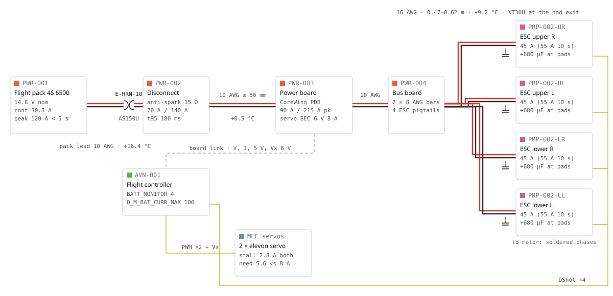

# Power distribution — K09-L

> **CDR fix round, 2026-11-13 (CDR-03, CDR-05; D-115, D-117).** The voltage-drop and path-resistance figures below
> are re-issued on the leads as routed (D-85…D-89: UR 0.670, UL 0.564, LR 0.701, LL 0.593 m, `CL-F2-ESC-LEN-*`) with one
> XT30U per branch (D-74): path resistance **7.92 mΩ** (`CL-F1-R-EXT`; `params.json#electrical.r_ext_mohm` is now 7.9),
> drop at the 100 A limiter **5.68 %** (`CL-F1-DROP-PEAK`). The limit on that drop is no longer the 5 % guideline
> (WB-11) but E1's thrust need, **11.5 %** (`CL-E1-DROP-ALLOW`: the drop at which `R-HOVER-TW` is just held on the
> more pessimistic of E1's two motor bounds), so the claim passes with +51 %. The 5 % guideline is exceeded by
> 0.68 points (`CL-F1-DROP-OVER-5PCT`) and all four leads are longer than its 0.560 m (`CL-F1-ESC-LEN-5PCT`): accepted,
> no 14 AWG (+26 g `REVIEWER EST`, `CDR-electrical.md` CDR-EL-04). **The rest of this document is still F1-R4** (leads
> 0.475–0.620 m, lead masses, temperatures to 0.1 °C): it is re-published under CDR-23. Current values: `claims.json`.

F1, revision F1-R4, 2026-11-10. R3 re-ran the analysis on F2's routed ESC leads (CR-F2-02), the 10 AWG main
jumpers of the PWR-R1 stack, E2's phase claims (CR-E2-19), the D-56 limit keys, D6's servo (CR-D6-06) and the
D-48 allocations. R4 re-runs it on F2's harness re-run of 2026-11-09 (ESC leads trimmed to 0.475–0.620 m), adds
the power-board link check (`CL-F1-PMOD-*`) and acknowledges the power wires in `subsystems/power/interfaces.json`. Status: `PROPOSED`. Every number is `MODELLED` by `team/F1/power.py`. Nothing is bench-tested.
Re-check: `python -I redesign/team/F1/power.py`, `python -I redesign/team/F1/draw_schematic.py`, then
`python -I redesign/proofs/build_graph.py`. Physical design: `subsystems/power/SPEC.md`.

**Verdict:** the main disconnect is the **Amass AS150U** (anti-spark). The pack plugs into a screwed stack in the
pod's left channel: AS150U cradle, then two **10 AWG jumpers of 50 mm or less**, the CoreWing power board (sensing),
and a bus board with two 8 AWG bars. Four **16 AWG** ESC leads run from the bars, routed by F2 at 0.475–0.620 m.
A **6 V UBEC** feeds the servos through a 5 A fuse. The propulsion path has no fuse. In R4 every F1 check passes:
F2's trim brought the LR lead to 0.620 m, inside the 0.643 m that keeps the drop at the 100 A limiter under 5 %
(4.89 %), so CR-F1-25 is closed. The tightest margins are the drop at 100 A (+2 %) and the bundled 16 AWG
runs (+5 %).

`FIG PWR-01 — Power distribution, single line, +/- pairs red/black, signal yellow, data grey dashed; drawn from claims.json.`

## Design currents

| Case | Pack current | Duration | Source | Status |
|---|---|---|---|---|
| Hover, gate mass, 5 m/s wind | 30.1 A | 120 s + 50 s descent | `CL-E2-HOVER-I-GATE`, `CL-E2-T-HOVER-PESS` | `UNVERIFIED` |
| Cruise, pessimistic | 22.4 A | 407 s | `CL-E2-CRUISE-I-PESS`, `CL-E2-T-CRUISE-PESS` | `UNVERIFIED` |
| Vertical climb 2.5 m/s (448 W / 14.8 V) | 30.3 A | — | `CL-B1-VCLIMB-P` | `UNVERIFIED` |
| **Continuous design current** (max of the three) | **30.3 A** | — | `CL-F1-I-CONT` | `MODELLED` |
| E2 climb phase 0–50 m | 35.5 A | 25 s | `CL-E2-I-CLIMB-PESS` | `UNVERIFIED` |
| Transition forward / back | 43.5 / 40.0 A | 20 s each | `CL-E2-I-TRANS-FWD-PESS`, `-BACK-PESS` | `UNVERIFIED` |
| Limited peak, 100 A limiter + 5 % sensor under-read | 105.3 A | ≤ 5 s | `CL-F1-ILIM-WORST` | `MODELLED` |
| Unlimited momentary, full pack | 120 A | < 5 s | `P:electrical.peak_current_a` | `PROPOSED` |
| Per ESC: hover share of the heavier pair (split 1.25) | 8.4 A | continuous | `CALC-F1-WIRES` | `MODELLED` |
| Per ESC: limiter / single-ESC burst on a fresh pack | 24.8 / 51.6 A | 5 s / 2 s | `P:propulsion.current_max_per_motor_a`, `CL-E1-IMAX-168-55` | `UNVERIFIED` |

The profile used for wire heating is `CL-F1-PROFILE`, built from E2's phase claims. It replaces the copied table
`ASM-F1-PROFILE`, which R3 retires. Only the ground row (180 s, 0.4 A, `ASM-F1-GROUND`) is still F1's own. It does
not affect any result.

## Main disconnect: AS150U

`R-DISCONNECT`: continuous rating ≥ 1.25 × 30.3 = **37.8 A**. Short-time rating ≥ 1.25 × 43.5 = **54.3 A**.
Momentary case: **120 A**.

| Rating | Required | XT60 | AS150U | Source |
|---|---|---|---|---|
| Continuous | 37.8 A | 35 A (Amass) / 30 A (Holybro): **fails** | 70 A (+85 %) | `SRC-J1-AMASS-XT60`, `SRC-J1-HOLYBRO-CONN`, `SRC-J1-AS150U` |
| 1 min | 54.3 A | 60 A (+10 %) | 150 A (AS150 family, +176 %) | `SRC-J1-HOLYBRO-CONN` |
| Momentary ≤ 5 s | 120 A (105 A limited) | no cited rating above 60 A: **fails** | 140 A (+17 %) | `SRC-J1-AS150U` |
| Anti-spark | wanted (4 × ~1 000 µF at 16.8 V) | none | 15 Ω pre-charge contact, t95 180 ms, inrush 1.1 A | `CL-F1-PRECHARGE-T95`, `CL-F1-INRUSH` |

The reseller ratings are `UNVERIFIED`; open the Amass sheet before ordering. To plug in, push slowly and hold at the
first detent for at least 0.5 s.

## Wire gauges and derating

Model: IEC copper resistance with temperature. Cooling is free convection (Churchill–Chu) plus radiation (ε 0.9),
derated 0.75 in a covered wing groove and 0.85 for a twisted pair in the pod. Ambient is 30 °C. Short runs are
modelled as fins with their ends at the terminal temperature (jumpers) or at the open-run temperature (bundles).
Transients use lumped copper and silicone heat capacity over `CL-F1-PROFILE`, with punches after each transition.

Limits (D-56, one source each):

- steady rise ≤ 10 °C: `P:electrical.wire_temp_rise_max_c`
- any case under 60 s ≤ 30 °C: `P:electrical.wire_temp_rise_short_max_c`
- pack's own leads ≤ 20 °C steady: `P:electrical.pack_lead_rise_max_c`

All three were F1 assumptions in R2. The six rise claims now point at these keys.

**Derating table** (`data/derating.csv`). Drop is at the run's own steady current, as a share of 14.8 V.

| Run | Gauge | Length (one way) | Steady current | Steady rise | Peak, limited / fault | Loop R (hot) | Drop | Mass | Claim | Status |
|---|---|---|---|---|---|---|---|---|---|---|
| Pack's own leads, pack → AS150U (maker gauge, assumed) | 10 AWG | 0.10 m | 30.3 A | 16.4 °C (limit 20) | — / 19.5 °C | 0.74 mΩ | 0.15 % | in pack | `CL-F1-PACKLEAD-RISE`, `-PEAK` | `UNVERIFIED` |
| Same if the pack ships with 12 AWG | 12 AWG | 0.10 m | 30.3 A | **28.5 °C, fails** | — / 43.7 °C | 1.22 mΩ | 0.25 % | — | `CL-F1-PACKLEAD12-RISE` | pack not accepted |
| Main jumpers AS150U → board → bars (W-MAIN-1 + -2) | **10 AWG** | 0.030 + 0.050 m | 30.3 A | **0.5 °C above the joints** | 17.2 / 19.5 °C | 0.59 mΩ | 0.12 % | 9.8 g | `CL-F1-MAIN-RISE`, `-PEAK` | `MODELLED` |
| Same 10 AWG if run long (bound only) | 10 AWG | — | 30.3 A | 16.4 °C, over the limit | — | — | — | — | `CL-F1-MAIN-RISE-LONG` | never extend the jumpers |
| Bus → ESC ×4, open groove run (UR/UL/LR/LL) | **16 AWG** | 0.595 / 0.475 / 0.620 / 0.497 m | 8.4 A | 9.2 °C | 13.8 / 17.6 °C | 13.7–17.9 mΩ | 1.02 % (LR) | 70.7 g | `CL-F1-ESC-RISE`, `-PEAK`, `-MASS` | `MODELLED` |
| Bundle: P1 straw, LR + LL pairs | 16 AWG | 0.05 m | 8.4 A | 9.5 °C | — / 23.7 °C | — | — | — | `CL-F1-BUNDLE-RISE`, `-PEAK` | `MODELLED` |
| Bundle: pod crossing, 2 twisted pairs stacked | 16 AWG | 0.09 m | 8.4 A | 9.5 °C | — / 18.8 °C | — | — | — | same | `MODELLED` |
| 18 AWG ESC alternative | 18 AWG | 0.620 m | 8.4 A | **16.4 °C, fails** | 31.0 / 41.8 °C | 29.2 mΩ | 1.66 % | 43.5 g | `CL-F1-ESC18-RISE` | rejected |
| Bars → fuse → UBEC | 20 AWG | 0.15 m | 1.3 A (servos stalled) | 0.8 °C | — | 10.6 mΩ | 0.10 % | 2.0 g | `CL-F1-FEED-RISE` | `MODELLED` |
| UBEC → servo bus | 20 AWG | 0.35 m | 2.8 A (both stalled) | 3.6 °C | — | 25.1 mΩ | 0.47 % of 6 V rail | 4.6 g | `CL-F1-BUS-RISE` | `MODELLED` |
| Power-board link to the FC, 5 V conductor (W-PMOD, GH-6) | 28 AWG | 0.164 m | 0.87 A (2 × FC 5 V load, `CL-F3-5V-REQ`) | 2.7 °C | — | — | — | F2 | `CL-F1-PMOD-RISE` | `MODELLED` |
| Same link if the servo current ran through it | 28 AWG | 0.164 m | 2.8 A (both stalled) | **24.7 °C, fails** | — | — | — | — | `CL-F1-PMOD-SERVO-RISE` | not accepted: no Vx on the link (CR-F1-29) |
| Motor phase leads | motor's own + F2 extension | F2 | — | — | — | — | — | F2 | — | F2 |

The 10 AWG jumpers are short enough that conduction to their soldered ends sets their temperature. Their mid-point
is 0.5 °C above the joints, consistent with `CL-PWR-JUMPER-RISE` (0.52 °C, conduction only). The joints themselves
sit at the AS150U and pack-lead temperature (16.4 °C steady, checked against 20 °C). The peak column uses the
long-wire transient for the jumpers, so it is conservative.

**Answer to CR-F2-02 (bundles):** both bundled sections are accepted. The P1 straw is modelled as nearly enclosed
(cooling factor 0.3). On its own it would rise 21.5 °C, but over 50 mm the copper conducts the heat to the open run on
either side, and the mid-point rise is 9.5 °C (5 % margin). The pod crossing behaves the same way. `T-F1-WIRE-HEAT`
adds a straw rig because the 0.3 factor is a judgement. If the straw reads above 10 °C, separate the two pairs there.

Steady rise by gauge (`data/gauge_sweep.csv`):

| Case | Current | 8 AWG | 10 AWG | 12 AWG | 14 AWG | 16 AWG | 18 AWG |
|---|---|---|---|---|---|---|---|
| Pack path, continuous (long run) | 30.3 A | 9.2 °C | 16.4 °C | 28.5 °C | 51.4 °C | — | — |
| Pack path, 43.5 A if held | 43.5 A | 17.9 °C | 32.1 °C | 56.6 °C | — | — | — |
| ESC lead, hover share | 8.4 A | 1.0 °C | 1.7 °C | 3.0 °C | 5.3 °C | **9.2 °C** | 16.4 °C |
| ESC lead, 24.8 A if held | 24.8 A | 7.2 °C | 12.7 °C | 22.0 °C | 39.5 °C | 71.4 °C | 137.7 °C |

## Voltage drop and path resistance

| Item | Value | Unit | Source | Status |
|---|---|---|---|---|
| Common path: 2 AS150U contacts 1.6 + board/shunt/joints 0.6 + 10 AWG jumper loop 0.59 | 2.79 | mΩ | `ASM-F1-R-CONTACT`, `ASM-F1-R-BOARD`, `CALC-F1-WIRES` | `UNVERIFIED` |
| ESC branch loops, hot, with one XT30U each (UL shortest … LR longest) | 18.7 … 22.6 | mΩ | `CALC-F1-WIRES` | `MODELLED` |
| Equivalent pack terminals → ESC pads (4 branches in parallel), hot | **7.92** (R4 6.69; params 7.9 since D-115) | mΩ | `CL-F1-R-EXT` | `MODELLED` |
| Drop to the farthest ESC at 30.3 A | 1.86 (limit 2, +7 %) | % | `CL-F1-DROP-CONT` | `MODELLED` |
| Drop to the farthest ESC at the 100 A limiter, 24.8 A per ESC | **5.68 (limit 11.5 from E1's thrust need: passes, +51 %)**; 0.68 points over the 5 % guideline | % | `CL-F1-DROP-PEAK`, `CL-E1-DROP-ALLOW`, `CL-F1-DROP-OVER-5PCT` | `MODELLED` |
| Longest 16 AWG lead for the allowable drop | 1.907 vs LR 0.701 (+172 %) | m | `CL-F1-ESC-LEN-ALLOW`, `CL-F1-ESC-LEN-MAX` | `MODELLED` |
| Longest 16 AWG lead for the 5 % guideline (not met, no limit) | 0.560; all four leads are longer | m | `CL-F1-ESC-LEN-5PCT` | `MODELLED` |
| Loss in the common path at 30.3 A | 2.6 | W | `CALC-F1-WIRES` | `MODELLED` |

History: R3 failed the 5 % check by 0.03 pp (LR 0.650 m); R4 passed it after F2 trimmed the leads (LR 0.620 m,
4.89 %). D-85…D-89 then routed the leads as built (LR 0.701 m) and D-74 added an XT30U per branch: 5.68 %. R5 removed
the limit instead of replacing it (CDR-EL-04). Since 2026-11-13 the limit is E1's allowable drop
(`CL-E1-DROP-ALLOW` 11.5 %, D-117) and `P:electrical.r_ext_mohm` is 7.9 (D-115). On E1's model the 7.92 mΩ path costs
4.2 % of worst-state thrust against no path at all (`CL-E1-PATH-THRUST-COST`), 6.5 % on its second bound; the step
from 6.7 to 7.9 mΩ moved the worst-state T/W from 2.120 to 2.106 (`CL-E1-TW-WORST`). `T-F1-DROP` (≤ 2 % at 30 A to the
LR pads, plugs in) stays the acceptance test.

## Protection, sensing, BECs

| Item | Decision | Numbers | Source | Status |
|---|---|---|---|---|
| Propulsion path fuse | **none** | a fuse that opens in flight crashes the aircraft. Protection comes from the AS150U rating, the wire margins, the 100 A limiter and the ESCs' own limit | `CL-F1-ILIM-WORST` 105 A ≤ 140 A | `PROPOSED` |
| UBEC feed fuse | 5 A mini blade, under the cradle | feed 1.3 A at stall; protects 20 AWG against a UBEC short | `CL-F1-FEED-RISE` | `PROPOSED` |
| Current/voltage sense | CoreWing F405 Wing V2 power board (`PWR-003`) | 90 A cont / 215 A peak ≥ 37.8 / 120 A; 64 A/V, calibrate within 5 % at 25–30 A | `CL-F1-SENSOR-CONT`, `-PEAK` | `UNVERIFIED` |
| Servo supply | **UBEC 6 V, 8 A class, kept** | D6 SH-0255MG+ stall 1.4 A at 6 V: 2 × 2 × 1.4 = 5.6 A required > CoreWing servo BEC 4.5 A (manual) | `CL-F1-SERVO-BEC-REQ`, `CL-F1-UBEC-RATING` (+43 %) | `UNVERIFIED` (stall from a retailer) |
| UBEC drop rule | ≤ 1.1 A per servo **and** FC servo BEC ≥ 4.5 A | 1.4 A: **not met**, so the UBEC stays (CR-D6-06) | `T-F1-SERVO-STALL` | closed |
| UBEC wiring | UBEC + to the FC servo rail only; the power board's Vx is **not** carried on the GH link (Vx pin cut or not wired), so the UBEC is never in parallel with the CoreWing servo BEC and servo current never runs in the 28 AWG link; common ground | link 2.7 °C at 0.87 A; 24.7 °C if 2.8 A stall current ran through it | `CL-F1-PMOD-RISE`, `-SERVO-RISE` | `PROPOSED` (CR-F1-29) |
| ESC capacitors | +680 µF 25 V low-ESR at each ESC's pads (leads 0.47–0.62 m) | ripple ≤ 1.0 V p-p | `ASM-F1-ESC-CAP`, `T-F1-RIPPLE` | `PROPOSED` |

## CoreWing power board: does it separate? (CR-F1-21)

Status: **answered from published sources; confirmed only on arrival (`UNVERIFIED`)**. R4: nothing new is published.
The order goes ahead on the unsoldered-pins SKU (item 1), which separates by construction: no header is soldered,
so the boards are joined only by the wires F2 solders. F3 measures the outline at `T-F3-ARRIVAL` (CR-F1-26).

| Question | Finding 2026-11-09 | Source |
|---|---|---|
| Separate board? | Yes. A 3-board stack: FC, PDB and wireless/USB | ReadyMadeRC listing 87195; ArduPilot board page |
| Joined how? | Header pins on the SpeedyBee F405 Wing APP, the same layout family; stood off on four screws. No plug-in cable to the FC is listed. A **"unsoldered pins" V2 SKU** ships a "cable & pin header set", so the link can be soldered wires | Oscar Liang review (SpeedyBee); ReadyMadeRC 87195 |
| Outline | none published for the PDB alone. Assume the stack footprint **52 × 32 mm** | ArduPilot page (52 × 32 × 17 mm, 40 g) |
| Mass | PDB 11.4 g, FC 8.9 g, wireless 4.2 g on one retailer listing | ReadyMadeRC 87195 (`UNVERIFIED`) |
| Pads (battery in, ESC out) | not published as text. Photos show large battery pads at one end | — |

What follows for the design:

1. Order the **unsoldered-pins V2** so that the FC-to-PDB link is a soldered 10–20 mm ribbon (`E-HRN-23`). There is
   no connector to back out.
2. The deck takes a 42 mm board today (`P:power.board_env_m`), and the PDB is likely 52 mm. If so, the deck grows
   10 mm forward, to x ≈ −0.063. F3 confirms the RX (x −0.0535 … −0.0405) is not under it, or D2 shortens the avionics
   plate (CR-F1-26). F1 re-runs `CL-PWR-CHANNEL-FIT` on the measured outline.
3. Mass stays at 28 g `EST` in `CL-PWR-MASS` until the board is weighed. The 11.4 g listing would give back about
   15 g to the reserve.
4. Fallback if the link cannot be separated (F3, CR-F3-13): the whole stack on gel cubes on the PDB plate.

## Fit in the pod

Unchanged from PWR-R1 (`subsystems/power/SPEC.md`): channel margin 1.85 mm, deck 11.1 mm over the bar joints,
GPS 0.138 m from the nearest power box (≥ 0.10), 10 AWG output jumper bend ratio 1.29.

**Answer to `ASM-F2-PWR-STACK` (CR-F2-02):** the stack is **not** "power board on the plate with the bus PDB stacked
on it, 8 AWG 0.038 m". As built in PWR-R1:

- the bus board (`PWR-004`) sits on the PDB plate;
- the frame stands on D2's four inserts;
- the power board (`PWR-003`) sits on the frame deck;
- `W-MAIN-1` is **10 AWG, 0.030 m** (AS150U cups → board input) and `W-MAIN-2` is **10 AWG, 0.050 m** (board output
  → bars, down through the deck window).

Coordinates are in CR-F1-18.

## Bought items

Wire is now F2's (`HRN-101/102`), so the 16 AWG and 20 AWG lines are dropped here to avoid buying twice (CR-F2-02).
Prices are `EST`, not quotes.

| Item | Qty | Use | Est. price | Status |
|---|---|---|---|---|
| Amass AS150U pair (male + female) | 5 | aircraft, 2 packs, charge lead, spare | $25 | `UNVERIFIED` (open the Amass sheet) |
| Silicone wire 10 AWG, red + black | 0.3 m each | main jumpers | $5 | `EST` |
| Silicone wire 8 AWG, red + black | 0.1 m each | bus bars (stripped, tinned) | $3 | `EST` |
| UBEC 6 V, 8 A class | 1 | servo rail | $18 | `UNVERIFIED` (datasheet) |
| Mini blade fuse 5 A + inline holder | 3 + 1 | UBEC feed | $6 | `EST` |
| Capacitor 680 µF 25 V low-ESR | 5 | one per ESC + spare | $5 | `EST` |
| FR4 1.6 mm 1 oz scrap (bus board), nylon M3 × 18 ×4, spacers, washers | 1 set | stack | $6 | `EST` |
| Heat-shrink assortment incl. 10 mm | 1 | joints | $6 | `EST` |
| **Total** | | | **$74** | `EST` (CoreWing board is avionics line `A01`) |

## Mass (D-48)

| Item | Mass | Status |
|---|---|---|
| Pack | 550 g | `UNVERIFIED` (listings 503–680) |
| AS150U half + jumpers 18.6 · power board 28 · bus 7.3 · UBEC 13 · frame 9 · fuse 3.5 · caps 8.8 | 88.2 g | `EST` (`CL-PWR-MASS-NONPACK`) |
| **Power total vs 648 g allocation** | **638.2 g, passes (+1.5 %)** | `CL-PWR-MASS`, `CL-F1-POWER-MASS` 88.2 ≤ 98 g |
| ESC leads, 4 × 16 AWG pairs (F2's harness, not power) | 70.7 g on the trimmed leads (R3 75.1) | `CL-F1-ESC-MASS` |

The avionics allocation is 45 g (F3's number, D-48), not the 52 g F1 proposed in CR-F1-19.

## Harness edges acknowledged (R4)

F2's harness re-run (2026-11-09) declared the power wires; power now lists them under `acknowledges` in
`subsystems/power/interfaces.json` (`make_power.py`). Each was checked against this analysis before acknowledging.

| Edge | Wire | Gauge, cut length | Checked against | Result |
|---|---|---|---|---|
| E-HRN-10 | W-PACK, pack → AS150U | 10 AWG (pack lead), 0.066 m | `CL-F1-PACKLEAD-RISE` at 0.10 m | passes; shorter is lower drop |
| E-HRN-11, -12 | W-MAIN-1, -2 | 10 AWG, 0.030 / 0.050 m | `P:power.jumper_len_m`, `CL-PWR-JUMPER-R` | match |
| E-HRN-13…16 | W-PWR-UR/UL/LR/LL | 16 AWG, 0.670 / 0.564 / 0.701 / 0.593 m (as routed, D-85…D-89) | `CL-F1-ESC-LEN-ALLOW` 1.907 m (5 % guideline 0.560 m: exceeded) | all pass the limit |
| E-HRN-21, -33 | W-FUSE-IN, W-UBEC-IN (fuse between) | 20 AWG, 0.031 + 0.173 m | `CL-F1-FEED-RISE` | passes |
| E-HRN-22 | W-UBEC-OUT → FC servo rail | 20 AWG, 0.065 m | `CL-F1-BUS-RISE` | passes |
| E-HRN-23 | W-PMOD, power board → FC | 28 AWG × 6, 0.164 m | `CL-F1-PMOD-RISE` | passes **if no Vx on the link** (CR-F1-29) |
| E-HRN-34…37 | W-CAP, cap legs at the ESC pads | 22 AWG legs, 0.011 m | `ASM-F1-ESC-CAP` (≤ 20 mm) | passes |

merge_check: 0 power warnings; E-HRN-22 and -23 still wait for avionics' acknowledgement (F3).

## Tests (all planned)

| Test | Proves | Pass |
|---|---|---|
| `T-F1-WIRE-HEAT` | steady and peak rises, incl. pack leads and the straw | jumpers ≤ 10 °C above their joints; 16 AWG groove and straw ≤ 10 °C after 10 min at 8.4 A; 50 A for 2 s ≤ 30 °C; pack lead ≤ 20 °C |
| `T-F1-CONN-HEAT` | AS150U continuous | 38 A for 10 min, housing rise ≤ 30 °C |
| `T-F1-DROP` | `CL-F1-R-EXT`, drops | 20 A step; ≤ 2 % at 30 A to the LR pads |
| `T-F1-SENSOR-CAL` | limiter accuracy | BAT.Curr within 5 % of a clamp meter at 5–30 A |
| `T-F1-SERVO-STALL` | UBEC margin, link current | measured stall; rail ≥ 5.8 V with both servos stalled, FC ≥ 4.8 V; GH-link 5 V current ≤ 0.87 A; FC servo-rail + to power-board Vx open |
| `T-F1-PRECHARGE` / `T-F1-RIPPLE` | anti-spark, ESC supply | bus ≥ 95 % before the main pins close; ≤ 1.0 V p-p at the ESC pads |
